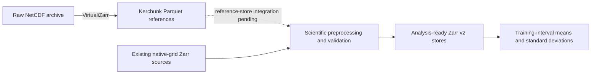

<!--
SPDX-FileCopyrightText: 2026 Samudra Authors

SPDX-License-Identifier: CC-BY-4.0
-->

# ocean_preprocessing

_Data engineering routines to prepare ocean simulations for neural emulation._

The library prepares ocean simulations for ML training and observational products
for evaluation. The simulation workflow has four stages: preserve the original
files, expose their arrays through cloud-readable references, apply the scientific
processing needed by the model, and compute normalization statistics.



Virtualization enables cloud access by indexing byte ranges in the original
files; it preserves the source values, grid, compression, and chunk layout.
Preprocessing makes the data analysis-ready: it centers fields on the native
grid, rotates vectors, optionally filters and regrids, validates the results,
and writes materialized Zarr stores. Together, suitable chunking and scientific
processing produce **analysis-ready, cloud-optimized (ARCO)** data.

**Current integration:** virtualization and preprocessing are available as separate
tools. The preprocessing CLI still reads the existing native-grid Zarr sources;
connecting it directly to the new Parquet reference stores is the next step.
The examples below keep those inputs distinct. Observations follow a parallel
[download → prepare workflow](#observation-products) that retains their native grids.

All Zarr outputs and Kerchunk metadata use **Zarr v2**, even though the
shared package environment uses the Zarr 3 runtime. Python 3.12 is required.

## CLI overview

After [setting up the environment](#environment-setup), use these entrypoints
to read the public OSN inputs and generate local outputs.

```bash
# 1. Index the original arrays without copying the physical fields.
python -m ocean_preprocessing.virtualize_om4 \
  s3://m2lines-pubs/Samudra/raw/OM4-5daily ./om4-native.parquet --anonymous

# 2. Produce an unfiltered 1° dataset from an existing native-grid Zarr source.
export FSSPEC_S3_ENDPOINT_URL=https://nyu1.osn.mghpcc.org/
export FSSPEC_S3_ANON=true
RAW=s3://m2lines-pubs/Samudra/raw
python -m ocean_preprocessing om4 \
  "$RAW/om4_5daily_snapshots.zarr" \
  "$RAW/ocean_static_no_mask_table.zarr" \
  "$RAW/grids/ocean_hgrid.zarr" \
  "$RAW/grids/gaussian_grid_180_by_360.zarr" \
  --output_path=./om4_onedeg/OM4.zarr --skip_spatial_filtering

# 3. Compute means and standard deviations for your selected training interval.
# Set TRAIN_START and TRAIN_END to dates in the dataset's calendar.
python -m ocean_preprocessing.make_norm_datasets ./om4_onedeg/OM4.zarr \
  --start "$TRAIN_START" --end "$TRAIN_END"
```

`python -m ocean_preprocessing` provides `om4`, `cm4`, and `basin_masks`
subcommands. Virtualization and normalization are sibling module entrypoints.
Inspect their arguments without starting processing:

```bash
python -m ocean_preprocessing.virtualize_om4 --help
python -m ocean_preprocessing om4 -- --help
python -m ocean_preprocessing cm4 -- --help
python -m ocean_preprocessing.make_norm_datasets --help
python -m ocean_preprocessing.obs_preprocessing -- --help
```

## Environment setup

The data tools share one mamba environment. xESMF requires conda-forge, and the
environment file installs this package in editable mode.

```bash
cd data
mamba env create -f mamba_env.yaml
mamba activate ocean_preprocessing
```

To update an existing environment, run from `data/`:

```bash
mamba env update -n ocean_preprocessing -f mamba_env.yaml
```

This upgrades older Python 3.11 / Zarr 2 environments to the runtime needed by
VirtualiZarr. The commands in this README work from any directory once the
package is installed and the environment is active.

## Virtualizing the original OM4 NetCDF archive

[`ocean_preprocessing.virtualize_om4`](ocean_preprocessing/virtualize_om4.py) uses
[VirtualiZarr](https://virtualizarr.readthedocs.io/en/stable/) to combine the annual
NetCDF files along `time` and write Kerchunk Parquet references with Zarr v2
metadata. The references point to the original files and retain their chunk
layout, so those files must remain available at the same URLs. Files must have
compatible native chunk shapes, with non-final file boundaries aligned to chunks
along `time`; otherwise the inputs need a separate rechunking step.
Unwritten native chunks must be materialized first, even with a declared
`_FillValue`; sparse inputs are rejected before publication.

File selection is frozen at discovery. The tool preserves filename order and
source time values, including duplicates or reversals; consumers validate any
chronological requirements.

Read the public archive anonymously and write references to a new local directory:

```bash
python -m ocean_preprocessing.virtualize_om4 \
  s3://m2lines-pubs/Samudra/raw/OM4-5daily ./om4-native.parquet
```

Local source directories are also supported. For file selection, static grid
files, and other options, see the CLI help:

```bash
python -m ocean_preprocessing.virtualize_om4 --help
```

The output filesystem must support exclusive directory renames. On HPC systems,
build on node-local storage before copying the completed reference store to OSN.

Parquet references use PyArrow. When opening them with fsspec, pass
`LazyReferenceMapper(path, engine="pyarrow")` from
`fsspec.implementations.reference` as the `fo` argument to the `reference`
filesystem; fsspec's directory shortcut defaults to `fastparquet`.
The [data guide](../docs/data.md#virtual-om4-references) lists the published annual,
static, and grid reference stores and provides an anonymous Xarray example.

## Scientific preprocessing

The `om4` and `cm4` subcommands share the processing pipeline after their
source-specific preparation. They interpolate staggered fields to cell centers,
validate the native-grid dataset, optionally account for partial depth cells,
and rotate both velocities and wind stresses into geographic east/north
components. Optional spatial filtering and horizontal regridding then produce
the target grid. The pipeline converts fields to float32, preserves metadata
and time bounds, optionally flattens depth into channels, validates the final
input dataset, and writes a Zarr v2 store with provenance.

The source already supplies five-day states and forcings; this CLI does not
apply a new temporal average. Filtering and target resolution are configurable,
rather than fixed at one smoothing scale or grid. Use `--skip_spatial_filtering`
for an unfiltered product and `--skip_flattening` to retain a depth dimension.
For CM4 input requirements and commands, see [the data guide](../docs/data.md#processing-cm4).

### Running the simulation pipeline


Example: Test out this CLI on a small, dry run (this will process a small portion of the data and not write any output):

```bash
# Set vars needed to access OSN Pod
export FSSPEC_S3_ENDPOINT_URL=https://nyu1.osn.mghpcc.org/
export FSSPEC_S3_ANON=true
# Then, run the standard OM4 processing pipeline:
python -m ocean_preprocessing om4 \
   "s3://m2lines-pubs/Samudra/raw/om4_5daily_snapshots.zarr" \
   "s3://m2lines-pubs/Samudra/raw/ocean_static_no_mask_table.zarr" \
   "s3://m2lines-pubs/Samudra/raw/grids/ocean_hgrid.zarr" \
   "s3://m2lines-pubs/Samudra/raw/grids/gaussian_grid_360_by_720.zarr" \
    --output_path="./local_om4_test.zarr" \
    --dry_run \
    --small_run
# ... [prints status messages]
# <xarray.Dataset> Size: 829MB
# Dimensions:    (time: 10, y: 360, x: 720)
# Coordinates:
#   * time       (time) object 80B 1958-01-03 12:00:00 ... 1958-02-17 12:00:00
#   * y          (y) float64 3kB -89.62 -89.12 -88.62 -88.13 ... 88.62 89.12 89.62
#   * x          (x) float64 6kB 0.25 0.75 1.25 1.75 ... 358.2 358.8 359.2 359.8
# Data variables: (12/80)
#     hfds       (time, y, x) float32 10MB nan nan nan ... 0.3576 0.3585 0.3594
#     tauuo      (time, y, x) float32 10MB nan nan nan ... -0.02243 -0.02271
# ...
```

Example: Run a real data processing pipeline on a coiled cluster:

```bash
# Set vars needed to access OSN Pod
export FSSPEC_S3_ENDPOINT_URL=https://nyu1.osn.mghpcc.org/
# Publishing to OSN requires write credentials. Public reads do not.
export FSSPEC_S3_ANON=false
export AWS_ACCESS_KEY_ID=...
export AWS_SECRET_ACCESS_KEY=...
# Then, run the standard OM4 processing pipeline:
python -m ocean_preprocessing om4 \
   "s3://m2lines-pubs/Samudra/raw/om4_5daily_snapshots.zarr" \
   "s3://m2lines-pubs/Samudra/raw/ocean_static_no_mask_table.zarr" \
   "s3://m2lines-pubs/Samudra/raw/grids/ocean_hgrid.zarr" \
   "s3://m2lines-pubs/Samudra/raw/grids/gaussian_grid_360_by_720.zarr" \
    --output_path="s3://m2lines-pubs/Samudra/v$(date "+%Y-%m")/om4_halfdeg/OM4.zarr" \
    --cluster="coiled" \
    --wait_for_workers=True
```

### Five-day snapshot source

The snapshot archive is
`s3://m2lines-pubs/Samudra/raw/om4_5daily_snapshots.zarr`. Its ocean state
variables (`thetao`, `so`, `uo`, `vo`, and `zos`) are instantaneous values at
00:00 UTC every five days. Its forcing variables (`hfds`, `tauuo`, `tauvo`, and
`wfo`) are five-day means, because the state transition responds to their
time-integrated fluxes.

On Torch, select this source with `DATA_VARIANT=snapshots` in
`scripts/slurm_preprocess_om4.sbatch`; derived output directories use the name
`om4_<resolution>_snapshots`.

## Normalization statistics

After preprocessing, compute normalization over the interval used for training:

```bash
python -m ocean_preprocessing.make_norm_datasets ./om4_onedeg/OM4.zarr \
  --start "$TRAIN_START" --end "$TRAIN_END"
```

The command writes `OM4_means.zarr` and `OM4_stds.zarr` beside `OM4.zarr`.
It computes unweighted population means and standard deviations over finite wet
space and time, retaining depth. The outputs record the source, selected time
coverage, and reduction method. Omitting `--start` and `--end` uses the entire
source record, so choose these explicitly when holding out validation/test years.

## Observation products

Emulator evaluation compares rollouts against observations, not just against OM4. A second CLI fetches and prepares the
three products that `samudra.metrics` scores against:

| Product | Source | Used for | Credentials |
| --- | --- | --- | --- |
| DUACS | Copernicus Marine (CMEMS) | surface geostrophic velocity, EKE | free account required |
| OISST | NOAA NCEI | sea-surface temperature | none |
| ARGO-IAP | IAP, Chinese Academy of Sciences | ocean heat content | none |

```bash
python -m ocean_preprocessing.obs_preprocessing -- --help
```

### Stage 1: fill the raw archive

```bash
RAW=/scratch/$USER/data/obs_raw
python -m ocean_preprocessing.obs_preprocessing download oisst    --output_dir=$RAW/oisst
python -m ocean_preprocessing.obs_preprocessing download argo_iap --output_dir=$RAW/argo-iap

# DUACS needs a free account from https://data.marine.copernicus.eu/register
export COPERNICUSMARINE_SERVICE_USERNAME=... COPERNICUSMARINE_SERVICE_PASSWORD=...
python -m ocean_preprocessing.obs_preprocessing download duacs    --output_dir=$RAW/duacs
```

On Torch these run as batch jobs — `PRODUCT=oisst sbatch scripts/slurm_obs_download.sbatch` — since compute nodes there
do have internet egress.

All three downloaders are restartable: files already present at a plausible size are never requested, and anything
that arrives truncated is deleted rather than left looking complete. Re-run after an interruption and only the missing
files are fetched. Transfers go through [`pypdl`](https://github.com/mjishnu/pypdl), which fetches several files at once
and splits each across connections — the latter matters most for the IAP archive, whose ~40 MB monthly files arrive
slowly over a single connection.

### Stage 2: derive the analysis-ready stores

```bash
python -m ocean_preprocessing.obs_preprocessing prepare all \
    --raw_root=$RAW --output_root=/scratch/$USER/data/obs
```

or, on Torch, `sbatch scripts/slurm_obs_prepare.sbatch` (see the header of that file for the environment variables).

Prepared stores and Zarr downloads use **Zarr v2** explicitly, because `samudra.metrics` pins `zarr<3` and cannot open a v3 store.

Credentials are only needed when writing to the NYU OSN pod (`AWS_ACCESS_KEY_ID`, `AWS_SECRET_ACCESS_KEY` and
`FSSPEC_S3_ENDPOINT_URL`); reading the public inputs, including the OM4 time axis, is anonymous.

Two properties of the output matter downstream, and the metrics depend on both:

- **Each product stays on its own native grid.** Nothing is spatially resampled here. The metrics interpolate the *model*
  onto the observation grid instead, so the observations are never smoothed before being used as truth.
- **Time alignment is a centered 5-day rolling mean**, sampled on the OM4 5-day timestamps — not an interpolation.
  `samudra.metrics` refuses to interpolate in time (it would deflate model variance and inflate RMSE), so the stored
  timestamps must match the model's exactly.

The target timestamps come from the published OM4 store rather than from any particular model rollout, which is what
makes these products reusable across runs. That store is public, so the prepare stage needs no credentials either.

<details>

<summary><h2>What do the scripts do? (Python interfaces and validation)</h2></summary>

_This section is considered legacy documentation._

### Preprocessed Datasets (`ds_processed`)
This is the only model specific step produced by modules in `ocean_preprocessing.simulation_preprocessing.<model_module>`. The output `ds_processed` can then be fed into the generic preprocessing steps to produce the input dataset. These functions should not modify the data in any other way than interpolating velocity data onto the tracer points (the setup/execution of which might depend on the source).

Example:
```python
from ocean_preprocessing.simulation_preprocessing.gfdl_om4 import om4_preprocessing

raw = "https://nyu1.osn.mghpcc.org/m2lines-pubs/Samudra/raw"
zarr_data_path = f"{raw}/om4_5daily_snapshots.zarr"
nc_grid_path = f"{raw}/ocean_static_no_mask_table.zarr"
nc_mosaic_path = f"{raw}/grids/ocean_hgrid.zarr"
ds_processed = om4_preprocessing(zarr_data_path, nc_grid_path, nc_mosaic_path)
```

#### QC
To ensure that the output of model specific preprocessing is correct, run the validation function before applying further steps:
```python
from ocean_preprocessing.dataset_validation import ds_processed_validate

ds_processed_validate(ds_processed, deep=True) # deep enables long-running tests that check for nan consistency on the entire dataset
```

### Input Datasets (`ds_input`)

#### QC
To ensure that an input dataset adheres to the most recent checks please always run the following before publishing/uploading:
```python
from ocean_preprocessing.dataset_validation import ds_input_validate
ds = ...
ds_input_validate(ds, deep=True) # deep enables long-running tests that check for nan consistency on the entire dataset
```

### Prediction Datasets

#### Postprocessing Raw prediction output
We aim to not upload the raw prediction output. Instead use the postprocessor to create an xarray dataset that is formattes as much as possible as the input data:

```python
from ocean_preprocessing.postprocessing import post_processor
ds_input = ... # load datasets that was used for the training of this model
ds_truth = ds_input.isel(time=...) # select the timesteps that are considered the ground-truth to compare predictions against
ds_raw_prediction = ... # output from the inference/prediction
ds_prediction = post_processor(ds_raw_prediction, ds_truth)
```

#### QC
Before uploading please always run the most recent checks
```python
from ocean_preprocessing.postprocessing import prediction_data_test
ds_prediction = ... # see above
ds_truth = ...# see above
prediction_data_test(ds_prediction, ds_truth)
```

</details>

## Where is the data?

### Preprocessing files

The preprocessing files are the inputs to create curated emulator dataseets for machine learning.
These files live on the OSN pod:

- Data: https://nyu1.osn.mghpcc.org/m2lines-pubs/Samudra/raw/om4_5daily.zarr
- Five-day snapshots: https://nyu1.osn.mghpcc.org/m2lines-pubs/Samudra/raw/om4_5daily_snapshots.zarr
- Gaussian Grid: https://nyu1.osn.mghpcc.org/m2lines-pubs/Samudra/raw/grids/gaussian_grid_180_by_360.zarr
- Mosaic File: https://nyu1.osn.mghpcc.org/m2lines-pubs/Samudra/raw/grids/ocean_hgrid.zarr
- Native Grid File: https://nyu1.osn.mghpcc.org/m2lines-pubs/Samudra/raw/ocean_static_no_mask_table.zarr

These can be directly input to our pre-processing scripts (see usage above).


### Original NetCDF archive

The public OM4 archive is located at
`s3://m2lines-pubs/Samudra/raw/OM4-5daily/`. It contains the annual NetCDF files
and their native-grid companions; see [the archive inventory](../docs/data.md#original-om4-netcdf-archive)
and [virtualization instructions](#virtualizing-the-original-om4-netcdf-archive).
Read it anonymously using the NYU OSN endpoint, or access individual objects at
`https://nyu1.osn.mghpcc.org/m2lines-pubs/Samudra/raw/OM4-5daily/<filename>`.

### Processed datasets

Public training releases, normalization stores, and observation products are
listed in [the data guide](../docs/data.md#available-datasets). For example:

- OM4: `s3://m2lines-pubs/Samudra/v2026-09/om4_onedeg/OM4.zarr`
- CM4: `s3://m2lines-pubs/Samudra/v2026-09/cm4_onedeg/CM4.zarr`

Public inputs require no access keys. Publishing new objects to the bucket
requires write credentials; generating local outputs does not.

## Developing this package

Follow the CLI usage instructions to clone the repository and create a local mamba environment. Then, please install
the development dependencies:

```bash
mamba install pytest scipy dask pre-commit hypothesis pytest-reportlog
```

`mamba_env.yaml` also installs the shared test helpers in `src/samudra/test_utils`, which `tests/conftest.py`
imports. If you build the environment another way, install them from the repository root with
`pip install -e ./src/samudra/test_utils`. They are a local path, not a PyPI package, so `pip install ".[test]"` can't
install them.

Run the data package tests from `data/` in the active environment:

```bash
python -m pytest tests
```

### Property tests and mutation checks

The [contributor guide](../docs/contributing.md#property-tests-and-mutation-checks) explains property tests,
campaigns, and mutation checks. This section covers what is specific to `data/`.

`tests/test_virtual_archive_properties.py` checks `virtualize_om4`. It generates small NetCDF archives, varying the
values, file splits, chunk layouts, CF packing, missing values, scalars, and file names. It builds Kerchunk references
from each archive and compares what the references decode to against reading the NetCDF files directly. A state
machine test (`PublicationMachine`) replays sequences of publish, fail, retry, and delete commands, including a
competing writer, without sleeping.

These properties encode the contracts agreed in #959:

* The set of source files is frozen at discovery. Files that appear later stay out of the payload and the provenance.
* Raw time order is kept, duplicates and reversals included. Consumers own chronology.
* Zero-copy publication needs compatible native chunk grids. Incompatible layouts fail with an actionable error.
* Sparse native chunks are rejected, even when a CF fill value is declared.

Proposed scientific policies need human agreement before they become properties.

Create the test environment and run a campaign from the repository root:

```bash
micromamba create -f data/.test.yml
micromamba activate samudra-data-test
python -m pip install --no-deps --no-build-isolation -e ./src/samudra/test_utils -e ./data
cd data
python -m samudra.test_utils.run --suite data --tests tests/test_*_properties.py \
  --dependency-file .test.yml --output /tmp/data-properties \
  --examples 1000 --seed 95920261105
```

Mamba installs every third-party package, and pip installs only the two local packages, without resolving
dependencies. `.test.yml` pins direct dependencies only. It isn't a full lock, so CI saves the exact Mamba solution
with each artifact. `.test-canary.yml` floats within supported version ranges. `mamba_env.yaml` remains the
environment for the rest of `data/`.

The mutation catalog for these properties is `tests/virtual_archive_mutations.py`. Run the gate from the repository
root, in the same environment:

```bash
python -m samudra.test_utils.mutations data/tests \
  --output /tmp/property-mutations --seeds 0 1 95920261105 --timeout 60 --budget 600
```

The gate works in four steps:

1. It runs each property on unmodified code for all three seeds. Any failure here stops the gate, so a bug that
   already exists is never counted as a kill.
2. For each mutation, it finds the mutation's source anchor, which must match exactly once, so a refactor that moves
   the code fails loudly. It substitutes the mutant in memory and runs the assigned property in a fresh subprocess.
   Production files are never modified.
3. Each mutant gets 40 generated examples and at most 60 seconds, within a shared 600-second budget. Explicit
   `@example`s, the Hypothesis example database, and shrinking are turned off, so only newly generated inputs can kill
   a mutant.
4. A mutant counts as killed only if the intended test's call phase failed, in a complete run with the expected
   Hypothesis settings, source hashes, and collected tests. Setup or collection errors, skips, timeouts, missing
   reports, and survivors all fail the gate.

The gate runs on PRs and pushes to `main` that touch these files, inside the nightly soak, and on demand. A newer push
to a PR cancels the older run. Each run's Summary shows `summary.md`. Its artifact, with source snapshots, commands,
timings, logs, and results, is kept for 30 days.

To preview triage locally without contacting GitHub:

```bash
python -m samudra.test_utils.triage /tmp/data-properties/pytest.jsonl \
  --repo m2lines/Samudra --run-url https://example.com/local-run
```

Add `--triage-output /tmp/property-triage` to look up matching open and closed issues (read-only) and write a JSON
and Markdown summary. Only `--apply` files issues. No property workflow has permission to write them.
