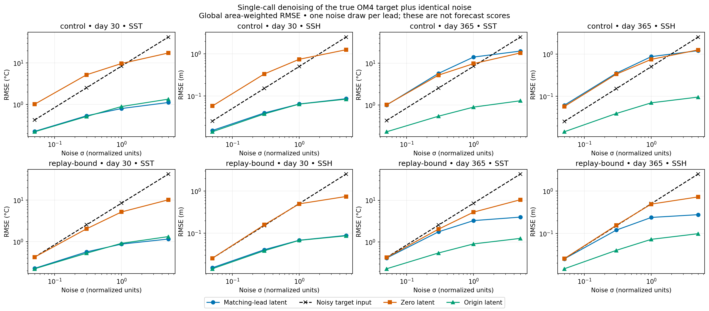
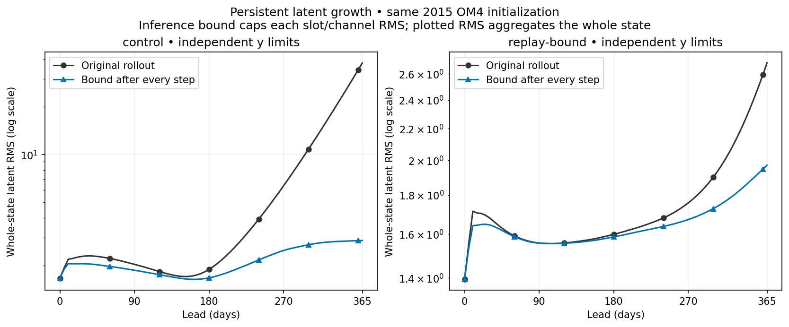
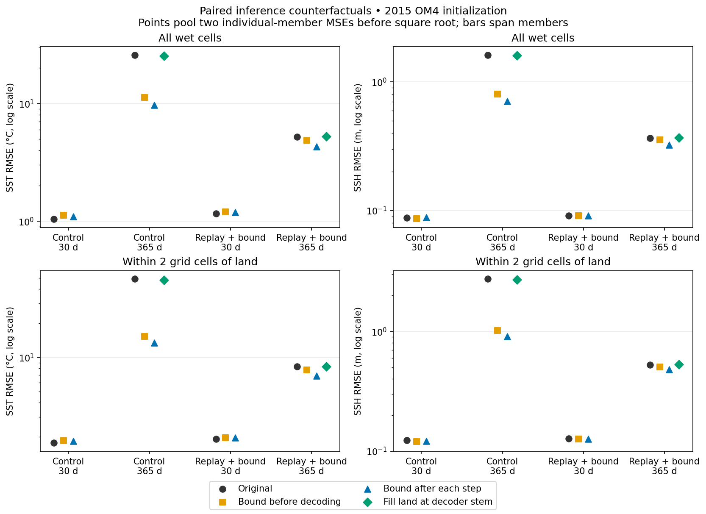
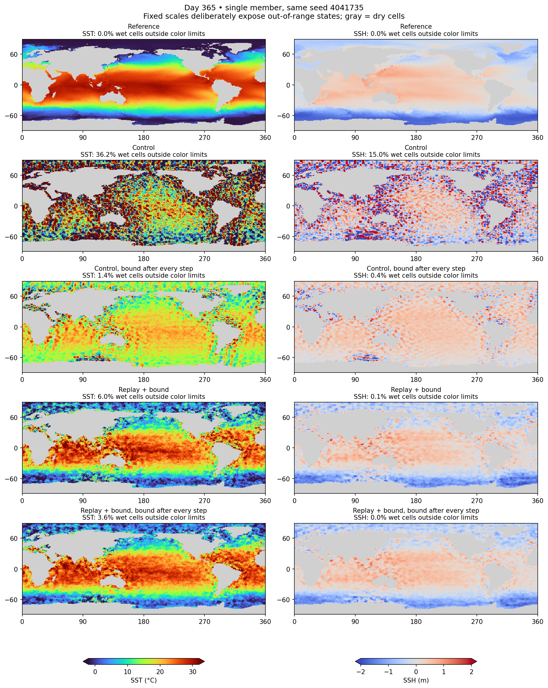

<!-- SPDX-FileCopyrightText: 2026 Samudra Authors -->
<!-- SPDX-License-Identifier: CC-BY-4.0 -->

# Coastal boundaries and latent normalization: frozen-model diagnostics

The strongest signal is **drifting latent conditioning**, rather than failure
of the denoiser to remove noise under all conditions. A recurrent latent RMS cap
reduces annual error, but does not restore a good forecast. Extending noisy fields
across land only before the first convolution has little effect. These are
mechanistic tests on one held-out OM4 origin, not a demonstrated production fix.

This follows the [eight-arm continuation results](interventions-v2-results.md)
and the [diagnostic protocol](coastal-decoder-probes.md). Both frozen checkpoints
have 8,128 observation and 8,128 OM4 updates. They share the cooled 8k/8k parent;
“control” and “replay-bound” are the corresponding 256-update continuation arms.
The latter already has a **soft** latent-amplitude penalty during training.

## Matched setup and scoring

- OM4 surface initialization at 2015-01-03 12:00, original forcings, leads 30/365
  days. These are native OM4 targets, not the three-origin observational annual
  benchmark or its blended score.
- Two matched sampling seeds, 32 denoising steps, existing spatially correlated
  noise. Primary sampled errors below pool squared errors over both individual
  draws, then take the square root. They are **not errors of an ensemble mean**.
- Cosine-latitude weighting and the original wet masks; SST in degrees Celsius,
  SSH in meters. No model weights, training data, or sampler settings change.
- 48 single-call denoising cases and 36 full-sampler cases. All three output
  artifact checksums verified; an independent recomputation from physical maps
  agrees with saved RMSEs to within 2.6e-8.

## 1. Unhealthy conditioning can damage a nearly correct field

We corrupt the true future field with known noise and denoise it once, changing
only the latent supplied to the same decoder. “Matching-lead” here means the
**evolved model latent**, not an oracle latent encoded from the true future state.

| Day-365 SST denoising, noise sigma | Noisy input RMSE | Control: matching-lead latent | Control: initial latent | Replay-bound: matching-lead latent | Replay-bound: initial latent |
|---|---:|---:|---:|---:|---:|
| 0.05 | 0.425 | 0.995 | 0.228 | 0.411 | 0.228 |
| 0.3 | 2.551 | 5.735 | 0.540 | 1.757 | 0.546 |
| 1 | 8.504 | 14.096 | 0.890 | 3.255 | 0.899 |
| 5 | 42.519 | 19.590 | 1.262 | 3.943 | 1.219 |

At low and moderate noise, the control's year-old latent actively makes the
field worse. The same weights can remove substantial noise with the initial
latent instead. At day 30, both models denoise successfully with their evolved
latents. Replay-bound improves the day-365 conditioning substantially, but still
underperforms its initial-latent counterfactual in this test.

This is **not a forecast using a fixed initial latent**: the decoder receives
noisy future truth. The annual case also returns to approximately the same season.
Zero conditioning generally performs poorly and is out of distribution. The result
does not show that conditioning is unnecessary, or that all grain has one cause;
it does show that noise-removal capacity alone cannot explain this annual failure.

## 2. Crossing decoder and latent trajectories implicates both, especially the latent

| Day-365 decoder | Latent trajectory | SST RMSE | SSH RMSE |
|---|---|---:|---:|
| Control | Control | 25.690 | 1.617 |
| Control | Replay-bound | 6.658 | 0.457 |
| Replay-bound | Control | 18.796 | 1.202 |
| Replay-bound | Replay-bound | 5.203 | 0.366 |

Replacing the control's latent trajectory changes its error much more than
replacing only its decoder. The decoder still contributes. This is supporting
evidence rather than a perfect decomposition: fine-tuning may change latent
coordinates, so crossed pairs need not be valid model combinations.

## 3. Latent amplitude control helps, but amplitude is not the entire problem

The processor has GroupNorm inside its residual blocks, but its persistent
state is updated by an unnormalized residual addition. Internal GroupNorm does
not itself bound the accumulated state. Control latent RMS grows **1.666 → 37.727**
between initialization and day 365; replay-bound grows **1.394 → 2.685**.

For each history slot and channel, the probe limits spatial RMS to twice that
channel's initial RMS, with an initial-scale floor of 0.1. It scales a channel
only when it exceeds that threshold; it does not subtract its mean. We compare
applying this only at readout against applying it after every processor step.

| Model and inference intervention | Day-30 SST RMSE | Day-365 SST RMSE | Day-365 SSH RMSE |
|---|---:|---:|---:|
| Control, unchanged | 1.044 | 25.690 | 1.617 |
| Control, cap only at readout | 1.120 | 11.255 | 0.806 |
| Control, cap every recurrent step | 1.097 | 9.642 | 0.709 |
| Replay-bound, unchanged | 1.163 | 5.203 | 0.366 |
| Replay-bound, cap only at readout | 1.197 | 4.852 | 0.355 |
| Replay-bound, cap every recurrent step | 1.188 | 4.304 | 0.323 |

The recurrent cap reduces annual SST member RMSE by **62.5% in control** and
**17.3% in replay-bound**. Improvement from a readout-only cap establishes strong
sensitivity to latent amplitude. Further improvement from recurrent limiting is
consistent with accumulated trajectory error. However, annual errors remain
large, and day-30 SST gets slightly worse. Bounded latent magnitude does not
guarantee correct spatial structure, conserved quantities, or stable decoded fields.

The same-seed maps below retain visibly poor fields after limiting: in particular,
the capped control loses much of the correct equator-to-pole SST contrast. The
lower RMSE is real, but is not evidence that the model has recovered ocean physics.
Fine texture remains in the replay-bound maps. Color limits are fixed across rows;
panel labels report the fraction of wet cells outside those limits.

This is an inference-only RMS intervention, **not a trained GroupNorm experiment**.
Full GroupNorm would also recenter and couple channel statistics, potentially
removing useful state information. Training with the chosen constraint could
allow the encoder, processor and decoder to adapt, but benefit is not established
by this frozen-model test.

## 4. This simple coastal filling intervention does not explain the runaway error

Nearest-wet filling changes only the noisy-input tensor entering the decoder's
first convolution. It preserves wet-cell inputs, the raw EDM skip, all weights,
the sampler and final output mask. Longitude is periodic.

| Day-365 model | Original SST / SSH RMSE | Filled-stem SST / SSH RMSE |
|---|---:|---:|
| Control | 25.690 / 1.617 | 25.371 / 1.608 |
| Replay-bound | 5.203 / 0.366 | 5.221 / 0.369 |

Both seeds agree on these small changes: about 1.2% SST improvement for control,
0.3% worsening for replay-bound. This gives little support to the hypothesis
that the initial zero-land discontinuity accounts for most annual failure.
It does **not** rule out mask-related problems: hidden convolutions, pooling,
latent dynamics and other masking remain unchanged, and the fill introduces an
inference-time training mismatch. Distance-binned exports allow examination of
the coastal subset separately; distances are grid cells, not kilometers.

## What to try next

Prioritize a matched **train-time persistent-state amplitude constraint** over
another inference-only land-fill variation. Compare the existing replay-bound
continuation with recurrent RMS limiting during both training and evaluation;
keep data, budget, seeds and losses matched. A separate learned residual gate
or normalization variant can test whether we can control growth while preserving
the useful amplitude information lost by a hard cap.

Evaluate day-30 skill as well as day-365 growth, individual members and means,
coastal versus offshore errors, latent norms and physical extremes. Replicate
across held-out origins before selecting a fix. A decoder-only diagnostic with
frozen late latents and complete sampled-field supervision would separately test
whether the denoising objective is too permissive of bad long-lead conditioning.

Replay's OM4 objective still supplies **noisy true fields** to the denoiser; it
does not train a complete noise-to-field sampler at every replay lead. Therefore,
low denoising training loss need not imply plausible unconditional-noise samples
from those late latents. These tests demonstrate harmful conditioning, but do not
by themselves establish that changing the training objective is necessary.

No additional training was launched by this diagnostic. Beta job **212173**
completed with exit 0, using one B200 for **244 seconds = 0.06778 allocated
GPU-hours**, below the eight-hour diagnostic ceiling. The probe itself took
71.94 seconds. The completed callback has been retired.

## Reproduction and assets

- [Probe source](../../../scripts/probe_diffusion_coastal_decoder.py) and
  [Beta launcher](../../../scripts/slurm_diffusion_coastal_probe_beta.sbatch).
- [Report generator](../../../scripts/report_diffusion_coastal_probe.py).
- Numerical exports, figures and provenance are in
  [coastal-decoder-assets](coastal-decoder-assets/).
- [Pooled sampled errors](coastal-decoder-assets/sampled-rmse.csv),
  [all individual-case metrics](coastal-decoder-assets/metrics.csv), and
  [verified provenance](coastal-decoder-assets/provenance.json).
- [Latent RMS at every step](coastal-decoder-assets/latent-rms.csv).
- PDFs: [sampled errors](coastal-decoder-assets/sampled-rmse.pdf),
  [denoising](coastal-decoder-assets/known-target-denoising.pdf),
  [member maps](coastal-decoder-assets/day365-members.pdf).

The runtime archive is `coastal-probe-0eeeee4858da`, based on commit
`d0c2bb80827b9b4ccd24b7ef5f5ad5fe48d978ca`. The checked-in probe subsequently
received only typing annotations to satisfy Mypy; inference behavior is unchanged.
Remote raw artifacts remain under
`/projects/ny/lz1955/multiscale/jrusak/runs/diffusion-interventions-v2/diagnostics/coastal-decoder-v1`.
