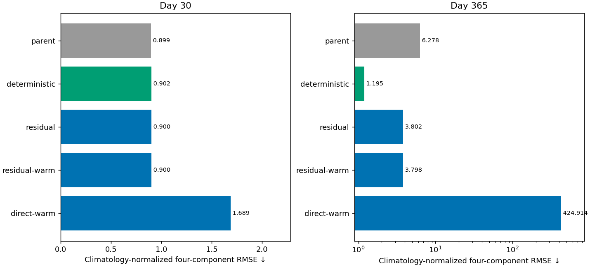
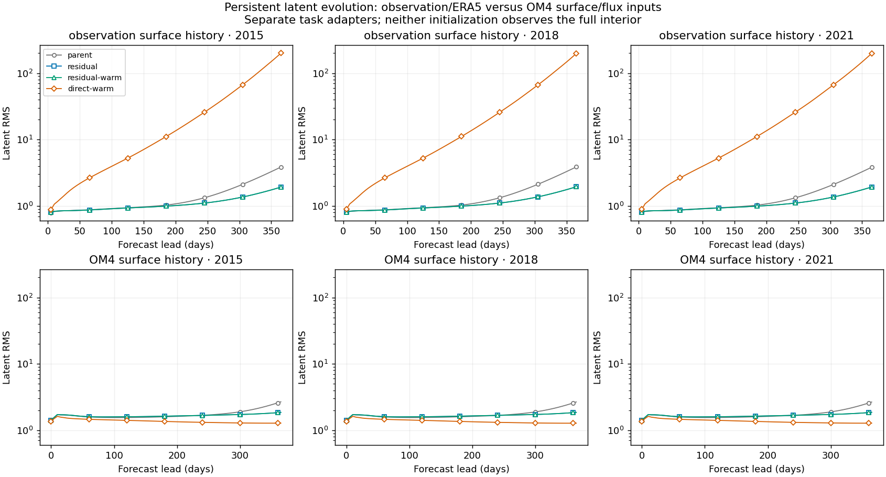
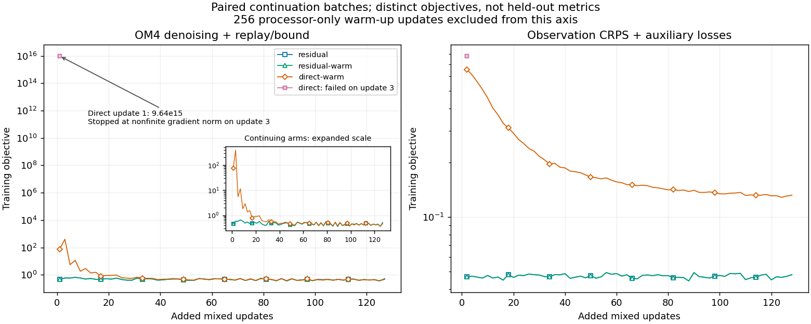

<!-- SPDX-FileCopyrightText: 2026 Samudra Authors -->
<!-- SPDX-License-Identifier: CC-BY-4.0 -->

# Direct next-latent prediction: short conversion pilot

**This direct-conversion recipe fails; further residual replay training helps.**
The warmed direct model's annual blended error is **424.91**, versus **3.80**
for both residual controls. Its latent trajectory explodes on observation inputs,
although it stays bounded on OM4 inputs. Removing the outer residual addition
does not by itself guarantee stable evolution.

The useful positive signal is continued improvement from the existing recipe:
another 128 mixed updates reduce annual error from **6.28 to 3.80 (39.4%)**,
with day-30 error essentially unchanged. Annual SST RMSE still grows from
**0.62 to 3.11°C**, unlike the deterministic reference's **0.64 to 0.71°C**.
We have not yet achieved comparable degradation over the year.

## What this experiment tests

This is a **conversion and short continuation of an existing residual model**,
not a from-scratch comparison of equally trained architectures. The immediate
parent is the previous replay-plus-latent-bound winner: 8,128 OM4 and 8,128
observation updates. Each successful continuation adds 64 of each, ending at
**8,192 / 8,192**, effective batch eight. All retain OM4 replay and the soft
latent-amplitude penalty, the full-latitude observation mask, existing forcing,
32 diffusion steps, and a fresh AdamW optimizer with a 1e-5 to 1e-6 cooldown.

The direct processor removes the outer `latest + prediction` addition; it
predicts the next latent slot directly. Its internal residual blocks are
unchanged. `direct-warm` first receives 256 processor-only updates matching
short OM4 latent trajectories from the frozen residual parent. `residual-warm`
receives the same procedure as a control. These extra warm-up exposures are
separate from the physical OM4/observation update counts. See the
[protocol and implementation pointers](direct-processor-pilot.md).

The un-warmed `direct` arm stopped at mixed update 3, with a nonfinite total
gradient norm after an initial OM4 objective of approximately 9.64e15. It has no
final forecast score. This establishes a failed immediate conversion; it does
not prove that a direct architecture cannot be trained. No guard was disabled
and no failed arm was silently replaced.

## Observation-initialized annual forecasts

| Model | Day 30 | Day 365 |
|---|---:|---:|
| Replay + bound parent | 0.89881 | 6.27816 |
| Residual continuation | 0.89986 | 3.80173 |
| Residual + warm-up | 0.89987 | 3.79838 |
| Direct + warm-up | 1.68863 | 424.91391 |
| Existing deterministic reference | 0.90242 | 1.19535 |
| Direct without warm-up | Failed on update 3 | No final score |

Scores use the mean of eight conditional diffusion draws and the same three
January starts in 2015, 2018 and 2021. Each component's RMSE is pooled as
`sqrt(mean(origin_RMSE²))`, divided by its training-seasonal-climatology RMSE,
and the four ratios are averaged: SST, SSH-derived velocity, 0–700 m heat
content, and 700–2,000 m heat content. Surface metrics use the day-30/day-365
five-day bins; heat content uses January/December means. Lower is better.
These are **not** the spectral validation composite or a full-year mean RMSE.
Climatology denominators differ by lead, so compare physical RMSE too.



| Model | SST RMSE day 30 → 365 (°C) | SSH RMSE day 30 → 365 (m) |
|---|---:|---:|
| Replay + bound parent | 0.622 → 5.122 | 0.077 → 0.431 |
| Residual continuation | 0.623 → 3.109 | 0.077 → 0.313 |
| Residual + warm-up | 0.623 → 3.106 | 0.077 → 0.313 |
| Direct + warm-up | 1.527 → 451.874 | 0.169 → 16.281 |
| Existing deterministic reference | 0.640 → 0.708 | 0.075 → 0.098 |


The deterministic reference is the existing 8k/8k model, not a newly trained
architecture-matched control. It provides context for gradual annual degradation.
The two residual continuations are the matched controls for this pilot.

## The task distinction matters

Day-365 latent RMS, averaged over the same three origins:

| Model | Observation task | OM4 task |
|---|---:|---:|
| Replay + bound parent | 3.847 | 2.674 |
| Residual continuation | 1.931 | 1.860 |
| Residual + warm-up | 1.930 | 1.862 |
| Direct + warm-up | **198.492** | **1.279** |

All three observational origins show the direct failure: final latent RMS ranges
from **197.55 to 199.71**. This is not a single anomalous initialization.
The bounded direct OM4 trajectory is still less accurate: mean normalized
native SST RMSE across origins at day 365 is **0.638**, versus **0.279** for
residual continuation. These native scores refer to ensemble-mean fields.



“OM4 initialized” means the initializer sees **OM4 surface history**, not a gold
interior. Both tasks use the surface-to-latent initializer. They differ in
surface values and missingness, forcing sources/adapters, and task-specific
input adapters. The warm-up uses **only the OM4 task and short trajectories**;
it does not explicitly preserve the observation-task transition map.

Consequently, bounded latent RMS on OM4 inputs does not establish stability on
observational inputs. Nor does bounded RMS establish an accurate field. This
pilot cannot separate the effects of the direct architecture from imperfect
transfer of an existing residual model, particularly across those task paths.

## Maps, members and spatial structure

All maps use nearest-neighbor rendering at one image pixel per source grid
cell, with identical physical color limits across arms. Values outside those
limits clip; the observation panels report the clipped fraction and the
[CSV](direct-processor-assets/obs-map-clipping.csv) gives actual extrema. A
visually saturated map is not evidence that the values merely reached the
colorbar endpoint.

| Surface-history source | SSH | SST |
|---|---|---|
| Observations, day 30 | [mean and draw](direct-processor-assets/obs-day30-ssh.png) | [mean and draw](direct-processor-assets/obs-day30-sst.png) |
| Observations, day 365 | [mean and draw](direct-processor-assets/obs-day365-ssh.png) | [mean and draw](direct-processor-assets/obs-day365-sst.png) |
| OM4, day 30 | [mean and draw](direct-processor-assets/native-day30-ssh.png) | [mean and draw](direct-processor-assets/native-day30-sst.png) |
| OM4, day 365 | [mean and draw](direct-processor-assets/native-day365-ssh.png) | [mean and draw](direct-processor-assets/native-day365-sst.png) |

OM4 interior maps: [day-30 temperature](direct-processor-assets/native-day30-t550.png),
[day-365 temperature](direct-processor-assets/native-day365-t550.png),
[day-30 salinity](direct-processor-assets/native-day30-s550.png),
[day-365 salinity](direct-processor-assets/native-day365-s550.png), at 550 m.

The maps show 2015; scores pool all three origins. “Draw 1” at different leads
is an independent conditional readout of the evolving deterministic latent,
not a coherent stochastic trajectory. The eight-member mean can hide grain;
individual draws remain visible beside it.

Nine-origin validation diagnostics include [North Pacific SST texture](direct-processor-assets/day30-sst-members.png),
[SSH texture](direct-processor-assets/day30-ssh-members.png),
and [scored spectra for means and individual draws](direct-processor-assets/day30-spectra.png).
The [spatial CSV](direct-processor-assets/spatial.csv) measures target-increment
error, not a specific detector of diagonal artifacts.

Short-lead validation also worsens: its separate composite is **1.764 direct**
versus **0.740 residual**. Direct's SST member target-increment RMSE is **0.589**
versus **0.291**; this is not evidence of a grain cure. Some OM4 direct maps look
smoother, but that appearance accompanies larger errors and does not transfer
to observational forecasts.

Ensemble calibration remains imperfect. On validation SST, residual has
spread/RMSE **0.623** and empirical nominal-90% coverage **55.5%**; warmed direct
has **0.841** and **68.5%**. The latter's wider spread and higher coverage do not
compensate for its much larger prediction errors. Eight samples give a coarse
interval estimate. See the CSV for SSH and interior T/S as well.

## Interpretation and next decision

1. **Continue to regard replay + bound as a promising stability intervention.**
   The further reduction is substantial and appears in physical errors and
   latent growth, not just the blended score. It still falls short of the desired
   gradual annual degradation. This is a fresh-optimizer continuation, not an
   uninterrupted longer run, so extrapolation to larger budgets remains uncertain.
2. **Do not extend this direct checkpoint as-is.** A cleaner next conversion
   should distill and qualify both OM4 and observation-task transitions,
   including observational rollouts, before the physical-loss continuation.
   Alternatively, a matched from-scratch residual/direct pair would test the
   architecture without this transfer confound. Neither experiment is launched.
3. **Track stability separately by task and by physical field.** The present
   OM4-only warm-up and replay/bound paths do not establish observational
   stability. An observation-side replay or consistency objective is a possible
   next intervention, but was not tested here.

The near-identical residual and residual-warm results indicate that the warm-up
procedure itself has little effect when the architecture is unchanged. The
failure of immediate conversion and observation-task drift after OM4-only
warm-up leave substantial optimization and transfer confounds. One seed and
three related annual starts do not establish an architecture ranking.



The curves separate OM4 denoising/replay objectives from observation CRPS and
auxiliary losses. Their scales are not comparable across tasks, and lower
training loss is not evidence of better annual forecasts.

## Reproduction and execution

Production **Beta 212190** ran on one node with four B200 GPUs for **6h09m57s**,
using **24.6633 allocated GPU-hours**. Including both qualification jobs,
the total is **28.1111 GPU-hours**, below the 40-hour pilot cap. This counts the
idle GPU after the raw direct arm failed. Three arms completed training,
nine-origin validation, three-origin OM4 evaluations, and three annual
observation forecasts each. The aggregate Slurm exit is **1**, solely because
the runner preserves the failed un-warmed direct arm; all three other arms
have successful per-arm results and complete evaluation receipts.

Runtime archive: `direct-v1-b673a95fcd25`, source commit `6f12fe53b`.
The final physical-task counters are 8,192 each; warm-up updates are recorded
separately. All data manifests and checkpoint identities matched. Reporting
was rerun from saved artifacts; no extra training or duplicate GPU evaluation
was submitted. The completion callback is retired, with no future reminders
remaining in this thread.

[Execution receipt](direct-processor-assets/execution.json),
[Machine-readable results and provenance](direct-processor-assets/results.json),
[annual component CSV](direct-processor-assets/annual.csv),
[validation](direct-processor-assets/validation.csv),
[calibration](direct-processor-assets/calibration.csv),
[native diagnostics](direct-processor-assets/native.csv),
[task-specific latent trajectories](direct-processor-assets/task-latent-rms.csv),
[training curves](direct-processor-assets/training-loss.csv).

The report verifies checkpoint counters, matching annual data manifests,
identical native/annual parent identity, and hashes of saved fields. The
[main report generator](../../../scripts/report_diffusion_interventions.py)
preserves the original 8k-parent default while accepting an explicit later
parent and its counts. The
[supplemental generator](../../../scripts/report_diffusion_direct.py) verifies
saved annual fields and compares task-specific latents and member maps.

```bash
.venv/bin/python scripts/report_diffusion_interventions.py \
  --root outputs/diffusion-direct-v1/evaluation \
  --baseline outputs/global-matched-v1 \
  --parent-annual outputs/diffusion-interventions-v2/evaluation/replay-bound/annual \
  --parent-updates-per-task 8128 --updates 128 \
  --arms residual residual-warm direct-warm \
  --presentation outputs/global-matched-v1/checkpoint-annual/presentation-results.json.gz \
  --output docs/experiments/diffusion-interior-beta/direct-processor-assets
.venv/bin/python scripts/report_diffusion_direct.py \
  --root outputs/diffusion-direct-v1/evaluation \
  --parent outputs/diffusion-interventions-v2/evaluation/replay-bound \
  --logs outputs/diffusion-direct-v1/production-logs/runs \
  --output docs/experiments/diffusion-interior-beta/direct-processor-assets
```

For the first command, `evaluation/parent/native` points to the existing
replay-bound native evaluation. Raw checkpoints and outputs remain under
`beta:/projects/ny/lz1955/multiscale/jrusak/runs/diffusion-direct-v1`;
the immediate parent is retained under `diffusion-interventions-v2`.
