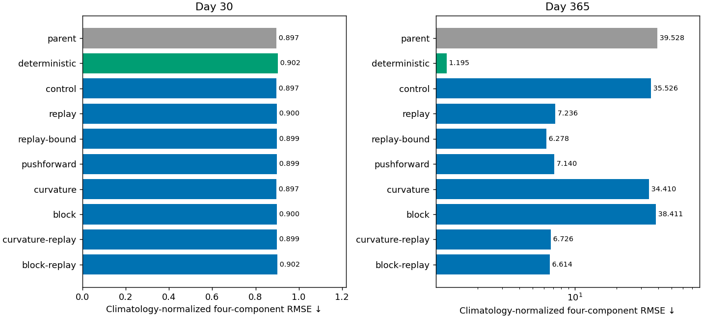
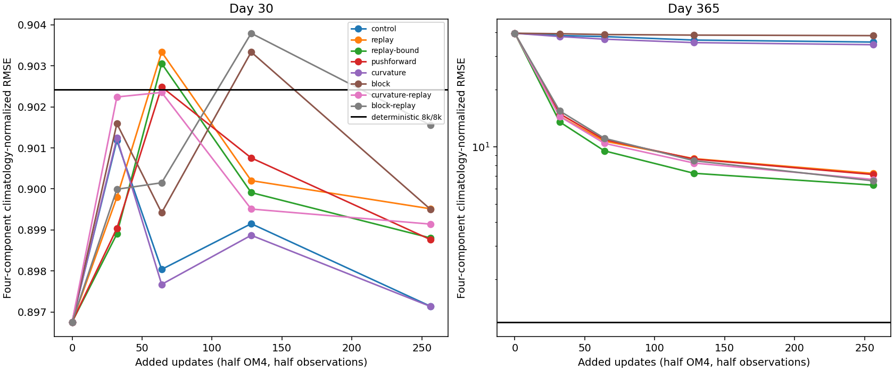
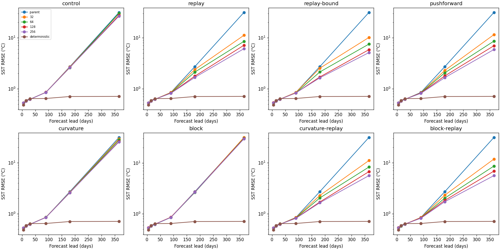
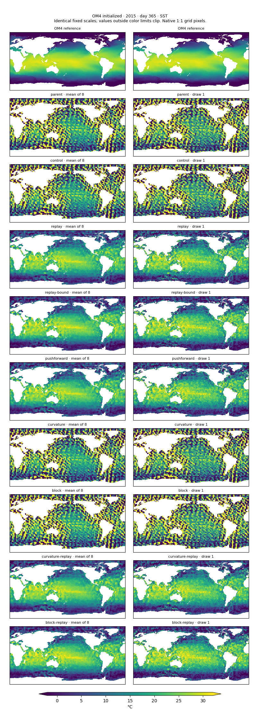
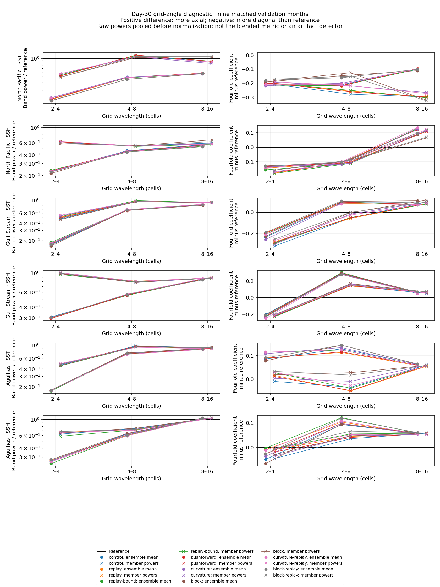

<!-- SPDX-FileCopyrightText: 2026 Samudra Authors -->
<!-- SPDX-License-Identifier: CC-BY-4.0 -->

# Replay, spatial losses and annual stability: final continuation results

**Training on model-generated long-lead states produces a large improvement
across all three forecast origins, but does not yet give the gradual degradation
seen in the deterministic reference over a year.**
Replay plus a soft latent-RMS bound reduces annual blended error from **35.53 to
6.28**, while preserving approximately the same day-30 score. Replay without
the bound reaches **7.24**. Improvements continue through 256 added updates,
with diminishing gains per added update. The native maps also show a change
from extreme runaway fields to imperfect, sometimes overly contracted spatial
distributions. This is more than an improvement in point error, but it is not
full physical realism.

**The diagonal artifact remains unresolved.** Spatial objectives change some
directional diagnostics without removing the visible pattern or stabilizing
annual forecasts on their own. A separate short timestep-consistency pilot
successfully optimized its auxiliary discrepancy but did not improve annual
stability. No further training was launched from these results.

## What was compared

The [protocol](interventions-v2.md) fixes one cooled parent trained on 8,000
observation and 8,000 OM4 updates. Each arm receives **256 added updates: 128
observation and 128 OM4**, effective batch eight, one paired seed, fresh AdamW
and a cosine learning rate from 1e-5 to 1e-6. Final counters are **8,128 / 8,128**.
All model components remain trainable. Data, full-latitude mask, normalization,
forcing, architecture, correlated noise and sampling settings are unchanged.
Evaluation uses eight draws and 32 denoising steps. The comparison is matched
in optimizer updates, not in compute cost.

Replay and fresh pushforward train six differentiable five-day advances after
model-generated burn-ins of 30/90/180/300 days. Replay retains detached chains
across uses, up to 360-day states; its gradient horizon is **30 days**, not a
year. Four OM4 microbatches retain the original objective and four use these
segments. No target interior is supplied as an input. Fresh pushforward resets
each chain on every use, so its lead distribution also differs from replay.
The replay objectives omit the original initial reconstruction term on replaced
microbatches; this is a remaining confound.

The latent bound is a soft training penalty above twice encoded-origin channel
RMS, with no inference clipping. Curvature adds target second differences along
axes and diagonals at 1/2/4-cell lags. Block adds target spatial averages over
3/7/15-cell squares. Both retain the original losses and add coefficient-two
feature losses: denoising MSE on OM4 and fair CRPS on observations. They are
target-matching objectives, not unconditional smoothing.

## Annual errors and their growth

| Arm | Day 30 | Day 365 | Increase from day 30 |
|---|---:|---:|---:|
| Untouched diffusion parent | 0.89676 | 39.52786 | 38.63111 |
| Matched continuation control | 0.89714 | 35.52554 | 34.62840 |
| Replay | 0.89952 | 7.23562 | 6.33610 |
| Replay + latent bound | 0.89881 | 6.27816 | 5.37935 |
| Fresh pushforward | 0.89877 | 7.13970 | 6.24093 |
| Curvature | 0.89714 | 34.41049 | 33.51335 |
| Block | 0.89951 | 38.41076 | 37.51125 |
| Curvature + replay | 0.89914 | 6.72591 | 5.82677 |
| Block + replay | 0.90156 | 6.61409 | 5.71253 |
| Existing deterministic reference | 0.90242 | 1.19535 | 0.29293 |

Lower is better. The blended score averages four climatology-normalized RMSEs:
SST, SSH-derived velocity, 0–700 m heat content and 700–2,000 m heat content.
For each component, compute `sqrt(mean(origin_RMSE²))` over the three origins,
then divide by the corresponding training-seasonal-climatology RMSE aggregated
the same way. Surface metrics use
the day-30/day-365 bins; heat content uses January/December means. This is not
the validation composite or the spectral blend. Climatology denominators differ
by lead, so the increase above is in normalized-score units, not a physical-RMSE
increase. SSH RMSE is also provided separately in the downloads.

Day-365/day-30 normalized-score ratios are **39.60×** for control, **8.04×** for
replay, **6.98×** for replay-bound and **1.32×** for the deterministic reference.
These likewise include lead-dependent climatology denominators; the physical
SST table below gives a more direct view of error growth.

All three January starts (2015, 2018, 2021) support the large stability effect:
control annual scores span **35.01–36.16**, replay **7.19–7.29**, and replay-bound
**6.24–6.32**. Replay-bound has the lowest score of the eight arms at each origin.
The roughly 13% advantage over replay is promising, but one seed and three
related starts do not establish a precise treatment effect. Spatial losses alone
provide no comparable annual benefit; their combinations with replay improve on
replay slightly, without surpassing replay-bound.

The deterministic model differs in architecture and other training settings.
Its role is to illustrate the desired degradation pattern. In physical units,
SST RMSE at days 30/90/180/365 is:

| Model | Day 30 | Day 90 | Day 180 | Day 365 |
|---|---:|---:|---:|---:|
| Control | 0.620 °C | 0.849 °C | 2.611 °C | 26.584 °C |
| Replay | 0.623 °C | 0.816 °C | 1.668 °C | 6.104 °C |
| Replay + bound | 0.622 °C | 0.831 °C | 1.636 °C | 5.122 °C |
| Deterministic reference | 0.640 °C | 0.645 °C | 0.704 °C | 0.708 °C |

Replay improves errors before the final endpoint as well as at day 365, but the
remaining acceleration after day 180 is substantial. This is not yet the
graceful degradation requested.

[Annual component CSV](interventions-v2-assets/annual.csv) ·
[Results and provenance](interventions-v2-assets/results.json) ·
[PDF](interventions-v2-assets/annual-rmse.pdf)

## Does more training keep helping?

All 24 early-checkpoint annual evaluations completed. These are checkpoints
along each arm's single 256-update cosine schedule, not separately optimized
32/64/128-update runs. Half the added updates are observation updates and half
are OM4 updates. The previous pilot's independently scheduled 128-update result
is not spliced into these curves.

| Arm | 32 updates | 64 | 128 | 256 |
|---|---:|---:|---:|---:|
| Control | 38.44 | 37.97 | 36.40 | 35.53 |
| Replay | 14.46 | 10.69 | 8.65 | 7.24 |
| Replay + bound | 13.51 | 9.51 | 7.25 | 6.28 |
| Fresh pushforward | 14.91 | 10.89 | 8.61 | 7.14 |
| Curvature | 37.99 | 36.80 | 35.29 | 34.41 |
| Block | 39.31 | 38.92 | 38.66 | 38.41 |
| Curvature + replay | 14.43 | 10.42 | 8.20 | 6.73 |
| Block + replay | 15.43 | 11.07 | 8.44 | 6.61 |

Every arm's pooled annual score improves monotonically across these saved
checkpoints. Most useful gains arise early for the long-state objectives.
Replay improves **26.0%, 19.1%, 16.4%** on successive doublings; replay-bound
improves **29.6%, 23.8%, 13.4%**. The last doubling requires twice as many added
updates as the preceding one, so returns per update decline even more strongly.
The learning-rate cooldown also changes across these intervals. The curves
support further improvement being possible, not a conclusion about its eventual
floor or the best longer-run schedule.

For scale only, repeating the **128→256 fractional gain** would give:

| Arm | Observed 256 | Conditional 512 | Conditional 1,024 | No further gain |
|---|---:|---:|---:|---:|
| Replay | 7.24 | 6.05 | 5.06 | 7.24 |
| Replay + bound | 6.28 | 5.44 | 4.71 | 6.28 |
| Fresh pushforward | 7.14 | 5.92 | 4.91 | 7.14 |
| Curvature + replay | 6.73 | 5.51 | 4.52 | 6.73 |
| Block + replay | 6.61 | 5.18 | 4.06 | 6.61 |

**These are arithmetic scenarios, not forecasts, confidence bounds, or a ranking
of future winners.** They assume a fractional improvement repeats despite a
different future learning-rate schedule and state distribution. Even those
scenarios remain far from the deterministic annual score. Simply extending the
current recipe is therefore not demonstrated to solve the stability problem.

[Per-origin/component curves](interventions-v2-assets/learning-curves/learning-curves.csv) ·
[Lead curves](interventions-v2-assets/learning-curves/error-versus-lead.csv) ·
[Conditional scenarios](interventions-v2-assets/learning-curves/conditional-budget-scenarios.csv) ·
[Curve provenance](interventions-v2-assets/learning-curves/provenance.json)

## Are the late fields more plausible without looking at pointwise truth?

The native maps use OM4 surface-history initialization and OM4 forcing, with
OM4 truth. They are distinct from the observation-initialized annual score.
The distribution statistics below use the **2015 native origin only**, all eight
members and their mean, cosine-latitude weighting, and matching reference at
each lead. They are qualitative evidence, not a precise ranking of variants.

At day 365, the control's ensemble-mean SST spatial standard deviation is
**24.69 °C**, versus **10.37 °C** in the reference. Its area-weighted 0.1–99.9
percentile interval is **−135.13 to 166.47 °C**. Replay-bound reduces those to
**8.87 °C** and **−6.74 to 34.56 °C**; the reference interval is **−1.80 to
30.73 °C**. The global mean alone would hide the catastrophe: control is
16.43 °C versus reference 18.50 °C, because large positive and negative errors
cancel.

This improvement is present in individual draws: average member SST spatial
standard deviation falls from **25.31 °C** in control to **9.40 °C** with
replay-bound. Nevertheless, replay-bound members still contain wet-pixel extremes
of **−32.47 and 53.16 °C**. Its ensemble mean has 1.72% of wet area outside the
reference's full range. A reference range is not a universal physical bound,
and isolated extremes need care, but these maps do not establish realism.

Improved stability also coexists with contraction of spatial distributions.
At day 365, 550 m-channel salinity spatial standard deviation is **0.761** in the reference,
**2.621** in control and **0.565** in replay-bound; SSH values are **0.611 m,
1.549 m and 0.516 m**. Lower RMSE has not restored the complete spatial structure.
The coarse saved leads place the main control catastrophe after day 180;
they cannot locate its precise onset. A deterministic native run under these
same inputs would be needed for a direct distributional comparison.

Member indices at separate leads are independent decoder draws, not coherent
stochastic trajectories. Day-zero surface fields are anchored to known inputs
and do not demonstrate forecast skill.

| Field | Day 30 | Day 365 |
|---|---|---|
| SSH | [Maps](interventions-v2-assets/native-day30-ssh.png) | [Maps](interventions-v2-assets/native-day365-ssh.png) |
| SST | [Maps](interventions-v2-assets/native-day30-sst.png) | [Maps](interventions-v2-assets/native-day365-sst.png) |
| Temperature, 550 m channel | [Maps](interventions-v2-assets/native-day30-t550.png) | [Maps](interventions-v2-assets/native-day365-t550.png) |
| Salinity, 550 m channel | [Maps](interventions-v2-assets/native-day30-s550.png) | [Maps](interventions-v2-assets/native-day365-s550.png) |

[Native latent growth and error](interventions-v2-assets/native-stability.png) ·
[Three-origin native metrics](interventions-v2-assets/native.csv) ·
[Member/mean distribution statistics](interventions-v2-assets/plausibility/field-statistics.csv) ·
[Detailed plausibility notes](interventions-v2-assets/plausibility/notes.md)

## Artifacts, spectra and calibration

Individual-member maps still show diagonal structure. The directional diagnostic
supplements radial spectra with the power-weighted `cos(4θ)` of Fourier wavevector
angle: negative departures from reference indicate relatively more diagonal
power. It uses grid-cell wavelength bands, not the physical-wavelength bins of
the scored spectrum. Ocean structure, tapering and the finite grid also affect
this coefficient; it is not a unique artifact detector.

For example, in North Pacific SST at 4–8-cell wavelengths, mean individual-member
power relative to truth changes from **1.173** in control to **1.079** with
curvature and **1.048** with block supervision. The corresponding angular
departures improve from **−0.278** to **−0.220** and **−0.126**. These selected
regional changes do not establish global removal of the artifact, and spatial
increment RMSE barely changes: member SST increment error is **0.2905 °C** for
control, **0.2909 °C** for curvature and **0.2890 °C** for block. The full regional
CSV and member maps are needed alongside an aggregate spectrum.

Calibration remains inadequate. Across the eight arms and four variable groups,
spread/RMSE is **0.53–0.66**, and empirical coverage of the reported 90% interval
is **48–59%**. Eight-member empirical intervals have finite-ensemble limitations,
so 90% is not an exact attainable calibration benchmark here; the low coverage
and spread ratios nevertheless show substantial remaining underdispersion.
Replay-bound SST spread/RMSE is 0.627 versus control 0.623, with coverage 55.9%
versus 55.5%. The stability intervention has not solved uncertainty calibration.
These are nine-month validation diagnostics, not year-end calibration claims.

[SST draw 1 and its high-pass field](interventions-v2-assets/day30-sst-members.png) ·
[SSH draw 1 and its high-pass field](interventions-v2-assets/day30-ssh-members.png) ·
[Scored radial spectra, mean and individual draw](interventions-v2-assets/day30-spectra.png) ·
[Spectrum CSV](interventions-v2-assets/spectra.csv) ·
[Directional CSV](interventions-v2-assets/directional/directional.csv) ·
[Spatial-increment CSV](interventions-v2-assets/spatial.csv) ·
[Calibration CSV](interventions-v2-assets/calibration.csv) ·
[Validation CSV](interventions-v2-assets/validation.csv)

## What the timestep pilot adds

The [separate five-/ten-day experiment](timestep-results.md) tested whether two
five-day paths agreeing with one ten-day path at their newest endpoint would
regularize the shared processor. Strong consistency reduced the logged training
discrepancy by about 98%, but annual error remained **38.10**, versus **37.29**
for its matched 128-update control. It used fresh origins and no replay.
This argues against scaling that exact local objective on its own. It does not
rule out consistency imposed on the long-lead states where instability occurs.

## Suggested next wave, subject to approval

The clearest next comparison is a longer matched **replay / replay-bound** pair,
with the same data and explicit checkpoints, to test whether the remaining
downward slope persists. A second targeted arm could increase the differentiated
forecast segment beyond 30 days at fixed long-state sampling; this addresses the
gap between exposure to old states and gradients through sustained evolution.
Changing chain freshness, loss horizon and sampling weights together would make
that result harder to interpret. A consistency-on-replay arm is lower priority
and should retain direct physical supervision.

Artifact work should remain a separate controlled question: the present spatial
losses give mixed texture changes and no clear visual cure. Before spending a
large training budget on them, isolate decoder behavior on fixed latents and
identical draws, measure directional residuals, and require improvement in both
members and truth-relative spatial statistics. Smoothness alone is insufficient.

Use training/validation diagnostics to set the next schedule and reserve new
annual origins for confirmation. The three annual cases here have been consulted
repeatedly and are exploratory; they cannot provide a fresh final holdout.

## Execution and reproducibility

All eight 256-update arms and all 24 early-checkpoint annual evaluations completed
successfully on Beta. Training source was the immutable archive
`interventions-v2-13ef3dcb046b`; learning-curve evaluation used
`learning-curves-5af6b89ec994`. Metric inputs, counts, origins and completion
records were verified; report provenance retains source/input fingerprints.
The [training module](../../../src/samudra/experiments/diffusion_interventions.py),
[runner](../../../scripts/run_diffusion_interventions.py),
[main report](../../../scripts/report_diffusion_interventions.py),
[curve report](../../../scripts/report_diffusion_learning_curves.py) and
[directional report](../../../scripts/report_diffusion_directional.py) are on
this branch. The [protocol](interventions-v2.md) records exact loss definitions.
The main report uses `--updates 256` and all eight `--arms`; curve rendering
uses the campaign root and the existing parent/deterministic annual outputs.
[Native plausibility reporting](../../../scripts/report_diffusion_native_plausibility.py)
reads the saved native fields, without rerunning GPU forecasts. Each report's
provenance export records its inputs; local paths are evidence locations rather
than a promise that raw trajectory arrays are stored in Git.

| Job | Purpose | Allocated GPU-hours |
|---|---|---:|
| 211872 | Eight-arm qualification | 1.00 |
| 211873 | Production and final evaluation | 87.73 |
| 211875 | 24 checkpoint annual evaluations | 12.56 |
| 212015 + 212017 | Timestep qualification, training and evaluation | 24.51 |
| Total, including timestep follow-up | | **125.80 / 192 cap** |

GPU-hours count allocated GPUs throughout each job, including loading and
evaluation, rather than inferred active-kernel time. The previous v1 campaign is
separate. This wave is complete; proposed larger runs are not submitted.

Report validation checked matching annual data manifests and checkpoint counts,
all validation NPZ checksums, native-map checksums and shared references. Native
distribution CSVs were reproduced byte-for-byte by the published reporting
script. Maps and curves were inspected; formatting, type, schema, license and
secret checks passed. Scanner rules are unchanged; only exact verified
provenance-fingerprint findings were added to its baseline. All campaign
callbacks and reminder timers are now retired.
