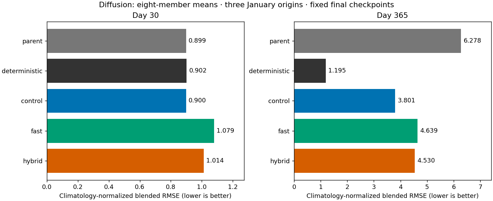
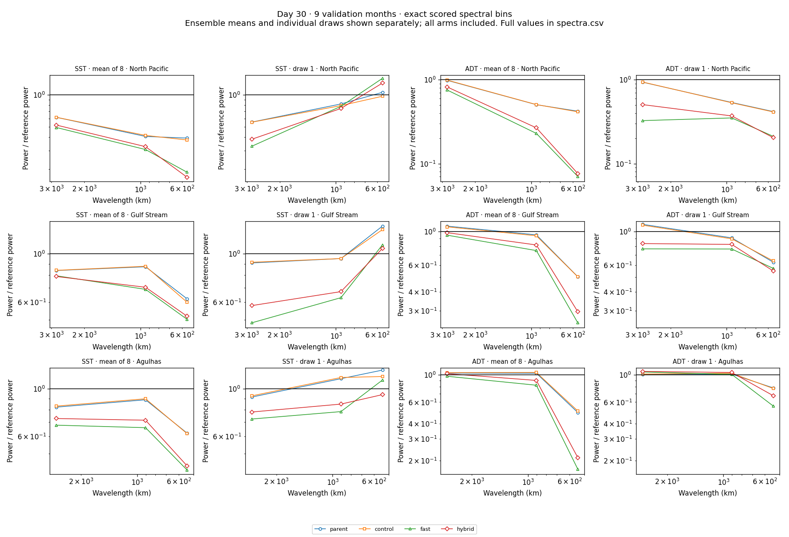
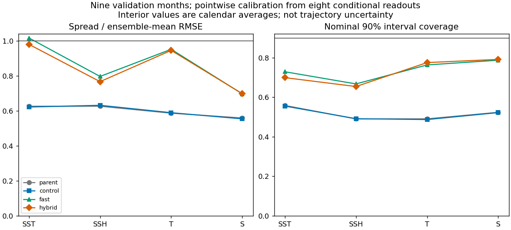

<!-- SPDX-FileCopyrightText: 2026 Samudra Authors -->
<!-- SPDX-License-Identifier: CC-BY-4.0 -->

# One-step observation training: faster, with a quality penalty

The one-step observation surrogate cuts training time substantially, but does
not preserve the full-sampler control's forecast quality at equal update count.
Including the frozen-parent cache preparation, fast training is **4.6× faster**;
its blended error is **20% higher at day 30 and 22% higher at day 365**. The hybrid
recovers some short-lead skill, but retains a 19% annual-error penalty. More
spread does not translate into better CRPS, and individual members remain grainy.

**Complete:** all three arms and every planned evaluation succeeded. Beta
production job **212306** finished in 5h56m14s. Including qualification 212300,
total cost was **26.05 allocated B200 GPU-hours**, below the 40-hour ceiling.
Monitoring is retired. The larger scratch pair has not been launched.

## What was compared

See the [protocol and qualification results](observation-fast-pilot.md). All arms
start from the same residual replay-bound parent at **8,128 OM4 + 8,128 observation
updates**, then add **64 of each task**, effective batch eight, with identical
sample order, paired seeds, fresh AdamW and a 1e-5 → 1e-6 cosine cooldown.
OM4 replay, the latent amplitude penalty, global latitude masks, forcings,
architecture and correlated noise are unchanged. Final counts are **8,192/task**.

| Arm | Observation training |
|---|---|
| Control | Existing two-member CRPS, backpropagated through the full 32-step sampler |
| Fast | One denoiser call per decoded state, scoring observed quantities with an EDM-weighted squared-error surrogate |
| Hybrid | 48 fast observation updates and 16 full-CRPS updates, interleaved three to one |

“One-step” refers to each decoder readout, not one network call for an entire
training update. Forecast leads and the separate monthly reconstruction task
still require multiple readouts. **Inference always uses 32 sampling steps and
eight members** in the comparisons below.

For the fast objective, one frozen-parent draw per training example supplies
missing physical input fields. Available SSH/SST values replace their imputed
values, and the interior sequence is adjusted to reproduce the observed monthly
average. Fresh noise is added to this completed input. The loss scores only
actual observed surfaces and monthly interior averages; imputed velocities and
unobserved cells are not truth labels. Future targets never enter initializer
inputs or latent evolution. This is an approximate objective with a frozen
imputation distribution, not an equivalent estimator of the control's CRPS.

## Forecast quality and annual degradation



| Fixed checkpoint | Day 30 blended error ↓ | Day 365 blended error ↓ | SST RMSE, day 30 → 365 (°C) |
|---|---:|---:|---:|
| Parent | 0.8988 | 6.2782 | 0.622 → 5.122 |
| Full-objective control | **0.8998** | **3.8011** | **0.623 → 3.110** |
| Fast | 1.0793 | 4.6387 | 0.772 → 3.784 |
| Hybrid | 1.0137 | 4.5303 | 0.708 → 3.700 |
| Existing deterministic reference | 0.9024 | 1.1954 | 0.640 → 0.708 |

These are the same four-component climatology-normalized scores used in the
previous annual comparisons: SST RMSE, SSH-derived velocity RMSE, and OHC RMSE
in 0–700 m and 700–2000 m. Each component is divided by the error of the fixed
training-seasonal-climatology forecast at the matching endpoint, then averaged
with equal weights. This climatology is a season-dependent training-data mean
field, not the mean of these model predictions. Three January origins
(2015, 2018, 2021) are pooled in squared-error space before taking RMSE. Surface
quantities use the day-30/day-365 bins; interior OHC uses January/December means.
SSH RMSE is also exported but is not an additional fifth blended component.

The matched comparison is control versus fast/hybrid. The deterministic model
is a contextual reference with different architecture and training history.
This annual score is also different from the nine-month validation composite
(which includes spectral terms); their numerical values should not be equated.

All three continuations reduce annual error relative to the parent, but the
control improves most. This does not establish that the surrogate itself improves
stability. None approaches the deterministic reference's mild annual degradation.
Observation-initialized day-365 latent RMS averages **1.94 control, 2.43 fast,
2.41 hybrid**, versus 3.85 in the parent. Physical annual errors remain large.

[Component and origin CSV](observation-fast-assets/annual.csv) ·
[PDF](observation-fast-assets/annual-rmse.pdf) ·
[Observation/OM4 latent trajectories](observation-fast-assets/task-latent-rms.png) ·
[Native OM4 scores](observation-fast-assets/native.csv)

## Members, spectra and spread



These spectra use the existing day-30 scoring regions and bins over nine
validation months. Ensemble means and draw 1 are plotted separately; power is
divided by reference power. They are radially averaged spectra, so they do not
isolate the orientation of diagonal artifacts or every grid-scale frequency.

The cheap arms lose ensemble-mean spatial power while retaining visibly noisy
members. For example, North Pacific SSH mean power in the highest scored bin is
**0.415 of reference for control, 0.070 fast and 0.076 hybrid**. Individual-member
SST wet-pair increment RMSE (four directions, lags 1/2/4/8 cells) is **0.291 control, 0.473 fast, 0.433 hybrid**:
fast is 62% worse. This is error against observed increments, not a standalone
diagonal-artifact detector. The paired maps below show increased fine grain in
the fast and hybrid members; smoother means are not evidence that the artifact
has been solved.



| SST, nine validation months | Control | Fast | Hybrid |
|---|---:|---:|---:|
| Spread / ensemble-mean RMSE | 0.623 | 1.018 | 0.981 |
| Nominal 90% interval coverage | 55.5% | 72.9% | 69.9% |
| Scale-normalized fair CRPS ↓ | **0.0362** | 0.0438 | 0.0398 |

Coverage increases but remains below nominal; **fair CRPS worsens in all four
groups: SST, SSH, interior temperature and salinity**. A spread/RMSE ratio near
one is therefore insufficient to claim calibration or forecast improvement.
These scores are pointwise conditional readout statistics. Interior samples are
calendar-averaged before scoring; draws at separate times are independent, not
coherent sampled ocean trajectories.

[Calibration CSV including parent](observation-fast-assets/calibration-with-parent.csv) ·
[Scored spectra CSV](observation-fast-assets/spectra.csv) ·
[Spatial-increment errors](observation-fast-assets/spatial.csv)

## Matched maps

Each figure shows parent/control/fast/hybrid, **mean of eight beside draw 1**, on
the same January 2015 origin within each task (January 1 for observations;
January 3 for OM4). Grid cells occupy one output pixel in each map;
scales are fixed across arms and clipping fractions are labeled. These are
representative maps, not an additional origin selected by quality.

| Field | Observation-initialized day 30 | Observation-initialized day 365 | OM4-initialized day 30 | OM4-initialized day 365 |
|---|---|---|---|---|
| SSH | [Map](observation-fast-assets/obs-day30-ssh.png) | [Map](observation-fast-assets/obs-day365-ssh.png) | [Map](observation-fast-assets/native-day30-ssh.png) | [Map](observation-fast-assets/native-day365-ssh.png) |
| SST | [Map](observation-fast-assets/obs-day30-sst.png) | [Map](observation-fast-assets/obs-day365-sst.png) | [Map](observation-fast-assets/native-day30-sst.png) | [Map](observation-fast-assets/native-day365-sst.png) |
| Temperature, 550 m | [Map](observation-fast-assets/obs-day30-t550.png) | [Map](observation-fast-assets/obs-day365-t550.png) | [Map](observation-fast-assets/native-day30-t550.png) | [Map](observation-fast-assets/native-day365-t550.png) |
| Salinity, 550 m | [Map](observation-fast-assets/obs-day30-s550.png) | [Map](observation-fast-assets/obs-day365-s550.png) | [Map](observation-fast-assets/native-day30-s550.png) | [Map](observation-fast-assets/native-day365-s550.png) |

Both initialization tasks use surface histories, not gold interiors. Observation
rollouts use ERA5 forcing; native OM4 rollouts use OM4 surface/flux inputs.
Observation-interior figures deliberately omit an instantaneous gold field,
because the available interior targets are monthly averages. Native figures
include OM4 references at the corresponding lead. Maps clip only for display; numerical
scores use un-clipped values. [Observation extrema/clipping](observation-fast-assets/annual-map-clipping.csv)
and [native extrema/clipping](observation-fast-assets/native-map-clipping.csv)
are exported for inspection.

## Time and what to try next

| Measured time | Control | Fast | Hybrid |
|---|---:|---:|---:|
| Mean observation update, including first-update overhead | 253.8 s | 9.4 s | Mixed objectives |
| Training subprocess, 128 mixed updates | 307.9 min | 46.9 min | 109.6 min |
| Training plus entire cache cost charged to this arm | 307.9 min | 67.6 min | 130.3 min |
| Elapsed arm completion including evaluation and cache wait | 354.1 min | 113.7 min | 176.7 min |

The shared cache took **20.7 minutes** and stores 243 training months in **52.75 GB**
(49.13 GiB). It is generated once for both cheap arms. Charging its entire cost
to either arm gives conservative training speedups of **4.56× fast / 2.36× hybrid**.
Excluding preparation, training subprocess speedups are 6.57×/2.81×. Evaluation
cost is effectively unchanged. These are measured continuation timings, not a
forecast for training either architecture from scratch.

The full node remained allocated while faster arms finished, so their completion
did not release those GPUs: production cost is **23.749 GPU-hours**, plus **2.302**
for qualification. [Timing CSV](observation-fast-assets/timing.csv),
[per-update measurements](observation-fast-assets/update-timing.csv) and
[timing plot](observation-fast-assets/update-timing.png) keep these distinctions explicit.

I would **not substitute this recipe unchanged in the large scratch pair**. A
small follow-up could test a fast phase followed by a full-CRPS tail at the same
numbers of each update as the hybrid. Separately, test the fast-loss scale before
spending a larger budget: observation gradient clipping occurred on 78% of fast
updates and 89% of hybrid updates, versus 0% for control. Matching optimizer/LR
does not match gradient magnitudes across MSE and CRPS. Those observations
motivate tests; they do not identify the cause of the quality loss.

Frozen single-draw imputation, altered noise-level supervision, loss scaling and
sampling mismatch remain confounded. A negative result here does not rule out a
properly distilled few-step sampler or a different observation-denoising method.
This is one seed and a short continuation from a mature model, not a
from-scratch comparison or evidence that more surrogate updates will recover
quality. No follow-up training is submitted by this report.

## Reproduction and evidence

Runtime source archive **obs-fast-v1-04fdba652e9e**, implementation commit
**b5d5e3c11**. Final snapshot counts, hashes, training lineage, all three annual
origins, masks/manifests and sampling settings are verified before plotting.
All **54 downloaded NPZ files** from the new arms passed SHA-256 read-back.
Recovery `last.pt` includes optimizer/RNG/replay; evaluation uses `step-0128.pt`.
Their archive hashes intentionally differ; actual evaluated snapshot hashes
were independently checked on Beta.

[Numerical results/provenance](observation-fast-assets/results.json) ·
[Checkpoint fingerprints](observation-fast-assets/pilot-provenance.json) ·
[Execution receipt](observation-fast-assets/execution-provenance.json) ·
[Validation metrics](observation-fast-assets/validation.csv)

W&B: [control](https://wandb.ai/ocean_emulators/default/runs/diffint-obs-fast-diffusion-observation-fast-v1-control),
[fast](https://wandb.ai/ocean_emulators/default/runs/diffint-obs-fast-diffusion-observation-fast-v1-fast),
[hybrid](https://wandb.ai/ocean_emulators/default/runs/diffint-obs-fast-diffusion-observation-fast-v1-hybrid).
The [objective](../../../src/samudra/experiments/diffusion_observation_fast.py),
[runner](../../../scripts/run_diffusion_observation_fast.py), and
[report script](../../../scripts/report_diffusion_observation_fast.py) are included.

```bash
MPLCONFIGDIR=/tmp/obs-fast-report-mpl .venv/bin/python scripts/report_diffusion_observation_fast.py \
  --root outputs/diffusion-observation-fast-v1/evaluation \
  --parent outputs/diffusion-interventions-v2/evaluation/replay-bound \
  --baseline outputs/global-matched-v1 \
  --presentation outputs/global-matched-v1/checkpoint-annual/presentation-results.json.gz \
  --runs outputs/diffusion-observation-fast-v1/progress/runs \
  --execution-results outputs/diffusion-observation-fast-v1/production-logs/RESULTS.json \
  --output docs/experiments/diffusion-interior-beta/observation-fast-assets
```
