<!--
SPDX-FileCopyrightText: 2026 Samudra Authors
SPDX-License-Identifier: CC-BY-4.0
-->

# Residual 4k observation-only cooldown: field and error maps

These maps compare the residual parent at 4,000 observation / 7,721 OM4 updates with its 500-update observation-only cooldown, using raw and reset-EMA weights. They complement the [rollout metrics report](residual-4k-cooldown-results.md). All examples here use the 2018 origin. They are individual examples, not aggregate skill estimates.

The day-30 SST errors look somewhat less grainy after cooldown, but individual members still contain substantial small-scale variation. The native OM4 salinity reconstruction remains visibly grainy. Cooldown also changes broad error patterns: the day-365 SSH example has larger errors after cooldown. Thus cleaner-looking short-lead fields do not establish better long-rollout accuracy.

Every saved panel uses exactly one image pixel per grid cell, with no smoothing or interpolation. Open the linked image at its native size if the browser scales the table. Gray means land or missing data. Each channel uses shared physical, error, and spread limits across all compared runs and selected leads, separately for the observation and OM4 groups. Physical limits come from reference percentiles; error limits use pooled absolute errors. Saturation percentages and unclipped ranges appear on each panel and in the metadata. Error means prediction minus reference; spread means pointwise sample standard deviation, not error.

The ensemble mean uses eight members. “Draw 1” is sampled independently at each lead and does not define a coherent trajectory. Annual observed surface comparisons use five-day verification bins. OM4 comparisons use model output at the labeled lead. Native day 0 is a surface-conditioned interior reconstruction with a valid OM4 target; it is not an observation-initialized interior reconstruction against observations.

## Observed SST at day 30

| Parent 4k | Cooldown raw | Cooldown EMA |
| --- | --- | --- |
| 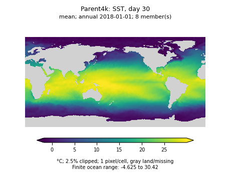 |  | 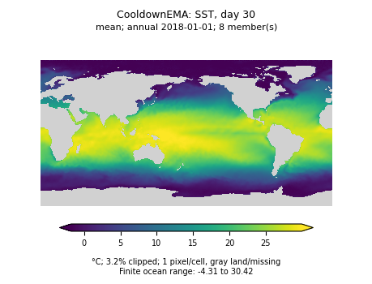 |
| 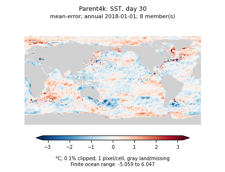 | 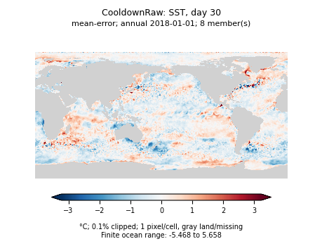 | 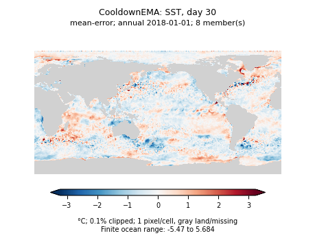 |
| 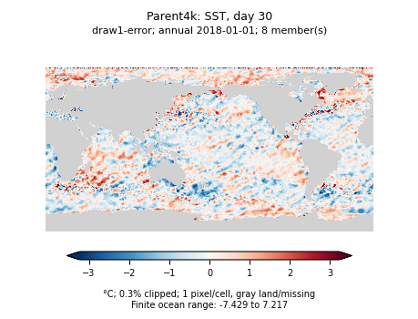 | 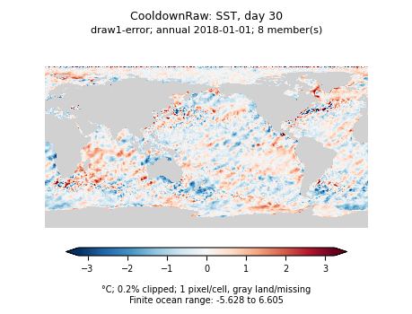 |  |

[Reference](residual-4k-cooldown-assets/annual/Parent4k-thetao_0-day30-reference.png), [raw draw field](residual-4k-cooldown-assets/annual/CooldownRaw-thetao_0-day30-draw1.png), [raw spread](residual-4k-cooldown-assets/annual/CooldownRaw-thetao_0-day30-spread.png).

## Observed SSH at day 365

| Parent 4k | Cooldown raw | Cooldown EMA |
| --- | --- | --- |
| 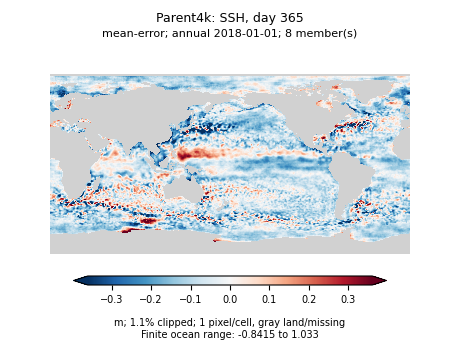 | 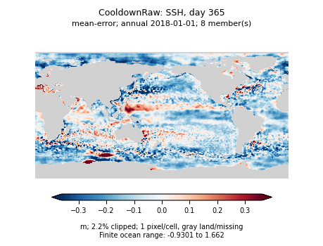 | 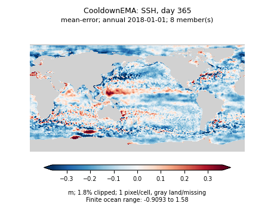 |
| 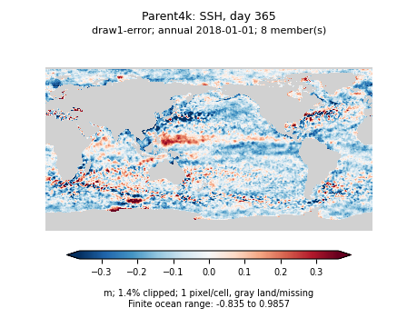 | 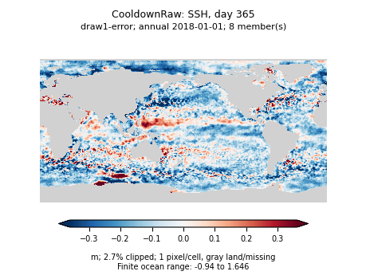 | 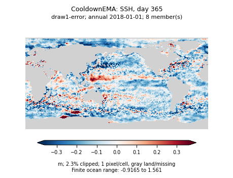 |

[Reference](residual-4k-cooldown-assets/annual/Parent4k-zos-day365-reference.png), [raw mean field](residual-4k-cooldown-assets/annual/CooldownRaw-zos-day365-mean.png), [raw draw field](residual-4k-cooldown-assets/annual/CooldownRaw-zos-day365-draw1.png).

## OM4 salinity reconstruction at day 0, level 9 (550 m)

| Parent 4k | Cooldown raw | Cooldown EMA |
| --- | --- | --- |
| 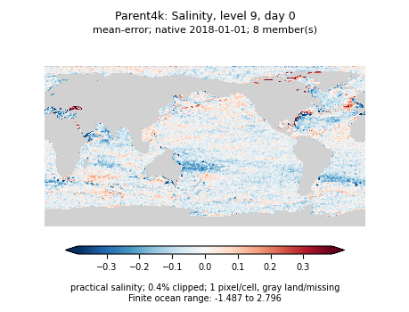 | 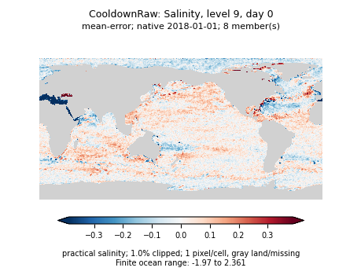 | 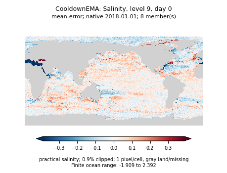 |
| 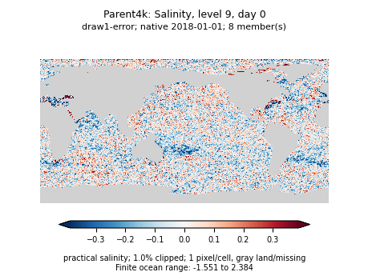 |  | 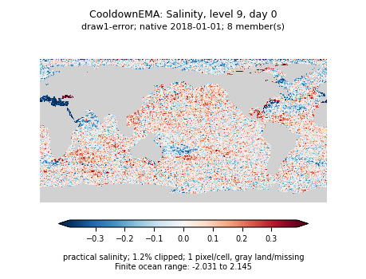 |

[Reference](residual-4k-cooldown-assets/native/Parent4k-so_9-day0-reference.png), [raw mean reconstruction](residual-4k-cooldown-assets/native/CooldownRaw-so_9-day0-mean.png), [raw draw reconstruction](residual-4k-cooldown-assets/native/CooldownRaw-so_9-day0-draw1.png), [raw spread](residual-4k-cooldown-assets/native/CooldownRaw-so_9-day0-spread.png).

## Deterministic context

These U-global and observation-only 8k examples are context, not matched ablations: training exposure, architectures, losses, and procedures differ. Surface target values and masks were verified against the diffusion targets on ocean cells before plotting; cached viewer files were checked against catalog SHA256 fingerprints. They use the same scales as the diffusion observation panels above. A deterministic prediction has no ensemble spread panel.

| Example | U-global | Observations only, 8k |
| --- | --- | --- |
| Day-30 SST error | 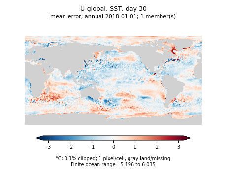 | 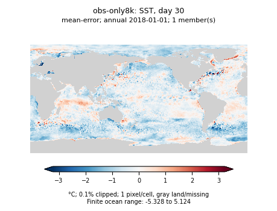 |
| Day-365 SSH error | 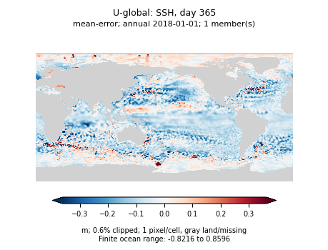 | 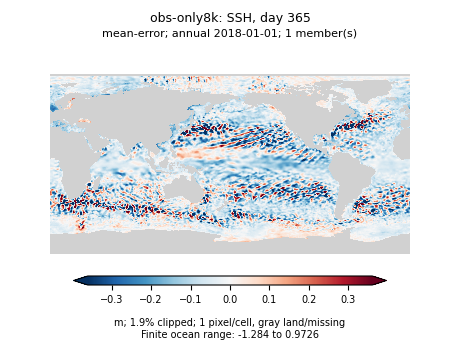 |

## Complete panels and numeric diagnostics

The [annual panel directory](residual-4k-cooldown-assets/annual) includes SSH/SST at days 30 and 365 for all five models. The [native OM4 panel directory](residual-4k-cooldown-assets/native) includes SSH/SST and level-9 temperature/salinity at days 0, 30, and 365 for all three diffusion checkpoints. Filenames identify model, variable, lead, and panel type. Separate panels retain native pixel resolution and stay below the repository's asset-size limit.

[Annual ranges and map diagnostics](residual-4k-cooldown-assets/annual/map-ranges.json) and [OM4 ranges and map diagnostics](residual-4k-cooldown-assets/native/map-ranges.json) include clipping, extrema, and finite/missing counts. Error panels also record unweighted ocean-cell RMSE and bias. These are single-map diagnostics, not the area-weighted or climatology-normalized rollout scores in the main report.
