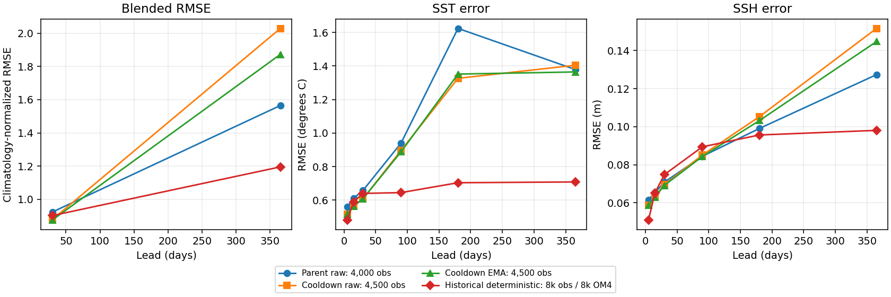
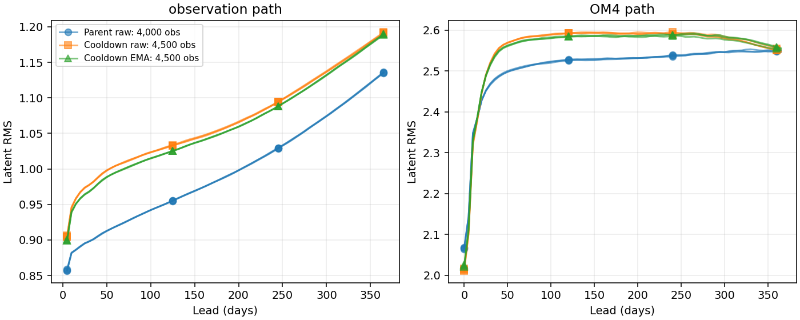

<!-- SPDX-FileCopyrightText: 2026 Samudra Authors -->
<!-- SPDX-License-Identifier: CC-BY-4.0 -->

# Residual 4k observation-only cooldown results

The 500-update observation-only cooldown improves short-lead accuracy, but
**worsens annual error**, particularly deep ocean heat content. EMA moderates
that annual regression; it does not remove it. Neither cooldown endpoint shows
the catastrophic latent explosion seen in the cancelled direct arm.

## Frozen annual comparison

All rows use the same three January origins (2015, 2018, 2021), full-latitude
observation masks and prescribed ERA5 forcing. Diffusion predictions use the
mean of eight members with 32 denoising steps. Lower scores are better.

| Endpoint | Observation / OM4 updates | Day-30 blended RMSE | Day-365 blended RMSE |
|---|---:|---:|---:|
| Parent residual, raw | 4,000 / 7,721 | 0.923727 | 1.564689 |
| Observation cooldown, raw | 4,500 / 7,721 | 0.878803 | 2.028578 |
| Observation cooldown, EMA | 4,500 / 7,721 | **0.875726** | 1.872391 |
| Historical deterministic | 8,000 / 8,000 | 0.902424 | **1.195355** |

Relative to the parent, cooldown EMA improves the day-30 score by **5.2%** and
worsens day-365 by **19.7%**. Raw cooldown worsens annual score by **29.6%**.
The deterministic row is context, not a matched architecture/exposure control.
The slightly better cooldown day-30 blend does not establish overall superiority.

The blend averages four climatology-normalized RMSE components: SST,
SSH-derived geostrophic velocity, OHC 0–700 m and OHC 700–2000 m. Each RMSE is
pooled as the square root of the mean squared per-origin RMSE; denominators are
the corresponding pooled training seasonal climatology errors at that lead.
Day 30 combines the day-30 surface bin with January OHC; day 365 combines the
last surface bin with December OHC. **This blend has no spectral term**, and
December OHC is a monthly mean, not an instantaneous day-365 field. SSH RMSE is
reported separately, not included as a fifth component.



[Per-origin and pooled component CSV](residual-4k-cooldown-assets/metrics/blended-components.csv)
· [Surface errors by lead](residual-4k-cooldown-assets/metrics/surface-leads.csv)
· [PDF](residual-4k-cooldown-assets/metrics/error-growth.pdf).

| Day-365 physical error | Parent | Cooldown raw | Cooldown EMA |
|---|---:|---:|---:|
| SST RMSE (°C) | 1.3793 | 1.4044 | 1.3644 |
| SSH RMSE (m) | 0.12737 | 0.15167 | 0.14477 |
| Velocity RMSE (m/s) | 0.17008 | 0.17733 | 0.17533 |
| OHC 0–700 m RMSE (GJ/m²) | 1.5298 | 1.8070 | 1.7424 |
| OHC 700–2000 m RMSE (GJ/m²) | 0.7341 | 1.2767 | 1.0925 |

The annual regression is not principally SST: EMA SST is slightly better than
the parent. Deep OHC deteriorates by about **49%**, and SSH and upper OHC also
worsen. Short-lead improvements alone would conceal this tradeoff.

## Members, calibration and native reconstruction

[Matched maps, member/mean error maps and grain diagnostics](residual-4k-cooldown-maps.md)
show modest SST grain reduction with substantial remaining member grain.
These are fixed examples, not a claim of globally resolved artifacts.

Nine-origin validation (November 2013–July 2014) improves its separate blended
spectral score from **0.761864** to **0.716993 raw / 0.717756 EMA**. That score
uses a different cohort and includes spectral terms; it is not interchangeable
with the annual table above. [Full validation components](residual-4k-cooldown-assets/metrics/validation.csv).

| Validation group | Parent spread/RMSE | EMA spread/RMSE | Parent interval coverage | EMA interval coverage |
|---|---:|---:|---:|---:|
| SST | 0.854 | 0.771 | 0.696 | 0.657 |
| SSH | 0.915 | 0.862 | 0.684 | 0.646 |
| Temperature | 0.846 | 0.759 | 0.693 | 0.620 |
| Salinity | 0.646 | 0.680 | 0.676 | 0.618 |

Pooled fair CRPS improves in every group, but coverage of the empirical central
90% intervals falls. Smoother members and improved mean errors therefore do not
imply better calibration. These are pointwise finite-eight-member diagnostics,
not tests of spatial or temporal coherence. Interior calibration uses the
observation evaluation's temporally averaged predictions.
[Raw and EMA calibration CSV](residual-4k-cooldown-assets/metrics/validation-calibration.csv).

Native OM4 reconstruction at lead zero and evolution at 30/90/180/365 days
remain available alongside the observation rollout. The
[complete native channel metric dump](residual-4k-cooldown-assets/metrics/native-channel-metrics.csv.gz)
contains ensemble-mean normalized MSE, mean member normalized MSE and spread
variance for every channel and origin; lead zero is reconstruction. Native
salinity maps retain member grain and show changed mean biases. The single-2018
550 m salinity reconstruction mean RMSE rises from 0.0886 to 0.0980 psu with EMA,
while draw-one RMSE falls from 0.1411 to 0.1360 psu. Those unweighted map numbers
are illustrative and distinct from pooled normalized scores. Removing OM4
supervision has not preserved every native reconstruction property.

## Latent evolution

Observation-path latent RMS at day 365 spans **1.135–1.137** in the parent,
**1.191–1.192** for raw cooldown and **1.189–1.190** for EMA. Native OM4 paths
end around **2.55** in all three. There is no direct-arm-style numerical
explosion in these evaluated years, but the annual physical error still worsens.
Bounded latent magnitude is insufficient evidence of accurate long-term dynamics.



[All origins and leads](residual-4k-cooldown-assets/metrics/latent-growth.csv).

## Protocol, provenance and limits

The [executed protocol](residual-4k-obs-cooldown.md) used **500 additional
observation-only updates**, preserving AdamW and resetting EMA to the raw parent
weights with a 100-update half-life. LR decayed linearly from 1e-4 to 1e-6.
Existing observation losses and latent-bound penalty were retained; no OM4 or
replay updates occurred in this branch. Raw and EMA are the same fixed endpoint,
not separately selected checkpoints. The main mixed residual run resumes independently from the **original parent**,
not from cooldown raw or EMA weights; its first resumed update was 11,722 with
finite loss. The direct run remains cancelled.

Extra observation exposure, changed task mixture and LR decay occur together.
This experiment cannot attribute effects to cooldown alone, nor distinguish
forgetting from other mechanisms of annual drift. EMA versus raw is a comparison
of averaging the same training trajectory. Three test origins and one seed do
not establish statistical robustness. Member indices at different forecast
leads are separate diffusion draws, not coherent sampled trajectories.

The report reducer verifies each input against the top-level completion record,
each section receipt hash, every section payload hash, task counts, eight-member
32-step settings and annual data manifest equality. The parent evaluation uses
its weights-only checkpoint export; the cooldown protocol names the full
optimizer-bearing source checkpoint, so those file hashes differ by design.
[Verification manifest](residual-4k-cooldown-assets/metrics/verification.json).

Reproduce from the local evaluation exports with:

```bash
MPLCONFIGDIR=/tmp/mpl-cooldown .venv/bin/python scripts/report_diffusion_obs_cooldown.py \
  --root outputs/diffusion-scratch-replay-v1/evaluation \
  --baseline outputs/global-matched-v1 \
  --presentation outputs/global-matched-v1/checkpoint-annual/presentation-results.json.gz \
  --output docs/experiments/diffusion-interior-beta/residual-4k-cooldown-assets/metrics
```

The useful next comparison is the continuing mixed residual run at later
checkpoints and its scheduled cooldown. These results do not support replacing
that run with observation-only continuation on short-lead scores alone.
