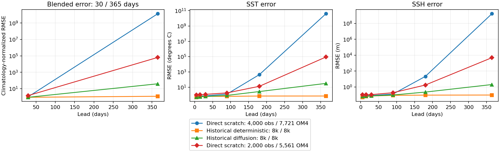
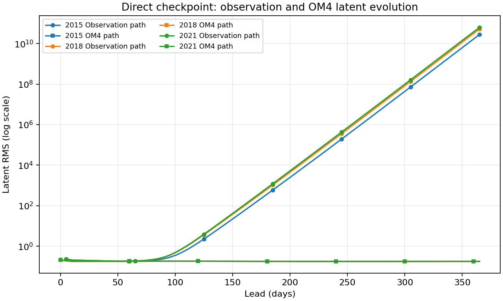
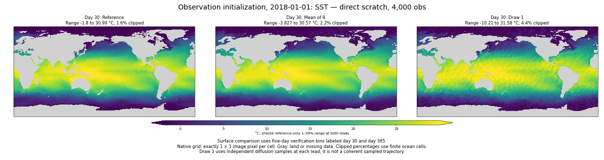
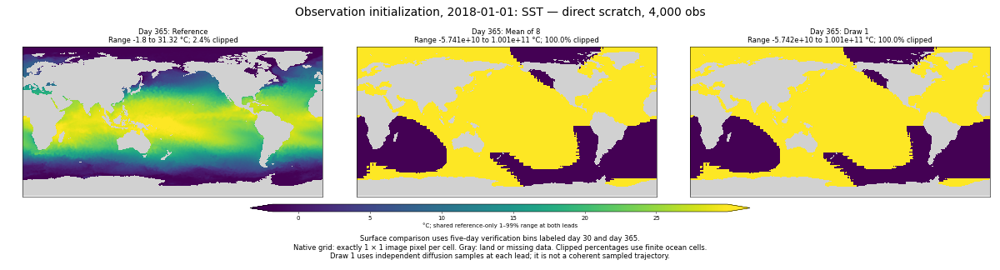

<!-- SPDX-FileCopyrightText: 2026 Samudra Authors -->
<!-- SPDX-License-Identifier: CC-BY-4.0 -->

# Direct scratch model at 4k observation updates

**Short-lead accuracy improves, but annual instability becomes substantially worse.** This is the direct + OM4 replay arm without a latent-bound penalty. Both training runs continue unchanged; this checkpoint precedes cooldown. The matched residual 4k checkpoint is not yet available.

| Direct checkpoint | OM4 updates | Observation updates | Day-30 blended RMSE | Day-365 blended RMSE |
| --- | ---: | ---: | ---: | ---: |
| Mixed step 7,561 | 5,561 | 2,000 | 1.4674 | 64,472 |
| Mixed step 11,721 | 7,721 | 4,000 | 1.0455 | 13,495,365,789 |

The day-30 score improves by about 29%, but the annual score worsens by roughly 209,000 times. SST RMSE at the new checkpoint is **0.751°C at day 30 and 3.93e10°C at day 365**; SSH RMSE is **0.0837 m and 1.62e9 m**. These are catastrophic physical-field errors, not just a normalization or visualization issue.

Scores use the mean of eight diffusion draws, 32 sampling steps, and the same three January origins (2015, 2018, 2021). Four pooled RMSE components are each normalized by the lead-specific training seasonal-climatology RMSE and averaged: SST, SSH-derived geostrophic velocity, OHC 0–700 m and OHC 700–2000 m. Surface endpoints are five-day bins; OHC uses January/December means. All annual data manifests match the historical comparison protocol. Historical controls have different training exposure and hyperparameters.

[PDF](scratch-replay-assets/direct-4k/error-growth.pdf) · [components and individual starts](scratch-replay-assets/direct-4k/blended-components.csv) · [surface lead curves](scratch-replay-assets/direct-4k/surface-leads.csv). Error axes are logarithmic.

## Latent growth and maps

Observation-path latent RMS starts around 0.192 at day 30, reaches 0.239–0.288 at day 90, and reaches **2.78e10–6.29e10 at day 365**. All three starts fail. OM4-path RMS remains around 0.18 throughout the year. Thus additional training has not transferred OM4 replay stability to the observation path. The paths differ in task conditioning, initial inputs and forcing, so these diagnostics do not isolate the cause. Bounded OM4 latents do not establish accurate OM4 forecasts.

[Latent CSV](scratch-replay-assets/direct-4k/latent-growth.csv).

SSH: [day 30](scratch-replay-assets/direct-4k/obs-2018-ssh-day30.png), [day 365](scratch-replay-assets/direct-4k/obs-2018-ssh-day365.png). OM4-initialized SSH: [day 30](scratch-replay-assets/direct-4k/om4-2018-ssh-day30.png), [day 365](scratch-replay-assets/direct-4k/om4-2018-ssh-day365.png). OM4-initialized SST: [day 30](scratch-replay-assets/direct-4k/om4-2018-sst-day30.png), [day 365](scratch-replay-assets/direct-4k/om4-2018-sst-day365.png).

Maps show reference, mean of eight and draw 1, at one pixel per grid cell. Shared reference-based limits and explicit ranges/clipping percentages expose the annual saturation. Draws at different leads are independent samples, not coherent trajectories. [Panel ranges](scratch-replay-assets/direct-4k/map-ranges.json). No spectral improvement is inferred from these maps.

## Separate validation calibration

| Group | Spread / ensemble-mean RMSE | Empirical 90% coverage |
| --- | ---: | ---: |
| SST | 0.876 | 69.2% |
| SSH | 0.936 | 70.0% |
| Interior temperature | 0.798 | 70.9% |
| Interior salinity | 0.712 | 67.2% |

These are pointwise, finite-eight-member diagnostics on the nine-origin validation cohort, not annual scores or measures of trajectory coherence. [Calibration and fair CRPS](scratch-replay-assets/direct-4k/validation-calibration.csv).

## Evidence and next steps

Evaluation **213310** completed successfully in **33m51s** on one four-GPU production Beta host. All validation/native/annual completion receipts and exported payload hashes were verified after download. Checkpoint SHA256 is `7b60ce5a27dcf1cb9bab94dc1954c8f6656308ce2a58aa382cc3c915d0619ef5`; immutable source is `scratch-replay-5c2a70055fcd`. Inputs and receipts are retained in `outputs/diffusion-scratch-replay-v1/evaluation/direct-obs4000` and the equivalent Beta campaign directory.

[The matched 2k comparison](scratch-replay-early-paired.md) found much more stable annual behavior for residual + replay + bound. The residual 4k evaluation will test whether that persists. Neither arm has begun its cooldown, which starts at mixed step 17,780 and decays LR from 1e-4 to 1e-6 over the final 2,540 updates. The present evidence does not establish that cooldown will fix direct-model instability. Both authorized training runs remain unchanged.

Reproduce metrics with `scripts/report_diffusion_scratch_early.py --evaluation <direct-obs4000> --comparison <direct-obs2000> --baseline outputs/global-matched-v1 --presentation outputs/global-matched-v1/checkpoint-annual/presentation-results.json.gz --output <assets>`. Maps use `scripts/report_diffusion_scratch_early_figures.py --root <direct-obs4000> --arm direct --surface-only --output <assets>`.
