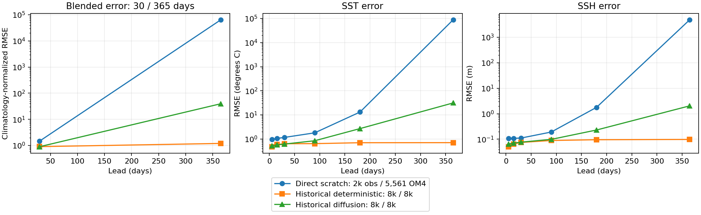
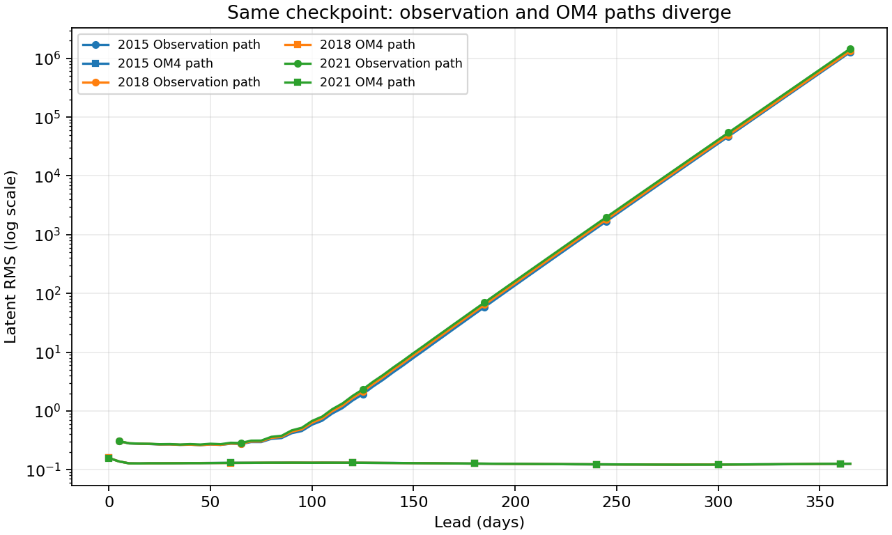
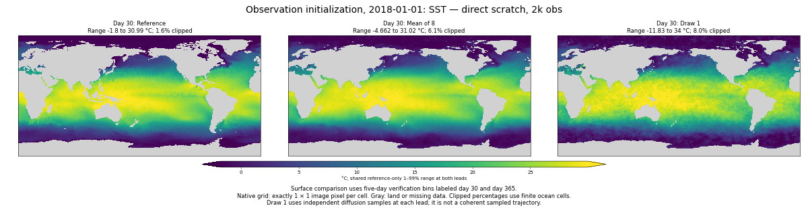
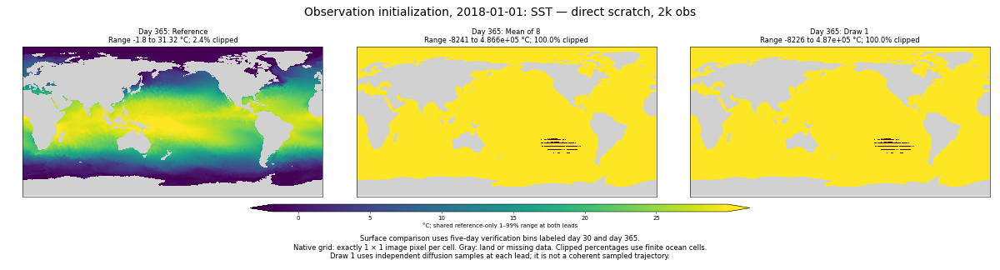
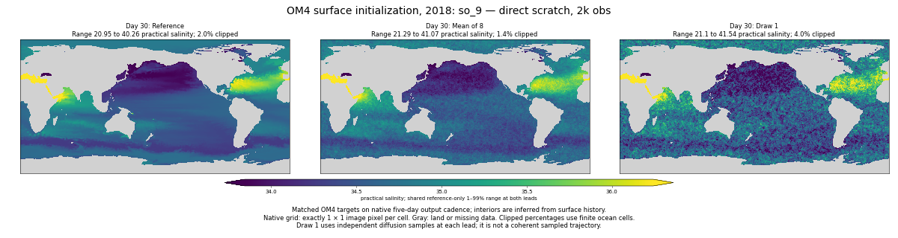
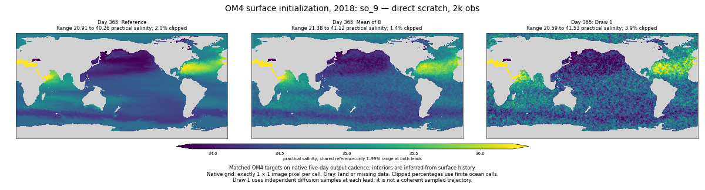

<!-- SPDX-FileCopyrightText: 2026 Samudra Authors -->
<!-- SPDX-License-Identifier: CC-BY-4.0 -->

# Scratch direct model: first 2k-observation evaluation

The early direct model **has not solved long-rollout instability**. Its observation-initialized forecasts become severely nonphysical during the year, even though its OM4-path latents remain bounded. Both authorized training runs continue; this is an interim diagnostic, not a final direct-versus-residual comparison.

This checkpoint contains **5,561 OM4 + 2,000 observation updates**, mixed step 7,561, before cooldown. Historical controls below have 8k updates of each task and different model/training settings. They provide reference behavior, not a matched architecture ablation.

## Observation-initialized forecast error

| Model | Day-30 blended RMSE | Day-365 blended RMSE |
| --- | ---: | ---: |
| Fresh direct + OM4 replay, early checkpoint | 1.4674 | 64,472.1592 |
| Historical deterministic, 8k/8k | 0.9024 | 1.1954 |
| Historical diffusion, 8k/8k | 0.8968 | 39.5279 |

Lower is better. These are ensemble-mean forecast scores for diffusion: each component pools squared errors over the same three January starts (2015, 2018, 2021), takes the square root, divides by that lead's pooled training seasonal-climatology RMSE, then averages the four ratios. Components are SST, SSH-derived geostrophic velocity, and 0–700/700–2000 m OHC. Surface endpoints use the established five-day bins; OHC uses January/December means. Annual manifests match those used for the controls. These numbers are not the separate nine-origin validation score.

The direct checkpoint's SST RMSE grows from **1.169°C to 88,037°C**, and SSH RMSE from **0.111 m to 4,876 m**. The magnitude makes clear that this is numerical model divergence, not merely a visible texture artifact or a difficult climatology denominator.

[PDF](scratch-replay-assets/early-direct-2k/error-growth.pdf) · [all components and individual origins](scratch-replay-assets/early-direct-2k/blended-components.csv) · [surface lead curves](scratch-replay-assets/early-direct-2k/surface-leads.csv). All error axes are logarithmic; connecting lines are visual guides between evaluated leads.

## Where the growth appears

Observation-path latent RMS is approximately **0.27 at day 30**, **0.42–0.47 at day 90**, and **1.28–1.46 million at day 365**, across all three starts. OM4-path latent RMS stays near **0.12–0.16** throughout the year, ending near 0.126.

[PDF](scratch-replay-assets/early-direct-2k/latent-growth.pdf) · [latent values](scratch-replay-assets/early-direct-2k/latent-growth.csv).

This supports a failure of stability to transfer from OM4 replay to the observation path at this checkpoint. The processor uses task conditioning, and the paths also differ in initial inputs, forcing and dates; this comparison does **not** isolate which difference causes the failure. Bounded OM4 latents do not by themselves establish accurate OM4 fields. Direct prediction also imposes no mathematical bound on repeated evolution: removing an explicit residual addition does not guarantee contraction.

The large observation-path latent growth precedes the enormous physical-field errors. Grain may still matter for short-lead member quality, but decoder denoising alone is not an adequate explanation of this annual failure.

## Mean and individual-member maps

The 2018 examples compare reference, mean of eight and draw 1 at day 30 and day 365, with exactly one image pixel per grid cell and shared reference-based color limits. Titles report actual value ranges and the fraction clipped by those limits. Near-total saturation at day 365 is therefore explicit; it is not hidden by independent autoscaling. Observation surface panels use five-day verification bins. Draw 1 at different leads uses independent noise and is not a coherent sampled trajectory.

Observation SSH: [day 30](scratch-replay-assets/early-direct-2k/obs-2018-ssh-day30.png), [day 365](scratch-replay-assets/early-direct-2k/obs-2018-ssh-day365.png). OM4 SSH: [day 30](scratch-replay-assets/early-direct-2k/om4-2018-ssh-day30.png), [day 365](scratch-replay-assets/early-direct-2k/om4-2018-ssh-day365.png). OM4 SST: [day 30](scratch-replay-assets/early-direct-2k/om4-2018-sst-day30.png), [day 365](scratch-replay-assets/early-direct-2k/om4-2018-sst-day365.png).

Short-lead mean fields retain recognizable large-scale structure, while individual members remain grainy. Native salinity also shows grain and large-scale bias at long lead despite bounded latents. These one-origin maps support qualitative inspection; they do not establish improved spectra or artifact suppression. [Panel ranges and clipping fractions](scratch-replay-assets/early-direct-2k/map-ranges.json) · [map reproduction script](../../../scripts/report_diffusion_scratch_early_figures.py).

## Ensemble diagnostics

Pointwise validation calibration, aggregated over the fixed nine-origin cohort:

| Group | Spread / ensemble-mean RMSE | Empirical 90% interval coverage |
| --- | ---: | ---: |
| SST | 0.852 | 69.6% |
| SSH | 0.681 | 58.2% |
| Interior temperature | 1.321 | 85.3% |
| Interior salinity | 1.115 | 89.6% |

These finite eight-member marginal intervals do not assess spatial or temporal coherence. Surface coverage is low; interior coverage and spread alone do not establish realistic individual fields. [Calibration CSV, including normalized fair CRPS](scratch-replay-assets/early-direct-2k/validation-calibration.csv).

## Status and evidence

- Evaluation **212865** completed successfully in 34m16s, using one four-GPU production Beta host (three concurrent probes; 2.28 allocated GPU-hours).
- All validation/native/annual completion receipts and every exported member payload were checksum-verified after download. Checkpoint source is `scratch-replay-5c2a70055fcd`, identical to the qualified training source.
- Remote output: `beta:/projects/ny/lz1955/multiscale/jrusak/runs/diffusion-scratch-replay-v1/evaluation/direct-obs2000`.
- The [campaign plan](scratch-replay.md) describes data, objectives, checkpoint counts and cooldown. Training **212418/212419** continues within the authorized budget, with durable monitoring. Residual's matching early evaluation remains pending its checkpoint.
- Next interpretation should use the residual early result and later direct checkpoints. This single early snapshot cannot establish the final benefit of either approach, nor whether the scheduled cooldown will change the instability.

Reproduce scores, receipt verification and curves with [the reporting script](../../../scripts/report_diffusion_scratch_early.py), using `--evaluation outputs/diffusion-scratch-replay-v1/evaluation/direct-obs2000 --baseline outputs/global-matched-v1 --presentation outputs/global-matched-v1/checkpoint-annual/presentation-results.json.gz --output docs/experiments/diffusion-interior-beta/scratch-replay-assets/early-direct-2k`.
