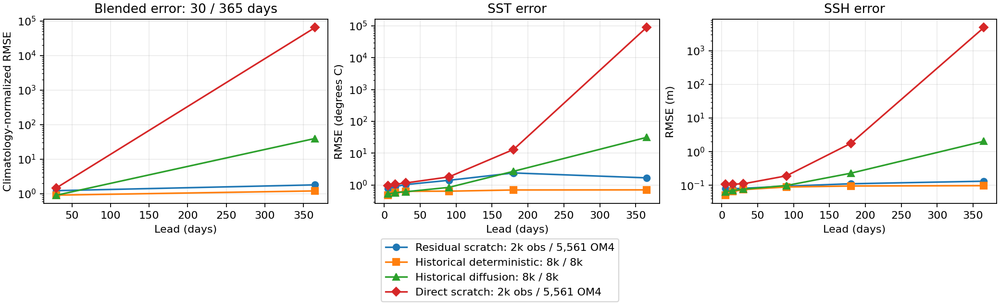
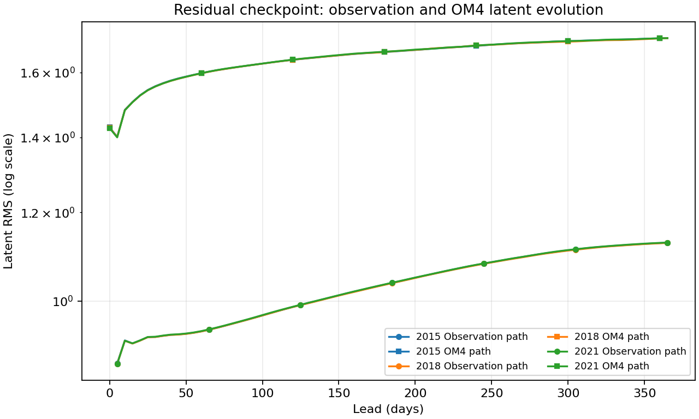
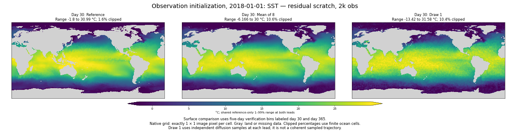
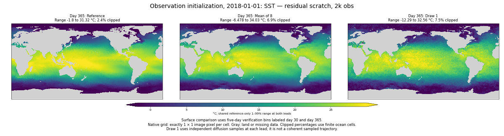

<!-- SPDX-FileCopyrightText: 2026 Samudra Authors -->
<!-- SPDX-License-Identifier: CC-BY-4.0 -->

# Scratch models: matched early 2k-observation evaluation

**Residual + replay + latent bound avoids the catastrophic annual growth seen in direct + replay at this early checkpoint.** Its error still increases and remains above the historical deterministic reference, but its degradation over the year is much closer to the behavior we wanted. Both training runs continue toward their authorized budgets and final cooldown.

Both fresh models have exactly **5,561 OM4 + 2,000 observation updates**, mixed step 7,561, before cooldown. They share seed, data, batch size, decoder and evaluation protocol. This is a comparison of two intervention packages: residual also has a soft latent-bound penalty (weight 0.1), whereas direct does not. It cannot isolate residual prediction from the bound's effect. Historical controls have 8k/8k updates and other hyperparameter differences.

| Model | Day-30 blended RMSE | Day-365 blended RMSE | 365 / 30 |
| --- | ---: | ---: | ---: |
| Residual + replay + bound, early | 1.2158 | 1.7875 | 1.47 |
| Direct + replay, early | 1.4674 | 64,472.1592 | 43,935 |
| Historical deterministic, 8k/8k | 0.9024 | 1.1954 | 1.32 |
| Historical diffusion, 8k/8k | 0.8968 | 39.5279 | 44.08 |

Lower is better. These scores use the diffusion mean of eight, 32 sampling steps, and the same January starts in 2015, 2018 and 2021. Each of four pooled RMSE components (SST, SSH-derived geostrophic velocity, OHC 0–700 m and OHC 700–2000 m) is divided by its lead-specific training seasonal-climatology RMSE, then averaged. Surface endpoints use five-day bins and OHC uses January/December means. Annual manifests were checked against the reference presentation. The ratio compares normalized scores with different lead-specific denominators; physical errors below also confirm modest growth rather than explosion.

Residual SST RMSE increases **1.039 → 1.689°C**; SSH RMSE increases **0.0820 → 0.1329 m**. Direct instead reaches 88,037°C SST RMSE and 4,876 m SSH RMSE.

[PDF](scratch-replay-assets/early-paired-2k/error-growth.pdf) · [components and individual origins](scratch-replay-assets/early-paired-2k/blended-components.csv) · [surface lead curves](scratch-replay-assets/early-paired-2k/surface-leads.csv). Logarithmic axes accommodate the direct failure; connecting lines are visual guides.

## Latent behavior

Residual observation-path latent RMS grows from approximately **0.929 at day 30 to 1.127 at day 365**, consistently across all three starts. Its OM4 path grows from about **1.555 to 1.717**. Direct observation-path RMS instead reaches 1.28–1.46 million. Absolute latent scales are representation-dependent; within-model growth is the relevant diagnostic.

[Latent CSV](scratch-replay-assets/early-paired-2k/latent-growth.csv) · [direct checkpoint report and maps](scratch-replay-early-direct.md). This supports finite-horizon stability for the residual package on these three origins, not a guarantee of long-term stability or accurate interiors.

## Residual mean and member maps

The 2018 example retains recognizable SST structure at one year, unlike the direct model's blow-up. Individual members still have visible grain, including implausibly cold values; reduced annual instability does not establish that texture artifacts are solved. No spectral improvement is claimed here.

SSH: [day 30](scratch-replay-assets/early-paired-2k/obs-2018-ssh-day30.png), [day 365](scratch-replay-assets/early-paired-2k/obs-2018-ssh-day365.png). OM4-initialized SSH: [day 30](scratch-replay-assets/early-paired-2k/om4-2018-ssh-day30.png), [day 365](scratch-replay-assets/early-paired-2k/om4-2018-ssh-day365.png). OM4-initialized SST: [day 30](scratch-replay-assets/early-paired-2k/om4-2018-sst-day30.png), [day 365](scratch-replay-assets/early-paired-2k/om4-2018-sst-day365.png).

Maps use one image pixel per grid cell, reference-based shared limits, and explicit ranges/clipping fractions. Draw 1 is independently sampled at each lead, not a coherent trajectory. [Panel ranges](scratch-replay-assets/early-paired-2k/map-ranges.json).

## Pointwise validation calibration

| Group | Residual spread / RMSE | Residual 90% coverage | Direct spread / RMSE | Direct 90% coverage |
| --- | ---: | ---: | ---: | ---: |
| SST | 0.914 | 73.7% | 0.852 | 69.6% |
| SSH | 0.874 | 77.9% | 0.681 | 58.2% |
| Interior temperature | 1.535 | 89.8% | 1.321 | 85.3% |
| Interior salinity | 1.158 | 89.4% | 1.115 | 89.6% |

These are separate nine-origin validation diagnostics with finite eight-member marginal intervals. They do not measure spatial/temporal coherence. Interior temperature spread exceeds ensemble-mean RMSE substantially. [Residual calibration including fair CRPS](scratch-replay-assets/early-paired-2k/validation-calibration.csv).

## Provenance and next steps

Residual evaluation **213179** completed in 35m17s on one four-GPU production Beta host. Direct evaluation was **212865**. All three completion receipts and exported payload hashes were verified locally; matching task counts and annual manifests were asserted. Both checkpoints use immutable source `scratch-replay-5c2a70055fcd`. Raw inputs and receipts are retained under `outputs/diffusion-scratch-replay-v1/evaluation/{direct,residual}-obs2000` and the equivalent Beta campaign directory.

Training jobs **212418 / 212419** continue unchanged toward 10,160 updates per task and the scheduled cooldown. This checkpoint supplies encouraging evidence for the residual package; later checkpoints will show whether that behavior persists and short-lead accuracy improves. No additional arm or training budget is introduced.

Reproduce metrics with `scripts/report_diffusion_scratch_early.py --evaluation <residual-obs2000> --comparison <direct-obs2000> --baseline outputs/global-matched-v1 --presentation outputs/global-matched-v1/checkpoint-annual/presentation-results.json.gz --output <assets>`. Generate surface maps with `scripts/report_diffusion_scratch_early_figures.py --root <residual-obs2000> --arm residual --surface-only --output <assets>`.
