<!--
SPDX-FileCopyrightText: 2026 Samudra Authors
SPDX-License-Identifier: CC-BY-4.0
-->

# Residual replay: 8k versus final cooldown maps

These shared-scale maps compare the residual model at 8,000 observation updates with its final checkpoint at 10,160 observation and 10,160 OM4 updates, after the scheduled mixed-training cooldown. This is **not** the separate 500-update observation-only cooldown fork. See the [main metrics report](scratch-replay-final.md) for aggregate rollout results and provenance. Training exposure and learning rate both change between the two checkpoints, so this comparison does not isolate the effect of cooldown.

For this 2018 origin, final day-30 SST mean and draw errors are smaller. Native salinity reconstruction and year-lead errors also decrease substantially, and its global mean bias moves close to zero. The shared-scale salinity maps look less strongly speckled, but conspicuous member grain remains; reduced RMSE and bias alone do not prove removal of high-frequency artifacts. In contrast, the observed day-365 SSH mean and draw RMSEs rise slightly, with a more negative mean bias. These are individual-origin diagnostics, not aggregate skill estimates.

Each cell occupies exactly one pixel in the saved map, without interpolation or smoothing. Open images at native size if the browser scales this table. Gray denotes land or missing data. Physical, error, and spread scales are shared across both checkpoints and all selected leads **within each channel and source**. Reference percentiles define physical ranges; pooled absolute errors define error ranges. Legends and JSON metadata record clipping and full ranges. Error is prediction minus reference; spread is pointwise sample standard deviation, not error.

The mean uses eight members. Draw 1 uses an independent sample at each lead and is not a coherent trajectory. Annual observed SST/SSH are five-day verification bins; native OM4 fields use their output cadence. Native day 0 tests surface-conditioned reconstruction against OM4, not an observed interior gold standard.

## Observed SST, day 30

| Residual 8k | Final cooldown |
| --- | --- |
|  | 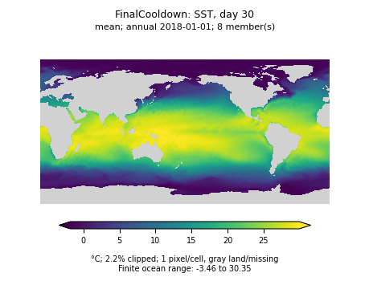 |
| 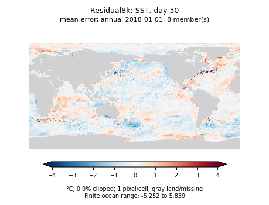 |  |
| 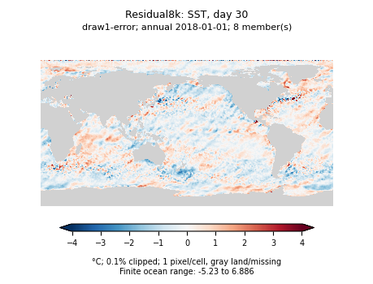 | 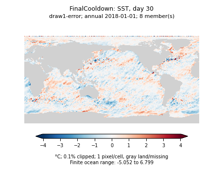 |

[Reference](scratch-replay-final-assets/annual/FinalCooldown-thetao_0-day30-reference.png), [Final single draw field](scratch-replay-final-assets/annual/FinalCooldown-thetao_0-day30-draw1.png), [Final spread](scratch-replay-final-assets/annual/FinalCooldown-thetao_0-day30-spread.png).

## Observed SSH, day 365

| Residual 8k | Final cooldown |
| --- | --- |
| 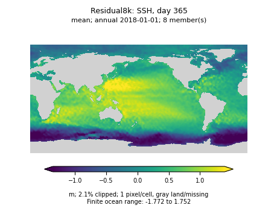 | 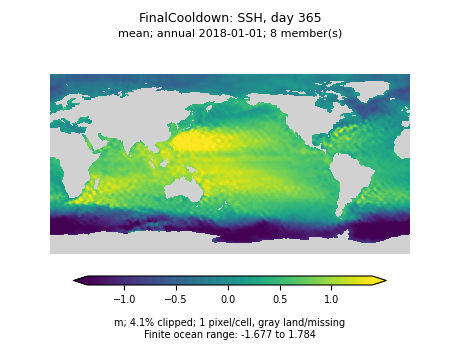 |
| 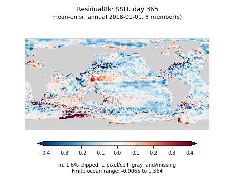 | 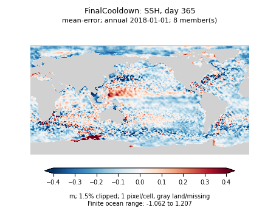 |
|  |  |

[Reference](scratch-replay-final-assets/annual/FinalCooldown-zos-day365-reference.png), [Final single draw field](scratch-replay-final-assets/annual/FinalCooldown-zos-day365-draw1.png), [Final spread](scratch-replay-final-assets/annual/FinalCooldown-zos-day365-spread.png).

## OM4 salinity reconstruction, day 0, level 9 (550 m)

| Residual 8k | Final cooldown |
| --- | --- |
|  | 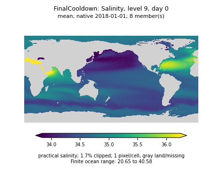 |
| 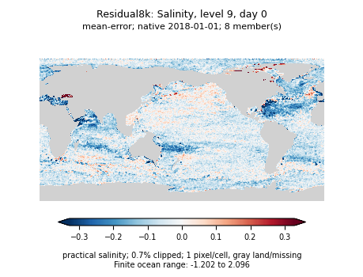 | 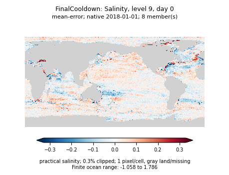 |
| 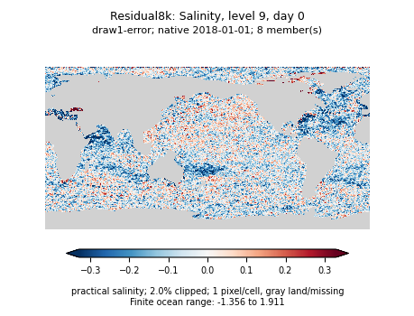 | 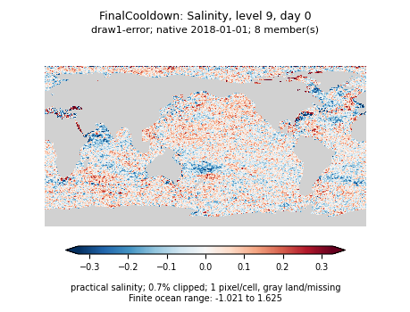 |

[Reference](scratch-replay-final-assets/native/FinalCooldown-so_9-day0-reference.png), [Final single draw field](scratch-replay-final-assets/native/FinalCooldown-so_9-day0-draw1.png), [Final spread](scratch-replay-final-assets/native/FinalCooldown-so_9-day0-spread.png).

## OM4 salinity, day 365, level 9 (550 m)

| Residual 8k | Final cooldown |
| --- | --- |
| 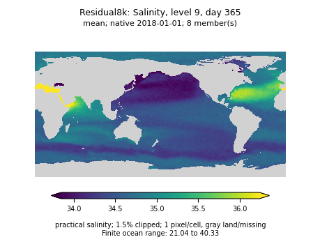 |  |
| 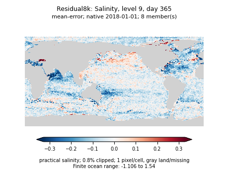 | 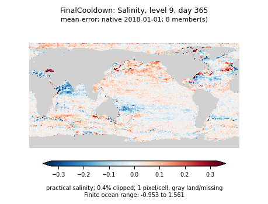 |
| 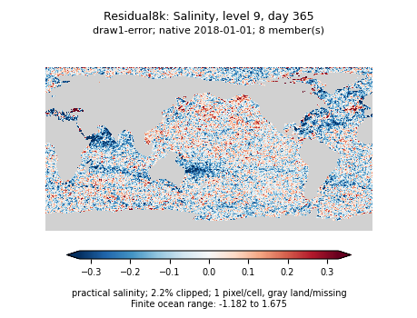 | 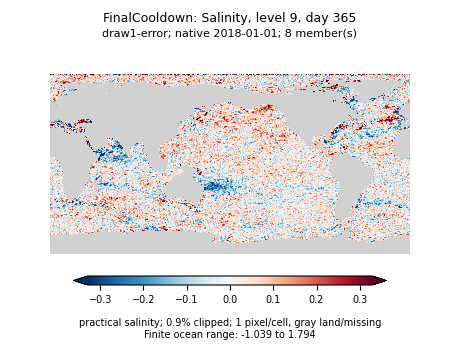 |

[Reference](scratch-replay-final-assets/native/FinalCooldown-so_9-day365-reference.png), [Final single draw field](scratch-replay-final-assets/native/FinalCooldown-so_9-day365-draw1.png), [Final spread](scratch-replay-final-assets/native/FinalCooldown-so_9-day365-spread.png).

## Single-map error checks

These are unweighted RMSEs over finite ocean cells for the pictured origin, not the climatology-normalized blended metric. They illustrate why changes in appearance should be checked against error and bias rather than interpreted as a universal improvement.

| Map | 8k mean RMSE | Final mean RMSE | 8k draw-1 RMSE | Final draw-1 RMSE |
| --- | ---: | ---: | ---: | ---: |
| Observed SST, day 30 (°C) | 0.59501 | 0.56147 | 0.71299 | 0.65821 |
| Observed SSH, day 365 (m) | 0.14285 | 0.14809 | 0.14887 | 0.15281 |
| OM4 salinity level 9, day 0 | 0.09855 | 0.06775 | 0.13668 | 0.10255 |
| OM4 salinity level 9, day 365 | 0.09702 | 0.07207 | 0.13921 | 0.10661 |

## Full panel collections

The [annual directory](scratch-replay-final-assets/annual) contains SSH/SST reference, ensemble mean, draw 1, both error panels, and spread at days 30 and 365. The [native directory](scratch-replay-final-assets/native) contains the same panels for SSH/SST and level-9 temperature/salinity at days 0, 30, and 365.

[Annual metadata](scratch-replay-final-assets/annual/map-ranges.json) and [native metadata](scratch-replay-final-assets/native/map-ranges.json) contain shared scale limits, finite/nonfinite counts, clipping fractions, unclipped ranges, and unweighted map error/bias diagnostics. Filenames identify checkpoint, variable, lead, and panel. All PNGs remain below the repository asset-size limit.
