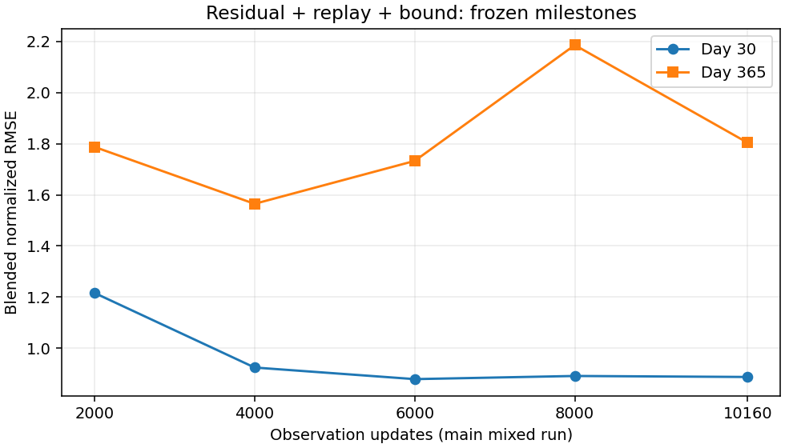
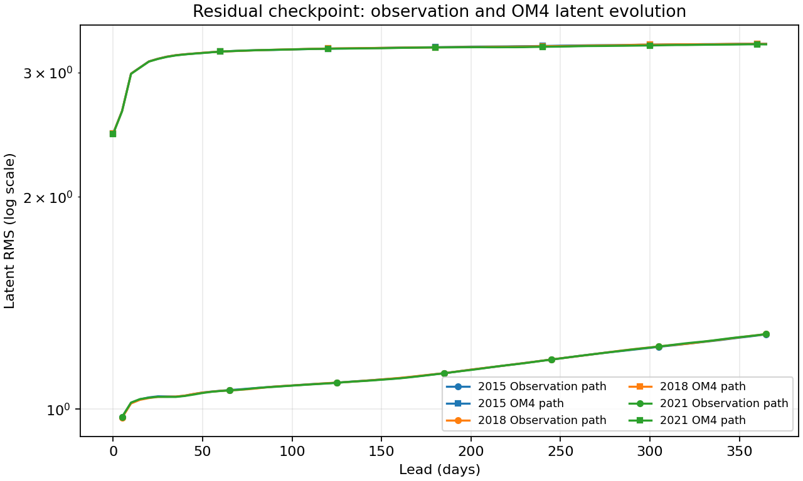

<!-- SPDX-FileCopyrightText: 2026 Samudra Authors -->
<!-- SPDX-License-Identifier: CC-BY-4.0 -->

# Scratch replay campaign: final residual result

The completed residual + replay + latent-bound run avoids the direct arm's
catastrophic annual explosion, but **does not achieve deterministic-like annual
accuracy**. After the scheduled cooldown, annual blended RMSE improves **17.5%**
relative to the pre-cooldown 8k checkpoint. It remains **15.3% worse than the
4k main-run checkpoint** and **50.9% above the historical deterministic score**.

The final checkpoint contains **10,160 observation + 10,160 OM4 updates**,
step **20,320**, with LR **1e-6**. Its final 2,540 mixed updates use the planned
cosine cooldown from 1e-4. The direct arm was stopped at the user's request
following severe observation-path annual divergence. No additional training is
included in this report.

## Final and intermediate annual scores

Same three January origins (2015, 2018, 2021), eight diffusion members, 32
sampling steps and matching annual data manifests. Scores use the ensemble
mean; lower is better.

| Frozen endpoint | Observation / OM4 updates | Day-30 blend | Day-365 blend |
|---|---:|---:|---:|
| Main residual, 2k | 2,000 / 5,561 | 1.215764 | 1.787477 |
| Main residual, 4k | 4,000 / 7,721 | 0.923727 | **1.564689** |
| Main residual, 6k | 6,000 / 8,960 | **0.878310** | 1.732721 |
| Main residual, 8k before cooldown | 8,000 / 9,708 | 0.890656 | 2.186175 |
| **Main residual, final after cooldown** | **10,160 / 10,160** | **0.886723** | **1.803789** |
| Separate 4k-parent obs-only cooldown, raw | 4,500 / 7,721 | 0.878803 | 2.028578 |
| Separate 4k-parent obs-only cooldown, EMA | 4,500 / 7,721 | 0.875726 | 1.872391 |
| Historical deterministic | 8,000 / 8,000 | 0.902424 | 1.195355 |

The 4k main checkpoint remains the lowest annual error among these measured
milestones. This is retrospective monitoring, not a new held-out selection
protocol. Historical deterministic architecture and exposure differ from this
campaign, so it is a reference rather than a controlled model ablation. The
separate observation-only cooldown also has a different exposure and schedule.



[Exact milestone components](scratch-replay-final-assets/milestone-components.csv)
· [Per-origin final/8k and historical comparison](scratch-replay-final-assets/blended-components.csv).

The blend is the equally weighted mean of four climatology-normalized RMSEs:
SST, SSH-derived geostrophic velocity, OHC 0–700 m and OHC 700–2000 m. Each RMSE
is pooled as the square root of mean squared per-origin RMSE. The denominator
is the pooled training seasonal climatology error at the corresponding lead.
Day 30 uses its surface bin and January OHC; day 365 uses its surface bin and
December OHC. OHC is a calendar-month mean, not an instantaneous field.
**No spectral term enters this blend.** SSH RMSE below is a separate diagnostic.

| Day-365 physical error | Main 4k | Main 8k | Final |
|---|---:|---:|---:|
| SST RMSE (°C) | 1.3793 | 1.4905 | 1.3459 |
| SSH RMSE (m) | 0.12737 | 0.14301 | 0.14719 |
| Geostrophic velocity RMSE (m/s) | 0.17008 | 0.19049 | 0.19259 |
| OHC 0–700 m RMSE (GJ/m²) | 1.5298 | 1.8213 | 1.6586 |
| OHC 700–2000 m RMSE (GJ/m²) | 0.7341 | 1.4389 | 0.9893 |

The annual recovery from 8k is primarily OHC and SST: deep OHC error falls
**31.2%**, upper OHC **8.9%**, and SST **9.7%**. SSH and velocity errors become
slightly worse. Compared with the best measured annual checkpoint at 4k, final
SST is slightly better but the other four diagnostic columns are worse.
[Surface error by lead](scratch-replay-final-assets/surface-leads.csv).

Extra mixed training and LR decay occur together; this experiment does not
isolate cooldown's causal contribution. The result supports partial recovery,
not the claim that cooldown resolves accumulated annual drift.

## Validation, native reconstruction and member uncertainty

The separate nine-origin November 2013–July 2014 blended spectral validation
score is **0.716457**, versus **0.710925 at 8k** and **0.680448 at 6k**. This
cohort and metric differ from the annual RMSE table and include spectral terms.
[Validation milestones](scratch-replay-final-assets/validation-milestones.csv).

[Matched 8k/final maps and member error diagnostics](scratch-replay-final-maps.md)
complement the scores. Ensemble means alone cannot establish good individual
members, calibration or temporal coherence.

Native OM4 reconstruction improves substantially for the inspected 550 m
T/S channels. Averaging those two channels and the three origins, lead-zero
ensemble-mean normalized MSE falls from **0.03810 at 8k to 0.02523 final**;
mean member MSE falls from **0.08629 to 0.05764**. At day 365 the respective
changes are **0.04147 → 0.02940** and **0.09501 → 0.06340**. These limited
channel metrics are squared training-normalized units, not physical RMSE or a
claim that all native channels improve.
[Native channel diagnostics](scratch-replay-final-assets/native-550m-metrics.csv).

Pointwise spread/RMSE, empirical central-90% coverage and fair CRPS are in the
[validation calibration table](scratch-replay-final-assets/validation-calibration.csv).
Final spread/RMSE ratios are **0.601 SST, 0.577 SSH, 0.541 temperature and
0.483 salinity**; interval coverages are **0.543, 0.465, 0.472 and 0.501**,
respectively. Both diagnostics worsen in every group versus 8k, indicating
increasing underdispersion despite native member-MSE improvement. Fair CRPS
improves slightly for SST/T/S but worsens for SSH.
Coverage uses eight members; interior quantities are temporally averaged.
These measures do not score coherent spatial structures or sampled trajectories:
member indices at successive leads correspond to separate diffusion draws.

## Latent behavior and conclusion

Observation-path latent RMS at day 365 is **1.277–1.278**, slightly below
**1.295–1.298 at 8k**. Native OM4 RMS ends at **3.290–3.296**, above
**2.861–2.867 at 8k**. Both remain finite, with no direct-arm-style many-order
explosion. Their finite magnitude does not guarantee physically correct fields.



[All origins and leads](scratch-replay-final-assets/latent-growth.csv).

The campaign's positive signal is bounded observation-path evolution with much
smaller annual error than the failed direct arm. Its limitation is persistent
annual drift and a short/long-lead tradeoff: increasing training beyond 4k
observation updates did not monotonically improve annual error. Direct versus
residual also changed the latent-bound penalty, so this comparison does not
isolate residual prediction from bounding. OM4-only replay did not establish
transfer of accurate long-rollout dynamics to the observation path.

## Execution and reproducibility

The actual final training step **212419.12 completed with exit code 0** and
reached the prescribed 20,320 updates. The enclosing allocation reports
**FAILED, exit 9**, because its original paused shell/old step was cancelled;
that allocation status is not a failure of the completed resumed training step.
Final evaluation **214448 completed in 32 minutes 35 seconds**.

The fresh campaign consumed **1,641.6722 allocated GPU-hours**, including
**533.9733** for the cancelled direct arm and **1,089.7067** for the residual
allocation. Forks and evaluations executed inside that allocation are already
included, not counted twice. The remainder covers qualification and external
evaluation allocations. Earlier pilot campaigns are excluded.
[Verified allocation ledger](scratch-replay-final-assets/allocation-ledger.json).

After transfer, the reducers verify top-level input/completion equality, all
section receipt and payload hashes, and annual manifest equality with the
existing climatology reference. The trajectory reduction independently verifies
all five main-run milestone exports. Full provenance remains in local input and
completion records; no duplicated checksum ledger is needed here.

```bash
MPLCONFIGDIR=/tmp/mpl-final .venv/bin/python scripts/report_diffusion_scratch_early.py \
  --evaluation outputs/diffusion-scratch-replay-v1/evaluation/residual-obs10160 \
  --comparison outputs/diffusion-scratch-replay-v1/evaluation/residual-obs8000 \
  --baseline outputs/global-matched-v1 \
  --presentation outputs/global-matched-v1/checkpoint-annual/presentation-results.json.gz \
  --output docs/experiments/diffusion-interior-beta/scratch-replay-final-assets
MPLCONFIGDIR=/tmp/mpl-final .venv/bin/python scripts/report_diffusion_residual_trajectory.py \
  --root outputs/diffusion-scratch-replay-v1/evaluation \
  --presentation outputs/global-matched-v1/checkpoint-annual/presentation-results.json.gz \
  --output docs/experiments/diffusion-interior-beta/scratch-replay-final-assets \
  --milestones 2000 4000 6000 8000 10160
```

[Campaign protocol](scratch-replay.md) ·
[Pre-cooldown 8k report](scratch-replay-residual-8k.md) ·
[Separate obs-only cooldown](residual-4k-cooldown-results.md).
