<!-- SPDX-FileCopyrightText: 2026 Samudra Authors -->
<!-- SPDX-License-Identifier: CC-BY-4.0 -->

# Grain and error maps: initial comparison

These are the completed residual diffusion **2k observation / 5,561 OM4** checkpoint, U-global mixed, and observation-only 8k. They are context comparisons, not matched training ablations. The 4k parent and its raw/EMA observation-only cooldown are still pending and will be reported separately.

The observation rollout starts 2018-01-01. Day 30 and day 365 use the corresponding five-day surface verification bins, with identical reference values on valid ocean cells across these exports. Errors are prediction minus reference. Each image uses one pixel per grid cell without smoothing; common error limits span both leads and all three methods. The 99th-percentile limits clip outliers; [range metadata](scratch-replay-grain-assets/annual/map-ranges.json) records clipping. Gray denotes masked or unavailable values.

Diffusion panels distinguish the mean of eight draws from draw 1. Draws at different leads use independent noise: this member index does not define a coherent stochastic trajectory. Deterministic baselines have no ensemble spread. U-global is its selected step-3800 checkpoint; obs-only is step 8000, with no OM4 training. Architectures, training exposure, and checkpoint selection differ.

See the [usual rollout metrics and reconstruction diagnostics](scratch-replay-early-paired.md) and [cooldown protocol](residual-4k-obs-cooldown.md). These maps do not replace the climatology-normalized blended metric.

## SST, day 30

| Method | Prediction | Error |
| --- | --- | --- |
| Diffusion mean of 8 | 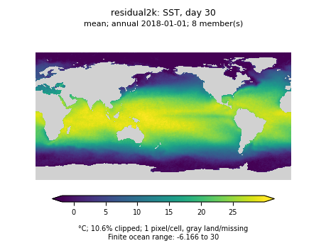 | 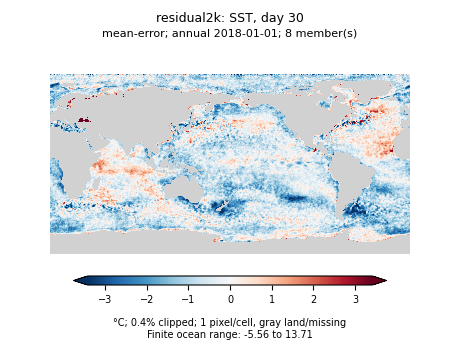 |
| Diffusion draw 1 |  | 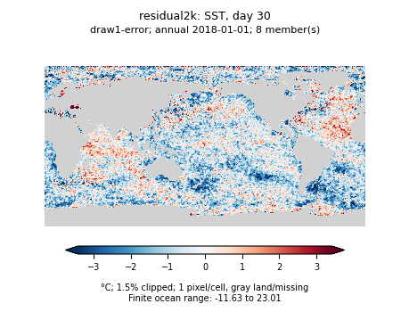 |
| U-global mixed | 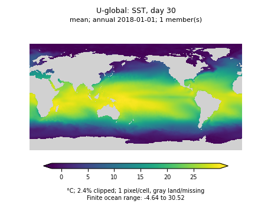 | 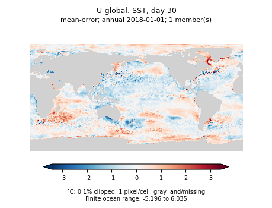 |
| Obs-only 8k |  | 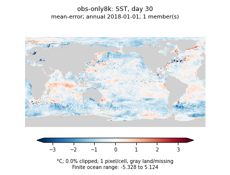 |

[Reference](scratch-replay-grain-assets/annual/residual2k-thetao_0-day30-reference.png) · [Diffusion spread](scratch-replay-grain-assets/annual/residual2k-thetao_0-day30-spread.png)

## SST, day 365

| Method | Prediction | Error |
| --- | --- | --- |
| Diffusion mean of 8 | 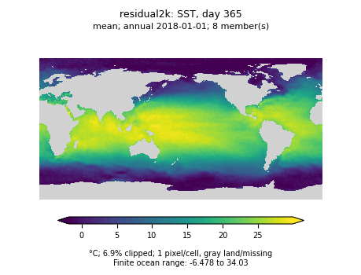 | 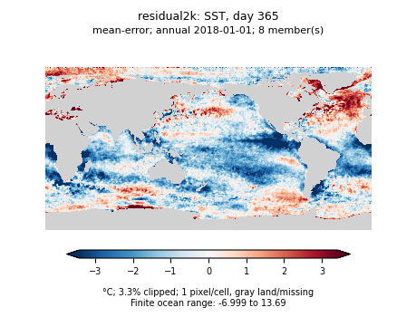 |
| Diffusion draw 1 | 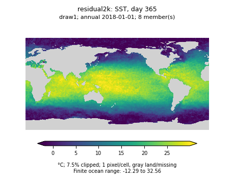 | 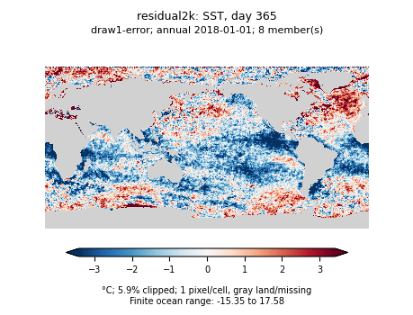 |
| U-global mixed |  | 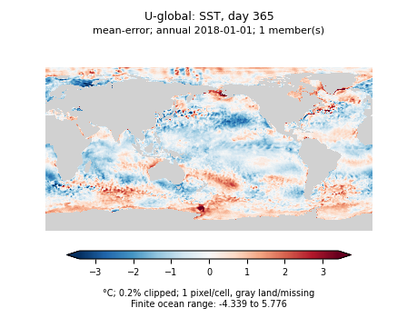 |
| Obs-only 8k |  | 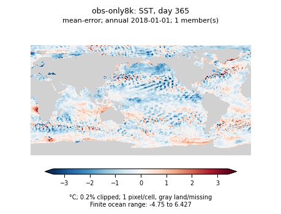 |

[Reference](scratch-replay-grain-assets/annual/residual2k-thetao_0-day365-reference.png) · [Diffusion spread](scratch-replay-grain-assets/annual/residual2k-thetao_0-day365-spread.png)

## SSH, day 30

| Method | Prediction | Error |
| --- | --- | --- |
| Diffusion mean of 8 |  | 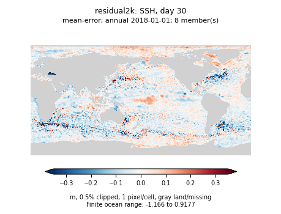 |
| Diffusion draw 1 | 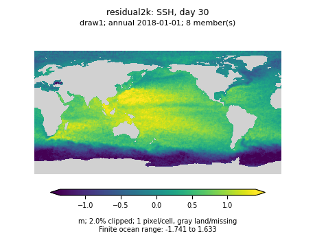 | 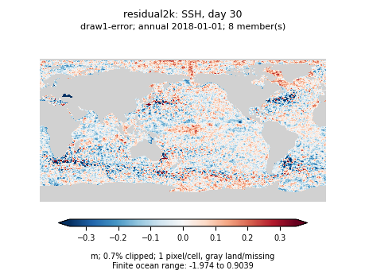 |
| U-global mixed |  | 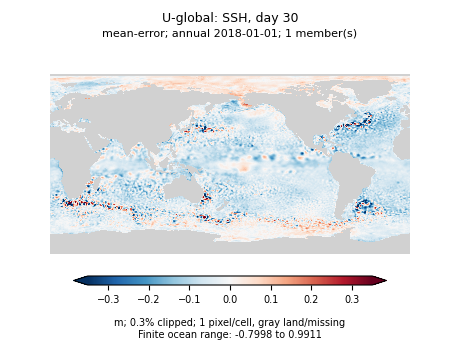 |
| Obs-only 8k |  | 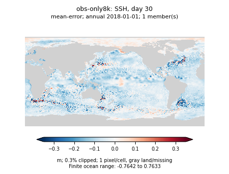 |

[Reference](scratch-replay-grain-assets/annual/residual2k-zos-day30-reference.png) · [Diffusion spread](scratch-replay-grain-assets/annual/residual2k-zos-day30-spread.png)

## SSH, day 365

| Method | Prediction | Error |
| --- | --- | --- |
| Diffusion mean of 8 |  | 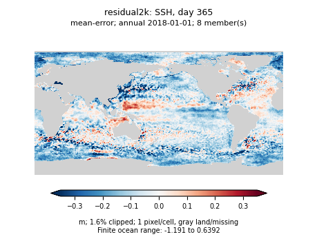 |
| Diffusion draw 1 | 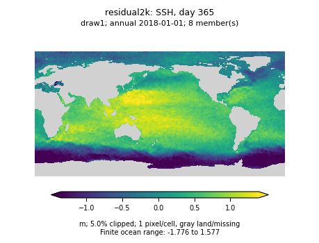 | 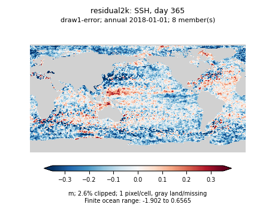 |
| U-global mixed | 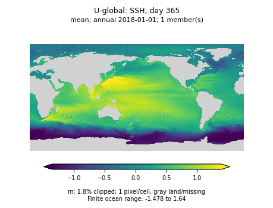 | 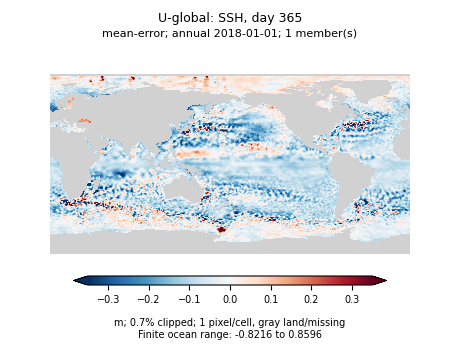 |
| Obs-only 8k |  | 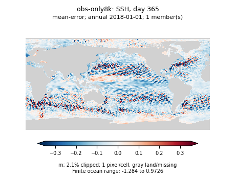 |

[Reference](scratch-replay-grain-assets/annual/residual2k-zos-day365-reference.png) · [Diffusion spread](scratch-replay-grain-assets/annual/residual2k-zos-day365-spread.png)

## OM4 initialization: interior reconstruction

These native OM4 examples have aligned instantaneous truth at initialization, unlike the observation monthly interior targets. They use the native evaluation example saved for 2018, not the observation rollout above.

### Temperature level 9

| Reference | Mean error | Draw 1 error |
| --- | --- | --- |
| 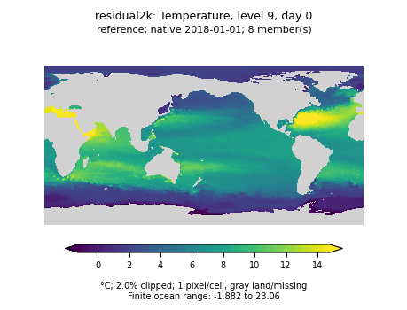 | 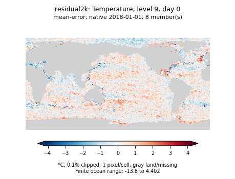 | 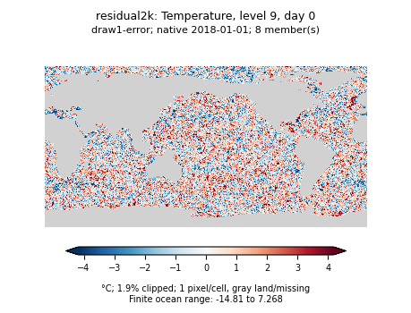 |

### Salinity level 9

| Reference | Mean error | Draw 1 error |
| --- | --- | --- |
| 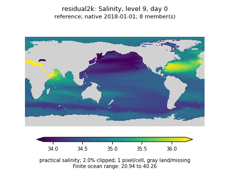 | 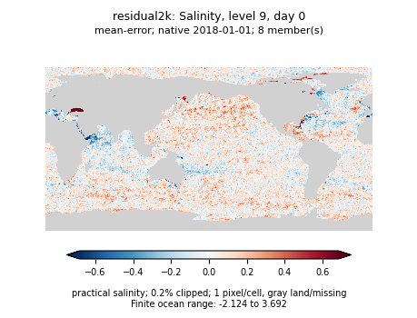 | 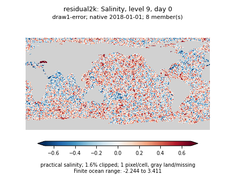 |
