<!--
SPDX-FileCopyrightText: 2026 Samudra Authors
SPDX-License-Identifier: CC-BY-4.0
-->

# Residual replay: 4k versus 6k observation-update maps

These shared-scale maps compare the continuing mixed-training residual model at 4,000 and 6,000 observation updates. They do **not** compare the separate observation-only cooldown fork. See the [main metrics report](scratch-replay-residual-6k.md) for task counts and aggregate rollout results.

For this 2018 origin, day-30 SST errors are smaller at 6k, but the draw still contains visible spatial texture and structured bands. Native salinity members remain conspicuously grainy both at initialization and at day 365; the mean changes its broad bias pattern rather than becoming uniformly more accurate. Annual SSH also changes its regional error pattern. These maps do not establish that grain is solved, and better surface examples do not establish better deep-ocean heat content or aggregate annual skill.

Each cell occupies exactly one pixel in the saved map, without interpolation or smoothing. Open images at native size if the browser scales this table. Gray denotes land or missing data. Physical, error, and spread scales are shared across both checkpoints and all selected leads **within each channel and source**. Reference percentiles define physical ranges; pooled absolute errors define error ranges. Legends and JSON metadata record clipping and full ranges. Error is prediction minus reference; spread is pointwise sample standard deviation, not error.

The mean uses eight members. Draw 1 uses an independent sample at each lead and is not a coherent trajectory. Annual observed SST/SSH are five-day verification bins; native OM4 fields use their output cadence. Native day 0 tests surface-conditioned reconstruction against OM4, not an observed interior gold standard.

## Observed SST, day 30

| Residual 4k | Residual 6k |
| --- | --- |
| 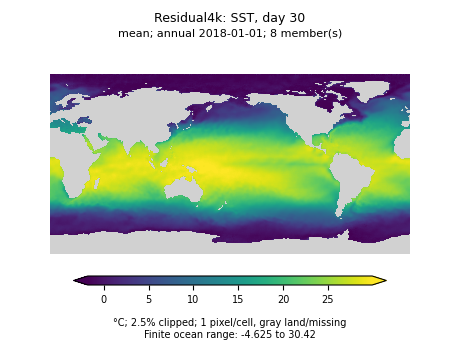 | 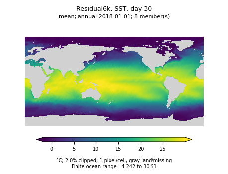 |
| 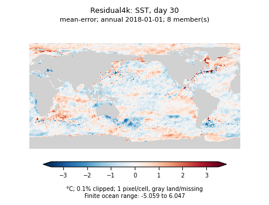 | 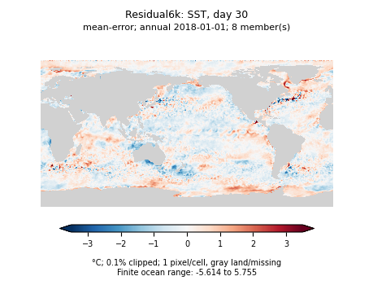 |
| 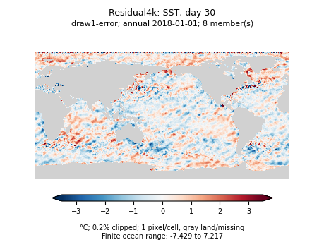 | 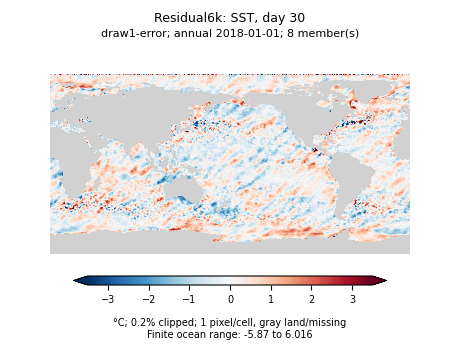 |

[Reference](scratch-replay-residual-6k-assets/annual/Residual6k-thetao_0-day30-reference.png), [6k single draw field](scratch-replay-residual-6k-assets/annual/Residual6k-thetao_0-day30-draw1.png), [6k spread](scratch-replay-residual-6k-assets/annual/Residual6k-thetao_0-day30-spread.png).

## Observed SSH, day 365

| Residual 4k | Residual 6k |
| --- | --- |
| 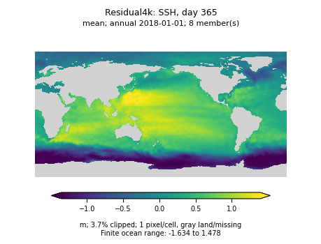 |  |
| 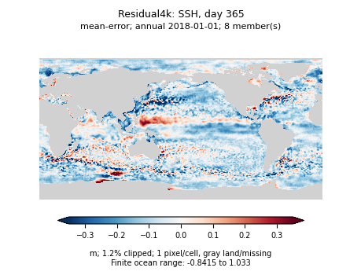 | 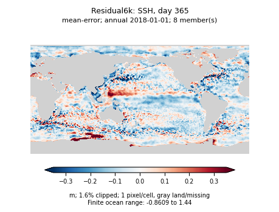 |
| 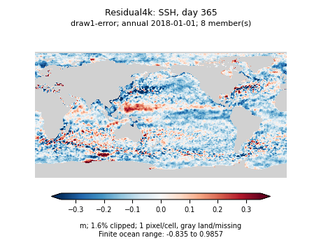 | 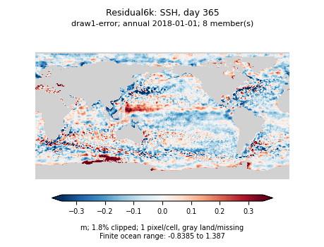 |

[Reference](scratch-replay-residual-6k-assets/annual/Residual6k-zos-day365-reference.png), [6k single draw field](scratch-replay-residual-6k-assets/annual/Residual6k-zos-day365-draw1.png), [6k spread](scratch-replay-residual-6k-assets/annual/Residual6k-zos-day365-spread.png).

## OM4 salinity reconstruction, day 0, level 9 (550 m)

| Residual 4k | Residual 6k |
| --- | --- |
| 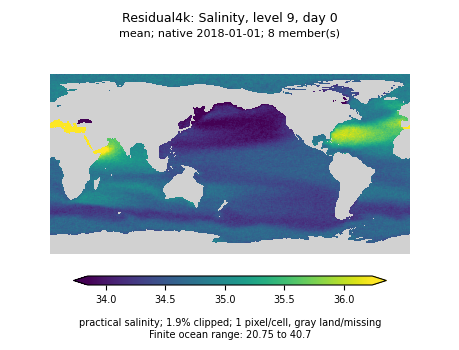 | 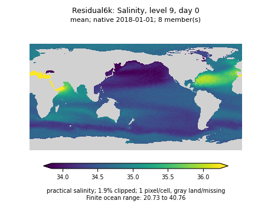 |
| 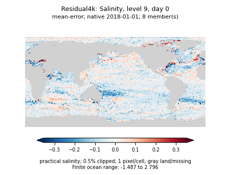 | 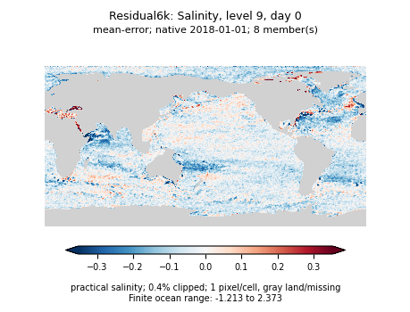 |
| 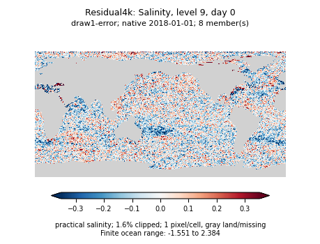 | 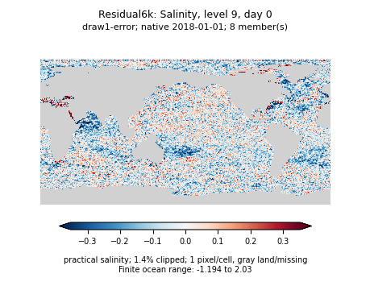 |

[Reference](scratch-replay-residual-6k-assets/native/Residual6k-so_9-day0-reference.png), [6k single draw field](scratch-replay-residual-6k-assets/native/Residual6k-so_9-day0-draw1.png), [6k spread](scratch-replay-residual-6k-assets/native/Residual6k-so_9-day0-spread.png).

## OM4 salinity, day 365, level 9 (550 m)

| Residual 4k | Residual 6k |
| --- | --- |
| 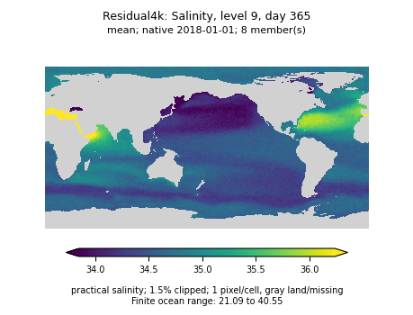 |  |
| 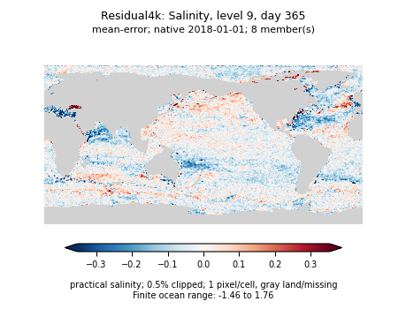 | 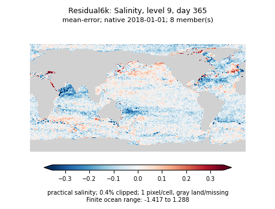 |
| 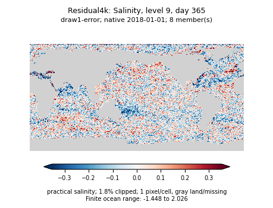 | 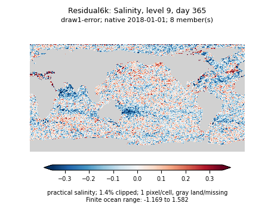 |

[Reference](scratch-replay-residual-6k-assets/native/Residual6k-so_9-day365-reference.png), [6k single draw field](scratch-replay-residual-6k-assets/native/Residual6k-so_9-day365-draw1.png), [6k spread](scratch-replay-residual-6k-assets/native/Residual6k-so_9-day365-spread.png).

## Single-map error checks

These are unweighted RMSEs over finite ocean cells for the pictured origin, not the climatology-normalized blended metric. They illustrate why changes in appearance should be checked against error and bias rather than interpreted as a universal improvement.

| Map | 4k mean RMSE | 6k mean RMSE | 4k draw-1 RMSE | 6k draw-1 RMSE |
| --- | ---: | ---: | ---: | ---: |
| Observed SST, day 30 (°C) | 0.64105 | 0.57722 | 0.82902 | 0.73122 |
| Observed SSH, day 365 (m) | 0.12333 | 0.12326 | 0.13317 | 0.12936 |
| OM4 salinity level 9, day 0 | 0.08861 | 0.09239 | 0.14106 | 0.13489 |
| OM4 salinity level 9, day 365 | 0.08928 | 0.08845 | 0.14334 | 0.13456 |

## Full panel collections

The [annual directory](scratch-replay-residual-6k-assets/annual) contains SSH/SST reference, ensemble mean, draw 1, both error panels, and spread at days 30 and 365. The [native directory](scratch-replay-residual-6k-assets/native) contains the same panels for SSH/SST and level-9 temperature/salinity at days 0, 30, and 365.

[Annual metadata](scratch-replay-residual-6k-assets/annual/map-ranges.json) and [native metadata](scratch-replay-residual-6k-assets/native/map-ranges.json) contain shared scale limits, finite/nonfinite counts, clipping fractions, unclipped ranges, and unweighted map error/bias diagnostics. Filenames identify checkpoint, variable, lead, and panel. All PNGs remain below the repository asset-size limit.
