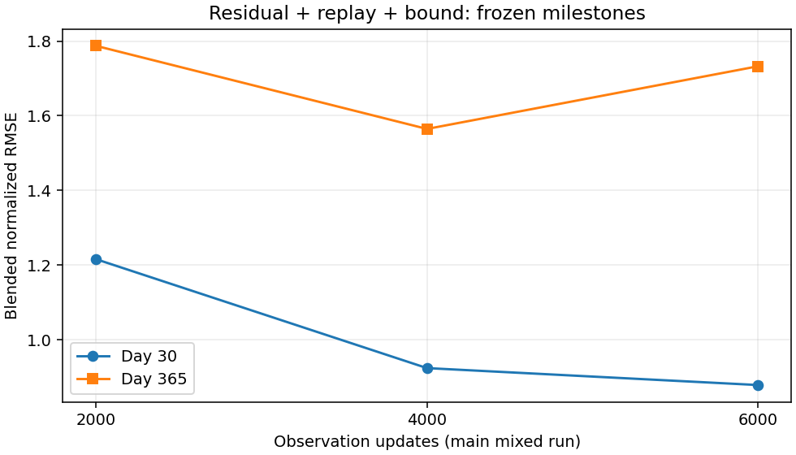
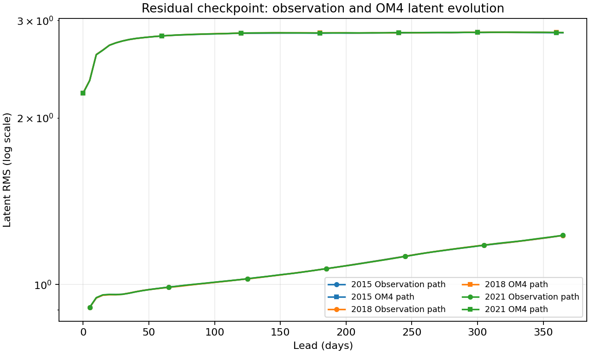

<!-- SPDX-FileCopyrightText: 2026 Samudra Authors -->
<!-- SPDX-License-Identifier: CC-BY-4.0 -->

# Residual scratch model at 6k observation updates

The main mixed residual run continues to improve short-lead accuracy, but its
annual error is **10.7% worse than at 4k observation updates**. The annual
regression is chiefly deep ocean heat content; SST and SSH errors improve
slightly. There is no return of the catastrophic direct-arm explosion.

This is the original mixed-training trajectory, **not** the separate
observation-only cooldown branch. The checkpoint contains **6,000 observation +
8,960 OM4 updates** and has not reached the main run's scheduled LR cooldown.

## Matched annual scores

Three January origins (2015, 2018, 2021), eight-member ensemble means, 32
sampling steps and identical annual data manifests are used at every milestone.
Lower is better.

| Frozen endpoint | Observation / OM4 updates | Day-30 blended RMSE | Day-365 blended RMSE |
|---|---:|---:|---:|
| Residual main, 2k | 2,000 / 5,561 | 1.216 | 1.787 |
| Residual main, 4k | 4,000 / 7,721 | 0.923727 | **1.564689** |
| Residual main, 6k | 6,000 / 8,960 | **0.878310** | 1.732721 |
| Separate 4k-parent obs-only cooldown, raw | 4,500 / 7,721 | 0.878803 | 2.028578 |
| Separate 4k-parent obs-only cooldown, EMA | 4,500 / 7,721 | 0.875726 | 1.872391 |
| Historical deterministic | 8,000 / 8,000 | 0.902424 | 1.195355 |

The 6k endpoint improves day-30 error by **4.9%** versus 4k, while annual error
rises **10.7%**. Its annual error is lower than either obs-only cooldown
endpoint, but the branches differ in both training exposure and LR schedule.
The deterministic model is historical context, not a matched model or compute
control. Short-lead agreement with its score does not imply comparable annual
accuracy.



[Exact milestone components](scratch-replay-residual-6k-assets/milestone-components.csv)
· [Per-origin 4k/6k and historical comparisons](scratch-replay-residual-6k-assets/blended-components.csv).

The blend averages four RMSE ratios to pooled training seasonal climatology:
SST, SSH-derived geostrophic velocity, OHC 0–700 m and OHC 700–2000 m. Pooling
uses the square root of the mean squared per-origin RMSE. Day 30 uses the
corresponding surface bin and January mean OHC; day 365 uses the last surface
bin and December mean OHC. This score **has no spectral term**. SSH RMSE below
is diagnostic, not an additional blend component.

| Day-365 physical error | Main 4k | Main 6k |
|---|---:|---:|
| SST (°C) | 1.3793 | **1.3119** |
| SSH (m) | 0.12737 | **0.12553** |
| Geostrophic velocity (m/s) | **0.17008** | 0.17496 |
| OHC 0–700 m (GJ/m²) | 1.5298 | 1.5280 |
| OHC 700–2000 m (GJ/m²) | **0.7341** | 0.9961 |

Deep OHC RMSE rises **35.7%**, while upper OHC is essentially unchanged. This
is physical prediction drift despite bounded latents, rather than numerical
blow-up. [Surface errors by lead](scratch-replay-residual-6k-assets/surface-leads.csv).

## Validation and member calibration

The separate nine-origin November 2013–July 2014 blended spectral validation
score decreases from **1.318347 at 2k → 0.761864 at 4k → 0.680448 at 6k**.
That is a different cohort and objective from the annual RMSE blend; neither
its value nor its continued improvement establishes annual improvement.
[Validation milestones](scratch-replay-residual-6k-assets/validation-milestones.csv).

| Group | 6k spread/RMSE | 6k empirical central-90% coverage |
|---|---:|---:|
| SST | 0.769 | 0.647 |
| SSH | 0.843 | 0.642 |
| Interior temperature | 0.763 | 0.637 |
| Interior salinity | 0.677 | 0.646 |

Pointwise fair CRPS improves in every group compared with 4k, but interval
coverage falls in every group. Coverage and spread are computed from eight
samples, and interior diagnostics use temporally averaged predictions. These
are not spatial- or temporal-coherence metrics. Separate diffusion draws at
successive leads do not constitute coherent sampled trajectories.
[Calibration and CRPS](scratch-replay-residual-6k-assets/validation-calibration.csv).

[Matched 4k/6k maps and member error maps](scratch-replay-residual-6k-maps.md).

## Native reconstruction and latent evolution

Native OM4 reconstruction and rollout diagnostics improve for the inspected
550 m temperature/salinity channels. Averaging those two channels and the three
origins, ensemble-mean normalized MSE at lead zero decreases from **0.04325 to
0.03638**, and at day 365 from **0.04471 to 0.03851**. Mean member normalized
MSE decreases from **0.11236 to 0.08885** at lead zero and **0.11626 to 0.09364**
at day 365. This limited channel diagnostic does not establish improvement for
all fields or prove that visible grain has disappeared. The units are squared
training-normalized units, not physical RMSE.
[Per-origin native 550 m metrics](scratch-replay-residual-6k-assets/native-550m-metrics.csv).

At day 365, observation-path latent RMS is **1.227** across the three origins
(compared with about 1.136 at 4k). OM4-path RMS is **2.849–2.852** (about 2.55
at 4k). These are finite, modest changes rather than the direct arm's many-order
explosion. A latent magnitude bound does not enforce correct evolution.



[All latent leads and origins](scratch-replay-residual-6k-assets/latent-growth.csv).

## Verification and reproduction

Beta evaluation **214126** completed in **33 minutes 24 seconds**. The reducer
checks the parent input against its top-level completion record, all three
section receipt hashes, every exported payload hash, and equality of annual
data manifests with the existing climatology reference. The trajectory reducer
also verifies these records for the 2k and 4k checkpoints. Full receipts remain
beside the local evaluation outputs; there is no new training in this analysis.

```bash
MPLCONFIGDIR=/tmp/mpl-residual6k .venv/bin/python scripts/report_diffusion_scratch_early.py \
  --evaluation outputs/diffusion-scratch-replay-v1/evaluation/residual-obs6000 \
  --comparison outputs/diffusion-scratch-replay-v1/evaluation/residual-obs4000 \
  --baseline outputs/global-matched-v1 \
  --presentation outputs/global-matched-v1/checkpoint-annual/presentation-results.json.gz \
  --output docs/experiments/diffusion-interior-beta/scratch-replay-residual-6k-assets
MPLCONFIGDIR=/tmp/mpl-residual6k .venv/bin/python scripts/report_diffusion_residual_trajectory.py \
  --root outputs/diffusion-scratch-replay-v1/evaluation \
  --presentation outputs/global-matched-v1/checkpoint-annual/presentation-results.json.gz \
  --output docs/experiments/diffusion-interior-beta/scratch-replay-residual-6k-assets
```

The main run continues unchanged toward later checkpoints and its scheduled
cooldown. The 4k endpoint currently has the lowest annual error among these
three main-run milestones; this is descriptive monitoring, not a new selection
rule. [Obs-only cooldown comparison](residual-4k-cooldown-results.md).
