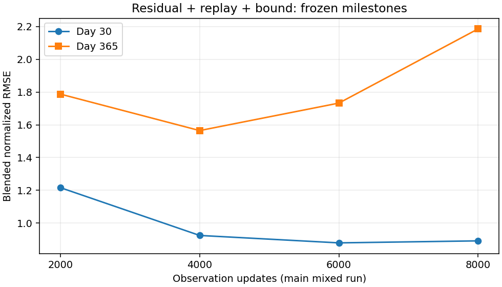
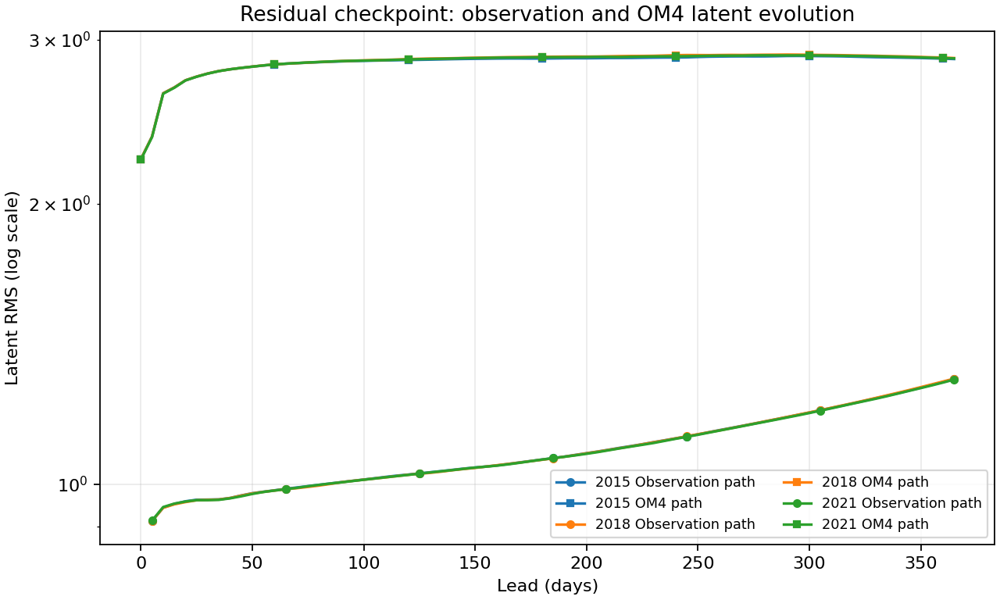

<!-- SPDX-FileCopyrightText: 2026 Samudra Authors -->
<!-- SPDX-License-Identifier: CC-BY-4.0 -->

# Residual scratch model at 8k observation updates

The 8k checkpoint regresses relative to 6k: day-30 blended RMSE rises **1.4%**,
and day-365 error rises **26.2%**. All annual blend components worsen, most
strongly deep ocean heat content. Latents remain finite; this is worsening
physical prediction accuracy rather than the catastrophic direct-arm explosion.

The evaluated checkpoint contains **8,000 observation + 9,708 OM4 updates**,
step **17,708**, and is **before cooldown**. The scheduled main-run cooldown
starts at step 17,780. Training has since entered that cooldown, so these scores
do not measure its effect. This is the main mixed trajectory, not the separate
4k-parent observation-only continuation.

## Frozen annual comparison

Three January origins (2015, 2018, 2021), eight-member ensemble means, 32 sampling
steps and matching annual data manifests are used throughout. Lower is better.

| Endpoint | Observation / OM4 updates | Day-30 blend | Day-365 blend |
|---|---:|---:|---:|
| Main residual, 2k | 2,000 / 5,561 | 1.215764 | 1.787477 |
| Main residual, 4k | 4,000 / 7,721 | 0.923727 | **1.564689** |
| Main residual, 6k | 6,000 / 8,960 | **0.878310** | 1.732721 |
| Main residual, 8k | 8,000 / 9,708 | 0.890656 | 2.186175 |
| Separate 4k-parent obs-only cooldown, raw | 4,500 / 7,721 | 0.878803 | 2.028578 |
| Separate 4k-parent obs-only cooldown, EMA | 4,500 / 7,721 | 0.875726 | 1.872391 |
| Historical deterministic | 8,000 / 8,000 | 0.902424 | 1.195355 |

The 4k checkpoint remains the lowest annual error among the measured main-run
milestones. That is a descriptive observation, not a new test-set selection
rule. The historical deterministic row differs in model/training configuration;
close short-lead scores do not establish comparable annual performance. The
obs-only branch also differs in exposure and LR schedule.



[Exact milestone components](scratch-replay-residual-8k-assets/milestone-components.csv)
· [Per-origin 6k/8k and historical comparisons](scratch-replay-residual-8k-assets/blended-components.csv).

The blend averages four RMSE ratios to pooled training seasonal climatology:
SST, SSH-derived geostrophic velocity, OHC 0–700 m and OHC 700–2000 m. RMSE
pooling is the square root of mean squared per-origin RMSE. Day 30 uses its
surface bin and January OHC; day 365 uses its surface bin and December OHC.
OHC is a calendar-month mean. **There is no spectral term in this blend.**
SSH RMSE is a separate diagnostic, not a fifth component.

| Day-365 physical error | Main 6k | Main 8k |
|---|---:|---:|
| SST RMSE (°C) | 1.3119 | 1.4905 |
| SSH RMSE (m) | 0.12553 | 0.14301 |
| Geostrophic velocity RMSE (m/s) | 0.17496 | 0.19049 |
| OHC 0–700 m RMSE (GJ/m²) | 1.5280 | 1.8213 |
| OHC 700–2000 m RMSE (GJ/m²) | 0.9961 | 1.4389 |

Deep OHC RMSE increases **44.5%**. Surface and upper OHC errors also regress;
the annual increase is not solely an artifact of one blend term.
[Surface errors by lead](scratch-replay-residual-8k-assets/surface-leads.csv).

## Validation, spread and native reconstruction

The separate nine-origin November 2013–July 2014 blended spectral validation
score is **0.710925**, worse than **0.680448 at 6k** but better than **0.761864
at 4k**. This cohort and metric differ from the annual table: the validation
score includes spectral terms. [Validation milestones](scratch-replay-residual-8k-assets/validation-milestones.csv).

| Group | 8k spread/RMSE | 8k empirical central-90% coverage |
|---|---:|---:|
| SST | 0.675 | 0.594 |
| SSH | 0.711 | 0.585 |
| Interior temperature | 0.666 | 0.583 |
| Interior salinity | 0.576 | 0.583 |

Every group's fair CRPS, spread/RMSE ratio and interval coverage worsens versus
6k. Members are underdispersed under these diagnostics. The central interval is
estimated from eight members; these are pointwise measures, not spatial or
temporal coherence tests. Interior diagnostics use temporally averaged
predictions. [Full calibration values](scratch-replay-residual-8k-assets/validation-calibration.csv).

Native OM4 diagnostics are mixed. Averaging normalized MSE across temperature
and salinity at 550 m and the three origins, lead-zero ensemble-mean MSE rises
from **0.03638 to 0.03810**, while mean member MSE falls from **0.08885 to
0.08629**. At day 365, mean MSE rises from **0.03851 to 0.04147** and member
MSE from **0.09364 to 0.09501**. These are squared training-normalized units,
not physical RMSE, and cover only the stated channels. Better member
reconstruction MSE alone is not evidence that grain has disappeared.
[Per-origin native channel diagnostics](scratch-replay-residual-8k-assets/native-550m-metrics.csv).

[Matched 6k/8k maps and member errors](scratch-replay-residual-8k-maps.md).

## Latent evolution

At day 365, observation-path RMS spans **1.295–1.298**, compared with about
1.227 at 6k. Native OM4 RMS spans **2.861–2.867**, compared with 2.849–2.852.
The magnitude penalty continues to accompany finite trajectories, but does not
ensure physically accurate evolution or prevent accumulated bias.



[All origins and leads](scratch-replay-residual-8k-assets/latent-growth.csv).

## Execution and reproduction

Beta evaluation **214266** completed in **33 minutes 28 seconds**. All exported
payload hashes, section receipt hashes, top-level input/completion equality and
annual manifest compatibility passed verification after transfer. The trajectory
reducer verifies all four main-run milestone exports. No new training or
checkpoint selection is performed by this report.

```bash
MPLCONFIGDIR=/tmp/mpl-residual8k .venv/bin/python scripts/report_diffusion_scratch_early.py \
  --evaluation outputs/diffusion-scratch-replay-v1/evaluation/residual-obs8000 \
  --comparison outputs/diffusion-scratch-replay-v1/evaluation/residual-obs6000 \
  --baseline outputs/global-matched-v1 \
  --presentation outputs/global-matched-v1/checkpoint-annual/presentation-results.json.gz \
  --output docs/experiments/diffusion-interior-beta/scratch-replay-residual-8k-assets
MPLCONFIGDIR=/tmp/mpl-residual8k .venv/bin/python scripts/report_diffusion_residual_trajectory.py \
  --root outputs/diffusion-scratch-replay-v1/evaluation \
  --presentation outputs/global-matched-v1/checkpoint-annual/presentation-results.json.gz \
  --output docs/experiments/diffusion-interior-beta/scratch-replay-residual-8k-assets \
  --milestones 2000 4000 6000 8000
```

The next authorized result is the main run after its scheduled cooldown.
This pre-cooldown regression gives no assurance that cooldown will recover
annual accuracy. The direct arm remains cancelled. See the
[6k report](scratch-replay-residual-6k.md) and
[separate obs-only cooldown](residual-4k-cooldown-results.md).
