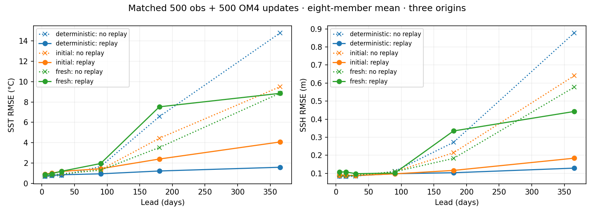
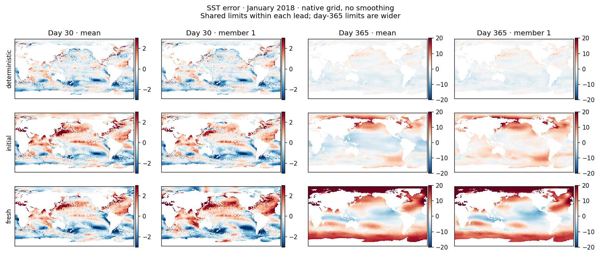
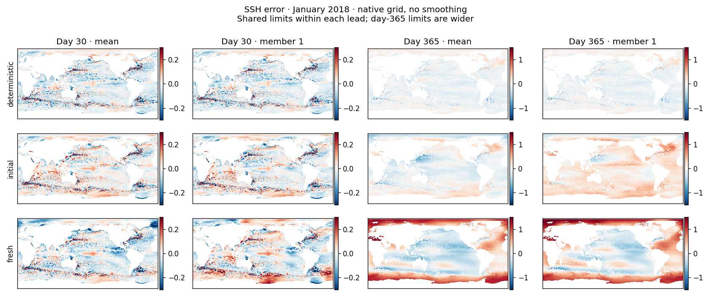

<!-- SPDX-FileCopyrightText: 2026 Samudra Authors -->
<!-- SPDX-License-Identifier: CC-BY-4.0 -->

# Stochastic latent trajectories with observation and OM4 replay

Question: does exposure to long, uninterrupted model trajectories prevent the
annual drift in the [first stochastic-state pilot](stochastic-state-results.md),
and does transition noise help once all arms receive that exposure?

This wave imports the observation replay policy from the multitask grid-search
[monthly replay campaign](https://github.com/m2lines/Samudra/blob/57e42cc32/docs/experiments/observation-d/monthly-replay-2026-10-20.md).
It adapts that policy to persistent ensemble latent states and a deterministic
physical decoder, and extends the same lead-balanced replay mechanism to OM4. It does not import the monthly model's diffusion objective.

## Three matched arms

| Arm | Initial latent | Latent transitions | Physical decoding |
|---|---|---|---|
| deterministic | Deterministic | Deterministic | Deterministic |
| initial | Sampled once per member | Deterministic | Deterministic |
| fresh | Sampled once per member | Fresh learned innovations each step | Deterministic |

Each starts from the same fresh parameter tensors and seed 1729, with
**500 observation + 500 OM4 optimizer updates**, effective batch eight,
two training members, width-64 decoder, and a cosine LR cooldown over the last
20% of mixed updates. These are fresh runs, not extensions of cooled pilot
weights. The prior no-replay 500/500 arms provide reference comparisons.
The correlated-noise arm is omitted from this small follow-up.

All arms retain the previous pilot's full-latitude ocean mask, normalization,
surface history, ERA5/OM4 forcings, and data split. They retain its physical-field
CRPS and wet-neighbor objectives, accessory reconstruction/completion objectives,
and **0.1 latent-magnitude penalty**. The source monthly replay campaign had no
latent bound and used a diffusion denoising objective; its scores are therefore
context, not matched controls for these arms.

## Replay policy

Both observation and OM4 updates use four fresh examples and four replay
continuations when an eligible state exists, with separate replay pools. Fresh
observation examples initialize from the existing 95-day observed surface history and save
a detached member-specific two-slot latent history at the exact boundary needed
for the next calendar month. Replay uses later ERA5 forcing and calendar context
and supervises that month's observations. It never resets the continued state
from a later observed ocean field or feeds an ensemble mean back into evolution.

Backpropagation spans only the current calendar month; it stops at the cached
latent. The separate reconstruction branch uses the target month's surface
history without inserting that state into the continued trajectory. Every member
retains its own trajectory; fresh-transition arms draw new innovations after the
cached boundary. The decoder has no explicit lead embedding. Calendar context and forcing retain
the original trajectory timestamps.

The pool holds eight entries in each of eleven subsequent calendar-month lead
buckets. Sampling is uniform across occupied buckets, then within a bucket.
States expire 250 optimizer updates after their original initialization,
including intervening OM4 updates; continuation does not refresh their age.
A trajectory cannot exceed 73 five-day steps or the original training target
split. Pool tensors, original timestamps, separate replay RNG, optimizer and
training RNG are checkpointed. Reports will show actual replay lead exposure and
state age; permitting a year is not proof that training sampled it.

OM4 replay advances through six native five-day steps per chunk (30 days), with
up to eleven continued chunks after the fresh chunk: 72 steps or 360 days in
total. Its separate pool likewise holds eight entries per lead bucket, samples
uniformly among occupied buckets, and expires states 250 optimizer updates
after original initialization. OM4 continuations use later model forcings and
full-state targets from the existing training split. They preserve each member's
latent history and never replace it with the later gold state. Initial-interior
and hidden-completion accessory losses remain separate fresh branches; they do
not reset continued forecasts. This is truncated backpropagation through one
30-day chunk, not a full-year differentiable rollout. Native pool contents and
its separate replay RNG are also serialized; actual lead and age exposure are
reported separately for observations and OM4.

## Reused interval data

Monthly files have different five-day phases, so simply concatenating adjacent
monthly payloads would misalign forcing and targets. We reuse the prepared
read-only interval cache at
`beta:/projects/ny/lz1955/multiscale/jrusak/runs/monthly-replay-20261020/replay-cache`.
It contains 7,397 intervals (19,173,024,128 bytes in `values.npy`), training months
May 1993–July 2013, bin starts through July 31 and required raw days through
August 4, 2013. Its receipt records exact equality with the future surface and
forcing payloads in all 243 original training months.

Before this wave, all three cache files were read back and matched the receipt;
the live grid, statistics and sample checksum-list contracts also matched.
Receipt SHA256:
`b2fd3b9b7bc906b70cde261706f470741744704bd374e19e594ddfb95d184720`.
No new upstream download or validation/test targets enter replay training.

## Qualification, evaluation and budget

Qualification performs four mixed updates, restores the checkpoint for four more,
and verifies real replay usage, source/optimizer/replay provenance, gradients,
matched initialization and ensemble exports. A separate qualification-only
chain backpropagates finite month-local losses through observation continuations
ending at day 365, and six-step chunk losses through OM4 continuations ending
at day 360, without parameter updates or later gold-state resets. Both pools
must show real training usage and survive resume. These smoke weights never
initialize production.

The initial observation-only qualification submission, job 215520, was cancelled
before starting (zero elapsed time and GPU cost) when the requested scope was
clarified to include both observation and OM4 replay. It did not produce weights
or qualify this expanded design.

Evaluate at 125, 250 and 500 observation updates. The first two screens use the
2018 annual case; the final evaluation uses the same three January starts
(2015, 2018, 2021), 73 native five-day steps, eight members, and the existing
monthly validation cohort. Inspect 30/365-day ensemble-mean and individual-member
errors/maps, regional spectra, temporal coherence, calibration, and annual
surface/interior error growth. Compare all three replay arms and the prior
matched no-replay endpoints; do not select checkpoints on the annual test cases.

Campaign root:
`beta:/projects/ny/lz1955/multiscale/jrusak/runs/stochastic-state-replay-v1`.
Three independent single-GPU processes share one four-GPU Beta production node;
the fourth GPU is idle and still counted in allocation cost. The initial cap is
40 allocated GPU-hours including qualification and evaluation, with an eight-hour
production allocation (32 GPU-hours). Production uses online W&B and durable
completion monitoring. No follow-on extension is authorized by this plan.

Implementation: [replay adapter](../../../src/samudra/experiments/stochastic_state_replay.py),
[trainer](../../../src/samudra/experiments/stochastic_state_train.py),
[worker runner](../../../scripts/stochastic_replay_beta_workers.sh),
[qualification](../../../scripts/qualify_stochastic_replay.py).

## Completed results

Qualification **215523** and production **215524** both completed successfully.
Production took 5h26m46s; total allocated compute including qualification was
**22.42 GPU-hours**. Every arm completed 500 observation + 500 OM4 updates and
cooled to 1e-6. All 84 final payload hashes were verified remotely; retrieved
metrics and map archives also matched their completion receipts.

**Replay strongly stabilizes the deterministic arm, partially helps initial-only
noise, and does not resolve fresh-transition-noise SST drift.** This reverses the
ranking of the no-replay pilot and argues against selecting an uncertainty
mechanism without training it on long trajectories.

| Arm | Day30 SST, no replay → replay (°C) | Day365 SST, no replay → replay (°C) | Day365 SSH, no replay → replay (m) |
| --- | ---: | ---: | ---: |
| Deterministic | 0.782 → 0.860 | 14.767 → **1.595** | 0.878 → **0.129** |
| Initial noise only | 0.913 → 1.187 | 9.494 → **4.076** | 0.641 → **0.184** |
| Fresh transition noise | 0.950 → 1.201 | 8.862 → **8.846** | 0.577 → **0.443** |

These are eight-member mean metrics, pooled as the square root of the mean of
squared per-origin RMSEs, across January 2015/2018/2021. Day30 and day365 refer to
five-day bins ending at those leads. They are not whole-year RMSEs. Each origin
uses the same cosine-area-weighted wet support as the earlier pilot.

[Exact replay scores](stochastic-state-replay-assets/annual-rmse.csv).
The deterministic SST error reduction is about 89%; the initial-only reduction
is about 57%. Fresh-noise SSH improves despite its essentially unchanged
end-of-year SST. Short-lead SST worsens in all arms. One seed and three annual
origins do not establish a universal ordering or explain the mechanism.

### Actual replay exposure

Every arm consumed **2,000 replay observation examples and 2,000 replay OM4
examples**, alongside the same number of fresh examples for each task. Observation
start leads reached 335 days, and OM4 start leads reached 330 days, followed by
their supervised continuation windows. Both pools' observed ages stayed within
250 optimizer updates. Long-lead sampling really occurred; it was not merely a
permitted configuration. The full lead histograms are retained in
[replay exposure](stochastic-state-replay-assets/replay-exposure.json).

### Mean and member maps

These compare the same January 2018 origin, with matched limits within each lead.
The year-end limits are deliberately wider, so the faint deterministic panel
should not be read as zero error. Large-scale drift remains visible in stochastic
members, especially the fresh-noise arm. These are compressed previews rendered
without smoothing; numerical maps and full members remain in the remote NPZ files.
Member identities are persistent throughout each rollout.

Short-lead nominal 90% empirical eight-member interval coverage was about
69%/84% for initial-noise SST/SSH and 65%/70% for fresh-noise SST/SSH, pooled over
the nine validation months. These are pointwise metrics with finite-ensemble
quantile limitations, not evidence of calibrated annual uncertainty.
[Calibration summary](stochastic-state-replay-assets/calibration-summary.json).

### What this suggests

The deterministic result shows that the present data, processor and decoder can
learn substantially more stable evolution with this replay recipe. The failure
of fresh transition noise therefore deserves focused diagnosis rather than a
blanket increase in training budget. Plausible causes include overly large learned
innovations, an unstable response to state perturbations, and difficulty learning
from cached stochastic states produced by older parameters. These remain
hypotheses; the current comparison does not distinguish them.

Before another training wave, measure latent/innovation RMS versus lead and
perform paired rollouts of the trained fresh-noise model with its transition
innovations scaled to zero, 0.25, 0.5 and one, while preserving the initial draw.
Zero-noise evaluation changes its training distribution, so it is a diagnostic,
not a replacement matched control. A second useful test is refreshing replay
states more frequently while keeping the sampled lead distribution matched.
No additional experiments have been launched.

### Provenance and retained outputs

Source snapshot `stochastic-replay-54d95f82609e`, implementation commit `f9ef9bdbf`.
The source was staged with 231 verified file hashes. All 23 focused tests and
repository checks passed. Qualification exercised both full-year paths with
finite local gradients and checkpoint resume before production was released.

Full metrics, calibration, regional member spectra, temporal statistics,
initialization maps, member fields and receipts are under
`beta:/projects/ny/lz1955/multiscale/jrusak/runs/stochastic-state-replay-v1/runs/{arm}/evaluation/final-obs500`.
The earlier no-replay comparisons retain their separate root and source. The two
sources of replay were added together, so this wave does not identify whether
observation replay, OM4 replay, or their combination produced the improvement.
