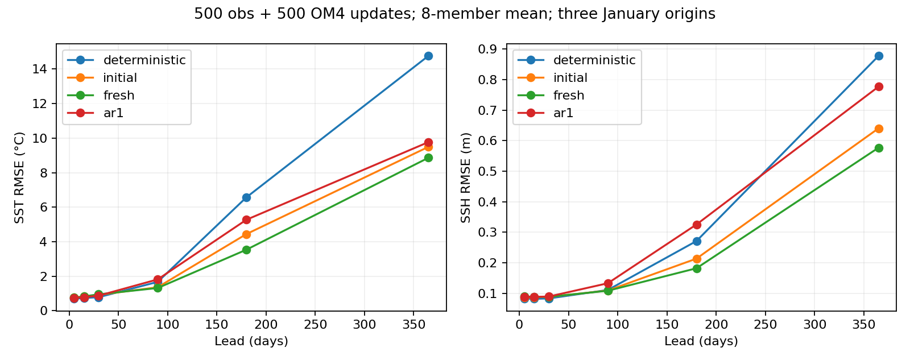
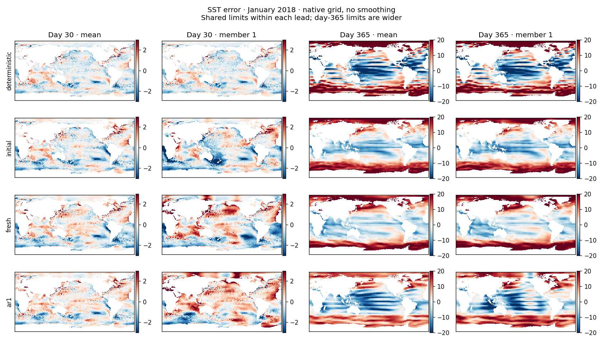
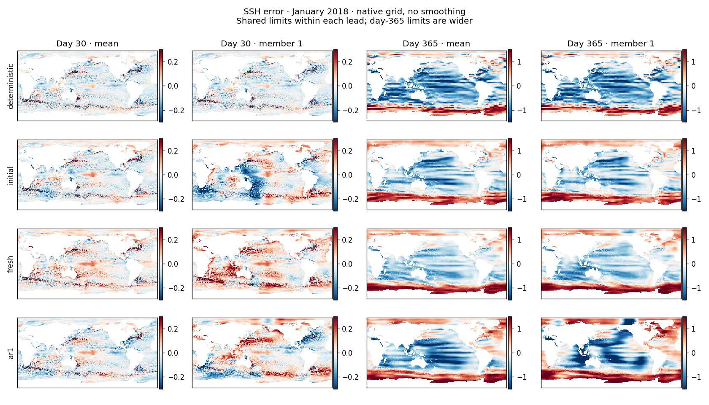

<!-- SPDX-FileCopyrightText: 2026 Samudra Authors -->
<!-- SPDX-License-Identifier: CC-BY-4.0 -->

# Stochastic latent trajectory pilot: results

All four arms completed 500 observation and 500 OM4 updates, including the final
20% learning-rate cooldown. Fresh transition noise reduced annual errors relative
to the matched deterministic pilot, but **none achieved stable annual forecasts**.
The deterministic pilot retained the best short-lead accuracy. These are fresh,
small-budget models, not continuations of the historical diffusion checkpoint.

## Annual forecast errors

Eight-member mean, three January starts (2015, 2018, 2021). Values below are
square roots of the mean of per-origin squared RMSEs, with equal origin weights;
each origin uses the existing cosine-area-weighted wet-cell metric. Day 30/365
refer to the five-day output bins ending at those leads, not whole-period RMSE.

| Arm | SST day 30 (°C) | SST day 365 (°C) | SSH day 30 (m) | SSH day 365 (m) |
| --- | ---: | ---: | ---: | ---: |
| Deterministic | 0.782 | 14.767 | 0.0833 | 0.8777 |
| Initial noise only | 0.913 | 9.494 | 0.0882 | 0.6406 |
| Fresh transition noise | 0.950 | 8.862 | 0.0887 | 0.5771 |
| Correlated transition noise | 0.872 | 9.769 | 0.0896 | 0.7771 |

Fresh noise reduces year-end SST/SSH errors by approximately 40%/34% relative to
this deterministic control. Relative to initialization-only noise, the reduction
is much smaller: approximately 7%/10%. This is one training seed, so the latter
ranking is a hypothesis for replication, not established superiority.

[Exact values at all six leads](stochastic-state-assets/annual-rmse.csv).

## Member maps and temporal behavior

The same January 2018 forecast is shown for every arm. Each member carries its own
latent state through the entire rollout. Member 1 therefore has a trajectory
identity, unlike independently sampled physical decodes at successive leads.
There is no stochastic physical decoder in these runs.

The maps still show pronounced large-scale and banded annual errors. Stochastic
members can have substantially larger early errors than their ensemble mean.
Replacing independent diffusion readouts does not by itself eliminate structured
spatial artifacts or processor drift. These figures use nearest-neighbor rendering
and no smoothing before export; the linked JPEGs are compressed previews, with
full numerical maps retained in the remote NPZ archives. The year-end color range is wider than the day-30 range.

For example, fresh-noise January 2018 members have SST lag-one correlations near
0.995 versus 0.979 in observations, and SSH correlations near 0.994 versus 0.929.
These are within-year, cell-centered, area-pooled correlations, not deseasonalized
statistics. High correlation here is not proof of realistic evolution: persistent
forecast drift can inflate it. The qualitative success is persistent member
identity; realistic temporal statistics remain unresolved.

## Short-lead calibration

Across the nine validation months, nominal 90% empirical eight-member intervals
cover approximately 67%/75% of SST/SSH targets for initialization-only noise,
67%/74% for fresh transition noise, and 78%/76% for correlated noise. These are
pointwise, area-weighted five-day surface comparisons. Eight-member empirical
quantiles have finite-ensemble limitations; this is not a calibrated 90% coverage
claim. Deterministic intervals have zero width. The validation results must not
be interpreted as year-long calibration.

[Coverage and spread/error ratios](stochastic-state-assets/calibration-summary.json).

## Interpretation and next experiment

This pilot establishes that a stochastic latent processor with deterministic
physical decoding can train on our observation setup and produce coherent member
histories. It does not establish that it resolves annual instability. Most of the
annual improvement over the deterministic pilot is already present with initial
noise alone. Correlating transition noise did not improve annual mean accuracy in
this seed, although its short-lead interval coverage was higher.

The next useful comparison is initialization-only versus fresh transition noise
with matched long-lead training/replay, retaining the deterministic arm. Keep the
current smaller architecture and budget matched, and evaluate individual members
as well as means. That separates learning stable long trajectories from choosing
an uncertainty mechanism. A second seed should precede a large investment based
on the modest fresh-versus-initial ranking. No additional runs were launched.

## Provenance

- [Experiment design and source pointers](stochastic-state-pilot.md).
- Beta production job `215378`: COMPLETED, exit 0, 3h51m25s, four B200s;
  15.43 allocated GPU-hours. Qualification `215374`: 6m59s, four B200s;
  approximately 0.47 GPU-hours. Total approximately 15.89 GPU-hours.
- Source snapshot `stochastic-state-727f254bdcb1`; implementation commit `835b65f5e`.
- All four final counts are 500 observation + 500 OM4. Three annual origins and
  nine validation months completed. All 112 final payload hashes verified remotely;
  retrieved metrics and map archives were also checked against their receipts.
- Full member fields, initialization maps, regional member/mean spectra, temporal
  diagnostics, receipts and calibration live under
  `beta:/projects/ny/lz1955/multiscale/jrusak/runs/stochastic-state-obs-v1/runs/{arm}/evaluation/final-obs500`.
- W&B: [deterministic](https://wandb.ai/ocean_emulators/default/runs/c7qbph4c),
  [initial](https://wandb.ai/ocean_emulators/default/runs/q03y2jkk),
  [fresh](https://wandb.ai/ocean_emulators/default/runs/tvsw79tv),
  [correlated](https://wandb.ai/ocean_emulators/default/runs/xgdutahz).
