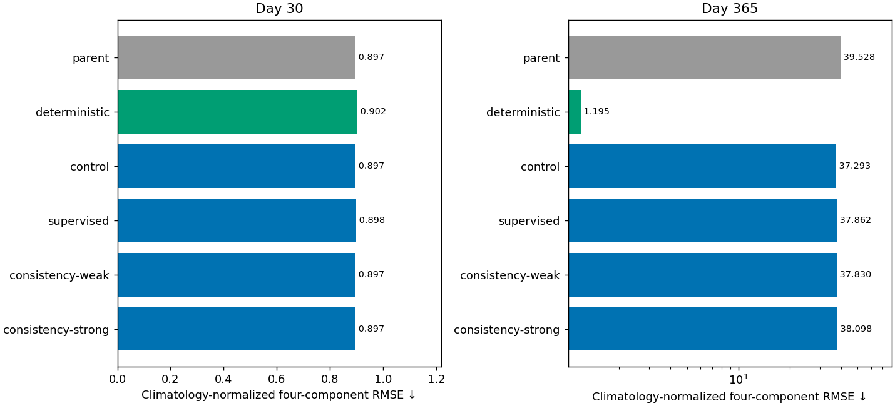
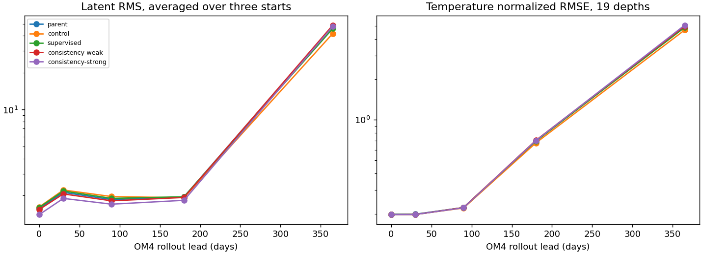
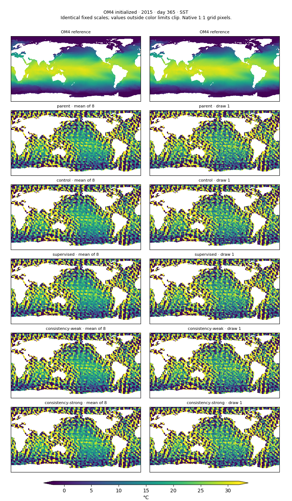

<!-- SPDX-FileCopyrightText: 2026 Samudra Authors -->
<!-- SPDX-License-Identifier: CC-BY-4.0 -->

# Five-/ten-day consistency: short continuation results

**This 128-update pilot did not reduce annual instability.** All four arms retain
nearly identical day-30 skill, but annual blended error grows roughly 42-fold.
The endpoint-consistency loss decreased substantially during training, so the
negative result is not simply that the added loss failed to optimize. Agreement
between short paths near a fresh training origin did not make this model's long
free-running trajectory stable.

This is a small, one-seed continuation of an already unstable model. It does not
rule out timestep conditioning or composition consistency trained from scratch,
at longer rollout states, or together with replay. The question here was whether
a cheap, local auxiliary objective would produce an early stability signal; it
did not.

## Matched comparison

[Protocol and implementation semantics](timestep-pilot.md).
All arms start from the same cooled 8,000-observation + 8,000-OM4 parent and
receive 128 additional optimizer updates: 64 observation and 64 OM4, effective
batch eight. Final counters are **8,064 observation / 8,064 OM4**. Optimizer,
learning-rate schedule, source draws, masks, normalization, forcings and diffusion
settings are matched. No arm uses replay or a new spatial loss. All model parts
remain trainable. Auxiliary objectives add compute, so this is update-matched,
not exactly compute-matched.

The ten-day route shares the processor backbone and output head with the normal
five-day route, adds a timestep/forcing adapter, and doubles the residual scaling.
We compare **only its day-ten latent** to the newest latent after two ordinary
five-day advances. We do not compare different historical slots. Both branches
receive gradients. For physical supervision, the decoder receives the short
path's day-five latent paired with the direct path's day-ten latent, and is
supervised on the corresponding OM4 fields. This supplies the decoder's usual
five-day-spaced history; it is not an independently evaluated variable-spacing
physical decoder. No target interior is given to the initializer.

All reported forecasts use the unchanged **five-day** inference path. The
extra adapter is absent from that path. This tests whether auxiliary training
improves the shared dynamics, not whether ten-day inference is better.

| Arm | Added OM4 objective | Day 30 | Day 365 | Day-365 / day-30 error |
|---|---|---:|---:|---:|
| Control | None | 0.89734 | 37.29270 | 41.56× |
| Supervised | 0.5 × ten-day physical denoising | 0.89794 | 37.86166 | 42.16× |
| Consistency weak | Same + 0.1 × endpoint loss | 0.89714 | 37.83017 | 42.17× |
| Consistency strong | Same + 1.0 × endpoint loss | 0.89669 | 38.09812 | 42.49× |

Lower is better. These are the existing four-component climatology-normalized
blended RMSE scores: SST, SSH-derived velocity, 0–700 m heat content and
700–2,000 m heat content. For each component, take the square root of the mean of squared origin RMSEs
over the same three January starts (2015, 2018, 2021), divide by the corresponding
training-seasonal-climatology RMSE and average the four ratios. Surface scores
use the day-30/day-365 bins; heat content uses the January/December means.
The day-365/day-30 column is a ratio of normalized scores with lead-specific
climatology denominators, not a raw physical-RMSE ratio. They are not the
validation composite or a spectral blend. SSH RMSE is reported
separately and is not substituted for the velocity component.

The best short-lead score is the strong-consistency arm, but the difference is
less than 0.1% relative to control and provides no annual benefit. All three
interventions have slightly worse annual blended error than the matched control;
with one seed, these small differences should not be treated as precise treatment
effects. The robust conclusion is the absence of a large stability improvement.

For context, the existing deterministic baseline scores **0.90242 / 1.19535** at
day 30 / day 365, while the untouched diffusion parent scores **0.89676 / 39.52786**.
The deterministic model differs in architecture and training settings. It is a
reference for the desired pattern of graceful degradation, not a controlled
architecture comparison. These continuations still display the runaway growth
that motivated the experiment.

[Component CSV](timestep-assets/annual.csv) ·
[Machine-readable results and provenance](timestep-assets/results.json)

## The auxiliary loss optimized, but annual behavior did not

Means over the first and last eight OM4 updates, using logged training batches
([numerical export](timestep-assets/training-auxiliary.csv)):

| Arm | Endpoint loss, first eight | Endpoint loss, last eight | Ten-day denoising, last eight |
|---|---:|---:|---:|
| Supervised | 0.10641 | 0.06458 | 0.34891 |
| Consistency weak | 0.08821 | 0.00417 | 0.34916 |
| Consistency strong | 0.06799 | 0.00143 | 0.34970 |

The supervised arm logs endpoint discrepancy but assigns it zero loss weight.
Endpoint discrepancy falls about 95% in the weak arm and 98% in the strong arm
between these windows. Their physical denoising losses remain similar to the
supervised arm. These are changing training batches, not a fixed held-out
composition test, so the percentages characterize optimization rather than
held-out consistency accuracy.

A locally self-consistent evolution can still be unstable. Both paths can agree
while sharing an expanding or biased trajectory, and the objective here only
sees a fresh initializer followed by ten days. It never explicitly constrains
states reached after many months of drift. The auxiliary ten-day adapter can
also help satisfy the composition objective; this pilot does not isolate how
much improvement came from that adapter versus the five-day dynamics. These are
possible explanations, not separately established causal findings.

The observed contrast with the replay campaign is useful: replay deliberately
trains from much later model-generated states, while this objective does not.
A replay-plus-consistency combination would test a different hypothesis and has
not been run here. Before scaling this particular setup, a stronger follow-up
would measure composition error on late free-running states and test whether
reducing it also improves physical error and field distributions there. Longer
training alone is not supported as a solution by this result.

## Physical fields, members and calibration

Year-end SST RMSE is **28.62°C** for control and **28.24–28.31°C** for the
consistency arms. Year-end SSH RMSE is **1.91–1.95 m** across all four arms.
These large physical errors reinforce the blended-score result: this is still
severe failure, rather than simply modest loss of small-scale forecast phase.
Slightly lower SST error in an intervention is offset by other components.

The native year-end SST maps retain catastrophic excursions in both individual
draws and ensemble means across all four arms. There is no visible recovery of
a plausible global SST field. Nine-month validation remains underdispersed:
spread/RMSE is about 0.62 for SST, 0.62–0.63 for SSH, 0.575–0.576 for
temperature and 0.528–0.530 for salinity. Nominal 90% interval coverage stays
at roughly 48–55%, with negligible differences between arms.

The following figures preserve the member view alongside ensemble means.
Independent diffusion draws at separate forecast times do not define coherent
member trajectories, so matching a member index across times must not be read
as tracking the same uncertainty realization. Native-OM4 diagnostics use a
different initialization/evaluation setting from the observational annual score;
they help locate drift and artifact behavior, but cannot replace that score.

[Day-30 SST member maps](timestep-assets/day30-sst-members.png) ·
[Day-30 SSH member maps](timestep-assets/day30-ssh-members.png) ·
[Calibration, coverage and spread/error CSV](timestep-assets/calibration.csv) ·
[Directional power diagnostics](timestep-assets/directional/directional.png)

Directional diagnostics retain individual-member power as well as power of the
ensemble mean. A directional statistic is not a unique detector of the diagonal
artifact: genuine fronts, regional geometry and spectral lattice effects also
contribute. Calibration and physical maps must be considered alongside RMSE;
consistency loss alone neither validates uncertainty nor establishes plausible
late fields.

## Execution and limitations

Beta production job **212017** completed all four arms and their prescribed
evaluations in **5:56:24**, allocating four B200s for **23.76 GPU-hours**.
Qualification job **212015** used another **0.749 allocated GPU-hours**. This is
allocation accounting, including evaluation and idle time within the job, not a
sum of GPU kernel time. Production used immutable source archive
`timestep-v1-25a5e181b345`, based on commit `7601a81d6`.

All final observation evaluations use eight diffusion draws and 32 denoising
steps, the matched annual data manifests and the same three starts. The nine-month
validation and native evaluations also completed. The run roots are
`/projects/ny/lz1955/multiscale/jrusak/runs/diffusion-timestep-v1` on Beta and
`outputs/diffusion-timestep-v1` locally. Each arm has online W&B logging under
`diffusion-interventions-timestep` and saved training events, protocol,
checkpoint-completion metadata and evaluator input manifests.

[Execution provenance and W&B links](timestep-assets/execution.json).

This is one seed, 64 additional OM4 updates per arm, and one auxiliary
parameterization. Annual cases have been consulted repeatedly during development,
so they are exploratory comparisons rather than an untouched final test set.
No additional training is implied by this report.

Report verification: matched annual manifests and checkpoint counts, validation
artifact checksums and native-map checksums passed. Figures were rendered and
inspected; repository formatting, schema, license and secret checks passed.
Secret-scanner rules are unchanged; the baseline records exact verified
provenance fingerprints in the new numerical exports.
