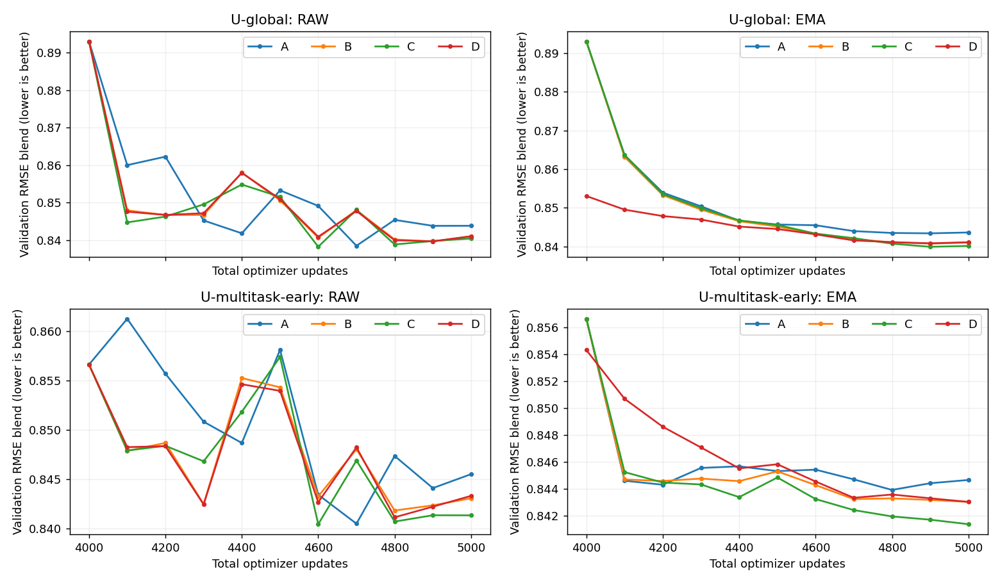

<!-- SPDX-FileCopyrightText: 2026 Samudra Authors -->
<!-- SPDX-License-Identifier: CC-BY-4.0 -->

# Standardizing cooldown from existing 4k runs

Compare data mixture, loss and EMA initialization using the completed S0
checkpoints from the [paired stability screen](stability-screen-2026-10-13.md).
The user approved eight 1,000-update continuations: four branches each for
**U-global** (recent 1° OM4 + observations) and **U-multitask-early** (the same
model, splitting OM4 exposure between recent and earlier 1° data). No architecture,
latent-channel or fine-resolution changes are introduced.

| Branch | Cooldown data | Objective | EMA at start |
|---|---|---|---|
| A | Seven observation updates then one OM4 update, repeated | Existing forecast + reconstruction/completion losses | Reset to raw weights |
| B | Observations only | Existing losses | Reset to raw weights |
| C | Observations only | Forecast loss only | Reset to raw weights |
| D | Observations only | Existing losses | Retain S0 EMA |

All branches start from identical raw model/Adam/RNG state within each family at
4,000 updates, preserve the per-task sample streams, and decay LR linearly from
1e-4 to 1e-6 over updates 4,001–5,000. Accumulation remains eight examples and EMA
half-life remains 100 optimizer updates. C preserves B's input corruption and
mask seeds; it removes loss terms only. D retains the existing 1,000-update EMA
history; all branches save EMA atomically with model/optimizer/RNG state.

A receives 875 observation and 125 OM4 updates. In the early-data family these
125 OM4 updates comprise 63 recent and 62 early examples at the optimizer-update
level. B/C/D receive 1,000 observation updates. Their first 875 observation
updates use the same sample/mask sequence as A. Different exposure is part of
the mixture treatment, not an accidental mismatch.

Compare raw and EMA RMSE validation at 4,000 and every 100 subsequent updates.
Primary screening summary is the mean over 4,600/4,700/4,800/4,900/5,000, weighted
equally across the two families; report endpoints and all components alongside
it. A vs B isolates data mixture, B vs C isolates auxiliary loss removal, and
B vs D isolates EMA history. The unchanged S0 checkpoint is a zero-extra-training
reference, not a matched-compute control for cooldown versus continued constant LR.

Before choosing a standard, add annual rollout and initializer temperature/OHC
diagnostics. The short validation cohort is November 2013–July 2014; observation
training ends July 2013. Audit an annual rollout beginning **2013-11-01** through
November 2014, including OM4 training-date exclusion, target coverage and forcing,
before using it as annual validation. This is one validation case, not a robust
annual test or the previously examined 2015/2018/2021 cohort. If its full payload
cannot be verified, report the blocker rather than substitute a test cohort into
selection. No final cooldown policy is chosen from short-lead scores alone.

## Completed short-lead comparison

All eight runs completed 5,000 total updates. The table uses the predeclared
last-five-validation mean, equally weighted across U-global and U-multitask-early.
Lower is better; the blend uses RMSE components, with no spectral term.

| Branch | Raw last-five mean | EMA last-five mean | U-global EMA endpoint | Early EMA endpoint |
|---|---:|---:|---:|---:|
| A: 7:1 obs/OM4, reset EMA | 0.844162 | 0.844298 | 0.843605 | 0.844648 |
| B: obs only, reset EMA | 0.842810 | 0.842485 | 0.840992 | 0.843016 |
| C: obs forecast loss only, reset EMA | 0.841616 | 0.841681 | 0.840119 | 0.841359 |
| D: obs only, retain EMA | 0.842699 | 0.842539 | 0.841085 | 0.843018 |

B improves on A by **0.21%** in the EMA summary; removing auxiliary loss in C
improves on B by **0.10%**. Retaining versus resetting EMA is effectively tied
(**0.007%**). These are small, single-seed effects, below the previous 1%
confirmation threshold. B and D also differ slightly in their raw trajectories
because of ordinary production numerical variation; that difference cannot be
caused by EMA history, which is not used for gradient updates.

[Per-family summary](assets/cooldown-standardization/summary.csv) ·
[All curve values](assets/cooldown-standardization/curves.csv).
ABC begin with EMA reset to raw weights, so their initial EMA point is not the
parent's existing EMA. D retains it. No final cooldown choice is made yet:
annual validation and initializer diagnostics remain outstanding.

## Execution and reproducibility

Producer `d72f7b192ea8319547ec61f6d35f5418087e8612` completed all eight branches
in Torch array **19878748**. Every endpoint has 1,000 cooldown updates, a verified
checkpoint hash, and preserved source model/Adam/RNG state. ABC have 1,000 EMA
updates; D has 2,000 including its parent history. Each run has 11 raw and 11 EMA
validation points. Source checkpoints and failed qualification attempts remain
immutable.

The initial replay qualification exposed an optimizer-state alias in the diagnostic
restore helper. Cloning the saved state before restore fixed it; populated-Adam
regression tests and all eight bitwise model/optimizer/RNG/EMA replay checks passed.
No acceptance tolerance or scientific training setting changed. The production
cost was **6.9000 GPU-hours**; including qualification and retries, this comparison
used **9.9097 GPU-hours**. The preceding stability campaign's **10.5378 GPU-hours**
is separate.

Implementation: [cooldown runner](../../../scripts/run_observation_cooldown_comparison.py),
[protocol tests](../../../tests/test_observation_cooldown_comparison.py).
Training root:
`/scratch/jr7309/runs/2026-10-14-observation-cooldown-standardization/recovery-snapshot-copy`.
The annual follow-up uses frozen final raw/EMA weights and the two parent S0
endpoints, with no retraining or new checkpoint selection.
