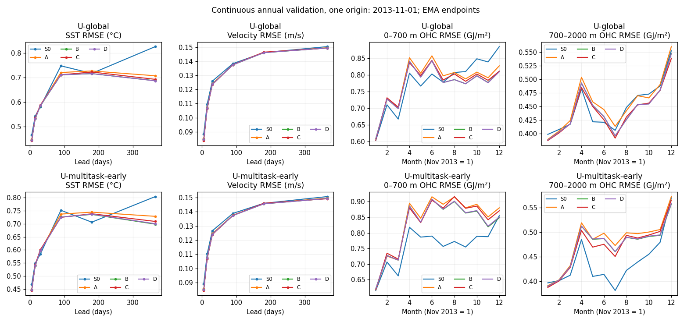
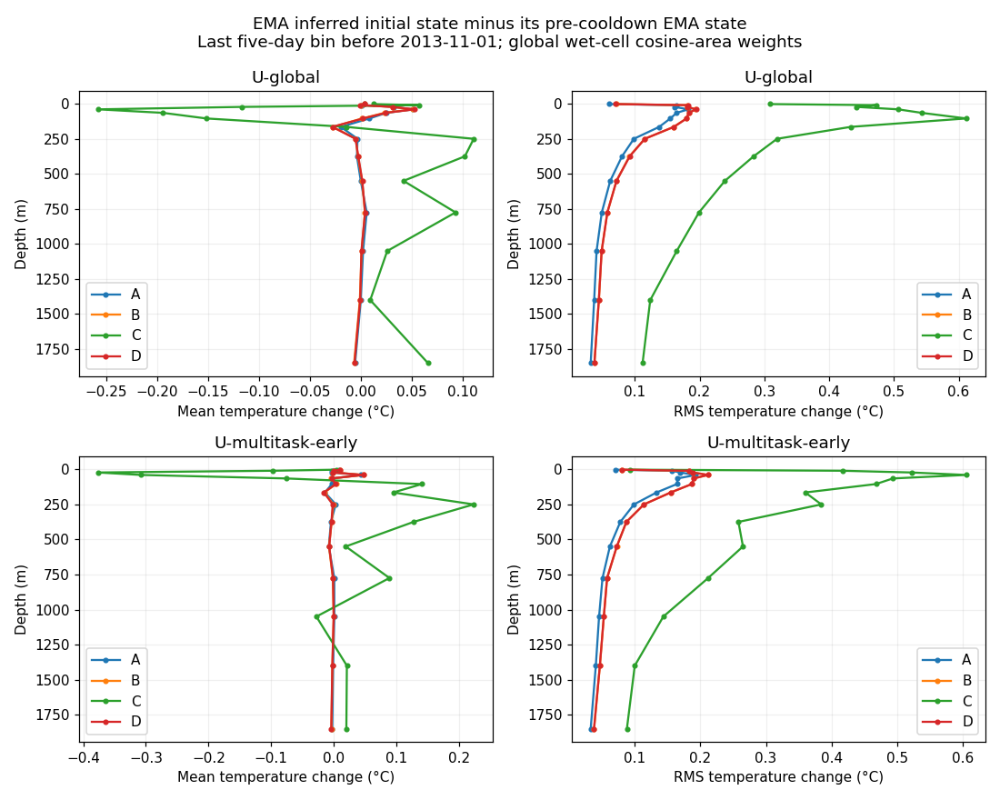
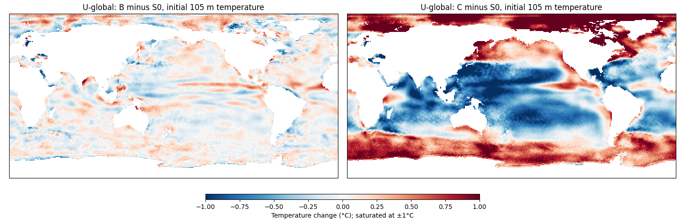
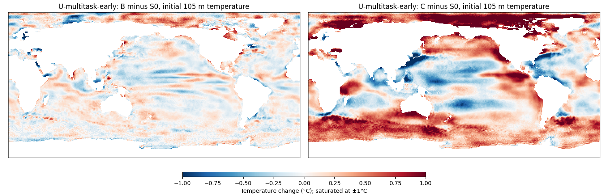

<!-- SPDX-FileCopyrightText: 2026 Samudra Authors -->
<!-- SPDX-License-Identifier: CC-BY-4.0 -->

# Standardizing cooldown from existing 4k runs

Compare data mixture, loss and EMA initialization using the completed S0
checkpoints from the [paired stability screen](stability-screen-2026-10-13.md).
The user approved eight 1,000-update continuations: four branches each for
**U-global** (recent 1° OM4 + observations) and **U-multitask-early** (the same
model, splitting OM4 exposure between recent and earlier 1° data). No architecture,
latent-channel or fine-resolution changes are introduced.

| Branch | Cooldown data | Objective | EMA at start |
|---|---|---|---|
| A | Seven observation updates then one OM4 update, repeated | Existing forecast + reconstruction/completion losses | Reset to raw weights |
| B | Observations only | Existing losses | Reset to raw weights |
| C | Observations only | Forecast loss only | Reset to raw weights |
| D | Observations only | Existing losses | Retain S0 EMA |

All branches start from identical raw model/Adam/RNG state within each family at
4,000 updates, preserve the per-task sample streams, and decay LR linearly from
1e-4 to 1e-6 over updates 4,001–5,000. Accumulation remains eight examples and EMA
half-life remains 100 optimizer updates. C preserves B's input corruption and
mask seeds; it removes loss terms only. D retains the existing 1,000-update EMA
history; all branches save EMA atomically with model/optimizer/RNG state.

A receives 875 observation and 125 OM4 updates. In the early-data family these
125 OM4 updates comprise 63 recent and 62 early examples at the optimizer-update
level. B/C/D receive 1,000 observation updates. Their first 875 observation
updates use the same sample/mask sequence as A. Different exposure is part of
the mixture treatment, not an accidental mismatch.

Compare raw and EMA RMSE validation at 4,000 and every 100 subsequent updates.
Primary screening summary is the mean over 4,600/4,700/4,800/4,900/5,000, weighted
equally across the two families; report endpoints and all components alongside
it. A vs B isolates data mixture, B vs C isolates auxiliary loss removal, and
B vs D isolates EMA history. The unchanged S0 checkpoint is a zero-extra-training
reference, not a matched-compute control for cooldown versus continued constant LR.

The protocol also requires annual rollout and initializer temperature/OHC
diagnostics before choosing a standard; the completed checks are below. The short validation cohort is November 2013–July 2014; observation
training ends July 2013. Audit an annual rollout beginning **2013-11-01** through
November 2014, including OM4 training-date exclusion, target coverage and forcing,
before using it as annual validation. This is one validation case, not a robust
annual test or the previously examined 2015/2018/2021 cohort. If its full payload
cannot be verified, report the blocker rather than substitute a test cohort into
selection. No final cooldown policy is chosen from short-lead scores alone.

## Completed short-lead comparison

All eight runs completed 5,000 total updates. The table uses the predeclared
last-five-validation mean, equally weighted across U-global and U-multitask-early.
Lower is better; the blend uses RMSE components, with no spectral term.

| Branch | Raw last-five mean | EMA last-five mean | U-global EMA endpoint | Early EMA endpoint |
|---|---:|---:|---:|---:|
| A: 7:1 obs/OM4, reset EMA | 0.844162 | 0.844298 | 0.843605 | 0.844648 |
| B: obs only, reset EMA | 0.842810 | 0.842485 | 0.840992 | 0.843016 |
| C: obs forecast loss only, reset EMA | 0.841616 | 0.841681 | 0.840119 | 0.841359 |
| D: obs only, retain EMA | 0.842699 | 0.842539 | 0.841085 | 0.843018 |

B improves on A by **0.21%** in the EMA summary; removing auxiliary loss in C
improves on B by **0.10%**. Retaining versus resetting EMA is effectively tied
(**0.007%**). These are small, single-seed effects, below the previous 1%
confirmation threshold. B and D also differ slightly in their raw trajectories
because of ordinary production numerical variation; that difference cannot be
caused by EMA history, which is not used for gradient updates.

[Per-family summary](assets/cooldown-standardization/summary.csv) ·
[All curve values](assets/cooldown-standardization/curves.csv).
ABC begin with EMA reset to raw weights, so their initial EMA point is not the
parent's existing EMA. D retains it. The completed annual and initializer checks below favor B as a practical
standard, with the limitations stated there.

## Annual validation and initializer checks

All 20 frozen evaluations completed: raw and EMA for A/B/C/D and the pre-cooldown
S0 endpoint in each family. One initialization on **2013-11-01**, followed by 73
five-day steps with prescribed ERA5 and no future surface corrections. Forecast
targets are later than recent OM4's final training date, 2013-10-04, and observation
training's final month, July 2013. Initialization history partly overlaps OM4
training dates; forecast targets do not. Earlier OM4 targets end before 1975.
The full annual payload passed timestamp, hash, finite-forcing and exact
first-30-day overlap checks against the monthly validation sample.

These are **one-origin validation diagnostics**, not held-out multi-origin test
results. OHC columns below average 12 calendar-month spatial RMSEs; they are not
RMSE of an annual-average field. Surface columns are the day-365 five-day bin.
No spectral term is used to rank these runs, and no new annual composite is
substituted for the short-lead RMSE blend.

| Model family | Branch, EMA | Day-365 SST RMSE (°C) | Day-365 velocity RMSE (m/s) | Monthly OHC RMSE, 0–700 m (GJ/m²) | Monthly OHC RMSE, 700–2000 m (GJ/m²) |
|---|---|---:|---:|---:|---:|
| U-global | S0: before cooldown | 0.8267 | 0.1504 | 0.7770 | 0.4486 |
| U-global | A | 0.7074 | 0.1496 | 0.7810 | 0.4552 |
| U-global | B | 0.6872 | 0.1495 | 0.7697 | 0.4450 |
| U-global | C | 0.6928 | 0.1494 | 0.7737 | 0.4427 |
| U-global | D | 0.6867 | 0.1494 | 0.7694 | 0.4449 |
| U-multitask-early | S0: before cooldown | 0.8039 | 0.1507 | 0.7579 | 0.4389 |
| U-multitask-early | A | 0.7283 | 0.1496 | 0.8354 | 0.4813 |
| U-multitask-early | B | 0.6985 | 0.1493 | 0.8223 | 0.4737 |
| U-multitask-early | C | 0.7088 | 0.1491 | 0.8301 | 0.4715 |
| U-multitask-early | D | 0.7000 | 0.1493 | 0.8230 | 0.4741 |

B reduces day-365 SST error versus S0 by **16.9% for U-global and 13.1% for
early-OM4**. Its OHC errors improve by about 1% for U-global but worsen by
**8.5% / 7.9%** for early-OM4. Thus improvement is not uniform across variables.
B and D remain almost indistinguishable; C does not improve day-365 SST over B.
Because S0 has 1,000 fewer updates, this comparison does not isolate LR decay
from the benefit of additional observation training.

Own initialized surface persistence gives day-365 SST **0.8216°C** and velocity
**0.1740 m/s** for every run: the observed-only surface policy fixes those
initial surface fields. Interior persistence differs by model. For B its monthly
OHC errors are **1.043 / 0.546 GJ/m²** (U-global) and **1.030 / 0.546 GJ/m²**
(early-OM4), both worse than evolving B. All raw/EMA, ADT, lead, monthly OHC and
own-persistence components are in the [component table](assets/cooldown-standardization/annual-components.csv).

### What changed in the initializer?

The following profiles compare each final EMA initializer with its own S0 EMA,
on the same inputs, at the last five-day bin before November 1. They use global
wet-cell cosine-area weights and physical temperature. **These are changes,
not errors against an independent subsurface truth**; larger change alone does
not prove forgetting. In particular, the last inferred state is not compared
as though it were a calendar-month IAP mean.

| Model family | Branch | RMS temperature change at 105 m (°C) | RMS initial OHC change, 0–700 m (GJ/m²) | RMS initial OHC change, 700–2000 m (GJ/m²) |
|---|---|---:|---:|---:|
| U-global | B: existing losses | 0.180 | 0.170 | 0.161 |
| U-global | C: forecast only | 0.612 | 0.622 | 0.611 |
| U-multitask-early | B: existing losses | 0.187 | 0.167 | 0.177 |
| U-multitask-early | C: forecast only | 0.467 | 0.584 | 0.528 |

Removing initializer reconstruction/completion losses allows substantially larger
changes in the inferred interior. Forecast supervision can still reward an
initializer/processor pair that compensates for those changes. That is a plausible
interpretation, not a demonstrated causal decomposition. The tiny 0.10% pooled
short-lead gain does not establish a benefit from accepting this extra freedom.
A/B/D retain much more similar inferred temperature structures.

The maps use two pixels per grid cell in each direction, with a common ±1°C
color scale. [Profiles for temperature, salinity and both velocities](assets/cooldown-standardization/initializer-profiles.csv)
and [initial OHC changes](assets/cooldown-standardization/initializer-ohc.csv)
include both raw and EMA weights.

### Recommended common cooldown

Use **B: 1,000 observation-only updates with the existing forecast,
reconstruction and completion losses; linear LR decay to 1% of the starting LR;
reset EMA from raw weights at the cooldown fork, half-life 100 updates**.
Preserve Adam state and sample ordering, and compare the fixed final EMA
checkpoint as well as the pre-cooldown checkpoint. Retained EMA D is effectively
tied; reset is a reproducible convention for comparing parents with different
EMA histories, not an empirically superior treatment here.

This is a practical default for the proposed search, not a statistically confirmed
optimum. Keep annual OHC and initializer diagnostics as safeguards, particularly
for early-OM4 models: the pooled short score did not reveal their annual OHC
regression. The frozen-endpoint comparison is complete; no search campaign or
longer training was launched.

## Execution and reproducibility

Producer `d72f7b192ea8319547ec61f6d35f5418087e8612` completed all eight branches
in Torch array **19878748**. Every endpoint has 1,000 cooldown updates, a verified
checkpoint hash, and preserved source model/Adam/RNG state. ABC have 1,000 EMA
updates; D has 2,000 including its parent history. Each run has 11 raw and 11 EMA
validation points. Source checkpoints and failed qualification attempts remain
immutable.

The initial replay qualification exposed an optimizer-state alias in the diagnostic
restore helper. Cloning the saved state before restore fixed it; populated-Adam
regression tests and all eight bitwise model/optimizer/RNG/EMA replay checks passed.
No acceptance tolerance or scientific training setting changed. The production
cost was **6.9000 GPU-hours**; including qualification and retries, this comparison
used **9.9097 GPU-hours**. The preceding stability campaign's **10.5378 GPU-hours**
is separate.

Implementation: [cooldown runner](../../../scripts/run_observation_cooldown_comparison.py),
[protocol tests](../../../tests/test_observation_cooldown_comparison.py).
Training root:
`/scratch/jr7309/runs/2026-10-14-observation-cooldown-standardization/recovery-snapshot-copy`.
The annual follow-up uses frozen final raw/EMA weights and the two parent S0
endpoints, with no retraining or new checkpoint selection.

Annual evaluation producer `1e90c7b1dbea5954ee658c57b6f02112e84dc56f`
passed 45 checkpoint/annual tests and repository commit checks. CPU audit
**19930550** and ten-task evaluation array **19930551** completed, producing all
20 raw/EMA output sets with verified lineage and finite metrics. Initial audit
**19930200** failed only because the checker expected the newer quarter-builder
filename convention; the existing archived files use `YYYY-MM-interior.npz`.
The corrected audit retains exact inventory and payload checks; the failed attempt
and zero-GPU dependent cancellation are preserved.

Annual evaluation used **0.1617 GPU-hours**; combined with this cooldown wave,
the total is **10.0714 GPU-hours**. CPU reduction **19932914** generated initializer
profiles from the saved physical outputs using
[this script](../../../scripts/summarize_cooldown_initializers.py).
Evaluation root:
`/scratch/jr7309/runs/2026-10-15-cooldown-annual/recovery-inventory`.
All completed callbacks are retired.
