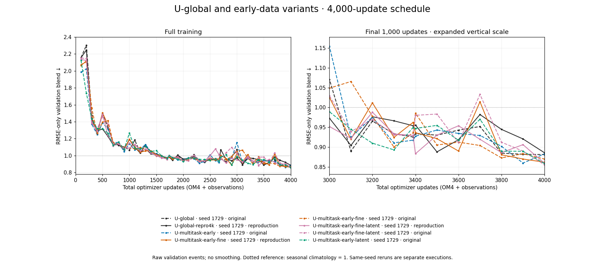
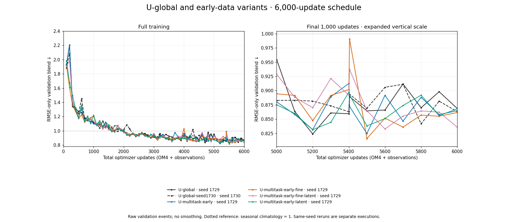
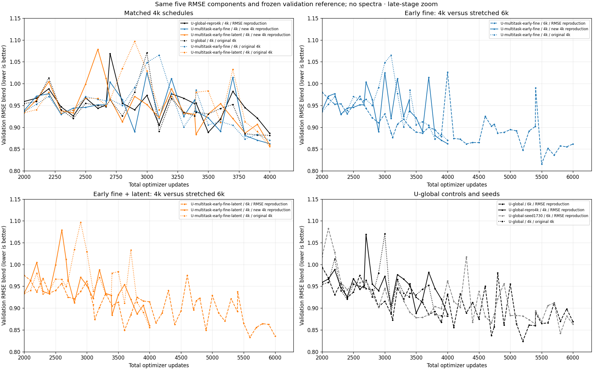
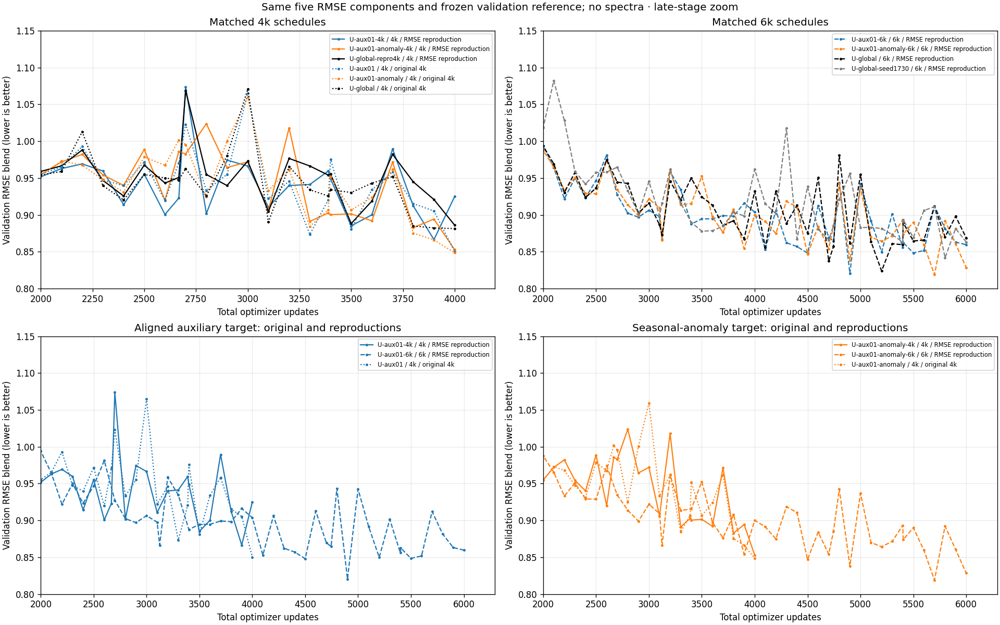

<!-- SPDX-FileCopyrightText: 2026 Samudra Authors -->
<!-- SPDX-License-Identifier: CC-BY-4.0 -->

# Matched 4k reproductions: earlier data and auxiliary losses

**The 4k advantage repeats in these same-seed executions.** Both fresh early-data
runs completed 4,000 updates and all 96 held-out origins. Relative to the matched
U-global-repro4k control, early-fine improves validation/test RMSE blend by
**2.7%/2.6%**, and early-fine+latent by **3.0%/3.7%**. Both selected their final
checkpoint, so this result also holds at the fixed 4k endpoint.

The subsequent auxiliary reproductions also completed: the anomaly recipe improves
validation/test by 3.8%/3.8%; the aligned recipe improves selected scores but has
a worse fixed 4k endpoint. See [auxiliary results](#auxiliary-loss-reproductions).

This supports the earlier-data recipes at this budget. It does not establish
that latent channels or fine resolution alone cause the gain, or quantify
variation across independent seeds. The [6k comparison](early-rmse-6k-2026-10-10.md)
uses a stretched mixture as well as a larger budget; its intermediate update
4,000 is not this matched control.

Contents: [Results](#results) · [Curves](#curves) · [Experiment](#experiment) ·
[Verification](#verification) · [Auxiliary reproductions](#auxiliary-loss-reproductions).

## Results

All values use the same five-component, full-field **RMSE-only** validation
blend and frozen denominators; lower is better. Historical runs were rescored
from saved physical components, removing spectra from this comparison. Their
data/grid/statistics hashes and observation-support definitions match.

| Model | Execution | Best validation | Best update | Final validation | Final-five mean |
|---|---|---:|---:|---:|---:|
| U-global | Original 4k, Beta | 0.8815 | 4,000 | 0.8815 | 0.9088 |
| U-global-repro4k | Matched 4k control, Torch | 0.8861 | 4,000 | 0.8861 | 0.9306 |
| U-multitask-early-fine | Original 4k | 0.8704 | 4,000 | 0.8704 | 0.8889 |
| U-multitask-early-fine | New 4k reproduction | **0.8624** | 4,000 | **0.8624** | 0.9037 |
| U-multitask-early-fine-latent | Original 4k | 0.8559 | 4,000 | 0.8559 | 0.9206 |
| U-multitask-early-fine-latent | New 4k reproduction | **0.8595** | 4,000 | **0.8595** | 0.9053 |

The two reproduced early-data models also beat the original U-global's RMSE
minimum. The original fine+latent advantage was 2.9% on RMSE alone, so it was
not solely a spectral-score effect. The new latent advantage over the new
non-latent fine model is only **0.3% on validation**; that small difference does
not establish a reliable benefit from the extra channels.

The final-five mean uses scheduled validations at budget−400, −300, −200,
−100 and the endpoint. This descriptive diagnostic was declared before the
new 4k results were available; it does not select checkpoints. These correlated
points are not five independent trials. Their variation across historical and
reproduced runs remains substantial, including for U-global itself.

For context, the 6k early-fine/fine+latent final-five means are **0.8524/0.8502**,
versus **0.8830/0.8808** for the two U-global seeds. Thus the close 6k minima hide
a late-training difference. The combined evidence supports a budget- and
checkpoint-dependent comparison, rather than dismissing the original 4k gain
as noise. It does not show that 4k is optimal: the 6k models reach lower errors.

### Held-out comparison

These are the validation-selected checkpoints, evaluated on the same 96 monthly
test origins. Test data did not select models or weights. The test blend uses
common held-out climatology denominators, separately from validation.

| Model, matched 4k execution | Test RMSE blend | Own initialized persistence | Change vs U-global-repro4k |
|---|---:|---:|---:|
| U-global-repro4k | 0.9082 | 0.9829 | — |
| U-multitask-early-fine | 0.8849 | 0.9824 | −2.6% |
| U-multitask-early-fine-latent | 0.8746 | 0.9718 | −3.7% |

| Model | SST RMSE (°C) | Geostrophic velocity RMSE (m/s) | EKE RMSE (m²/s²) | OHC 0–700 m RMSE (10⁸ J/m²) | OHC 700–2000 m RMSE (10⁸ J/m²) |
|---|---:|---:|---:|---:|---:|
| U-global-repro4k | 0.6478 | 0.11491 | 0.025254 | 8.073 | 4.358 |
| U-multitask-early-fine | 0.6276 | 0.11503 | 0.025242 | 7.453 | 4.291 |
| U-multitask-early-fine-latent | 0.6396 | 0.11479 | 0.025218 | 7.244 | 4.153 |

The largest gains are in upper-ocean heat content: **7.7%/10.3%** for fine and
fine+latent. SST improves **3.1%/1.3%**; fine+latent also improves deep OHC by
**4.7%**. Velocity/EKE differences are tiny, and both still have worse EKE RMSE
than their own initialized persistence (0.022554 m²/s²). The result is mainly
thermodynamic improvement, not evidence of recovered eddy variability.

[All held-out components and persistence controls](artifacts/early-rmse-4k-2026-10-11/heldout-scores.csv).
Historical test scores are not retroactively assigned to the RMSE minima: the
historical selector could choose different weights.

## Curves

### All U-global seeds and early variants, separated by budget

These figures include every archived U-global execution and all four early-data
variants, with separate 4k and 6k schedules. Each shows the full trajectory and
an unsmoothed final-1,000-update zoom. All 722 validation events use the same
five-component RMSE-only blend; historical spectral-selected runs are rescored
from their physical errors. This does not change their saved checkpoint selection.

At 4k, both U-global executions use seed 1729; they are original/reproduction
executions, not independent seeds. At 6k, U-global seeds 1729 and 1730 are both
shown. Early variants use seed 1729. The 6k schedule is stretched, so its update
4,000 is not equivalent to the endpoint of the 4k schedule.

[4k vector figure](artifacts/early-rmse-by-budget-2026-10-13/rmse-validation-4k.pdf) ·
[6k vector figure](artifacts/early-rmse-by-budget-2026-10-13/rmse-validation-6k.pdf) ·
[Curve inventory and source hash](artifacts/early-rmse-by-budget-2026-10-13/provenance.json.gz).
Reproduce with `scripts/plot_early_rmse_by_budget.py` using the validation CSV below.

### Cross-budget and reproduction views

The complete comparison contains **722 verified validation events across 14
series**. All lines use the same RMSE blend. Solid lines are current 4k
reproductions, dotted lines original 4k runs, and dashed lines stretched 6k
runs. Colors identify model families. Markers are actual validation events;
no smoothing chooses minima. The late views explicitly restrict the displayed
range; the full view and CSV retain every point.

[Full training curves](artifacts/early-rmse-4k-2026-10-11/validation-full.png) ·
[Observation-exposure curves](artifacts/early-rmse-4k-2026-10-11/validation-observation-exposure.png) ·
[Vector figure](artifacts/early-rmse-4k-2026-10-11/validation-late.pdf) ·
[All values and five physical components](artifacts/early-rmse-4k-2026-10-11/validation.csv) ·
[Minima, endpoints and final-five means](artifacts/early-rmse-4k-2026-10-11/minima.csv).

## Experiment

| Literal model name | Description | Recent OM4 1° | Earlier OM4 ¼° | Observation updates | Extra recurrent channels |
|---|---|---:|---:|---:|---:|
| U-global-repro4k | Recent-only matched control from the preceding wave | 2,000 | 0 | 2,000 | 0 |
| U-multitask-early-fine | Earlier fine-resolution examples through the existing encoder/decoder; best validation in the 6k RMSE wave | 1,000 | 1,000 | 2,000 | 0 |
| U-multitask-early-fine-latent | Same fine task plus recurrent channels on all tasks; best original 4k validation, including RMSE rescoring | 1,000 | 1,000 | 2,000 | 10 |

All three have a global 1° processor. The early models wrap it with the existing
encoder/decoder for the ¼° task; they do not evolve the globe at ¼°. New runs
start fresh at seed 1729, fixed LR 1e-4, eight-example accumulation, and unchanged
losses, normalization and splits. The 4k progressive mixture ends at exactly
2,000 observation updates; earlier/recent OM4 alternate in the remaining slots.
No cooldown is used. These are repeat executions of the same seed, not new
independent seeds. No qualification weights enter training.

**U-global** in the original wave is the prior 4k Beta control. **U-global** and
**U-global-seed1730** in the RMSE wave are the completed 6k controls with
3,000 updates per task and seeds 1729/1730. Historical early models have their
recorded Torch recovery history. Curve labels distinguish wave and budget;
the current reproductions and 6k runs share the same Torch training producer.

Selection uses the equal mean of SST, geostrophic velocity, EKE, OHC 0–700 m and
OHC 700–2000 m RMSE ratios to the frozen validation climatology. Surface errors
average day 5/15/30; OHC uses calendar-month means. There is no detrending,
deseasonalization or spectral term. Validation is saved every 100 total updates
and observation milestones. Test comparisons use 30-day, separately initialized
forecasts, not continuous multi-year rollouts.

This is a comparison at fixed mixed-task updates, not matched FLOPs: fine-task
updates cost more. The new reproductions test the combined earlier-data/fine-task
recipes; they do not independently isolate temporal variety from resolution.

## Verification

All jobs completed successfully on October 11 by **15:52:51 ET**: CPU data audit
**19580149**, qualification array **19580150**, and training/evaluation array
**19580151**. Each arm used one Torch RTX6000, 16 CPUs and 192 GB RAM, at most
two concurrent GPUs. Actual allocated time was **8.7656 GPU-hours**, including
qualification, startup, training and evaluation; **no retries**.

The unchanged successful training producer is
`eae2b5c56da44eb3686a6eaf72a80aa419a4b5a4`. Fresh qualification checked fitting,
gradient paths, exact I/O and bitwise deterministic checkpoint replay. The
completion auditor independently hashed both selected checkpoint files and
verified all 4,000 consecutive updates, exposures, finite losses/gradients,
fixed LR, seed, producer, frozen validation scores, and both complete 96-origin
evaluations. Plotting verified the shared data/support contracts and all saved
RMSE scores. Reporting changes did not alter training code.

[Completion/checkpoint audit and accounting](artifacts/early-rmse-4k-2026-10-11/verification.json) ·
[Curve provenance](artifacts/early-rmse-4k-2026-10-11/provenance.json).
Cluster root: `/scratch/jr7309/runs/2026-10-11-early-rmse-4k`.
Its launch contracts and immutable result/validation bundles are retained;
no source data or checkpoints were deleted. Reporting script:
`scripts/plot_early_rmse_reproductions.py`.

## Auxiliary-loss reproductions

**Both 4k reproductions completed training and all 96 held-out origins.** The added fresh runs
are **U-aux01-4k** and **U-aux01-anomaly-4k**, each matched to U-global-repro4k:
2,000 recent global OM4 updates plus 2,000 observation updates, seed 1729,
fixed LR 1e-4, and the same progressive task mixture and RMSE-only validation.
These are independent 4k schedules, not intermediate checkpoints from 6k runs.
The corresponding [6k reproductions](early-rmse-6k-2026-10-10.md#auxiliary-loss-reproductions)
stretch that mixture to 3,000 updates of each task.

**U-aux01** adds a 129-parameter pointwise head to U-global's processor features
(total 62,967,809 parameters). On OM4 updates, it predicts standardized
`log1p(q / scale)` at every valid coarse cell and all six forecast leads,
where `q = 0.5 * (mean(u² + v²) - mean(u)² - mean(v)²)` comes from the original
quarter-degree five-day-mean surface velocities. The accessory loss is
area-weighted MSE with coefficient 0.01. **U-aux01-anomaly** instead targets that
standardized quantity minus its per-cell, calendar-month training mean. The
head is unused at observation inference; neither recipe supplies fine fields
to the processor or adds recurrent channels. Both use the original recent OM4
period, not the earlier-data extension. [Original target methods](extent-accessory-controls-2026-10-04.md#fixed-setup-and-literal-model-names).

Only one original execution of each of these exact recipes was found. They
are the top two genuine target variants by their **rescored RMSE validation
minimum**, not by held-out test performance or the old spectral composite:

| Original recipe | Best RMSE validation | Update | Final-five mean |
|---|---:|---:|---:|
| U-global | 0.8815 | 4,000 | 0.9088 |
| U-aux01 | 0.8502 | 4,000 | 0.9127 |
| U-aux01-anomaly | 0.8486 | 4,000 | 0.8952 |

The aligned run's late-window mean does not improve on U-global despite its
better minimum. That discrepancy makes replication particularly useful. The
seasonal-mean variant's RMSE minimum is 0.8611; its stronger ranking under the
old composite partly reflected spectra. The shuffled target remains a control.
[All original candidate scores](artifacts/auxiliary-rmse-2026-10-11/original-candidate-ranking.csv).

| Model, matched 4k | Best validation | Selected update | Endpoint validation | Final-five mean | Held-out blend | Own persistence |
|---|---:|---:|---:|---:|---:|---:|
| U-global-repro4k | 0.8861 | 4,000 | 0.8861 | 0.9306 | 0.9082 | 0.9829 |
| U-aux01-4k | 0.8665 | 3,900 | 0.9249 | 0.9187 | 0.8962 | 0.9614 |
| U-aux01-anomaly-4k | 0.8529 | 4,000 | 0.8529 | 0.8987 | 0.8740 | 0.9563 |

The anomaly recipe repeats its improvement: **3.8% lower validation and test**
than U-global-repro4k, also at the fixed endpoint. Its test blend is almost equal
to early-fine+latent (0.8746). The aligned recipe improves selected validation by
2.2% and test by 1.3%, but its final validation is **4.4% worse** than the control.
Its original RMSE minimum was 0.8502 versus 0.8665 now, demonstrating substantial
same-seed execution variation. Neither reproduction measures independent-seed
uncertainty.

| Model | SST (°C) | Geostrophic velocity (m/s) | EKE (m²/s²) | OHC 0–700 m (10⁸ J/m²) | OHC 700–2000 m (10⁸ J/m²) |
|---|---:|---:|---:|---:|---:|
| U-global-repro4k | 0.6478 | 0.11491 | 0.025254 | 8.073 | 4.358 |
| U-aux01-4k | 0.6661 | 0.11519 | 0.025442 | 7.187 | 4.434 |
| U-aux01-anomaly-4k | 0.6317 | 0.11492 | 0.025355 | 7.155 | 4.196 |

The anomaly gain is predominantly thermodynamic: upper/deep OHC improve
11.4%/3.7%, SST 2.5%, while velocity is unchanged and EKE slightly worsens.
Aligned supervision improves upper OHC by 11.0% but worsens the other four
components. The blended score should not be read as a general dynamics gain.

[Full curves](artifacts/auxiliary-rmse-2026-10-11/validation-full.png) ·
[All validation components](artifacts/auxiliary-rmse-2026-10-11/validation.csv) ·
[All held-out components and controls](artifacts/auxiliary-rmse-2026-10-11/scores.csv) ·
[July day-30 SST anomalies](artifacts/auxiliary-rmse-2026-10-11/maps-4k/day30-2022-07-anomalies-sst.png) ·
[January/July map set, including persistence](artifacts/auxiliary-rmse-2026-10-11/maps-4k/).

Accessory target MSE decreases during training: **0.4911→0.3107** for aligned
and **0.2908→0.2745** for anomaly, comparing first/final-quarter averages.
After weighting by 0.01, these are respectively 27.5% and 23.9% of the final-quarter
OM4 physical objective. The scalar magnitudes are not gradient attribution;
the term is applied only on OM4 steps.
[Accessory training curves and values](artifacts/auxiliary-rmse-2026-10-11/accessory-training.png).

The reproductions retain the matched Torch container/runtime. CPU observation
caching is checked against uncached tensors; target files are copied from Beta
with full file-by-file SHA-256 verification. Fresh fitting, gradient routing,
exact serialization replay and throughput gates precede production. Diagnostic
weights are excluded. Pinned producer: `56aac9375a59a7204cd54d85a0c5a3b8e9383d59`.
Cluster root: `/scratch/jr7309/runs/2026-10-11-auxiliary-rmse`.

The complete 4k/6k auxiliary wave used **14.2461 allocated GPU-hours**, including
qualification, training and held-out evaluation, with no GPU/training retries.
All four selected checkpoint hashes, complete update sequences, exposures,
fixed LR, finite gradients and 96-origin outputs passed independent collection.
[Completion and accounting evidence](artifacts/auxiliary-rmse-2026-10-11/verification.json).
One CPU-only map-export filename error was recovered with failed records retained;
no training or scientific protocol changed. Jobs: audit **19597634**, qualification
**19597635**, training/evaluation **19597636**, successful report export **19606934**.
