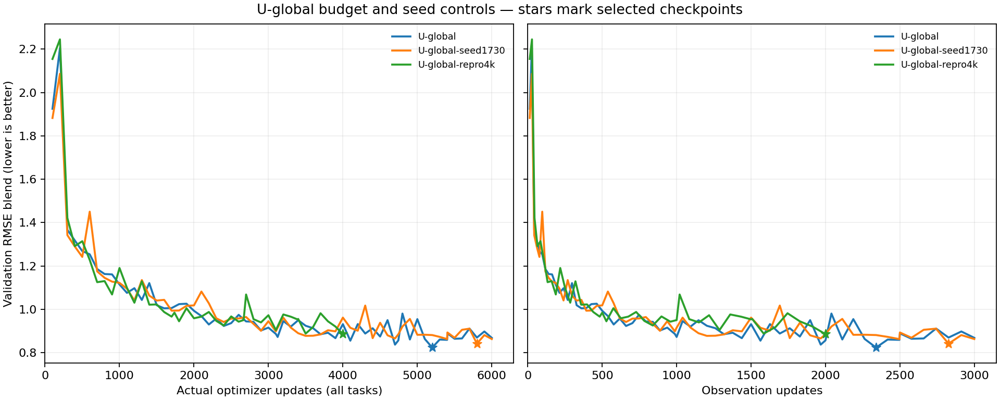
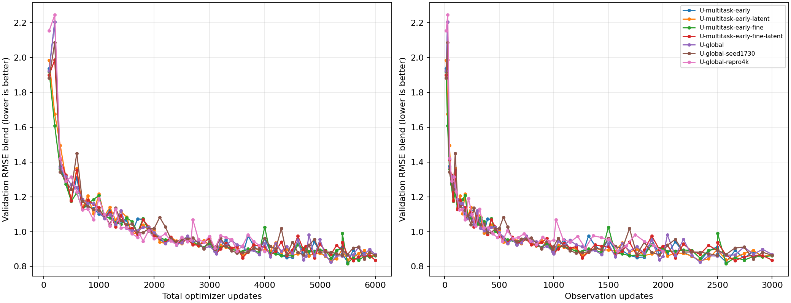
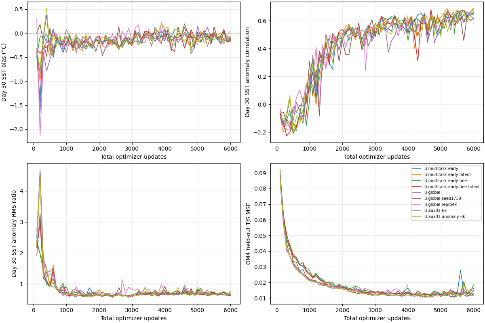
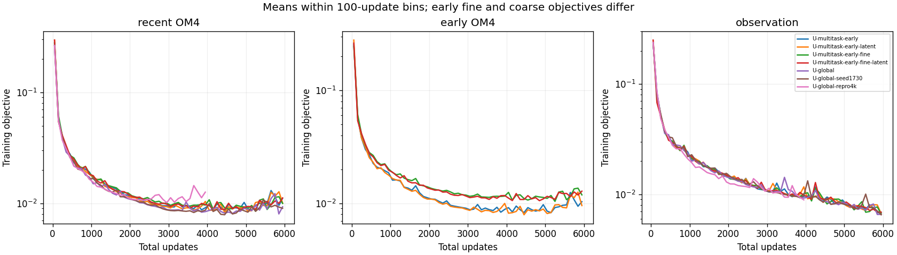

<!-- SPDX-FileCopyrightText: 2026 Samudra Authors -->
<!-- SPDX-License-Identifier: CC-BY-4.0 -->

# Longer early-data comparison with RMSE selection

All seven fresh runs completed. **Longer U-global training helps:** the selected
6k model's held-out RMSE blend is 0.8423, versus 0.9082 for the 4k reproduction
(7.3% lower). Its second seed scores 0.8503. **The early-data variants do not
establish a reproducible advantage:** the fine-input variant improves narrowly,
by less than the observed two-seed U-global spread. These results support a
6k [quarter-degree U-global follow-on](quarter-global-plan-2026-10-10.md), without
yet justifying a second quarter-degree arm.

The historical [four-arm report](early-fine-wave-2026-10-07.md) and
[cooldown report](early-fine-cooldown-2026-10-08.md) use their original selection
protocols. This wave uses RMSE-only selection throughout.

Contents: [Results](#results) · [Runs](#runs) · [Selection](#selection) · [Diagnostics](#diagnostics) ·
[Execution](#execution).

The [matched 4k early-data reproductions](early-rmse-4k-reproduction-2026-10-11.md)
test whether the earlier gain repeats before interpreting the 6k result as noise.

## Results

Lower is better. Validation uses nine origins and its frozen climatology
denominators. The held-out blend uses all 96 test origins and the same held-out
seasonal-climatology denominators for every model; that control scores 1.
Test data never select weights. Own persistence holds each selected model's
initialized ocean state fixed, without applying its evolution processor.

| Model | Selected total update | Selected validation blend | Endpoint validation blend | Held-out blend | Own persistence blend |
|---|---:|---:|---:|---:|---:|
| U-global | 5,200 | 0.8241 | 0.8689 | 0.8423 | 0.9391 |
| U-global-seed1730 | 5,800 | 0.8419 | 0.8633 | 0.8503 | 0.9513 |
| U-global-repro4k | 4,000 | 0.8861 | 0.8861 | 0.9082 | 0.9829 |
| U-multitask-early | 5,500 | 0.8250 | 0.8648 | 0.8405 | 0.9216 |
| U-multitask-early-latent | 5,200 | 0.8315 | 0.8682 | 0.8300 | 0.9099 |
| U-multitask-early-fine | 5,500 | 0.8160 | 0.8616 | 0.8349 | 0.9160 |
| U-multitask-early-fine-latent | 5,600 | 0.8329 | 0.8360 | 0.8534 | 0.9681 |

[All physical components and persistence controls](artifacts/early-rmse-6k-2026-10-10/final/scores.csv) ·
[Independent completion and checkpoint audit](artifacts/early-rmse-6k-2026-10-10/final/verification.json).

The two 6k U-global seeds improve selected validation by 5.0–7.0% and held-out
blend by 6.4–7.3% relative to the 4k reproduction. Even their fixed 6k endpoints
improve validation, by 2.0–2.6%. The stretched mixture changes exposure at each
intermediate update; this supports the longer training recipe, not a claim that
6,000 is optimal or that the benefit comes solely from extra observation updates.

U-multitask-early-fine beats seed-1729 U-global by 0.98% on validation and 0.87%
on test. The two U-global seeds differ by 2.17% and 0.96%, respectively. Two seeds
cannot estimate significance reliably, but that scale argues against declaring
a robust early-fine win. The early-latent arm has the lowest test blend while
losing to U-global on validation; it must not be promoted by choosing on the
held-out ranking. Latent channels do not consistently improve the paired arms.

[All five normalized components](artifacts/early-rmse-6k-2026-10-10/progress/validation-components.png) ·
[Numeric validation history, including physical units](artifacts/early-rmse-6k-2026-10-10/progress/validation.csv).
All 421 saved validation blends were independently recomputed from their five
components and the frozen reference.

## Runs

| Literal model name | Seed | Recent OM4 1° updates | Earlier OM4 updates | Observation updates | Total |
|---|---:|---:|---|---:|---:|
| U-global | 1729 | 3000 | 0 | 3000 | 6000 |
| U-global-seed1730 | 1730 | 3000 | 0 | 3000 | 6000 |
| U-global-repro4k | 1729 | 2000 | 0 | 2000 | 4000 |
| U-multitask-early | 1729 | 1500 | 1500 at 1° | 3000 | 6000 |
| U-multitask-early-latent | 1729 | 1500 | 1500 at 1° | 3000 | 6000 |
| U-multitask-early-fine | 1729 | 1500 | 1500 at ¼° | 3000 | 6000 |
| U-multitask-early-fine-latent | 1729 | 1500 | 1500 at ¼° | 3000 | 6000 |

U-global uses the original ~63.0M-parameter U-Net with recent OM4 and observations.
The early arms replace half its OM4 updates with 1958–1974 examples. The fine
arms use the existing fine encoder/decoder around the global 180×360 processor;
the latent arms add 10 recurrent channels on all tasks. Architecture, physical
losses, AdamW settings, eight-example accumulation, input adapters, masks and
normalization follow the original report. All models start fresh; qualification
weights never enter production. LR stays **1e-4** for both tasks, without warmup
or cooldown. Recent OM4 coverage and observation splits are unchanged.

The progressive mixture is stretched to the new budget: cumulative observation
updates at fraction f are floor(M*(f/4+3*f²/4)), with M=3000 (2000 for repro4k).
OM4 slots alternate recent and early in the early arms. At total updates
1500/3000/4500/6000 the long runs have 328/937/1828/3000 observation updates.
Thus the long run's update 4000 is **not** an original-schedule reproduction.
U-global-repro4k preserves the original 4000-update training schedule and seed,
but uses the new reporting/selection criterion and the common Torch runtime.
Comparison with the historical Beta run includes hardware/runtime variability.
The two long U-global seeds give only an initial estimate of run variability,
not a reliable confidence interval for every arm or a significance test.

## Selection

The primary score is the equal mean of five RMSE ratios, each divided by the
same frozen validation seasonal-climatology RMSE: SST, SSH-derived geostrophic
velocity, EKE, OHC 0–700 m and OHC 700–2000 m. Lower is better; the climatology
control scores 1. No spectral calculation or spectral qualification contributes
to this wave. This is a new explicit protocol; old protocols retain their behavior.

RMSE uses full physical fields without deseasonalization or detrending. EKE is
formed from velocity anomalies about the evaluated cohort's time mean, not a
seasonal or detrended decomposition. Surface errors average day 5/15/30; OHC
uses calendar-month means. The same nine validation origins, global masks and
strict velocity support are retained. The frozen five climatology denominators
come unchanged from the original U-global selection reference; source hash and
new reference hash are recorded in paths.json. Held-out test metrics never
select checkpoints. Training losses remain unchanged.

## Diagnostics

Validation ran every 100 total updates and at saved observation-exposure
milestones. The blend is plotted against both total and observation updates;
component, dynamics and retention curves use total updates. SST diagnostics use
the shared training-only seasonal climatology. These short-lead, reinitialized
cohorts do not establish long-term autonomous dynamics.

The models still damp SST anomalies: the six long-run selected models retain
only 0.66–0.72 of the observed day-30 anomaly RMS, with cold biases of
0.15–0.28°C. U-global's day-30 anomaly correlation is 0.659, versus 0.592 for
the 4k reproduction. Lower RMSE has not removed the amplitude deficit.

All selected models improve their overall held-out blend over own persistence,
but **EKE RMSE worsens**: approximately 0.0247–0.0253 m²/s² versus persistence's
0.02255 m²/s². Better SST, velocity and heat-content errors do not imply that
every aspect of variability improves.

[Monthly temperature/salinity error profiles](artifacts/early-rmse-6k-2026-10-10/final/heldout-depth-errors.png) ·
[Profile numbers, including own persistence](artifacts/early-rmse-6k-2026-10-10/final/heldout-depth-errors.csv) ·
[Training-loss bins](artifacts/early-rmse-6k-2026-10-10/final/training-loss.csv).
Fine and coarse early-OM4 objectives differ, so their loss magnitudes are not
direct measures of relative model quality. The observation objectives are shared.

The day-30 maps compare every selected model with observations and initialized
surface persistence, using the same January/July 2022 examples and common
color limits. Persistence is identical across these models on the plotted
SST/ADT support; their inferred subsurface states and heat-content persistence
still differ. Anomalies subtract the shared training seasonal climatology.
These are five-day means from short rollouts, not annual endpoints.

| Case | SST | ADT / SSH |
|---|---|---|
| January anomalies | [Map](artifacts/early-rmse-6k-2026-10-10/maps/day30-2022-01-anomalies-sst.png) | [Map](artifacts/early-rmse-6k-2026-10-10/maps/day30-2022-01-anomalies-adt.png) |
| July anomalies | [Map](artifacts/early-rmse-6k-2026-10-10/maps/day30-2022-07-anomalies-sst.png) | [Map](artifacts/early-rmse-6k-2026-10-10/maps/day30-2022-07-anomalies-adt.png) |
| July absolute fields | [Map](artifacts/early-rmse-6k-2026-10-10/maps/day30-2022-07-fields-sst.png) | [Map](artifacts/early-rmse-6k-2026-10-10/maps/day30-2022-07-fields-adt.png) |

Diagnostic weights are preserved every 500 observation updates, alongside
initial, selected and latest states. Milestones include weights, manifest,
counts and RNG metadata; only latest checkpoints include optimizer state.
The profiles linked above are monthly forecast-error profiles, not new
initializer-state or annual-rollout evaluations.

## Execution

All jobs completed successfully by October 11 **05:49 ET**: CPU audit **19555071**,
seven qualification tasks **19555072**, and training/evaluation array **19555073**.
Each run used one Torch RTX6000, 16 CPUs and 192 GB RAM, with at most four
concurrent tasks. Actual Slurm allocation totals are **33.0325 GPU-hours**,
including qualification, initialization, training and evaluation; no retries.

All 73 targeted training tests and commit checks passed. Production used fresh
weights after fitting, exact-I/O, deterministic replay and throughput gates.
The final collector verified all expected training events and task exposures,
finite losses/gradients, fixed LR, seeds, producer, independently hashed selected
checkpoints, and complete 96-origin evaluation records. Reporting changes did
not alter the pinned training producer.

Pinned producer: `eae2b5c56da44eb3686a6eaf72a80aa419a4b5a4`.
Cluster root: `/scratch/jr7309/runs/2026-10-10-early-rmse-6k`.
[Exact run/data/source contract](artifacts/early-rmse-6k-2026-10-10/paths.json) ·
[Slurm requests and dependencies](artifacts/early-rmse-6k-2026-10-10/submission.json).
Runner: `scripts/run_early_fine_rmse_wave.py`; Slurm entry:
`scripts/slurm_early_fine_rmse.sbatch`. The source commit remains fixed even when this report is updated.
