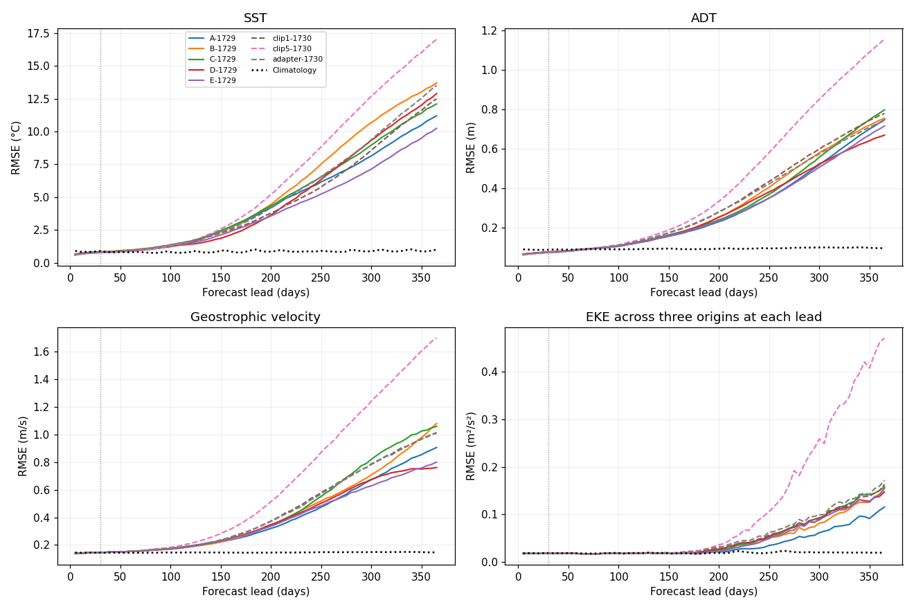
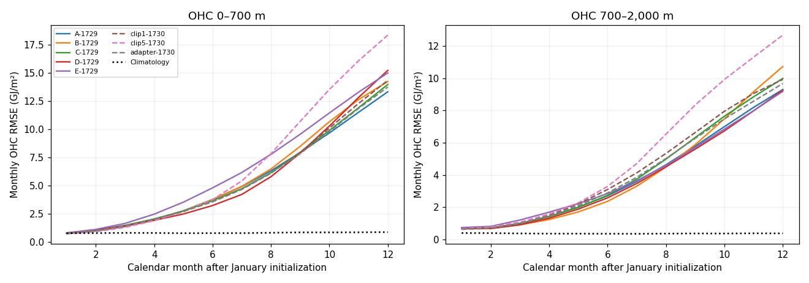
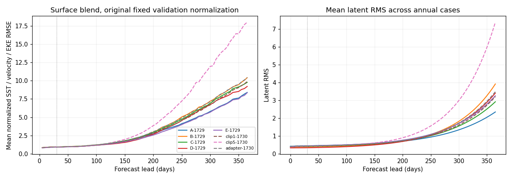
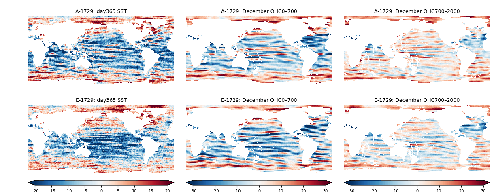
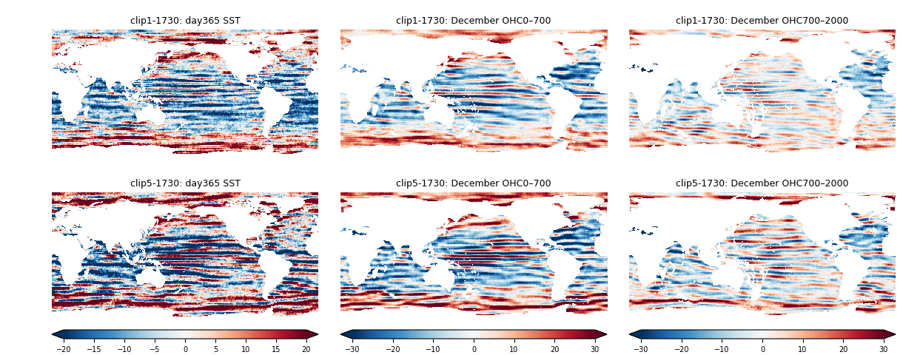

<!-- SPDX-FileCopyrightText: 2026 Samudra Authors -->
<!-- SPDX-License-Identifier: CC-BY-4.0 -->

# Continuous annual evaluation of monthly latent/diffusion pilots

**All eight fixed models completed all three year-long cases with finite
predictions, but every model has poor long-lead skill.** Day 365 SST RMSE is
10.25–17.04°C versus seasonal climatology 1.00°C. December OHC errors are more
than an order of magnitude above climatology, with substantial latent growth.
The earlier monthly validation near-ties do not establish useful annual forecasts.

This is an evaluation of the completed [monthly pilots and reproductions](monthly-latent-pilots-2026-10-16.md),
using fixed cooled 3k EMA endpoints. No training or annual checkpoint selection.
Each case initializes once and evolves continuously for 365 days with prescribed
ERA5. Decoder lead conditioning also extrapolates beyond its month-long training
range, so annual degradation cannot be attributed solely to latent evolution.

Contents: [Lead curves](#lead-curves) · [Endpoint metrics](#endpoint-metrics) ·
[Error maps](#error-maps) · [Interpretation](#interpretation) ·
[Models and methods](#models-and-methods) · [Verification](#verification).

## Lead curves

SST, ADT, geostrophic velocity and EKE are scored every 5 days; OHC is scored for
each calendar month. Vertical dotted lines mark the old day 30 validation horizon.
Solid curves are seed 1729; dashed curves are seed 1730; names are defined below.

The physical-unit curves are primary. The auxiliary surface blend below uses
**the original fixed nine-origin validation climatology denominators**, matching
the OHC-excluded training plots. The source evaluator's separate same-lead annual
climatology ratio is retained in the data as `surface_blend`; the plotted score
is `fixed_validation_surface_blend`. No OHC values are interpolated into a daily
composite. Latent RMS is a representation diagnostic, not a physical error metric.

All three cases show deterioration; the ordering varies by case. These are three
January starts, not enough to characterize seasonal/year uncertainty or seed
variability. [Per-origin SST curves](assets/monthly-latent-annual-2026-10-18/per-origin-sst.png)
and [per-origin values](assets/monthly-latent-annual-2026-10-18/per-origin-sst.csv)
are supplied without treating the case spread as a confidence interval.

## Endpoint metrics

Pooled spatial RMSE over the three cases at fixed lead; lower is better. The
final surface output is the five-day mean for days 360–365. Velocity is derived
geostrophically from predicted SSH. EKE uses anomalies **across the three origins
at each lead**, not anomalies through the year; it is not the older early/fine
report's annual temporal-anomaly EKE. All errors are raw, with no detrending or
deseasonalizing; EKE's own anomaly operation is part of its definition.

| Model | Day 365 SST °C | ADT m | Velocity m/s | EKE m²/s² |
|---|---:|---:|---:|---:|
| A-1729 | 11.19 | 0.749 | 0.907 | 0.115 |
| B-1729 | 13.70 | 0.756 | 1.080 | 0.155 |
| C-1729 | 12.10 | 0.798 | 1.060 | 0.158 |
| D-1729 | 12.88 | 0.670 | 0.762 | 0.147 |
| E-1729 | 10.25 | 0.717 | 0.801 | 0.155 |
| clip1-1730 | 12.50 | 0.780 | 1.015 | 0.163 |
| clip5-1730 | 17.04 | 1.157 | 1.700 | 0.471 |
| adapter-1730 | 13.52 | 0.742 | 1.009 | 0.172 |
| Seasonal climatology | 1.00 | 0.096 | 0.146 | 0.018 |

How SST error grows:

| Model | Day30 °C | Day90 °C | Day180 °C | Day 365 °C |
|---|---:|---:|---:|---:|
| A-1729 | 0.83 | 1.14 | 3.41 | 11.19 |
| B-1729 | 0.82 | 1.23 | 3.50 | 13.70 |
| C-1729 | 0.82 | 1.21 | 3.50 | 12.10 |
| D-1729 | 0.81 | 1.13 | 2.81 | 12.88 |
| E-1729 | 0.76 | 1.13 | 2.98 | 10.25 |
| clip1-1730 | 0.81 | 1.15 | 3.07 | 12.50 |
| clip5-1730 | 0.77 | 1.14 | 3.95 | 17.04 |
| adapter-1730 | 0.80 | 1.25 | 3.30 | 13.52 |

December OHC is a **calendar-month mean**, not a day 365 interior snapshot.
Latent values are mean RMS across the three cases at initialization and day 365.

| Model | December OHC 0–700 GJ/m² | OHC 700–2,000 GJ/m² | Initial → final latent RMS |
|---|---:|---:|---:|
| A-1729 | 13.33 | 9.30 | 0.431 → 2.350 |
| B-1729 | 14.24 | 10.73 | 0.384 → 3.917 |
| C-1729 | 13.98 | 9.99 | 0.403 → 2.921 |
| D-1729 | 15.23 | 9.26 | 0.339 → 3.407 |
| E-1729 | 15.00 | 9.19 | 0.394 → 3.257 |
| clip1-1730 | 14.34 | 9.93 | 0.400 → 3.211 |
| clip5-1730 | 18.36 | 12.68 | 0.402 → 7.377 |
| adapter-1730 | 13.75 | 9.68 | 0.409 → 3.484 |
| Seasonal climatology | 0.88 | 0.37 | — |

## Error maps

These matched 2021-case panels show prediction minus observation at identical
support and color limits. SST is the final five-day mean; OHC is December's
calendar mean. Each map uses one pixel per retained grid cell (180×360), north
up and longitude increasing from0° to 360°. End triangles denote values beyond
the plotted color limits; metrics use unclipped values.

## Interpretation

1. **The common long-horizon problem dominates the small monthly improvements.**
   Every model degrades strongly by 180 days and fails badly at a year. Finite
   tensors alone are a weak stability check. A's day 365 SST error includes a
   −5.23°C mean bias, but removing it still leaves 9.90°C centered RMSE: a uniform
   offset does not explain the deterioration. The error maps show pronounced zonal
   banding. Velocity, EKE and OHC errors also grow.
2. **Short-horizon ranking can reverse.** In the matched seed 1730 comparison,
   clip5 has lower day 30 SST error (0.77 versus 0.81°C) but much higher day 365
   error (17.04 versus 12.50°C), larger velocity error and greater latent growth.
   This is one seed under extrapolated inference, not proof of a generally
   optimal clipping threshold. Obs-only E has the lowest year-end SST error,
   but 10.25°C is still poor and its OHC advantage is not uniform.
3. **Both latent drift and decoder extrapolation remain plausible contributors.**
   The evolved representation grows markedly in norm. Independently, decoder
   position conditioning reaches roughly365days although training covered only
   the first month. First-month replay passes exactly, which validates the
   extension's initial binning/sampling; it does not qualify this extrapolation.
   Norm growth is not by itself proof of the error mechanism.
4. **The next diagnostic should separate these two effects before broader tuning.**
   At selected long leads, compare evolved versus held initial latent states,
   crossed with true versus in-training-range decoder lead conditioning. Keep
   monthly duration, weights and noise paired. This is a readout sensitivity
   diagnostic, not a replacement for the true-lead results above. If evolved
   states remain poor with in-range readout, longer latent-rollout supervision
   and explicit drift diagnostics become the more direct target. No additional
   experiment has been launched by this report.

## Models and methods

Every table/legend name denotes a fixed `endpoint-03000.pt` EMA. These are
matched 3k endpoints, including E; they are not reselected by annual metrics.
All use the same 48,702,016-parameter architecture: a separate surface initializer,
two 128-channel latent slots on 45×90, a shared latent processor, and a physical
window-conditioned diffusion decoder on 180×360. The OM4 adapter adds 12 parameters.
Full training details and losses are in the [parent report](monthly-latent-pilots-2026-10-16.md).

| Name | Meaning |
|---|---|
| A-1729 | Seed 1729; 50% observation / 50% recent OM4 main updates; surface initialization |
| B-1729 | Same mix; initializer tasks 50% surface / 25% missing-variable / 25% spatial-gap |
| C-1729 | Seed 1729; 50% observation / 25% recent OM4 / 25% CM4; surface initialization |
| D-1729 | Same mix as C; initializer tasks as B |
| E-1729 | Seed 1729; observation-only optimization; surface initialization; shared OM4 normalization retained |
| clip1-1730 | Independent A reproduction, seed 1730, clipping threshold 1 |
| clip5-1730 | Matched to clip1-1730, clipping threshold 5 from the first update |
| adapter-1730 | Matched to clip1-1730, identity-started affine 3→3 OM4 forcing adapter during model-data training |

Each model trains 2k main updates and then 1k obs-only cooldown, resetting EMA to
raw weights at the switch, retaining Adam, decaying LR from 1e-4 to 1e-6 and using
EMA half-life 100 updates. A–D and seed 1730 arms see 2k observation updates total;
E sees 3k. The extra OM4 forcing adapter is inactive on ERA5-driven annual inference;
its effect is through mixed training and learned shared weights.

Annual cases start January 1 in 2015, 2018 and 2021. The initializer consumes 19
historical five-day SST/ADT/ERA5 bins. The processor evolves 73 successive latent
steps with prescribed future ERA5 and geographic/calendar context, without future
ocean observations or monthly state resets. Thus this is conditional ocean
evolution under known atmospheric forcing, not an operational weather forecast.

At each lead, metrics use the mean of eight diffusion draws with 32 sampler
steps. These are errors of the ensemble mean, not CRPS or a calibration test.
Monthly interiors are decoded from exact calendar-overlap-weighted latent states;
the top temperature layer for OHC comes from overlap-weighted decoded SST. Decoder
position is the true absolute forecast midpoint, 2.5…362.5days for native bins and
15.5…349.5days for calendar months; duration remains5days or the month length.
No monthly teacher-forcing or reinitialization is introduced.

Predictions and references share the fixed global observation grid. Geostrophic
metrics exclude |latitude|<5° and require valid reference velocities/SSH gradients.
OHC uses complete temperature-column geometry from static masks and exact depth
layer overlap: 38,933 shallow and 37,190 deep cells. Missing observations further
restrict each score; missing predictions inside fixed model support fail loudly.

## Verification

Qualification 214407 passed exact first-month surface/OHC replay against the old
monthly evaluator using clip1-1730 for all three origins, plus real saved-case OHC/climatology
scoring. Evaluation 214408 completed all eight models. All 24 annual archives,
32 output hashes, source checkpoint/audit identities, 73 surface leads, 12 OHC
months and 74 latent-RMS entries per case were checked. Targets agree across
models, predictions are finite on fixed support, and all source weights stayed
read-only. Twelve A–D archives were reused byte-for-byte from the qualified prior
attempt; twelve E/seed 1730 archives were newly inferred. The fixed-support scoring
repair did not change predictions. Earlier dtype/timestamp/scoring attempts remain
preserved; [attempt provenance](monthly-latent-pilots-2026-10-16.md#continuous-365-day-follow-up)
records them.

Producer `8973278c9`; root:
`/projects/ny/lz1955/multiscale/jrusak/runs/monthly-annual-20261018/recovery-ohc-support`.
Annual evaluation including all retries used **2.8886 allocated GPU-hours**;
the campaign total is **100.5136 GPU-hours**. Monitoring is closed; no further
runs were launched.

[All lead metrics](assets/monthly-latent-annual-2026-10-18/lead-metrics.csv) ·
[Monthly OHC](assets/monthly-latent-annual-2026-10-18/monthly-ohc.csv) ·
[Machine-readable results](assets/monthly-latent-annual-2026-10-18/results.json) ·
[Verification](assets/monthly-latent-annual-2026-10-18/verification.json) ·
[Checksums](assets/monthly-latent-annual-2026-10-18/checksums.txt).
