<!-- SPDX-FileCopyrightText: 2026 Samudra Authors -->
<!-- SPDX-License-Identifier: CC-BY-4.0 -->

# Small latent/diffusion pilots

Status: **All five pilots completed** in Beta job **214108** (10h19m46s).
Each reached 2,000 main updates and 1,000 observation-only cooldown updates,
with online W&B, twelve validation checkpoints, and saved main/cooled endpoints.
Producer `1c9817d44`; full qualification **214096** passed. Allocated production
GPU time was 41.3178 hours; including qualification attempts, **41.5228 GPU-hours**.

## Pilot results

These are **validation results**, not held-out test or annual rollout results.
The shared blend is the mean of five raw-RMSE ratios to fixed seasonal climatology:
SST, geostrophic velocity, EKE, and OHC at 0–700 m and 700–2,000 m. No spectra enter
selection. A score of one equals the climatology blend. Nine monthly origins,
eight ensemble members, and 32 sampler steps are fixed across arms.

| Arm and meaning | Main endpoint (2k) | Cooled endpoint (3k) | Selected step / score |
|---|---:|---:|---:|
| A: OM4 + obs / surface | 1.3037 | 1.1182 | 3000 / 1.1182 |
| B: OM4 + obs / multitask | 1.3677 | 1.1257 | 3000 / 1.1257 |
| C: OM4 + CM4 + obs / surface | 1.3639 | 1.1330 | 3000 / 1.1330 |
| D: OM4 + CM4 + obs / multitask | 1.4121 | 1.1393 | 3000 / 1.1393 |
| E: Obs only / surface | 1.1821 | 1.1443 | 2750 / 1.1421 |

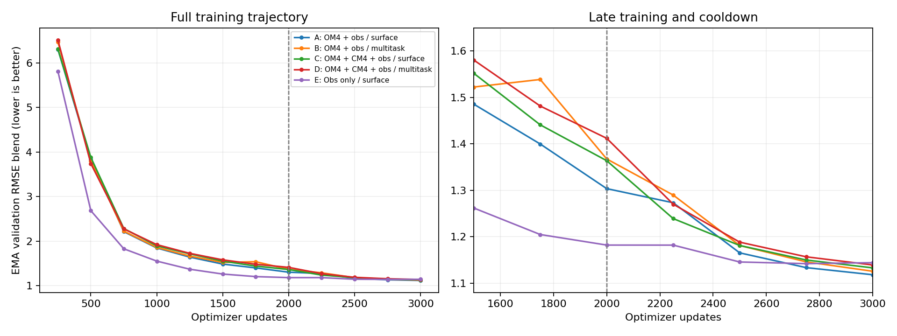

The simple OM4+obs arm A finishes best, 2.27% below obs-only E at the matched
3k endpoint. Multitask initialization and replacing half of OM4 with CM4 show
no improvement in this pilot. Before cooldown, obs-only is best. The mix arms
receive 1,000 observation updates during main training versus 2,000 for E;
after cooldown those counts are 2,000 versus 3,000. Thus this is a matched total
update budget, not a matched observation exposure comparison. Cooldown changes
both the learning rate and the mix for A–D, so its improvement cannot be attributed
to learning rate alone. One seed and small final differences do not establish a
reliable ranking. All final blends remain above seasonal climatology overall;
component performance should guide objective and training-setup follow-ups.
Obs-only E has the best surface SST, velocity and EKE errors, while A has the
best OHC errors in both depth ranges. The composite winner therefore reflects
better subsurface heat content, not uniformly better forecasts.

Cooled endpoint components (SST/velocity/EKE averaged over leads 5, 15 and 30 days):

| Arm | SST (°C) | Velocity (m/s) | EKE (m²/s²) | OHC 0–700 m (GJ/m²) | OHC 700–2,000 m (GJ/m²) |
|---|---:|---:|---:|---:|---:|
| A | 0.7879 | 0.13712 | 0.02144 | 0.7585 | 0.5908 |
| B | 0.7845 | 0.13708 | 0.02151 | 0.7779 | 0.5950 |
| C | 0.7418 | 0.13736 | 0.02145 | 0.7734 | 0.6298 |
| D | 0.7565 | 0.13714 | 0.02149 | 0.8099 | 0.6155 |
| E | 0.6998 | 0.13534 | 0.02121 | 0.8142 | 0.6570 |

[Machine-readable curves and component metrics](assets/monthly-latent-pilots-2026-10-16/results.json).
[Checkpoint byte hashes](assets/monthly-latent-pilots-2026-10-16/checkpoint-sha256.txt)
are relative to the run root. These verify retained files; this report does not
claim a separate post-training checkpoint reload evaluation.

- [A: OM4 + obs / surface](https://wandb.ai/ocean_emulators/observational-transfer/runs/5488bc38064c)
- [B: OM4 + obs / multitask](https://wandb.ai/ocean_emulators/observational-transfer/runs/66188f65768e)
- [C: OM4 + CM4 + obs / surface](https://wandb.ai/ocean_emulators/observational-transfer/runs/ba6af0dc0924)
- [D: OM4 + CM4 + obs / multitask](https://wandb.ai/ocean_emulators/observational-transfer/runs/c8ed764155f9)
- [E: Obs only / surface](https://wandb.ai/ocean_emulators/observational-transfer/runs/b0723b64e7ab)

## Training diagnostics (initial log audit)

The logged gradient norm is the **pre-clipping** global norm of the accumulated
batch-eight gradient. Every update clips it to at most 1 before AdamW. During
updates 1,001–2,000, all five arms clipped every update. For A:

| Source | Mean loss ± SD | Median gradient norm | 90th percentile | Clipped updates |
|---|---:|---:|---:|---:|
| Observation | 0.2630 ± 0.0708 | 4.839 | 7.015 | 100% |
| OM4 | 0.6412 ± 0.0655 | 3.113 | 4.571 | 100% |

A's source-dependent mean accounts for 88.5% of loss variance in that interval
(87.7–89.5% across A–D). This explains most of the alternating trace; it does
not establish harmful gradient conflict. The denoising objective averages
area-weighted error within each supported channel and then averages channels,
so extra output channels do not mechanically multiply the loss. Observation
and model updates nevertheless differ in target distributions, support, native
versus monthly weights, and diffusion noise. Compare each source's trajectory
and physical validation, not the pooled scalar alone.

Heavy clipping is an optimization question, not evidence by itself of exploding
updates: norms are finite and validation improves, and the logged norm is not
Adam's actual parameter-step magnitude. Observation gradients are larger even
though their scalar loss is smaller. In A's final 500 cooldown updates, clipping
still occurs 91.8% of the time (median norm 2.452). Clipping therefore substantially
changes the gradient scale supplied to Adam; it should be measured before
changing the threshold or interpreting nominal task weights.

Other questions suggested by this audit:

- The composite favors subsurface OHC while surface errors favor obs-only; inspect
  gradient alignment and per-component validation before changing data ratios.
- OM4 and observations use different forcing paths: the learned ERA5 adapter is
  observation-only, while OM4 supplies its native three forcings. Transfer could
  depend on this interface as well as ocean fields.
- The diffusion decoder is stochastic but latent evolution is deterministic;
  decoder spread alone does not establish calibrated trajectory uncertainty.
- Direct monthly and native-window readouts need not agree. Native day-5/day-30
  OHC is especially diagnostic for E, which has no native interior supervision.

Read-only diagnostic job **214194** completed on production Beta (11m56s). Script commit
`c7160b76e` imports the unchanged training producer `1c9817d44`; no optimizer
steps or checkpoint writes are performed. It measures A's raw 2k/3k gradients
using four batch-eight replicates per source, with within-source cosine controls,
and exports all five cooled EMA models at two validation origins and leads 5/30.
The initializer probe covers the U-Net; its input projection is not included.
OM4 has no adapter gradients, so adapter cross-source cosine is not informative.
Maps use five-day-bin means; monthly OHC observations are not matching daily
truth. All twenty map exports and both gradient probes passed finite-value and archive checks.

Additional read-only job **214195** (diagnostic commit `f022e38b2`) follows the
map job and computes counterfactual AdamW update norms relative to module weight
norms under clipping thresholds 1, 5 and no clipping, using the same gradients
and saved optimizer moments. This is a mathematical single-step calculation,
not a training intervention or evidence of longer-term benefit. The calculation
was checked against an actual float64 AdamW step at three gradient scales to
1e-14 tolerance. Each checkpoint retains its saved LR, so compare clipping
choices within a checkpoint before comparing 2k and 3k absolute updates.
It also records mean/RMS/max of learned ERA5 adapter outputs and normalized
OM4 forcings; these are distribution diagnostics, not paired physical errors.
OM4 batches do not use the adapter, whose absent gradients correctly skip both
Adam moments and weight decay. Original checkpoint files remain read-only.

The eight ERA5 inputs, in order, are 10 m zonal wind, 10 m meridional wind,
2 m temperature, 2 m dewpoint temperature, surface pressure, downward surface
solar radiation, downward surface thermal radiation, and total precipitation.
Their preparation names are defined in `observation_prepare.py::FORCING`.

## Gradient alignment and example maps

Four independent batch-eight probes per source use A's raw weights at each
endpoint, identical batch/noise draws across the two checkpoints, and the actual
training objectives. These are training examples, not validation performance.
Cosines are averaged over all cross-source batch pairs; within-source means
exclude the diagonal. Global clipping preserves each gradient direction.

| Module | Cross-source cosine at 2k | Cross-source at 3k | Obs/obs at 3k | OM4/OM4 at 3k |
|---|---:|---:|---:|---:|
| Initializer U-Net | 0.593 | 0.062 | 0.273 | 0.983 |
| Processor | 0.599 | -0.016 | 0.112 | 0.963 |
| Decoder | 0.695 | -0.040 | 0.392 | 0.997 |

The tasks align positively before cooldown; afterwards they are approximately
orthogonal, with weak negative processor/decoder cosines. Observation gradients
also become substantially less consistent across batches. This does not support
a claim of strong persistent task conflict throughout training.

| Checkpoint/source | Probe loss | Initializer norm | Processor norm | Decoder norm | Adapter norm |
|---|---:|---:|---:|---:|---:|
| 2k / obs | 0.1806 | 0.582 | 0.299 | 6.480 | 0.0136 |
| 2k / OM4 | 0.5487 | 0.182 | 0.105 | 3.029 | 0 |
| 3k / obs | 0.0909 | 0.078 | 0.054 | 0.481 | 0.0050 |
| 3k / OM4 | 0.8746 | 1.051 | 0.819 | 24.506 | 0 |

These are mean pre-clipping module norms, not parameter updates. The decoder
dominates the probed gradients; the ERA5 adapter does not. The same OM4 probes
get worse after observation-only cooldown while observation probes improve:
evidence of lost model-data fit during specialization. That makes decoder/loss
balance and retaining some model supervision worth investigating. It does not
isolate forcing as the cause, nor prove that retaining OM4 improves obs forecasts.
The measured norm breakdown omits the initial frame projection; the additional
Adam diagnostic includes it. Frozen-checkpoint probe gradients differ from
online training gradients and should not be substituted for the training trace.

Latent RMS increases over 30 days by 5.6–6.0% for A, 4.1–4.2% for B, 4.9–5.1% for
C, 2.1–2.3% for D and 13.0–13.8% for E in these two examples. This is not explosive
short-horizon growth; longer-rollout stability remains untested here.
[Full gradient records](assets/monthly-latent-pilots-2026-10-16/gradient-diagnostics.json)
and [latent RMS traces](assets/monthly-latent-pilots-2026-10-16/latent-rms.json).

Maps use the cooled 3k EMA endpoints, eight-member means, and matched origins
November 2013 and April 2014. Each grid cell occupies exactly 2×2 pixels, with
shared per-variable scales across arms and leads within each panel. Color limits
use pooled 1st/99th percentiles; gray marks missing support. Longitude runs 0–360°,
north at top. The separately sampled map ensembles are not the identical random
stream used for the aggregate validation scores. OHC panels are native five-day
readouts, not the directly supervised monthly product; they have no matching
five-day observation target. Model fields are smooth at this resolution; these
absolute maps alone cannot establish dynamical skill or ensemble calibration.

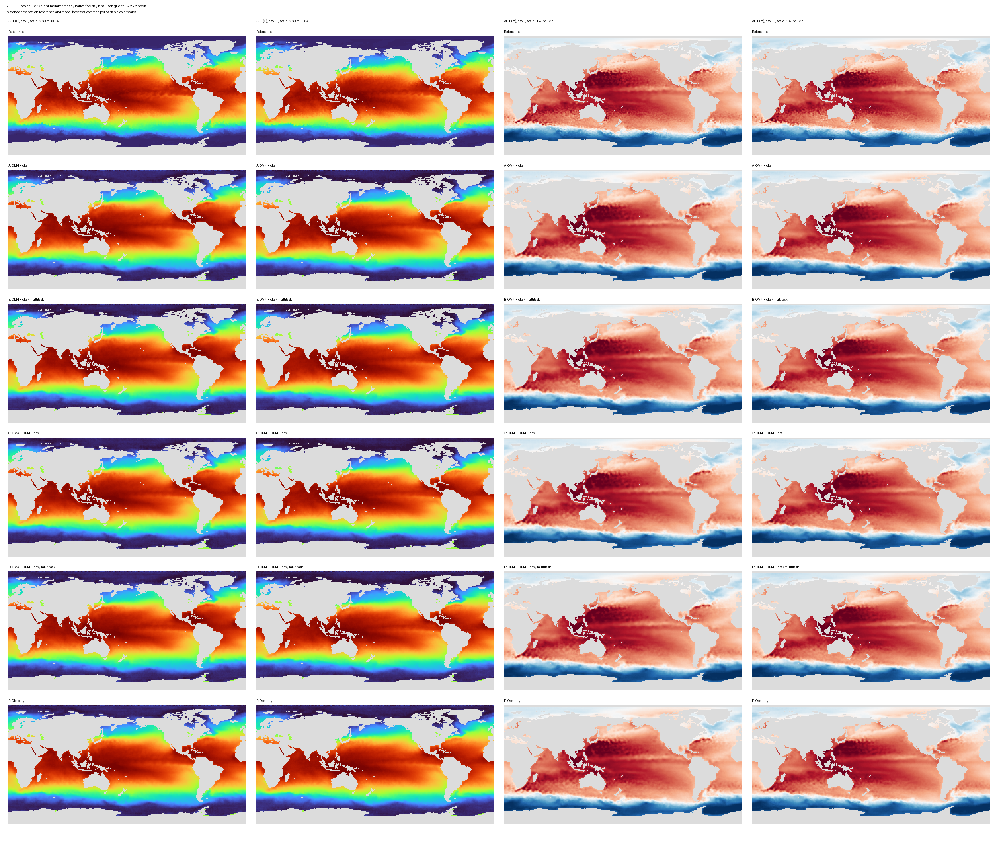

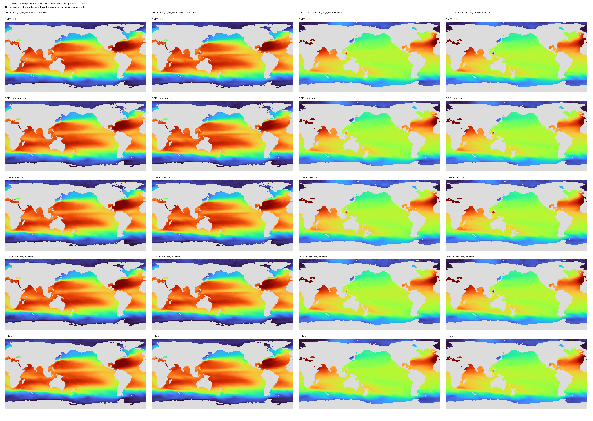

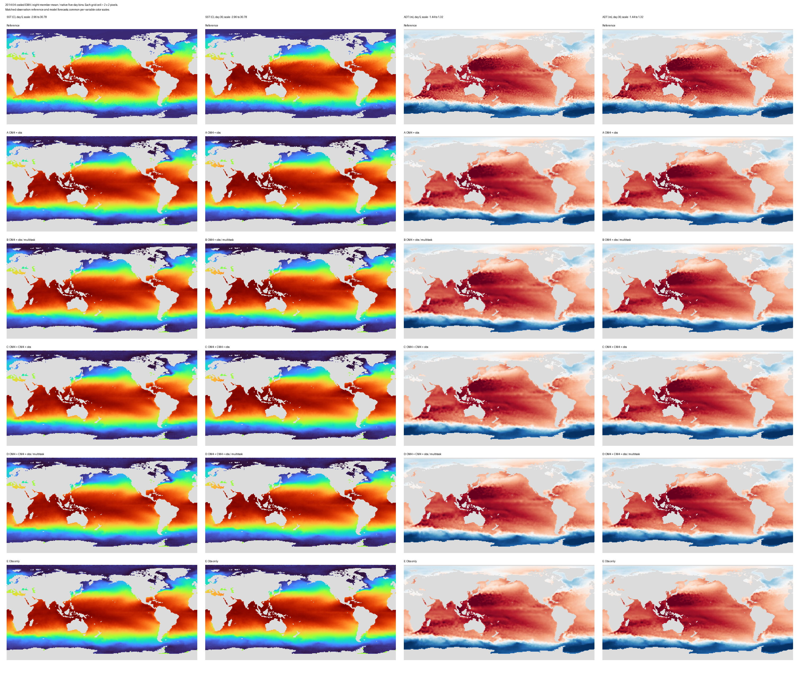

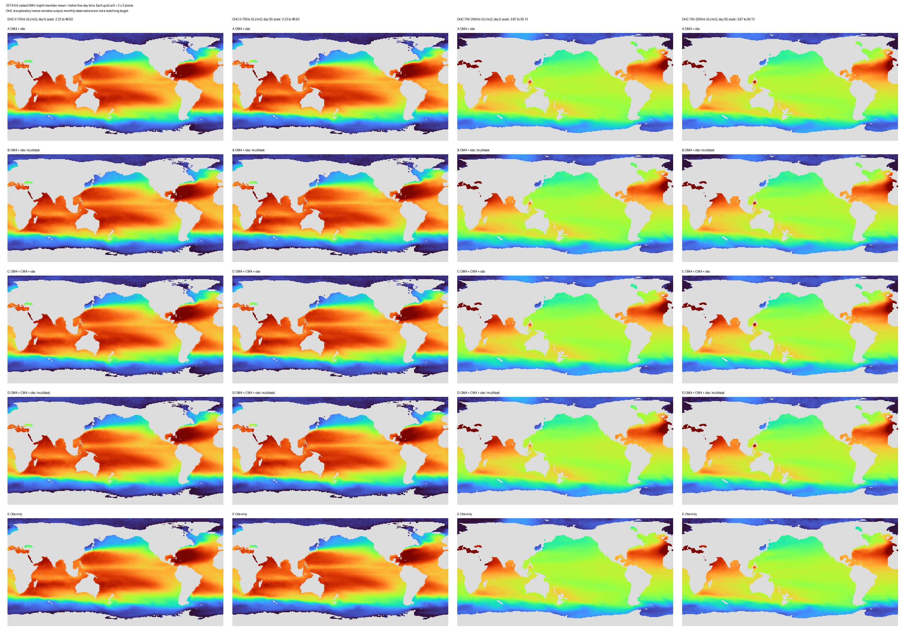

This diagnostic consumed 0.7956 allocated GPU-hours (one GPU active on a required
four-GPU Beta node), bringing completed allocation time to 42.3183 GPU-hours.
Clipping/forcing diagnostic 214195 also completed (3m49s, 0.2544 allocated GPU-hours); total completed campaign allocation is now 42.5728 GPU-hours.

## Clipping and forcing follow-up

Job **214195** completed without updating weights. Results use four batch-eight
replicates per source, raw A checkpoints and their saved AdamW moments. At 2k,
median predicted next-step size as a percentage of each module's weight norm:

| Source/module | Clip 1 | Clip 5 | No clipping |
|---|---:|---:|---:|
| Obs initializer | 0.0396% | 0.1396% | 0.1632% |
| Obs processor | 0.0383% | 0.1351% | 0.1590% |
| Obs decoder | 0.0506% | 0.1662% | 0.2036% |
| OM4 initializer | 0.0459% | 0.0912% | 0.0912% |
| OM4 processor | 0.0387% | 0.0645% | 0.0645% |
| OM4 decoder | 0.0596% | 0.1299% | 0.1299% |

Clipping materially changes the update; Adam does not cancel its effect when
existing moments are held fixed. These small relative update norms do not suggest
an immediate giant-step problem. They also do not prove that increasing the
threshold improves training. Global clipping is driven mainly by decoder
gradients and scales down initializer/processor gradients at the same time.
This supports testing clipping policy before changing physical normalization.

At the cooled endpoint, these four obs probes have total norms 0.41–0.64, so
threshold choice has no effect on their next step. OM4 probes have norms 20–28;
clip 1 to 5 raises the median decoder update about 2.6-fold. This is an endpoint
probe, not a contradiction of frequent clipping during the preceding online
cooldown trajectory. The endpoint LR is 1e-6 rather than 1e-4 at 2k; do not
attribute their smaller absolute updates solely to clipping.

Forcing summaries at 2k (means and RMS averaged across sampled examples and all
spatial cells, including land):

| Representation | Channel means | Channel RMS |
|---|---|---|
| Learned ERA5 adapter | -0.147, 0.598, 0.979 | 0.537, 1.153, 1.880 |
| Normalized OM4 stress-x/stress-y/heat-flux | 0.009, 0.007, -0.011 | 0.845, 0.826, 0.856 |

The learned representation differs from the physical forcing representation;
that alone is not a defect because its channels have no physical calibration.
The comparison also includes zero-filled land for OM4, while the adapter can emit
nonzero values on land, so these are not matched ocean-only statistics. Adapter
gradients remain small; there is no evidence that they directly dominate clipping.
A separate lead is OM4 heat-flux tails: the largest sampled normalized absolute
value is approximately 180, despite global RMS below one. Locate those values,
check raw units and saved normalization, and examine spatial support before
changing scales or adding an OM4 adapter. A global mean/RMS cannot resolve that.

Recommended next experiment, subject to approval: matched short continuations
from 2k with threshold 1 versus 5, same LR/data draws, monitoring module update
sizes and both source losses. If decoder domination remains limiting, compare
module-wise clipping against that control rather than immediately changing data
normalization. Forcing interpretation needs ocean-only, geographically localized
checks; these diagnostics have not established forcing as the cause of lost OM4 fit.

Numerical audit: the original float32 cosine calculation produced self-cosines
up to 1.007 because its vector normalization and dot-product reductions differed.
Published matrices now normalize the saved Gram entries by their own diagonal,
which algebraically cancels the original normalization factors; zero-gradient
adapter rows remain zero and are not evidence of alignment. Source now uses a
float64 Gram calculation. This correction changes the 2k initializer cross-source
mean from 0.597 to 0.593, without changing the interpretation. Raw cluster output
is preserved. [Full clipping and forcing records](assets/monthly-latent-pilots-2026-10-16/clipping-diagnostics.json).

## Question and arms

Does model-data supervision improve observation forecasts with a shared latent
processor and physical diffusion decoder? Does varying the initializer's available
inputs improve that transfer? All fields are global 1° (180 × 360).

| Arm | Main optimizer-update mix | Initializer inputs |
|---|---|---|
| A | 50% observations, 50% OM4 | Surface only |
| B | 50% observations, 50% OM4 | Multitask |
| C | 50% observations, 25% OM4, 25% CM4 | Surface only |
| D | 50% observations, 25% OM4, 25% CM4 | Multitask |
| E | 100% observations | Surface only |

One seed (1729), 2,000 main updates, effective batch eight. Constant main LR
1e-4. Then 1,000 observation-only updates with LR linearly declining to 1e-6,
retaining optimizer state and resetting EMA to raw weights at the fork; EMA
half-life 100 updates. This is a deliberately small comparison, not a reliable
ranking of small differences. No later search wave is included in this launch.

Multitask draws: 50% surface-only, 25% missing-variable family, 25% spatial gap.
Model data can supply the available interior fields. Observation examples supply
only observed surface history: the variable task removes SST or SSH, and gaps
remove a quarter-height by quarter-width rectangle. They never acquire monthly
interior targets as initializer inputs. Task changes do not remove forecast
losses or shorten forecast horizons.

## Architecture and losses

Separate initializer and processor. One initialization from nineteen five-day
historical frames, with explicit per-field availability. Its output is one latent
state containing two memory slots, each 128 channels on a 45 × 90 grid. The
processor autoregresses that state using forcings and geographic/seasonal context;
decoded physical samples never feed back. A shared denoiser decodes 77 physical
channels, conditioned on latent state, target support, window duration and lead.
All arms use this same **48,702,016-parameter** architecture. Initial real-observation
qualification measured 0.736 seconds per microbatch and 4.32 GB peak allocated
CUDA memory. This is a short timing including three training examples; it excludes
model-data I/O and validation and is not an end-to-end production estimate.

The proposed monthly speedup is **direct monthly-target denoising**, conditioned
on a calendar-weighted average of evolved latent states. Native five-day targets
use individual latent states. Monthly outputs are not guaranteed to equal the
average of separately sampled five-day outputs; report their consistency as a
diagnostic. Training uses single denoiser calls, not differentiation through a
complete diffusion sampler.

Observation loss: 0.8 monthly interior denoising + 0.2 five-day surface denoising
+ 0.1 initial-surface reconstruction. Interior supervision uses the existing
fourteen temperature and fourteen salinity layers, excluding supplied SST from
interior supervision. Surface loss samples a uniformly chosen forecast lead;
its expectation is the mean over all forecast leads. Missing targets are excluded
from both corrupted inputs and scoring. This is masked marginal denoising, not a
complete-field likelihood or invented interior labels. Reconstruction uses the
last historical surface, not the future month's interior average. Model-data
loss is 0.5 full-field monthly denoising + 0.5 full-field native forecast denoising
+ 0.1 full-field initial reconstruction. Model-data objectives still need full
qualification before production.

## Data and evaluation contracts

CM4 source: `s3://m2lines-pubs/Samudra/v2026-09/cm4_onedeg/CM4.zarr`.
Destination: `/projects/ny/lz1955/multiscale/jrusak/data/cm4_onedeg/CM4.zarr`.
Source inventory: 131,466 objects, 140,827,879,002 bytes. Grace transfer job
138228 completed in 21m08s, with full read-back verification, zero differences,
and byte-identical source-before/source-after/destination metadata. Its
`COMPLETE.json` records metadata SHA256
`5bfbf9fb994bdbe7247f0d5b88546c8c0a025ada3a632b8d59f556e4272d2e43`.
Callback job 138229 also completed; transfer monitoring is retired.

Live static audit: CM4, the existing OM4 store, and the observation grid have
exactly equal latitude/longitude coordinates; CM4 has the expected 19 layer
depths and thicknesses. No horizontal regridding is required. This verifies
geometry, not completeness of dynamic fields.

CM4 uses its own tauuo/tauvo/hfds and actual noleap interval bounds. Retain the
fixed OM4 normalization for model fields/forcings, including CM4; do not relabel
CM4 dates as OM4 dates. Observation physical outputs use the same fixed reference
scales; ERA5 has its existing training-only normalization and learned forcing
adapter. E has no model-data training examples but shares reference normalization.

OM4 uses the existing recent period (1975 onward, through the training cutoff),
not early OM4 in addition to CM4. The draft model-data adapter reserves the last
20 CM4 model years and uses its first 180 years. The OM4 timestamp axis has sixteen
six-day jumps at leap-year boundaries. It must not silently become contiguous
five-day calendar coverage: the adapter records and excludes monthly windows
whose history or targets cross these gaps. Full data qualification will report
the resulting sample inventory before production.

Use existing observation train/validation/test splits and raw RMSE-blend reporting,
not spectra for checkpoint selection. Validation runs every 250 optimizer updates
over all nine existing validation origins: eight members, 32 Heun steps, fixed
sampler seeds, EMA weights, and the existing five-component normalized RMSE score
with a fixed seasonal-climatology denominator. Report both main and cooled
endpoints and component errors. Full qualification measures this sampling cost.

Surface metrics use the ensemble-mean five-day surface predictions. OHC uses
directly sampled monthly interior temperature/salinity, with its top temperature
layer supplied by the calendar average of native SST predictions (SST is excluded
from IAP interior supervision). This readout is explicit; it is not a claim that
the two decoder windows are physically identical. A frozen-initial-latent readout
is a separate diagnostic, not a physically constant persistence forecast.

## Launch gates

One Beta production node, with up to four independent single-GPU arms at a time
and the fifth subsequently; qualification may change that packing if memory or
throughput requires it. Waiting for the production queue is acceptable.

Initial qualification checks real-observation loading, all three initializer
input tasks, finite nonzero gradients into initializer/processor/decoder/forcing
adapter, memory/throughput, and exact optimizer/checkpoint replay. This is not
sufficient to qualify CM4 or the complete production protocol. Production also
requires verified CM4 transfer, channel/grid/calendar/forcing audits, model-data
loss and gradient checks, a frozen evaluation contract, and online W&B bring-up.
Diagnostic weights are never promoted to production.

Implementation: [model](../../../src/samudra/experiments/monthly_latent.py),
[observation objective](../../../src/samudra/experiments/monthly_pilot_data.py),
[model-data adapter](../../../src/samudra/experiments/monthly_model_data.py), and
[initial qualification](../../../scripts/qualify_monthly_latent.py).
The persistent-latent processor and diffusion core were imported from the
diffusion worktree at `2b98db3deb4370c3b641cf0d1055a8b394917589`; unused auxiliary
loss helpers were omitted. Fixed 4× pooling replaces adaptive pooling where
the grids have an exact integer ratio, enabling deterministic CUDA replay.
Eleven CPU tests pass, including pooling value/gradient equivalence, masking,
native-calendar weighting, exact source allocation, and rejection of missing
wet CM4 values. Repository pre-commit checks pass for the pinned producer.

Preserved qualification attempts: 214083 failed before Python because Slurm
rounded CPU allocation inconsistently; 214086 was held and canceled without
running; 214087 reached backward but deterministic CUDA rejected adaptive pooling.
Including successful 214088 (94 seconds), completed qualification GPU time is
200 seconds (0.05556 GPU-hours); 214094 is excluded until its accounting is final.
214088 verified finite nonzero gradients in all four trainable components for
all three tasks, and bitwise-identical checkpoint replay. Its diagnostic weights
will not be used. The production runner and validation path are implemented;
full model-data/evaluation qualification subsequently passed in 214096.

214094 subsequently verified the retained OM4 normalization and all three fitting
tasks on both model sources. It found 409 eligible recent-OM4 months and 2,156
CM4 months. OM4 loading/fitting took 7.5–17.3 seconds per example versus
1.9–3.1 seconds for CM4, so production will use a packed OM4 copy whose every
frame is read back and byte-hash matched to the existing store. No values, masks,
normalization, or sampling are changed by packing. Twelve CPU tests now pass,
including exact packed/native equality and corruption rejection. Completed GPU
time including failed 214094 is 366 seconds (0.10167 GPU-hours).

Grace preparation jobs 138249 and 138251 failed before Python because the shared
Enroot image cache denied access; the second attempt's environment override was
ignored by Pyxis. Both attempts and logs are retained (zero GPU-hours). Recovery
138253 imported the same pinned image directly into a private project cache before
starting Pyxis and completed in 18m06s; CPU callback 138254 succeeded. The packed
store contains 2,702 × 77 × 180 × 360 float32 values (53,927,596,928 bytes including
the NPY header). Every frame passed source-byte-hash read-back; the complete digest
inventory, file header/size, and unchanged source/grid metadata were also checked.
All three CPU attempts together used 20m36s elapsed allocation time and zero
GPU-hours. Replacement full Beta qualification 214096 uses `FULL_QUALIFICATION=1`, `PRODUCER=1c9817d44`, and
`PACKED_OM4=RUN_ROOT/packed-om4`. It passed, and production 214108 completed all five arms.

Run root: `/projects/ny/lz1955/multiscale/jrusak/runs/monthly-latent-pilots-20261016`.
Proofs live in `initial-qualification-JOBID/`; producer-matched `QUALIFIED.json`
and unchanged data/normalization hashes are required before production updates.

## Approved clipping and OM4-adapter continuations

All three branches fork A's raw and EMA **2,000-update main endpoint**, preserving
its Adam moments and RNG/data-draw state. Each trains 1,000 more updates with
constant LR 1e-4, batch eight, seed 1729, and exactly 50% obs / 50% OM4. This is
continued mixed training, not another obs-only cooldown. Retain EMA half-life
100 without reset; evaluate the same nine-origin/eight-member/32-step raw-RMSE
blend every 250 updates. Compare both curves and the common 3k endpoint.

| Name | Global clipping threshold | OM4 forcing interface |
|---|---:|---|
| clip1 | 1 | Existing normalized physical forcings |
| clip5 | 5 | Existing normalized physical forcings |
| adapter | 1 | Identity-started learned affine 3→3 transform |

The adapter has 12 parameters (3×3 weights plus three biases), operates pointwise
on normalized OM4 forcings for initialization and evolution, and restores zero
on model land. ERA5 retains its existing learned adapter. Only the new parameters
receive fresh Adam state; the backbone and its optimizer history are preserved.
The adapter begins exactly at the old interface, avoiding an initial input shift.
This is the minimal learned-affine interface test, not a capacity-matched nonlinear
adapter test. No CM4 or extra seeds are added.

Beta job **214212 completed** all three qualifications and continuations in
2h57m01s on one four-GPU node. Monitoring is closed. Producer `6a76e61ee`; thirteen focused CPU tests and all repository pre-commit
checks pass. Source checkpoint hash is pinned in the launcher. All three branches
must pass real obs/OM4 batch-eight updates, finite gradients, checkpoint reload,
and (adapter branch) identity-output and nonzero-learning checks before any
production branch starts. Qualification weights are discarded: production reloads
the original immutable 2k checkpoint. Source-specific W&B losses/clipping are
logged alongside the mixed trace. New run root:
`/projects/ny/lz1955/multiscale/jrusak/runs/monthly-clip-adapter-20261017`.

Runtime reference: original A used 6h34m including validation, comprising 5h19m
for its first 2k mixed updates and 1h15m for its obs-only cooldown. Approximately
three hours per new 1k mixed continuation is a rough estimate, excluding queue;
the three arms run concurrently. The earlier five-pilot allocation's 10h20m
included E running after A and should not be interpreted as A's runtime.

## Clipping and adapter continuation results

All branches completed 1,000 additional mixed updates (500 obs + 500 OM4),
ending at 3k total with 1,500 updates from each source. No cooldown or EMA reset.
All four validation checkpoints were finite; all three select their 3k endpoints.

| Branch | Final RMSE blend ↓ | Obs updates clipped | OM4 updates clipped |
|---|---:|---:|---:|
| clip1 | 1.165185 | 100.0% | 100.0% |
| clip5 | 1.164020 | 25.2% | 6.0% |
| adapter | 1.161374 | 100.0% | 100.0% |

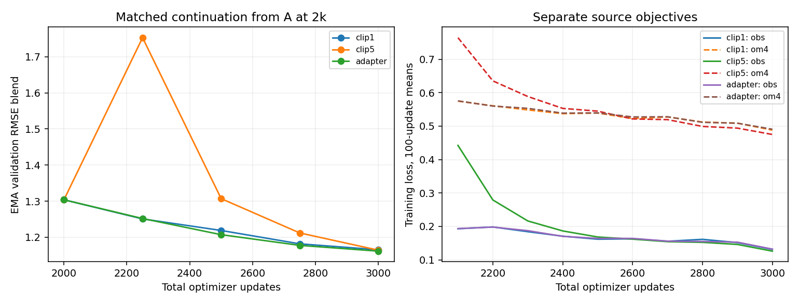

Clip5 initially destabilizes the continuation: its EMA blend rises to about
1.75 at update 2,250, versus 1.25 for clip1, before recovering. Both source
training losses also spike. The threshold change is abrupt while retaining Adam
moments accumulated under clip1; this test does not isolate whether a gradual
change or training with clip5 from the beginning would behave differently.

Clip5 improves the final blend by 0.10% versus clip1; the adapter improves it by
0.33%. These are tiny single-seed differences, not convincing evidence of improved
forecast skill. Heavy clipping was real and changing it substantially altered
optimization, but this test does not show that clipping1 was the main obstacle.
Likewise this small affine forcing adapter does not show a meaningful benefit;
it does not rule out more expressive or physically constrained forcing alignment.

| Branch | SST °C | Velocity m/s | EKE m²/s² | OHC 0–700 GJ/m² | OHC 700–2,000 GJ/m² |
|---|---:|---:|---:|---:|---:|
| clip1 | 0.75890 | 0.139835 | 0.021602 | 0.85163 | 0.63128 |
| clip5 | 0.72716 | 0.140836 | 0.021636 | 0.83540 | 0.64846 |
| adapter | 0.76309 | 0.139859 | 0.021592 | 0.83195 | 0.63282 |

Clip5 has 4.2% lower SST RMSE but 2.7% worse deep OHC and 0.7% worse velocity
RMSE than clip1; the pooled blend hides these tradeoffs. The adapter lowers
upper-ocean OHC error by about 2.3%, with little change in the other components.
These component differences also need replication before a scientific claim.

The adapter learned rather than remaining frozen: raw diagonal weights end at
0.96085/0.95912/0.96833, largest absolute off-diagonal about 0.01009, and largest
absolute bias about 0.00159. Both new Adam parameter states record exactly 500
OM4 updates. Saved weights are finite. This mainly resembles a modest rescaling
of normalized forcing, not a large change of representation.

For context, the previous obs-only cooldown endpoint scored 1.11824 versus
1.16518 for continued mixed training at clip1. That is not an isolated cooldown
comparison: both the LR schedule and source mixture differ. The continuation
results support prioritizing objective/data-exposure questions over interpreting
the original large pre-clipping norms as a sufficient explanation of performance.

[Full curves and component records](assets/monthly-latent-pilots-2026-10-16/continuation-results.json).
- [clip1 W&B](https://wandb.ai/ocean_emulators/observational-transfer/runs/5a7ce70bf5f6)
- [clip5 W&B](https://wandb.ai/ocean_emulators/observational-transfer/runs/9ad43d840011)
- [adapter W&B](https://wandb.ai/ocean_emulators/observational-transfer/runs/4ff5004a2eac)

This allocation used 11.8011 GPU-hours including qualification (three active
training GPUs on a required four-GPU host). Total completed campaign allocation,
including earlier pilots and diagnostics: **54.3739 GPU-hours**. This report adds
no test-set or annual-rollout claims and launches no further experiments.

## From-scratch reproduction: seed 1730

Beta job **214259 completed successfully** in 6h30m24s. All three arms passed
qualification and completed the matched schedule.

User-approved follow-up reproduces the **original 2k mixed + 1k cooldown sweep**,
not the later fixed-LR 3k continuation schedule. All three arms start from random
initialization with **seed 1730** (original A used 1729), identical backbone
initialization and matched data draws. No learned checkpoint or optimizer state
is loaded. Arms are clip1, clip5, and clip1 with the identity-started 12-parameter
OM4 forcing adapter. Clipping choice applies from the first update through cooldown.

Main: 2,000 updates at LR 1e-4, 50% obs / 50% recent OM4, effective batch eight.
Cooldown: reset EMA to raw at 2k, retain Adam, use 1,000 obs-only updates and
linearly decay LR to 1e-6; EMA half-life 100. All targets, loss weights, evaluation
origins, eight-member/32-step sampler and raw-RMSE blend remain unchanged. Report
both 2k and cooled 3k endpoints, curves and components; compare new clip1 with
original A to assess seed variability, and compare new arms within seed 1730.

Producer `bc66ef3e6`; fourteen focused tests and pre-commit checks pass, including
exact main/cooldown allocation and endpoint LRs. GPU qualification checks both
source tasks, adapter identity/learning and checkpoint reload; all initial
backbone hashes must agree across arms before any training starts. Qualification
weights are discarded and production reinitializes from seed 1730. Online W&B
and source-specific losses/clipping remain enabled.

Run root: `/projects/ny/lz1955/multiscale/jrusak/runs/monthly-scratch-seed1730-20261017`.
One Beta node, three concurrent GPU runs, 12-hour allocation limit.

### Reproduction results

| Model (seed) | Main 2k RMSE blend ↓ | Cooled 3k RMSE blend ↓ |
|---|---:|---:|
| A (1729) | 1.303730 | 1.118241 |
| clip1 (1730) | 1.316232 | 1.092317 |
| clip5 (1730) | 1.269390 | 1.095043 |
| adapter (1730) | 1.325215 | 1.097456 |

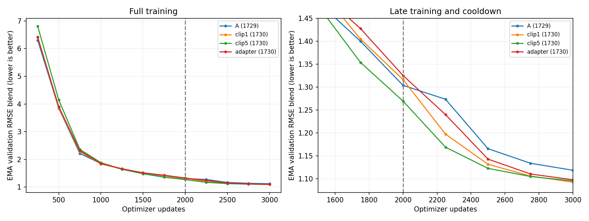

Every run selects its 3k endpoint. Clip5 is 3.56% better than the matched control
at 2k, but finishes 0.25% worse after cooldown. The forcing adapter finishes
0.47% worse. Neither intervention improves the final blend in this seed.
The new control finishes 2.32% better than original A: the observed seed difference
is larger than either final intervention difference. Two control seeds do not
estimate the full seed distribution, but these results do not support a robust
benefit from either change. Clip5's earlier advantage warrants distinguishing
optimization speed from final cooled performance; it is not evidence of a lasting
skill improvement. The dashed line marks both the EMA reset and switch to
obs-only, decreasing-LR training, so improvement across it is not an isolated LR effect.

All rows below use the cooled 3k EMA and the same nine validation origins.

| Model (seed) | SST °C | Velocity m/s | EKE m²/s² | OHC 0–700 GJ/m² | OHC 700–2,000 GJ/m² |
|---|---:|---:|---:|---:|---:|
| A (1729) | 0.78791 | 0.137122 | 0.021445 | 0.75846 | 0.59078 |
| clip1 (1730) | 0.75688 | 0.136537 | 0.021415 | 0.75655 | 0.55998 |
| clip5 (1730) | 0.73148 | 0.134943 | 0.021362 | 0.72598 | 0.59723 |
| adapter (1730) | 0.74720 | 0.136415 | 0.021407 | 0.74480 | 0.58028 |

The aggregate hides a depth tradeoff: clip5 improves SST by 3.4% and upper OHC
by 4.0% versus clip1, but worsens deep OHC by 6.7%. The adapter improves SST
by 1.3% and upper OHC by 1.6%, but worsens deep OHC by 3.6%. Thus neither
change is uniformly worse; their surface/upper-ocean gains do not improve the blend.

[All validation curves and component records](assets/monthly-latent-pilots-2026-10-16/scratch1730-results.json).

- [clip1 W&B](https://wandb.ai/ocean_emulators/observational-transfer/runs/8c77f721cd68)
- [clip5 W&B](https://wandb.ai/ocean_emulators/observational-transfer/runs/b8a1825f9051)
- [adapter W&B](https://wandb.ai/ocean_emulators/observational-transfer/runs/eea9787c44c6)

Verified all 3,000 ordered finite training events per arm, exactly 1,000 OM4 and
2,000 obs updates, all twelve nine-origin validation records, the shared random
backbone hash, and the cooldown LR endpoint. Adapter checkpoint reload verified
finite model/EMA state and exactly 1,000 Adam updates for its 12 parameters;
obs-only cooldown leaves that adapter unchanged after the EMA reset. No diagnostic
or qualification weights were promoted. This is validation evidence, with no
new test-set or annual-rollout claim.

The completed allocation, including qualification, used **26.0267 GPU-hours**;
total campaign allocation including earlier pilots, diagnostics and continuations
is **80.4006 GPU-hours**. No additional experiments were launched.

## Early-cooldown and convergence diagnosis

The final blends are close, but the models are not identical: clipping5 trades
better surface/upper OHC against worse deep OHC. This follow-up tests whether
observation-only adaptation overwhelms earlier mixed training, whether EMA hides
raw-weight differences, and whether the forecast uses ocean-state evolution.

Three authorized clip1 branches use seed1730 control states at 0, 100 and 1,000
mixed updates, each followed by exactly 1,000 observation-only cooldown updates.
Each retains its own Adam state and resets EMA to its raw weights. Observation
sampling and diffusion RNG streams are paired to the original control's 2k
cooldown; no weights or moments are taken from that 2k checkpoint. LR decays
from 1e-4 to 1e-6, batch8, EMA half-life100, unchanged losses and nine-origin
RMSE validation every250 cooldown updates. Both raw and EMA weights are scored.
The existing 2k→3k control is the comparison. This varies prior mixed-data
exposure; it does not hold total training compute or observation exposure fixed.

Only the random fork and 2k/3k endpoints were retained. Reconstruct the first
1,000 control updates and retain states100/1000. Require exact agreement with
saved losses, gradient norms, LR/source schedule and all four validation payloads
before branching. Each cooldown passes two real observation updates and an exact
saved-weight reload check, then restarts from its source; qualification weights
are discarded. A failed replay blocks the cooldowns, rather than silently using
an approximate reconstruction.

Read-only diagnostics on all three completed treatments:

- Raw versus EMA at 2k and 3k, with the identical eight-member/32-step noise stream
  and full nine-origin cohort; unchanged EMA evaluations must reproduce saved metrics.
- At 3k EMA, hold the initialized latent fixed while preserving requested lead and
  monthly duration. This isolates processor evolution more cleanly than the older
  persistence diagnostic, which also changed decoder position to the initial time.
- Swap only surface history/availability between validation cases (fixed cyclic
  shift by four), retaining recipient forcing, calendar/context and targets.
- Zero the adapted forcing while retaining surface history and context. This is
  an out-of-distribution sensitivity probe, not an alternative physical forecast.
- Save prediction/reference arrays for paired per-origin, field and spatial
  comparisons, rather than relying on the pooled blend alone.

A near-matching 0→1k result would show that the cooldown can learn most of this
short-lead validation skill without model-data pretraining. A worse 0→1k but
similar 100/1000→cooldown result would suggest rapidly acquired reusable features.
Raw-weight separation with EMA convergence would implicate averaging; convergence
in both would implicate training/objective dynamics instead. Small degradation
under history swapping or fixed latents would motivate checking seasonal/spatial
priors and whether the decoder is carrying evolution. Perturbation sensitivity
alone does not establish physically correct dynamics. The initializer's code
slices physical inputs to historical frames; a regression test verifies future
physical-field values cannot enter the trajectory through that interface.

EMA after1,000 cooldown updates retains only 2^-10 of its reset starting weights.
It can still smooth the late trajectory, but is not predominantly retaining the
pre-cooldown model. No new annual or test-set claim is made by these diagnostics.

**Beta214322 completed successfully** in 4h18m22s, producer `f31344f86`,
on one four-GPU node. Sixteen focused tests and pre-commit checks pass. Root:
`/projects/ny/lz1955/multiscale/jrusak/runs/monthly-early-cooldown-20261018`.
The source run was mounted read-only. All cooldowns and diagnostics are complete;
monitoring is closed.

### Early cooldown results

The last 1k observation updates do **not** recover the final control's skill from
random or minimally trained weights. Earlier mixed training matters in this
recipe. Each row gets the same 1k cooldown examples/noise and LR schedule, while
retaining its source Adam state. Counts include pre-cooldown training.

| Mixed updates before cooldown | Total obs / OM4 updates | Final EMA blend ↓ | Final raw blend ↓ |
|---|---:|---:|---:|
| 0 | 1,000 / 0 | 1.880664 | 1.842059 |
| 100 | 1,050 / 50 | 1.702661 | 1.681825 |
| 1,000 | 1,500 / 500 | 1.205722 | 1.182247 |
| 2,000 | 2,000 / 1,000 | 1.092317 | 1.085411 |

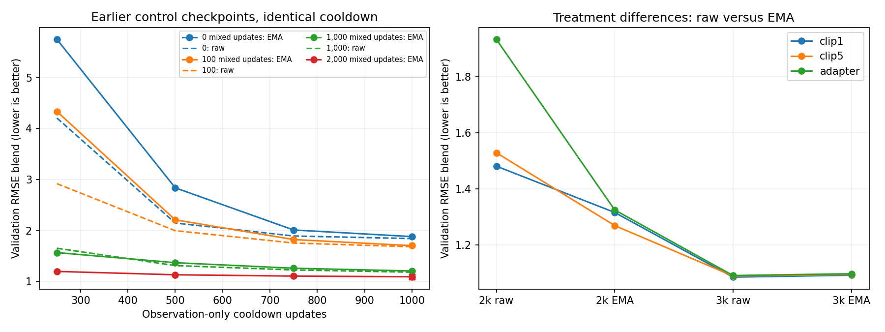

This is not an OM4-versus-observation causal comparison: longer main training
adds both kinds of examples, changes optimizer state, and keeps LR high longer.
In particular, 0→1k starts decaying LR immediately; its poor result does not show
that an adequately trained obs-only model cannot match the control. The experiment
rejects the narrower hypothesis that this final 1k cooldown learns essentially
the same predictor regardless of its starting checkpoint.

| Mixed updates before cooldown | SST °C | Velocity m/s | EKE m²/s² | OHC 0–700 GJ/m² | OHC 700–2,000 GJ/m² |
|---|---:|---:|---:|---:|---:|
| 0 | 0.8116 | 0.146970 | 0.022030 | 1.7003 | 1.4506 |
| 100 | 0.7712 | 0.145110 | 0.021970 | 1.4455 | 1.2811 |
| 1,000 | 0.7873 | 0.140018 | 0.021673 | 0.8648 | 0.6845 |
| 2,000 | 0.7569 | 0.136537 | 0.021415 | 0.7565 | 0.5600 |

Most of the early-checkpoint deficit is interior heat content: 0→1k SST error
is 0.812°C versus 0.757°C for 2k→3k, but upper/deep OHC errors are 1.700/1.451
versus 0.757/0.560 GJ/m². Thus surface skill is acquired much sooner than the
interior skill dominating the remaining blend gap.

### Is EMA concealing the treatment effect?

| Treatment | 2k raw | 2k EMA | 3k raw | 3k EMA |
|---|---:|---:|---:|---:|
| clip1 | 1.481499 | 1.316232 | 1.085411 | 1.092317 |
| clip5 | 1.529351 | 1.269390 | 1.089390 | 1.095043 |
| adapter | 1.933963 | 1.325215 | 1.091019 | 1.097456 |

At 2k EMA changes the picture substantially: the adapter's raw score is much
worse, and clip5's EMA advantage is absent in its raw endpoint. After cooldown,
raw weights are slightly better than EMA in every arm, and both have the same
ordering (clip1, clip5, adapter) and similarly small separation. Therefore EMA
is **not hiding a large final blend improvement** from either treatment. One
raw endpoint cannot establish typical raw-weight performance during the main
phase; its larger differences may reflect training fluctuations. The raw final
results also retain surface/depth tradeoffs, rather than identical errors.

### Does the predictor use the ocean state and evolution?

All following scores use the cooled 3k EMA and paired sampling noise. Holding
latents fixed preserves the requested decoder lead and duration. History swapping
retains recipient forcing/calendar; zero forcing removes adapted atmospheric
inputs from both initialization and evolution.

| Treatment | Standard | Hold latent fixed | Swap surface history | Zero adapted forcing |
|---|---:|---:|---:|---:|
| clip1 | 1.092317 | 1.807704 | 1.591100 | 2.330314 |
| clip5 | 1.095043 | 1.987767 | 1.588688 | 2.656751 |
| adapter | 1.097456 | 1.823128 | 1.593098 | 2.273209 |

For clip1 these interventions worsen the blend by approximately 65%, 46% and
113%, respectively. Thus the model is sensitive to initialized ocean history,
processor evolution, and atmospheric conditioning. A decoder ignoring all these
and emitting only a static spatial pattern is inconsistent with these results.
These are out-of-distribution perturbations: they do not prove physically correct
eddy dynamics, or separate seasonal information from dynamically useful anomalies.
A fixed latent may also be outside the decoder's usual forecast-state distribution.

The component sensitivities are informative too. For clip1, swapping history
raises SST error from 0.757 to 2.047°C, but deep OHC only from 0.560 to 0.599
GJ/m² (about7%). Holding latents fixed raises deep OHC to1.476; zero forcing
raises it to1.424. This leaves open that deep-ocean prediction relies heavily
on a learned spatial/seasonal representation driven by forcing/context, with
less dependence on the particular surface history. The perturbations do not
rule out that more specific shortcut; same-season cross-year swaps are needed
to separate seasonal conditioning from state-dependent prediction.

The strongest current interpretation is that cooldown genuinely brings these
particular treatments toward similar validation performance, while retaining
component tradeoffs. Earlier training remains valuable; EMA alone does not explain
the convergence. Whether this reflects a shared optimization regime, objective
limitations or observation-domain adaptation remains unresolved. Useful next
controls would be same-season history/forcing swaps across years (preserving
seasonality), paired anomaly/change scores, and replicated treatment comparisons.
These are suggestions, not newly launched runs.

The reconstructed first1,000 updates match all saved losses, gradient norms,
sources/LRs and four full validation payloads exactly. All three cooldowns passed
qualification, produced1,000 finite obs updates and four raw/EMA validation pairs;
all six unmodified diagnostic EMA scores exactly reproduce saved evaluations.
Twenty-one prediction archives passed integrity checks. These remain nine-origin
validation results, with no new test or annual evaluation.

[Full curves, components and diagnostic records](assets/monthly-latent-pilots-2026-10-16/early-cooldown-results.json).
Prediction/reference archives remain at the run root under `diagnostics/`.
Allocation cost including replay, qualification and diagnostics: **17.2244 GPU-hours**;
completed campaign total: **97.6250 GPU-hours**. No further compute is running for
this follow-up.

## Validation learning curves without OHC

Drop both OHC terms and average the three remaining original ratios equally:
SST RMSE / climatology SST RMSE, geostrophic velocity RMSE / its climatology
RMSE, and EKE RMSE / its climatology RMSE. Each component retains the original
5/15/30-day lead averaging; nine origins, EMA weights and decoder noise are
unchanged. A score below1 beats climatology on this reduced blend. Velocity and
EKE both derive from SSH; they are not independent physical quantities. This
is a post-hoc view of existing checkpoints, not a change to training or selection.

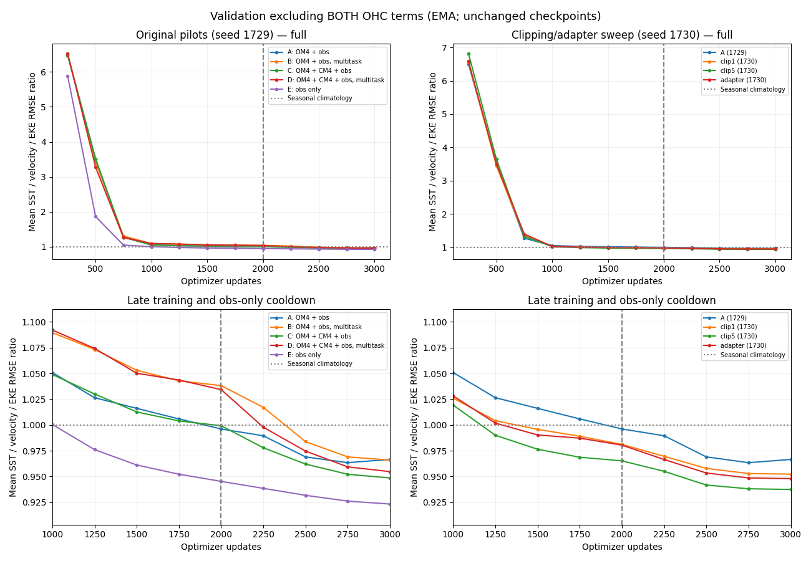

Top panels show full training, bottom panels use matching late-training axes.
The dashed vertical line at2k marks the obs-only cooldown and EMA reset.

| Model | Seed | Main 2k ↓ | Cooled 3k ↓ |
|---|---:|---:|---:|
| A: OM4 + obs | 1729 | 0.9961 | 0.9665 |
| B: OM4 + obs, multitask | 1729 | 1.0381 | 0.9660 |
| C: OM4 + CM4 + obs | 1729 | 0.9993 | 0.9486 |
| D: OM4 + CM4 + obs, multitask | 1729 | 1.0343 | 0.9547 |
| E: obs only | 1729 | 0.9453 | 0.9233 |
| clip1 (1730) | 1730 | 0.9811 | 0.9522 |
| clip5 (1730) | 1730 | 0.9652 | 0.9374 |
| adapter (1730) | 1730 | 0.9804 | 0.9479 |

The ranking changes materially. Original obs-only E has the best reduced score,
4.48% lower than A at3k; its advantage is visible before cooldown as well.
It sees more observation updates at the same total update budget (3k versus2k
for mixed arms), so this does not isolate whether model data are intrinsically
unhelpful. C, which replaces half of OM4 with CM4, finishes1.86% below A on this
blend despite its worse original OHC-inclusive blend. Multitask B is essentially
tied with A; D improves over B but does not beat C.

In the matched seed1730 sweep, clip5 finishes1.56% below clip1, and the forcing
adapter0.45% below clip1. Thus the interventions do have surface benefits that
were offset by interior errors; cooldown does not erase clip5's surface advantage.
The control seed difference on this reduced blend is1.48%, similar in size to
the clip5 improvement. These single-seed comparisons do not establish a robust
ranking. All rows above compare fixed3k endpoints, not reselected checkpoints.

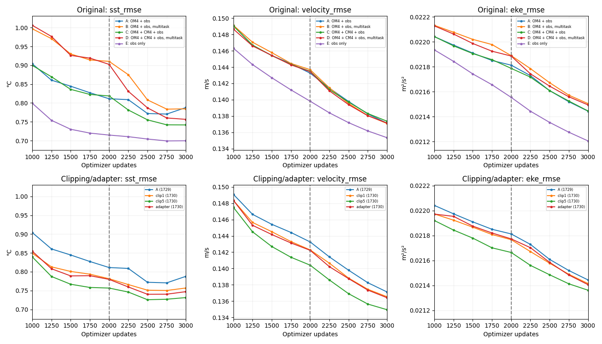

The component plots use shared vertical scales between sweeps and physical
units. They show how much of each blend difference is SST versus velocity/EKE.

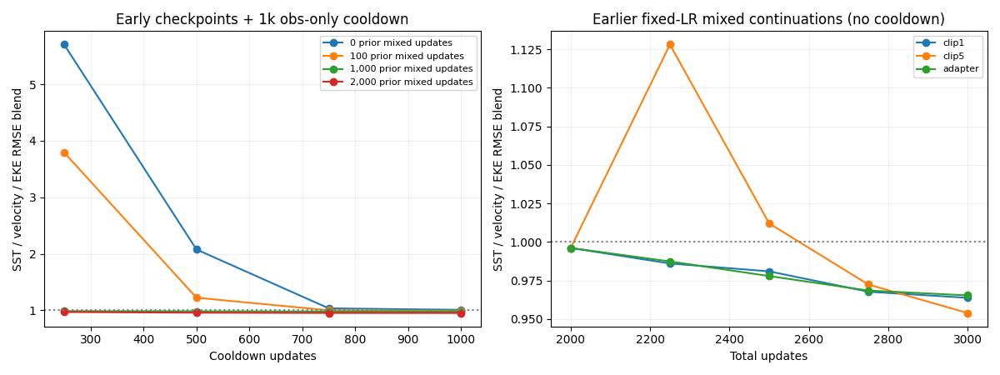

For the early-cooldown experiment, final reduced scores from0/100/1000/2000
mixed updates are **1.0084 / 0.9868 / 0.9766 / 0.9522**. The large gaps in the
OHC-inclusive score mostly disappear, although earlier mixed training still
helps the reduced metric in this recipe. The separate right panel shows the
older fixed-LR mixed continuations; those received no cooldown and should not
be conflated with the matched2k+1k sweep.

Normalization provenance: runners retained component metrics and full blended
scores but not the separate climatology result. The five fixed denominator
constants were recovered by solving the redundant blend equations from A's12
checkpoints, then checked against141 original, reproduction, continuation and
diagnostic records. Maximum reconstruction error is2.7e-15. Recovered denominators
are SST0.829498851°C, velocity0.139780864m/s, EKE0.0221360379m²/s²; full-precision
constants and all plotted points are in the [data file](assets/monthly-latent-pilots-2026-10-16/surface-only-results.json).
No training, model evaluation or new compute allocation was needed.

## OHC learning curves and interpretation

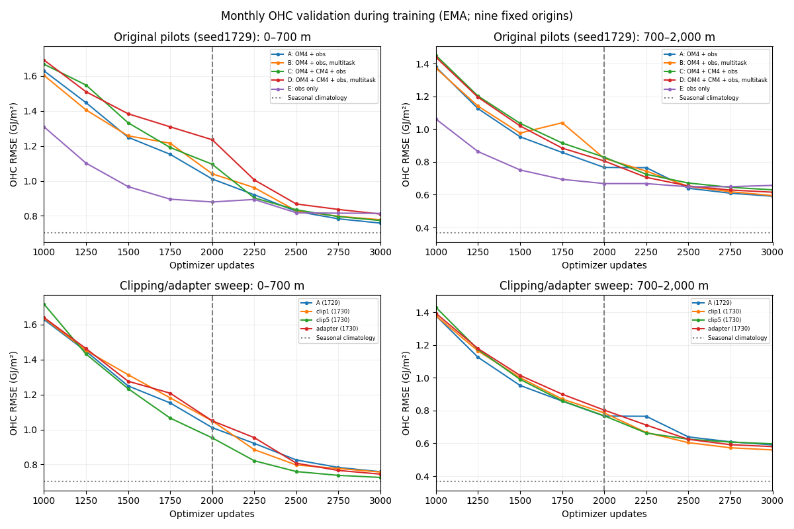

[Full training range](assets/monthly-latent-pilots-2026-10-16/ohc-curves-full.png) ·
[Early-checkpoint cooldowns](assets/monthly-latent-pilots-2026-10-16/ohc-curves-early.png) ·
[All plotted values](assets/monthly-latent-pilots-2026-10-16/ohc-curves-results.json).
Units are GJ/m²; upper and deep layers have separate axes, shared between sweeps.
The vertical line marks cooldown/EMA reset; horizontal dotted lines are seasonal
climatology errors. These are calendar-month OHC targets, not day30 snapshots.

The original mixed models begin cooldown with worse OHC than obs-only E, then
improve substantially and overtake it. A's upper/deep errors fall from1.011/0.767
to0.758/0.591 GJ/m², while E falls from0.879/0.668 to0.814/0.657. A finishes
6.8%/10.1% below E, despite E's better surface skill and greater observation
exposure. This supports a reusable interior representation from mixed training
that benefits from observation adaptation; it does not isolate OM4 data from
training schedule and optimizer effects. The early-checkpoint results likewise
show that interior skill needs more prior training than surface skill here.

In the new sweep, clip5's upper-OHC advantage persists through cooldown
(0.726 versus control0.757), but its deep error is worse (0.597 versus0.560).
The forcing adapter has the same direction of tradeoff at smaller magnitude.
The final pooled scores are therefore similar partly because improvements in
surface/upper-ocean quantities cancel losses at depth. This is a multi-objective
tradeoff, not evidence that every treatment has learned the same predictor.

All cooled OHC errors remain above this cohort's seasonal-climatology errors
(0.702/0.367). Deep OHC is a particular weakness even for the best model.
Absolute OHC RMSE alone cannot distinguish spatial/seasonal bias from failure
to predict anomalies, nor show that the learned deep state evolves physically.
The history-swap diagnostic found weak deep-OHC sensitivity relative to SST;
that keeps learned spatial/seasonal priors a live explanation. Both layer-wise
anomaly/change scores and longer continuous rollouts are useful follow-ups.
These observations do not establish an observed dynamical benefit or a replicated
winner for the clipping/adapter interventions.

## Continuous 365-day follow-up

User-authorized annual evaluation uses the fixed cooled3k EMA endpoints of
original A/B/C/D/E (seed1729) and new clip1/clip5/adapter (seed1730). No retraining
or annual checkpoint selection. The early-cooldown branches and the older
fixed-LR continuations are excluded from this first annual comparison.

Initialize once from19 historical five-day surface/ERA5 bins; evolve73 successive
five-day latent steps using prescribed future ERA5 and calendar/geographic
context. Future surface/interior observations are scored only. Decode each
five-day surface with the same eight-member,32-step readout as the monthly
validation; decode calendar-month interiors from overlap-weighted latent states.
Top-layer OHC continues to use overlap-weighted decoded SST. Calendar windows
are never treated as fresh ocean initializations. Prescribed ERA5 means this
is ocean evolution under known atmospheric forcing.

Use the existing three annual cases: January1 in2015,2018 and2021. Plot SST,
ADT and geostrophic-velocity RMSE every five days, EKE RMSE across the three
origins at each fixed lead, and OHC RMSE in both layers for each calendar month.
This EKE convention preserves the monthly report's fixed-lead aggregation axis;
it differs from the older early/fine report's within-year temporal-anomaly EKE.
Include seasonal climatology and the surface-only blend, preserving individual
components. The three same-season cases are a small diagnostic cohort.

Annual payload hashes/timestamps, all12 monthly targets, full first-month input
overlap and frozen checkpoint hashes must pass audit. Before evaluation, the
new rollout/readout must reproduce first-month surface/OHC predictions from the
existing monthly evaluator exactly for all three origins using the control.
The source checkpoints are read-only. Save prediction/reference maps and latent
RMS along the full trajectory, with online W&B evaluation tracking.

The decoder's requested position is the true absolute forecast lead (surface
midpoint2.5…362.5 days; monthly midpoint15.5…349.5), while durations remain5days
or the calendar-month length. Training only covered roughly the first month:
**both processor evolution and decoder lead conditioning extrapolate** in this
annual test. An annual failure cannot by itself identify which causes it.

For clip5 versus clip1, changes in contributions to the original five-term blend
are: surface terms combined **−0.0089**, upper OHC **−0.0087**, deep OHC
**+0.0203**, for net **+0.0027** (worse). The numerical cancellation explains
the near-tie without requiring identical model behavior. Climatology-normalizing
also makes a fixed absolute deep-OHC error count about1.9× as much as the same
GJ/m² error in upper OHC, because its climatology RMSE is0.367 versus0.702.
This is a consequence of the chosen relative-skill weighting, not evidence that
the deep layer is inherently1.9× more scientifically important.

Annual evaluation is now gated by short qualification **214407**, followed by
production **214408**, producer `8973278c9`. Current root:
`/projects/ny/lz1955/multiscale/jrusak/runs/monthly-annual-20261018/recovery-ohc-support`.
Twenty-three focused tests and pre-commit checks pass. All source checkpoints
remain read-only, the scientific protocol is unchanged, and monitoring is active.

The first-month replay already passed exactly in214379. A–D then saved all three
full annual rollouts, but scoring stopped on seven shallow reference cells outside
the model's complete-column temperature support. The repair derives a **fixed**
support from depth masks and layer overlap (38,933 shallow/37,190 deep cells),
matching the model's OHC integration and existing monthly comparison. It does
not use prediction-dependent masking; missing predictions inside this geometry
still fail. Every saved A–D prediction has exactly this support in every month.

The12 completed rollouts will be reused via pinned hashes, verified source/audit/
qualification lineage and fresh reference-array comparisons; old files are mounted
read-only and copied with byte-for-byte checks. Remaining inference is only E
and the three seed1730 models. Fresh qualification repeats first-month agreement
and scores actual preserved annual OHC plus climatology before releasing production.

All attempts are retained under the parent annual root:

| Job(s) | Outcome | Allocated GPU-hours |
|---|---|---:|
| 214352 | Qualification stopped on validity dtype; fixed | 0.2244 |
| 214378 | Qualification stopped on NumPy timestamp conversion; fixed | 0.2133 |
| 214379 | Exact first-month qualification passed | 0.0811 |
| 214380 | Twelve annual rollouts saved; common OHC support scoring failure | 1.1322 |

Annual allocation so far: **1.6511 GPU-hours**; campaign total **99.2761** before
this recovery. Source/data hashes match across all attempts. No training or new
checkpoint selection occurred.

The support correction successfully scores all12 preserved annual cases locally.
Their forecasts are finite but have severe long-lead drift: A's pooled day365
SST RMSE is approximately11.2°C, and its2015 latent RMS grows from0.43 to2.35.
These partial results are not a completed eight-model comparison, nor does the
scoring exception explain the drift. The extrapolation of both latent evolution
and decoder lead conditioning remains a material interpretation limit.
