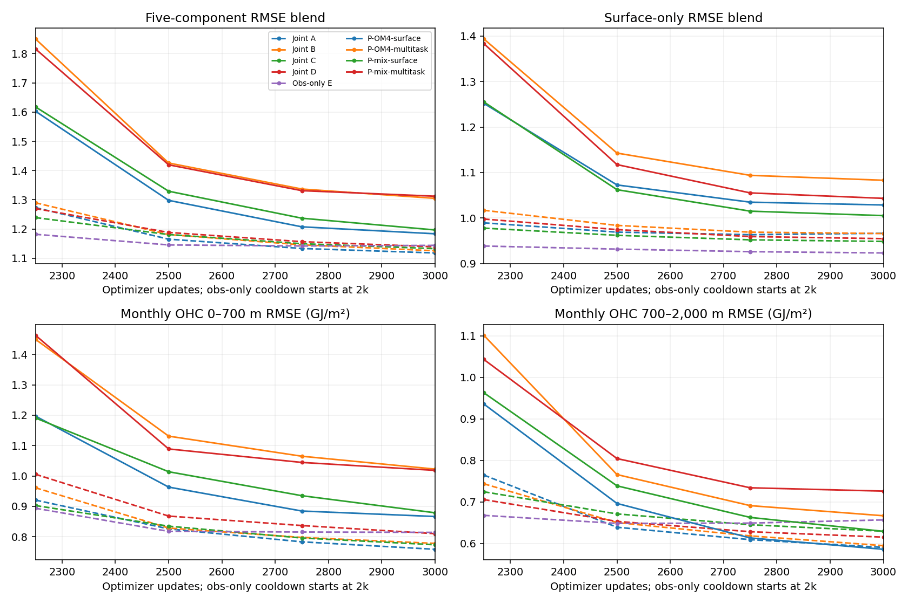

<!-- SPDX-FileCopyrightText: 2026 Samudra Authors -->
<!-- SPDX-License-Identifier: CC-BY-4.0 -->

# Model-only pretraining, then observation adaptation

Question: do the model datasets and multitask initializer help when observations
are introduced only during the final adaptation stage, rather than jointly
throughout training?

Status: **all four monthly runs completed** in Beta production **215049**;
annual qualification **215379** is running. Pinned training producer: `a1e74e188`. Run root:
`beta:/projects/ny/lz1955/multiscale/jrusak/runs/monthly-pretraining-20261020`.

This is a separate four-run comparison alongside the
[longer-training and replay wave](monthly-replay-2026-10-20.md). No replay or
latent-size regularizer is introduced here.

## Monthly results

With this 2k-model/1k-observation allocation, **model-only pretraining followed by
cooldown is worse than the original joint training**. Every new model selects
the final 3k checkpoint. Multitask initializer training is worse than surface-only
at both fixed model-data mixtures in this seed. Replacing half the OM4 updates
with CM4 improves surface error but does not improve the full blend.

| Model | Full blend ↓ | Surface blend ↓ | SST °C ↓ | Velocity m/s ↓ | EKE m²/s² ↓ | OHC 0–700 / 700–2,000 m GJ/m² ↓ |
|---|---:|---:|---:|---:|---:|---:|
| P-OM4-surface | 1.1838 | 1.0287 | 0.9011 | 0.14157 | 0.02185 | 0.8665 / 0.5862 |
| P-OM4-multitask | 1.3050 | 1.0831 | 1.0218 | 0.14339 | 0.02195 | 1.0226 / 0.6670 |
| P-mix-surface | 1.1969 | 1.0053 | 0.8408 | 0.14180 | 0.02187 | 0.8787 / 0.6295 |
| P-mix-multitask | 1.3123 | 1.0433 | 0.9222 | 0.14351 | 0.02194 | 1.0184 / 0.7263 |
| Original joint A | 1.1182 | 0.9665 | 0.7879 | 0.13712 | 0.02144 | 0.7585 / 0.5908 |
| Original joint B | 1.1257 | 0.9660 | 0.7845 | 0.13708 | 0.02151 | 0.7779 / 0.5950 |
| Original joint C | 1.1330 | 0.9486 | 0.7418 | 0.13736 | 0.02145 | 0.7734 / 0.6298 |
| Original joint D | 1.1393 | 0.9547 | 0.7565 | 0.13714 | 0.02149 | 0.8099 / 0.6155 |
| Original obs-only E | 1.1443 | 0.9233 | 0.6998 | 0.13534 | 0.02121 | 0.8142 / 0.6570 |

These are the **fixed 3k EMA endpoints**, evaluated on the same nine validation
origins. E's selected checkpoint is 2750 (full blend 1.1421); all other rows select
3k. Surface components average leads 5/15/30 days, and OHC is a direct monthly
readout. The surface blend excludes both OHC terms; both blends retain the
original fixed seasonal-climatology normalization. A value below one beats that
reference on the aggregate. These are raw-field errors, without deseasonalizing
or detrending. Definitions of the P models appear in the next section; original
[joint A–D and obs-only E](monthly-latent-pilots-2026-10-16.md#question-and-arms)
use the same source/task matrix with observation updates during main training.

[Complete curves, including model-only pretraining](assets/monthly-model-pretraining-2026-10-20/validation-full.png)
use logarithmic vertical axes to retain the large initial adaptation gap. Full
blends at 2k are 4.9368 / 7.0696 / 4.6587 / 7.3550 for the four P models, falling
to 1.1838 / 1.3050 / 1.1969 / 1.3123 after cooldown. The ERA5 adapter is still
untrained at 2k, so those pretraining validation scores are **not a clean test of
ocean transfer independently of forcing adaptation**. The original joint models
have already trained that adapter before cooldown.

The final difference is not hidden by EMA: raw-weight full blends are 1.1806,
1.2946, 1.1861 and 1.2989, respectively. Interpretation remains limited by one
seed and unequal observation exposure: the P runs receive 1k observation
updates, original joint A–D 2k and obs-only E 3k. This result disfavors this
allocation/ordering recipe; it does not show that model pretraining is inherently
unhelpful. The [replay comparison](monthly-replay-2026-10-20.md) separately changes
long-lead exposure and addresses annual stability.

[Verified results](assets/monthly-model-pretraining-2026-10-20/results.json) and
[input/checkpoint hashes](assets/monthly-model-pretraining-2026-10-20/checksums.txt)
include all components, curves and online W&B links. Annual diagnostics are
pending and will use fixed 3k endpoints without annual selection.

## Runs and data exposure

| Run name | Arm | First 2k optimizer updates | Initializer tasks during pretraining | Final 1k updates |
|---|---|---|---|---|
| P-OM4-surface | A | 100% OM4 | Surface only | 100% obs, surface inputs |
| P-OM4-multitask | B | 100% OM4 | 50% surface, 25% missing variable family, 25% spatial gap | 100% obs, surface inputs |
| P-mix-surface | C | 50% OM4 / 50% CM4 | Surface only | 100% obs, surface inputs |
| P-mix-multitask | D | 50% OM4 / 50% CM4 | 50% surface, 25% missing variable family, 25% spatial gap | 100% obs, surface inputs |

All four start from the same random weights and seed 1729. An update accumulates
eight examples, matching the [original A–E pilots](monthly-latent-pilots-2026-10-16.md):
16k model examples, followed by 8k observation examples. A/B receive 2k OM4
updates; C/D receive 1k OM4 and 1k CM4 updates. **No observation training updates
occur before update 2001.** Fixed observation validation during pretraining
does not perform optimizer updates; its scores are diagnostic only. Final
checkpoint selection is restricted to the observation cooldown.

This reuses the original A–D matrix with observations removed from main
training. It does not include a CM4-only arm. Relative to those original joint
pilots, the total update budget is matched, but the number of model updates is
doubled and observation updates are halved. This tests the practical allocation
and sequencing recipe; it cannot attribute a difference solely to ordering.

## Model, objective and sources

Use the same 48,702,016-parameter architecture: separate masked physical-history
initializer, deterministic two-slot latent processor and physical diffusion
decoder. Global 1° fields are 180×360; latent slots are 128×45×90 each. Histories
contain nineteen five-day bins. Multitask changes only the initializer's
available input fields; the processor still evolves a full latent state.
Pretraining target fields and forecast windows are the same across tasks.

Model loss remains 0.5 full-field monthly denoising + 0.5 full-field native
five-day denoising + 0.1 initial reconstruction. The observation cooldown retains
0.8 monthly temperature/salinity denoising + 0.2 future SST/SSH denoising + 0.1
initial surface reconstruction, including interior supervision but no explicit
OHC-integral loss. No soft latent bound, latent norm penalty or architecture
change is added.

OM4 and CM4 retain their original native calendars, training cutoffs, masks and
three own-model forcings (`tauuo`, `tauvo`, `hfds`). CM4 retains **OM4
normalization**, including forcing scales. Sources on Beta are:

- OM4: `/projects/ny/lz1955/multiscale/jrusak/data/diffusion-interior-beta/data/om4_onedeg_v3`,
  with the original byte-verified packed physical fields.
- CM4: `/projects/ny/lz1955/multiscale/jrusak/data/cm4_onedeg/CM4.zarr`,
  the previously transferred and fully read-back-verified store.
- Obs: `/projects/ny/lz1955/multiscale/jrusak/data/obs_full_range/d-observation-pilot/samples`.

The learned eight-variable ERA5 adapter is unused during model-only pretraining
and first learns during the observation cooldown. The model datasets use their
native forcings directly, as in the original pilots. Existing observation/OM4
normalization and data splits remain fixed for comparability.

## Schedule, validation and execution

AdamW, clipping at 1, main LR 1e-4, EMA half-life 100 updates. At 2k, retain Adam
moments, reset EMA to raw weights and linearly decay LR from 1e-4 to 1e-6 over
the 1k observation-only cooldown. No optimizer, decoder, initializer or forcing
adapter is reinitialized at the transition.

Keep nine-origin monthly validation every 250 updates, eight diffusion members,
32 sampler steps and the existing five-component raw-RMSE/climatology blend.
Report surface-only, upper/deep OHC and raw/EMA endpoint metrics alongside the
full blend. Save uncooled 2k and cooled 3k checkpoints. Compare with the original
joint A–D and obs-only E at 3k, explicitly reporting source-update counts. Repeat
the same fixed-endpoint three-origin annual rollout diagnostics to check whether
short-lead improvements survive through day 365; do not select on annual tests.

All four qualifications must pass before production: original source and
normalization hashes, every applicable initializer task on each model source,
finite observation adaptation, exact model/EMA/Adam/RNG serialization across an
observation update, and real diffusion evaluation. Qualification explicitly
checks that model training supplies no ERA5-adapter gradients and that observation
adaptation does. Diagnostic weights never initialize production.

Use one four-GPU Beta node for the four production processes, with online W&B
and `async-job-followup` quiet monitoring. Queue estimates are advisory; waiting
is acceptable. Retain producer hashes, qualification artifacts and GPU accounting.

Qualification job 215045 completed in 24m05s (0.4014 GPU-hours), including every
applicable task, identical random backbone hashes, original data contracts and
bitwise-exact observation-adaptation restart. Production starts from random
weights, not the qualification states. Production 215049 completed in 10h02m53s
on four GPUs (40.1922 GPU-hours); training plus qualification cost 40.5936
GPU-hours, with no failed attempts. Annual evaluation is accounted separately.
