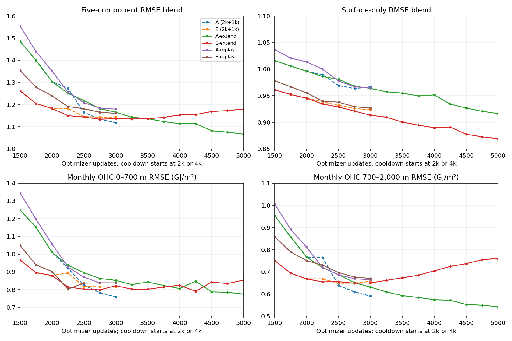
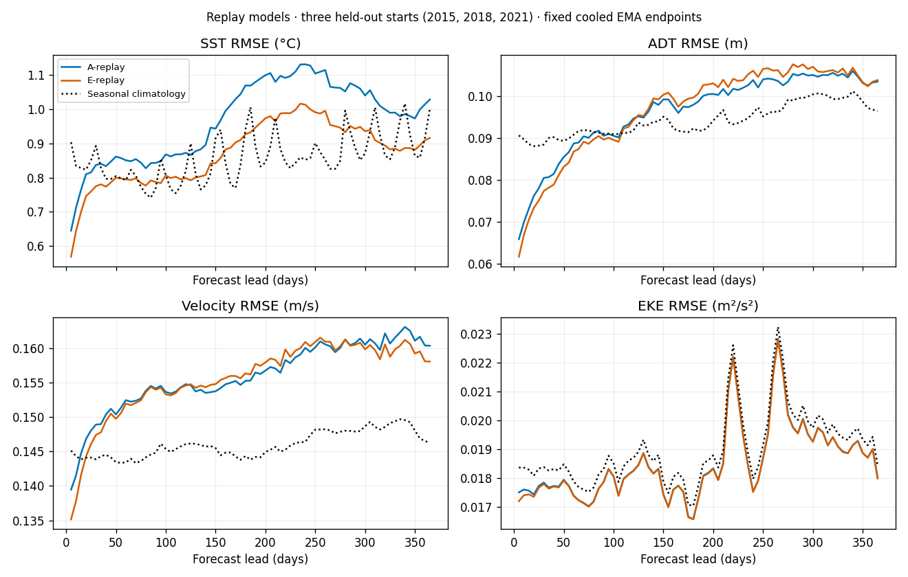
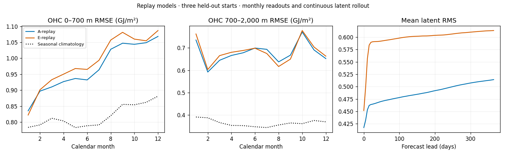
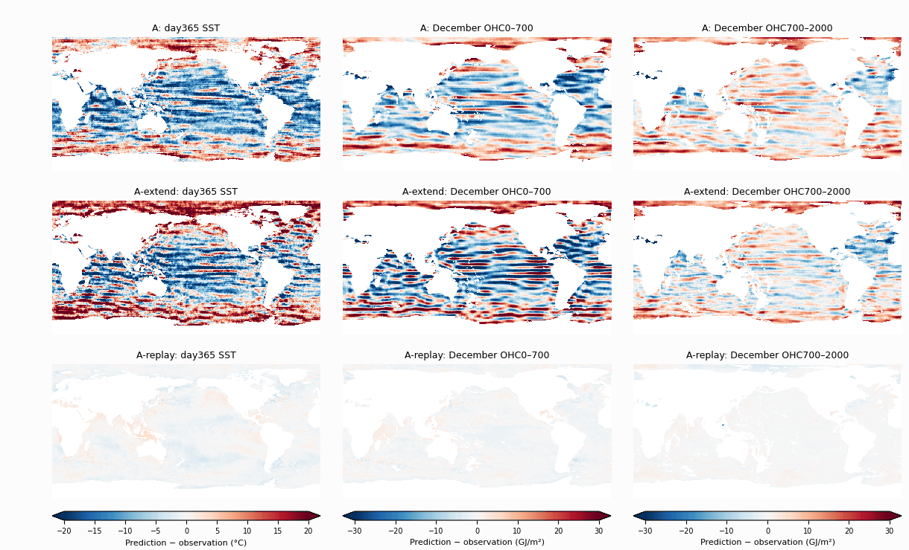
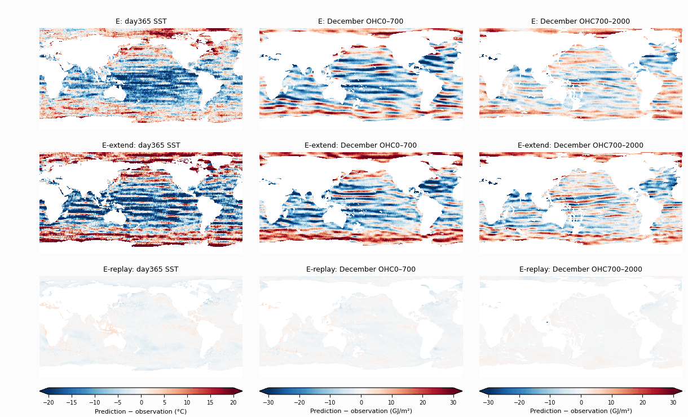

<!-- SPDX-FileCopyrightText: 2026 Samudra Authors -->
<!-- SPDX-License-Identifier: CC-BY-4.0 -->

# Longer training and observation replay

[Day-30 map addendum: ensemble means and individual decoder draws](monthly-replay-map-addendum-2026-10-22.md)
for all six comparison models and three held-out starts.

Question: does additional training or exposure to the model's own longer latent
rollouts improve the monthly forecasts and the severe annual drift documented
in the [original pilots](monthly-latent-pilots-2026-10-16.md) and
[365-day evaluation](monthly-latent-annual-2026-10-18.md)?

Status: **all four training runs and their fixed-endpoint annual evaluations
completed**. Training was Beta **215046** (6h16m49s on one four-GPU node), producer
`ed020de4b` (24 targeted tests and repository checks passed). Annual qualification
**215336** and evaluation **215337** passed, using evaluation-only producer
`57e42cc32`. The annual evaluator accepts explicitly frozen 3k/5k endpoints;
its metric, support, noise, readout and cohort definitions are unchanged.

**Replay greatly reduces the annual drift**, while more short-horizon training
alone does not. The monthly tradeoff and annual gains are shown separately below.

Grace **141793** prepared and independently hash-verified 19.17 GB covering
7,397 five-day intervals; every future surface/forcing payload in the 243
original training months matched exactly. The CPU-only retry corrected a
container GPU-hook failure before Python in **141790**, with no source change.
Qualification verified exact serialized optimizer/EMA/RNG/replay updates in all
four arms and finite replay loss ending at day 365 in both replay arms. Its
29m19s cost was **0.489 GPU-hours**; no qualification weights enter production.

Run root: `beta:/projects/ny/lz1955/multiscale/jrusak/runs/monthly-replay-20261020`.
The staged `paths.json` pins original A/E checkpoint hashes and all four run
definitions. Training allocated **25.121 GPU-hours**, plus **0.489 GPU-hours**
for qualification, totaling **25.610 GPU-hours** before annual evaluation.
Annual qualification and evaluation added **1.184 GPU-hours**, for **26.794
GPU-hours** across this new wave. No GPU retries were needed; the failed CPU
container launch is retained separately.

## Monthly validation results

Longer mixed OM4/observation training improves A's endpoint blend by **4.64%**.
Longer observation-only training improves surface prediction but worsens OHC,
so its five-component blend deteriorates. Replay does not improve the monthly
blend at this budget, despite its large annual benefit below.
These are nine-origin validation results, not annual or
held-out-test results, and all models use seed 1729.

| Literal run name | Main + cooldown updates | Final EMA blend | Final raw blend | Surface-only blend | SST (°C) | OHC 0–700 m (GJ/m²) | OHC 700–2,000 m (GJ/m²) |
|---|---:|---:|---:|---:|---:|---:|---:|
| A | 2k + 1k | 1.1182 | — | 0.9665 | 0.7879 | 0.7585 | 0.5908 |
| E | 2k + 1k | 1.1443 | — | 0.9233 | 0.6998 | 0.8142 | 0.6570 |
| A-extend | 4k + 1k | **1.0664** | 1.0692 | 0.9163 | 0.7133 | 0.7748 | **0.5424** |
| E-extend | 4k + 1k | 1.1793 | 1.1867 | **0.8693** | **0.6334** | 0.8534 | 0.7601 |
| A-replay | 2k + 1k | 1.1794 | 1.1803 | 0.9646 | 0.7672 | 0.8372 | 0.6639 |
| E-replay | 2k + 1k | 1.1601 | 1.1513 | 0.9266 | 0.6960 | 0.8376 | 0.6701 |

All columns use the fixed cooled endpoints. Original A/E raw endpoints were
not part of their original saved validation curves. A/E are the original
OM4+obs and obs-only models; all six literal names are defined below. SST and
surface blends average leads 5, 15 and 30 days; OHC scores the calendar-month
mean. The full blend averages SST, velocity, EKE and both OHC RMSEs after dividing
by the same fixed seasonal-climatology errors; no spectra or detrending enter.

Curves focus on updates 1.5k onward. Dashed A/E curves cool after 2k; extensions
share their first 2k and cool after 4k; replay models start from scratch and cool
after 2k. A-extend's SST and deep OHC improve by 9.5% and 8.2%, respectively,
while upper OHC worsens 2.2%. E-extend's surface-only blend improves 5.8%, but
deep OHC worsens 15.7%. Its best full blend is 1.1338 at update 2750, followed by
a sustained OHC-driven rise; more training is not uniformly beneficial under
the current objective. Its surface-only improvement continues through cooldown.

The replay endpoints' full-blend penalties relative to original A/E are 5.5%
and 1.4%; surface-only changes are −0.2% and +0.4%. Raw and EMA endpoint scores
are close, so EMA does not conceal a large monthly benefit. Replay halves the
number of fresh short-horizon observation examples, making a short/long lead
tradeoff plausible; these results alone do not diagnose its cause.

Both replay runs really reached **335-day start leads**, followed by the next
month's supervised continuation, with no observed-ocean resets. A-replay used
8,000 fresh and 8,000 replay examples; E-replay used 12,000 of each. Maximum
cached-state ages were 250 and 246 optimizer updates. Thus long-lead exposure
occurred in production, rather than only in qualification. The saved per-update
lead summaries do not reconstruct an exact per-example lead histogram.

[Machine-readable curves, components, exposure and endpoint hashes](assets/monthly-replay-2026-10-20/results.json).
Reproduce with [the report generator](../../../scripts/summarize_monthly_replay.py).

## Annual results

These are continuous rollouts from **January 2015, 2018 and 2021**: one
initialization, 73 five-day steps, prescribed future ERA5, no observed-ocean
reset, and the same fixed cooled EMA endpoints as the monthly table. They are
held-out reporting cases, not selection targets. Surface values are five-day
means; OHC below is the December monthly mean. Three starts provide a small
cohort, not a precise estimate of global long-range skill.

| Literal run name | Day30 SST (°C) | Day90 SST (°C) | Day180 SST (°C) | Day365 SST (°C) |
|---|---:|---:|---:|---:|
| A | 0.825 | 1.137 | 3.413 | 11.194 |
| E | 0.764 | 1.133 | 2.982 | 10.245 |
| A-extend | 0.745 | 0.988 | 2.896 | 12.882 |
| E-extend | 0.675 | 1.000 | 3.002 | 14.677 |
| A-replay | 0.837 | 0.843 | 1.069 | 1.028 |
| E-replay | 0.775 | 0.787 | 0.927 | **0.916** |

The replay-only panels retain seasonal climatology as a reference.
[Original six-model surface comparison](assets/monthly-replay-2026-10-20/annual-surface-curves.png).

Seasonal-climatology SST RMSE at day365 is **1.002°C**. Replay therefore largely
removes the previous catastrophic growth but only reaches approximately
climatological error at a year. E-replay is below climatology for SST on this
cohort; neither replay model beats climatology on velocity or OHC. The improvement
over the original models occurs in every case: A-replay's day365 SST errors are
1.132/0.993/0.951°C, and E-replay's are 0.974/0.885/0.885°C, in chronological
origin order. Original A/E were above 10°C in every case.
Seasonal climatology uses the retained training-split calendar-month means;
the three annual cases do not determine those means.

| Literal run name | Day365 ADT (m) | Day365 velocity (m/s) | Day365 EKE (m²/s²) | December OHC 0–700 m (GJ/m²) | December OHC 700–2,000 m (GJ/m²) | Mean latent RMS, initial → day365 |
|---|---:|---:|---:|---:|---:|---:|
| A | 0.749 | 0.907 | 0.1154 | 13.329 | 9.303 | 0.431 → 2.350 |
| E | 0.717 | 0.801 | 0.1549 | 15.001 | 9.186 | 0.394 → 3.257 |
| A-extend | 0.829 | 1.022 | 0.1572 | 20.316 | 9.047 | 0.428 → 3.771 |
| E-extend | 0.839 | 1.066 | 0.2022 | 15.918 | 11.324 | 0.384 → 6.868 |
| A-replay | 0.103 | 0.160 | 0.0180 | 1.068 | 0.652 | 0.417 → 0.514 |
| E-replay | 0.104 | 0.158 | 0.0180 | 1.087 | 0.663 | 0.452 → 0.613 |
| Seasonal climatology | 0.096 | 0.146 | 0.0184 | 0.881 | 0.370 | — |

EKE is computed across the three origins at each fixed lead, matching the prior
report's aggregation axis; it is not within-year temporal-anomaly EKE. There is
no new combined 365-day/OHC selection score.

[Original six-model OHC/latent comparison](assets/monthly-replay-2026-10-20/annual-ohc-latent.png).
Replay-only panels are generated from the same verified metrics with
[the replay-only plotting script](../../../scripts/plot_monthly_replay_curves.py).

Replay keeps latent RMS near its initialized scale **without any added latent
penalty or soft bound**. Longer monthly-only training improves early SST but
still develops large annual surface/interior errors and latent growth. This
supports longer-lead exposure as a useful training change. It does not establish
which part fixes the failure: replay changes both the processor's state
distribution and the decoder's exposure to true long-lead conditioning. It also
does not demonstrate useful century-long dynamics or retained initialized-state
information at long leads. A matched seasonal-climatology/history-sensitivity
analysis would distinguish those questions.

The 2021 day365 SST and December OHC error maps use matched limits across each
original/extended/replay trio, north up and 0–360° longitude, at exactly one image
pixel per grid cell:

[Full annual metrics and per-origin SST curves](assets/monthly-replay-2026-10-20/annual-results.json),
[verified annual output/checkpoint hashes](assets/monthly-replay-2026-10-20/annual-checksums.txt)
and [reproducible annual figure generator](../../../scripts/summarize_monthly_replay_annual.py).
All 18 annual payloads in the six-model comparison and 24 recorded output hashes
were checked, with identical observation references and fixed OHC support.

## Results viewer

All six literal models—**A, E, A-extend, E-extend, A-replay and E-replay**—have
complete viewer exports for the same three annual starts. The entries are labeled
`Monthly diffusion · <model name>`. They contain all 73 surface readouts,
14-depth initialized T/S/U/V reconstructions, twelve monthly OHC maps, and the
actual 14-depth temperature profiles underlying those heat maps. Each includes
its own decoded initialized persistence and a model description. The live
viewer is deployed at `238ff9f`; browser/WebSocket checks exercised all six
models' surface, initialized-interior, monthly-heat, profile and persistence
controls successfully.

All 18 regenerated surface, OHC and latent arrays matched the published annual
outputs byte-for-byte, including masks. Independent native-layer integration
of the retained temperature profiles matched both OHC layers in every case.
The initial reconstruction uses a separate eight-draw decoder noise stream and
does not alter the latent forecast. It is an exploratory full-field readout:
only initial surface reconstruction is directly observation-supervised, and
E has no full-field model supervision. IAP is preceding-December monthly T/S
context, not instantaneous interior truth; it provides no U/V.

Inference producer `f2c493d4a` used the same fixed cooled EMA checkpoints,
eight diffusion draws and 32 sampler steps. Qualification and the full export
used **2.336 GPU-hours**, including the preserved context-lookup failure;
this is additional to the training/evaluation budget above. See the
[export receipt and checkpoint/output hashes](assets/monthly-replay-2026-10-20/viewer-exports.json),
[inference exporter](../../../scripts/export_monthly_replay_viewer.py), and
[viewer preparation code](https://github.com/m2lines/Samudra/blob/codex/observation-viewer/apps/observation_viewer/prepare_monthly_replay.py).

## Four runs

| Literal run name | Initialization | Main training | Cooldown | Observation replay |
|---|---|---|---|---|
| A-extend | Original A raw 2k checkpoint, including optimizer/EMA/RNG | Another 2k updates, reaching 4k main; 50% OM4 / 50% obs | 1k obs only; ends at total 5k | None |
| E-extend | Original obs-only E raw 2k checkpoint, including optimizer/EMA/RNG | Another 2k updates, reaching 4k main; 100% obs | 1k obs only; ends at total 5k | None |
| A-replay | Fresh random initialization, original seed 1729 | 2k updates; 50% OM4 / 50% obs | 1k obs only; ends at total 3k | Half of observation examples |
| E-replay | Fresh random initialization, original seed 1729 | 2k updates; 100% obs | 1k obs only; ends at total 3k | Half of observation examples |

Here “updates” means optimizer updates, with eight accumulated examples each,
matching the existing pilots. The new computation is 3k updates / 24k examples
per run. The replay pilots compare with original A/E at the same 2k+1k budget;
the extensions compare with A/E before their original cooldown. None resumes
cooled 3k weights, and qualification weights never initialize production.

The comparison rows **A** and **E** refer to the original 2k-main + 1k-cooldown
runs: A uses the same 50% OM4 / 50% observation main mix, and E uses observations
only. Their architecture, losses and evaluation match the new runs. The
extensions preserve their raw 2k checkpoint state and add another 2k main
updates before the new cooldown; they do not add onto the old cooled weights.

All runs retain the same 48,702,016-parameter latent processor and physical
diffusion decoder, 1° fields (180×360), 19 five-day history bins, OM4
normalization, AdamW, clipping at 1, and EMA half-life 100 updates. The main LR
is fixed at 1e-4. Cooldown retains Adam moments, resets EMA to raw at its start,
and linearly decays LR to 1e-6 over 1k updates. There is **no latent magnitude
penalty, soft bound, or new architecture**.

The observation objective remains 0.8 monthly interior temperature/salinity
denoising + 0.2 native five-day SST/SSH denoising + 0.1 initial surface
reconstruction. There is no direct OHC-integral training loss. A retains the
original OM4 full-field loss and native forcing interface. E has no OM4
optimization examples but retains shared OM4 normalization.

## Replay definition

Each observation update accumulates four fresh forecasts and four replay
continuations, except when no eligible replay state exists during startup.
This also applies during the observation-only cooldown. Model updates in A
are unchanged: its main mix is 50% OM4, 25% fresh obs and 25% replay obs.

Fresh forecasts initialize from the original observed 95-day surface history.
They save a detached latent state at the native five-day boundary needed to
cover the next calendar month. Replay continues that state with subsequent
ERA5 forcing and geographical/calendar context, then scores the later month's
surface and interior observations. No later observed ocean field resets,
corrects, or enters the continued forecast state. Decoder lead conditioning
uses the true elapsed lead from the original initialization, rather than
resetting it each month.

Backpropagation covers one later month per replay example and stops at the
cached state: this is truncated backpropagation, not differentiation through
an entire stored year. Its reconstruction term is a separate fresh initializer
branch at the target month, preserving the original reconstruction weight and
initializer learning without feeding that branch into the continued forecast.

The pool holds up to eight entries for each of the next eleven calendar-month
leads. We sample uniformly among occupied lead buckets, then uniformly within
the selected bucket; this encourages long leads rather than a geometric
distribution dominated by the second month. The total trajectory is capped at
73 five-day steps. Months requiring more steps, and targets outside the
original May 1993–July 2013 training split, are ineligible. Cached states expire
250 optimizer updates after their **original initialization**, including OM4
updates; extending a chain does not refresh that age. States, timestamps, age,
pool contents and the separate replay RNG are serialized for exact restarts.

Training samples have five-day bins anchored to each month's origin; adjacent
monthly files cannot simply be concatenated. A read-only interval cache derives
all required phases from the already prepared daily SST/ADT/ERA5 archive using
the original strict five-day mean. It verifies exact equality with all 243
original training months' future surface and forcing payloads. Its latest raw
date matches the last original training sample's final bin; it includes no
validation/test targets. It retains source-file hashes and full cache read-back
hashes. Expected cache size is about 19 GB, with no new upstream transfer.

## Comparisons and qualification

Selection and the main learning curves retain the existing nine-origin monthly
RMSE blend (SST, geostrophic velocity, EKE, upper/deep OHC), the same fixed
climatology denominators, eight diffusion members and 32 sampling steps.
Validation runs every 250 updates. Report the surface-only blend and each OHC
component alongside the full blend. Save raw and EMA endpoint validation so
averaging cannot hide a difference.

At the fixed cooled endpoints, repeat the same three continuous annual test
rollouts (January 2015, 2018 and 2021), with 73 five-day steps and no latent reset.
Compare 30/90/180/365-day metrics, monthly OHC and latent RMS against the original
A/E endpoints. Annual tests are reporting only, not a checkpoint-selection
criterion. Report actual replay lead exposure and age distributions: a maximum
allowed horizon does not prove that training reached it. One seed and matched
update counts do not establish significance or exact FLOP matching.

Before production: verify pinned source/data hashes, finite updates in all four
arms, exact serialization/restart of model/EMA/optimizer/RNG/replay state,
diffusion evaluation, and a finite replay example ending at day 365. Run the
four production processes on one four-GPU Beta node, with online W&B and durable
completion follow-up. Prepared data use Grace CPU compute. Keep prior source
checkpoints read-only and retain failed attempts and GPU accounting.

Implementation: [replay state and loss](../../../src/samudra/experiments/monthly_replay.py),
[runner](../../../scripts/run_monthly_replay.py),
[interval preparation](../../../scripts/prepare_monthly_replay.py).
