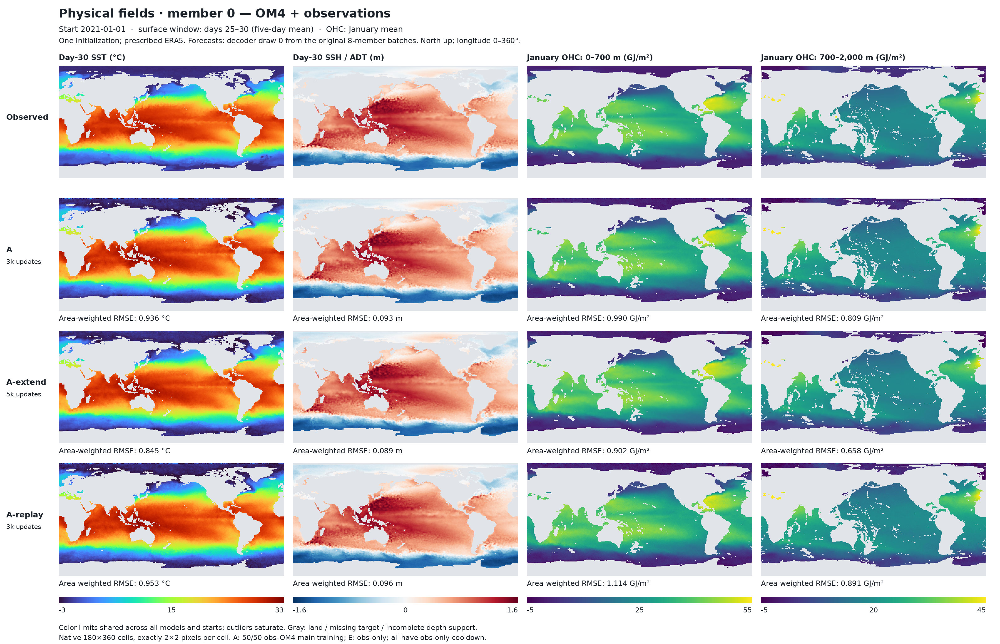
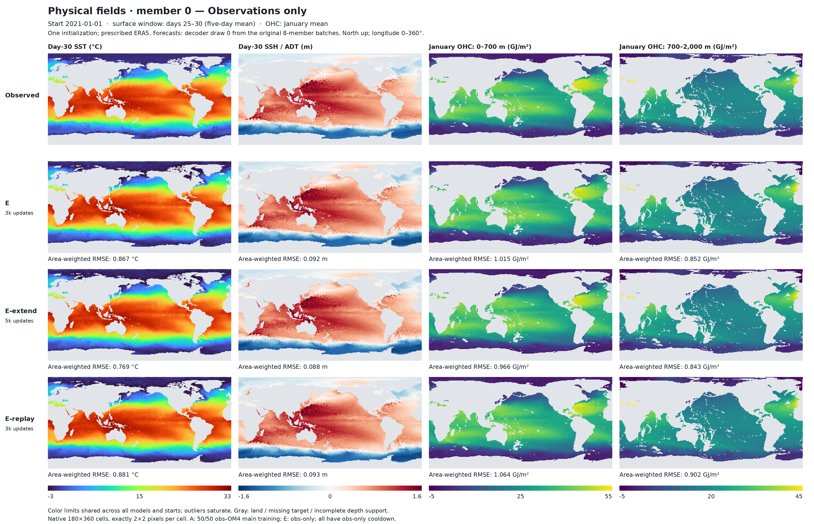

<!--
SPDX-FileCopyrightText: 2026 Samudra Authors

SPDX-License-Identifier: CC-BY-4.0
-->

# Monthly replay: day-30 maps and individual decoder draws

Addendum to the [monthly replay comparison](monthly-replay-2026-10-20.md).
These maps compare the same six fixed checkpoints at starts **2015-01-01,
2018-01-01 and 2021-01-01**. They show SST and SSH/ADT for the five-day window
ending at day 30, and January mean OHC at 0–700 m and 700–2,000 m.
Each set includes physical fields alongside observations and signed
prediction-minus-observation errors, with area-weighted RMSE beneath each panel.

| Literal model name | Main training | Observation-only cooldown |
|---|---|---|
| A | 2k updates, 50% observations / 50% OM4 | 1k updates |
| A-extend | 4k updates, same mix | 1k updates |
| A-replay | 2k updates, same mix; replay on half the observation examples | 1k updates, with replay |
| E | 2k observation updates | 1k updates |
| E-extend | 4k observation updates | 1k updates |
| E-replay | 2k observation updates; replay on half the examples | 1k updates, with replay |

All six use a deterministic latent processor and a stochastic physical diffusion
decoder. **Single-draw maps show member 0 before averaging**, from the same
eight-member, 32-sampling-step batches used for the published ensemble means.
The member is fixed in advance across models and starts. The export reproduces
the original first-month ensemble means and latent trajectories bit for bit.
These are individual decoder draws along a deterministic latent trajectory;
they do not represent stochastic dynamics feeding back into the processor.
Monthly OHC uses that member's monthly temperature draw, with the same
member's native SST contributions substituted as in the ensemble evaluation.

Color scales are shared across models, starts and ensemble/single-draw figures.
Gray cells lack a valid target or the required model depth support. Outliers
saturate at the displayed limits. Every native grid cell occupies exactly
2×2 pixels. This addendum changes no training, checkpoint selection or reported
ensemble validation scores.

## All map panels

Each link opens four quantities together: SST, SSH/ADT, upper OHC and deep OHC.

| Start | Family | Ensemble mean | Member 0 |
|---|---|---|---|
| 2021-01-01 | A / A-extend / A-replay | [Fields](assets/monthly-replay-maps-2026-10-22/ensemble/day30-2021-01-01-A-fields.png) · [Errors](assets/monthly-replay-maps-2026-10-22/ensemble/day30-2021-01-01-A-errors.png) | [Fields](assets/monthly-replay-maps-2026-10-22/member0/day30-2021-01-01-A-fields.png) · [Errors](assets/monthly-replay-maps-2026-10-22/member0/day30-2021-01-01-A-errors.png) |
| 2021-01-01 | E / E-extend / E-replay | [Fields](assets/monthly-replay-maps-2026-10-22/ensemble/day30-2021-01-01-E-fields.png) · [Errors](assets/monthly-replay-maps-2026-10-22/ensemble/day30-2021-01-01-E-errors.png) | [Fields](assets/monthly-replay-maps-2026-10-22/member0/day30-2021-01-01-E-fields.png) · [Errors](assets/monthly-replay-maps-2026-10-22/member0/day30-2021-01-01-E-errors.png) |
| 2018-01-01 | A / A-extend / A-replay | [Fields](assets/monthly-replay-maps-2026-10-22/ensemble/day30-2018-01-01-A-fields.png) · [Errors](assets/monthly-replay-maps-2026-10-22/ensemble/day30-2018-01-01-A-errors.png) | [Fields](assets/monthly-replay-maps-2026-10-22/member0/day30-2018-01-01-A-fields.png) · [Errors](assets/monthly-replay-maps-2026-10-22/member0/day30-2018-01-01-A-errors.png) |
| 2018-01-01 | E / E-extend / E-replay | [Fields](assets/monthly-replay-maps-2026-10-22/ensemble/day30-2018-01-01-E-fields.png) · [Errors](assets/monthly-replay-maps-2026-10-22/ensemble/day30-2018-01-01-E-errors.png) | [Fields](assets/monthly-replay-maps-2026-10-22/member0/day30-2018-01-01-E-fields.png) · [Errors](assets/monthly-replay-maps-2026-10-22/member0/day30-2018-01-01-E-errors.png) |
| 2015-01-01 | A / A-extend / A-replay | [Fields](assets/monthly-replay-maps-2026-10-22/ensemble/day30-2015-01-01-A-fields.png) · [Errors](assets/monthly-replay-maps-2026-10-22/ensemble/day30-2015-01-01-A-errors.png) | [Fields](assets/monthly-replay-maps-2026-10-22/member0/day30-2015-01-01-A-fields.png) · [Errors](assets/monthly-replay-maps-2026-10-22/member0/day30-2015-01-01-A-errors.png) |
| 2015-01-01 | E / E-extend / E-replay | [Fields](assets/monthly-replay-maps-2026-10-22/ensemble/day30-2015-01-01-E-fields.png) · [Errors](assets/monthly-replay-maps-2026-10-22/ensemble/day30-2015-01-01-E-errors.png) | [Fields](assets/monthly-replay-maps-2026-10-22/member0/day30-2015-01-01-E-fields.png) · [Errors](assets/monthly-replay-maps-2026-10-22/member0/day30-2015-01-01-E-errors.png) |

## Example: member 0, January 2021

OM4 + observations:

Observations only:

## Reproducibility

[Ensemble plot manifest](assets/monthly-replay-maps-2026-10-22/ensemble/manifest.json)
and [single-draw plot manifest](assets/monthly-replay-maps-2026-10-22/member0/manifest.json)
record source/output hashes, color limits, RMSE and saturation fractions.
[Export provenance](assets/monthly-replay-maps-2026-10-22/export-provenance.json)
records the frozen checkpoints and exact-replay checks.
The [executed draw-exporter source](assets/monthly-replay-maps-2026-10-22/export_single_member.py.txt)
captures the member before reduction; the
[figure-generator source](assets/monthly-replay-maps-2026-10-22/generate.py.txt)
renders the saved arrays and verifies pixel replication.
