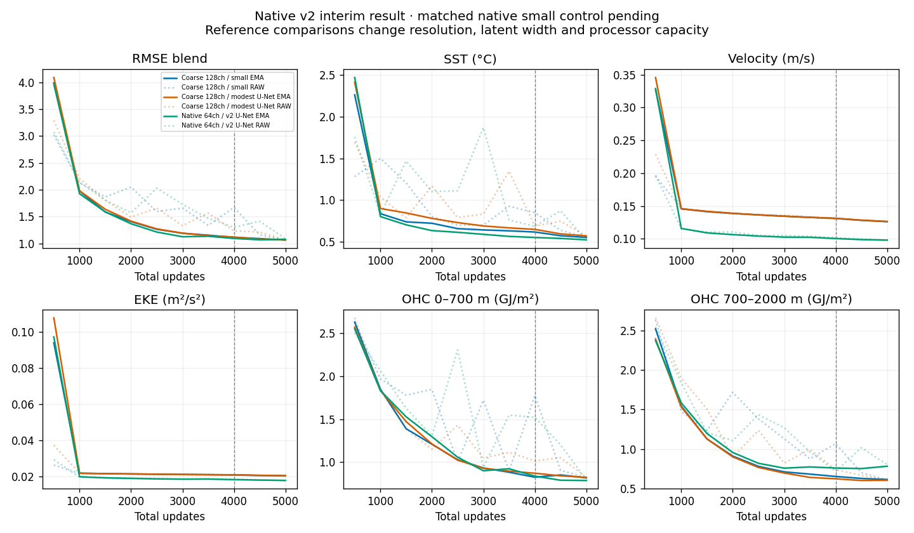
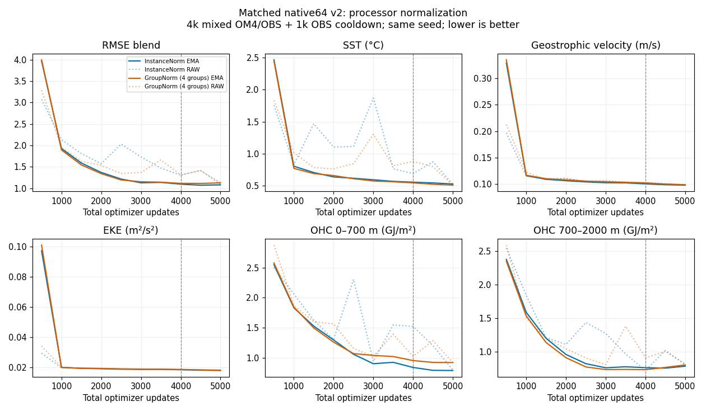

<!-- SPDX-FileCopyrightText: 2026 Samudra Authors -->
<!-- SPDX-License-Identifier: CC-BY-4.0 -->

# Native-resolution latent processor comparison

**All three native runs completed.** GroupNorm in the v2 processor gives blend
1.11122, 3.93% worse than InstanceNorm (see the [normalization comparison](#processor-groupnorm-comparison-november-4)).
 At native 180×360 resolution with 64 channels per
latent slot, the small processor selects EMA update 5,000 with blend **1.02071**;
the v2 U-Net selects update 4,500 with **1.06915**. The small processor's blend
is **4.53% lower**. V2 improves velocity, EKE and upper OHC, but worsens deep OHC
by 23.8% relative to the matched small model. This single-seed result does not
support a general claim that the smaller architecture is better.

The [deep-OHC diagnosis](native-ohc-diagnosis-2026-11-05.md) traces v2's late rise
to a growing cold bias shared by training and validation examples, while
bias-removed error improves slightly.

Lower is better. The blend equally averages the five errors divided by fixed
climatology errors. All models select EMA from the ten checkpoints at updates
500–5,000 under the same 4k mixed + 1k OBS cooldown budget. Surface metrics
average leads 5/15/30 days; OHC uses monthly targets. These are validation
selection results, not annual held-out scores.

| Selected EMA metric | Coarse 128ch small reference | Native 64ch small | Native 64ch v2 |
|---|---:|---:|---:|
| Selected update | 5,000 | 5,000 | 4,500 |
| RMSE blend | 1.06486 | **1.02071** | 1.06915 |
| SST RMSE (°C) | 0.55262 | 0.53599 | 0.54064 |
| Geostrophic velocity RMSE (m/s) | 0.12600 | 0.10113 | 0.09865 |
| EKE RMSE (m²/s²) | 0.020446 | 0.018384 | 0.018080 |
| OHC 0–700 m RMSE (GJ/m²) | 0.81635 | 0.87720 | 0.78856 |
| OHC 700–2000 m RMSE (GJ/m²) | 0.61240 | 0.60643 | 0.75100 |

The native small model improves the blend by 4.15% versus its coarse reference.
Both native models have substantially better geostrophic velocity errors than
the coarse models. The matched native pair therefore suggests that the large
velocity gain does not require the v2-sized processor. Comparing native against
coarse still changes both latent resolution and channel count; it does not
isolate a resolution-only effect. The two processor families also use different
normalization, as specified below.

Solid lines are EMA, dotted lines raw weights. The plot includes both earlier
coarse-latent references. “Modest U-Net” uses widths 64/128/256 on the coarse
grid; v2 uses 280/380/480/520. Cooldown begins at update 4,000. Native small's
final raw blend is 1.02702, close to its EMA 1.02071. V2's raw blend at the
selected 4,500 update is 1.41389; its final EMA blend rises to 1.07753. Raw/EMA
behavior and the deep-OHC plateau merit investigation before interpreting the
architecture comparison as a capacity limit.

[Curve data](assets/native-latent-pair-2026-10-30/curves.csv) ·
[Small metrics](assets/native-latent-pair-2026-10-30/small-results.json) ·
[V2 metrics](assets/native-latent-pair-2026-10-30/v2-results.json).

| Execution | Native small | Native v2 |
|---|---:|---:|
| Production job | 220340 | 220346 |
| Successful production + evaluation | 2h18m14s | 3h21m02s |
| Total allocated GPU-hours, including qualification and retries | 11.2733 | 14.0433 |
| W&B | [Small](https://wandb.ai/ocean_emulators/observational-transfer/runs/5e72c99bb92f) | [V2](https://wandb.ai/ocean_emulators/observational-transfer/runs/94d147cea4cb) |

Small had one 14m38s node-failure attempt before training, automatically requeued
by Slurm. Both successful attempts fit within four hours; no timeout continuation
was needed. Combined cost was **25.3167 GPU-hours**. Both runs completed all
5,000 updates (3,000 OBS / 2,000 OM4). All ten raw/EMA receipts and checkpoint
hashes were verified for each model. Both completion callbacks are retired.

Selected checkpoint SHA256 values:
- Small: `79123bc3dcdf5351cc7976b0f5700f7dc5aa853237d69bd5fe450cab02494593`.
- V2: `97c0f50b92cedb853562a94ad6ac0224ee83144086a79a08dc68ccf05a71435d`.

## Matched experiment protocol

Compare the small convolutional processor and Samudra ConvNeXt U-Net with
**two 64-channel latent slots on the full 180×360 grid**. Both runs start from
scratch. This directly compares processors at the same latent resolution and
width; comparison to the earlier 45×90/128-channel runs also changes width.

| Run | Processor | Latent grid | Channels per slot |
|---|---|---|---:|
| A-shared-era5-native64-small | Four residual convolutional blocks | 180×360 | 64 |
| A-shared-era5-native64-samudra-v2 | ConvNeXt U-Net, widths 280/380/480/520 | 180×360 | 64 |

Both use seed 1729, shared ERA5 through the existing 8→32→3 adapter, the same
OM4/OBS dates and sample order, 4,000 alternating source-specific updates (50% each), and 1,000
OBS-only cooldown updates. Effective batch eight uses four GPUs × two examples.
OBS and OM4 loss weights remain 0.5 interior/monthly + 0.5 forecast + 0.1
initializer. Main LR is 1e-4; cooldown linearly decays to 1e-6, resetting EMA at its start. No replay
or latent magnitude penalty is added. Initializer, decoder and forcing-adapter
initial weights are identical between the two new runs; processor construction
preserves the RNG stream. Processor normalization remains GroupNorm for the
small model and InstanceNorm for the U-Net, as in the prior comparison.

Checkpoint every 500 updates and evaluate raw and EMA weights after training
at all ten saved checkpoints using the unchanged nine-origin, eight-member,
32-step validation. Only EMA checkpoints compete for selection. Select on the
original five-component climatology-normalized RMSE blend and show all component
curves. Report both matched new runs alongside the earlier coarse-latent pair.
No further scientific arms are automatically authorized by this comparison.

Each run uses its own full four-GPU Beta allocation, online W&B, parallel data
prefetch and compiled training denoising. A short beta_test qualification races
an inline production qualification under a shared lock. Qualification must pass
exact serialized optimizer/EMA/RNG replay, exact prefetch inputs, finite losses
and full-grid memory checks before training. Qualification weights are discarded.
If native-resolution memory does not fit, preserve failures and assess a matched
activation-checkpointing recovery without changing effective batch or science.

The canceled October 23 native-latent run is not reused: it used native OM4
forcing and different OBS weights. These two fresh runs use the current shared
ERA5 baseline. Submission IDs and runtime measurements follow below.

## Reference protocol

Data, five-day forecast steps, losses and validation follow the
[shared-ERA5 reweighted baseline](shared-era5-obs-reweight-2026-10-26.md) and
[coarse-latent processor comparison](shared-era5-samudra-2026-10-27.md).
Validation origins span November 2013 through July 2014; these same origins
supply the selection curves. The blend equally averages climatology-normalized
SST, geostrophic velocity, EKE, OHC 0–700 m and OHC 700–2000 m errors.
Forcing remains prescribed throughout rollout. This submission includes the
matched validation comparison; it does not yet include new annual rollouts.

CPU checks: 24 tests passed, including native-grid constructor/RNG agreement,
shared forcing, prefetch and deferred evaluation. Parameter counts from the
configured models are 47,372,608 total / 411,776 processor for small, and
130,253,440 total / 83,292,608 processor for Samudra v2. GPU qualification must still
establish runtime memory and throughput.

## Submission

Producer `ffdfd8f6fefb8609176edf4cda29093e6cc73442`.
Beta root: `/projects/ny/lz1955/multiscale/jrusak/runs/native-latent-pair-20261030`.
Each arm has frozen `paths.json`, verified source archive and separate outputs.

| Model | Production (standard QoS) | Qualification (test QoS) |
|---|---:|---:|
| Small | 220340 | 220341 |
| Superseded small U-Net (canceled before starting) | 220342 | 220343 |

All four jobs were submitted and released on October 30; they were pending at
the submission check. Production uses one four-GPU node per model with a 24h
limit. Test jobs have a two-hour limit and cannot duplicate production training.
The queue had 201 pending production jobs and 25 pending test jobs when checked;
start times and native-resolution runtime were unavailable, so no results ETA
is assigned yet. Remote completion callbacks and dedicated quiet monitors are
active, with six-hour fallback checks. Runtime and scientific results are pending.

## V2-sized replacement

The user replaced the undersized U-Net arm with widths 280/380/480/520 and
dilations 1/2/4/8, one block per scale and expansion factor two, following the
v2 backbone configuration. InstanceNorm follows the v2 high-resolution preset;
the residual latent update and 64-channel projections remain unchanged. The
small-processor control (220340/220341) is retained without modification.

The v2 arm retains the existing per-transition processor checkpointing, with
initializer/decoder checkpointing disabled, matching the small control. The
monthly objective backpropagates through its sequence of five-day latent
transitions. Qualification must establish actual memory usage and throughput.

The old pending Samudra jobs were canceled with zero allocated runtime and their
callback retired. Replacement production **220346** and qualification **220347** are submitted
and released, with standard/test QoS respectively. Both were pending at the
release check. Root suffix: `samudra-v2`; producer
`97bd0feb9110ebdee5051066bbd17b3959908e7e`. All 27 targeted CPU tests and commit
checks passed. Source archive integrity and the remote completion hook were
verified. A dedicated quiet monitor covers the replacement; the small arm keeps
its existing monitor.

## Short allocations for backfilling (November 3)

Production jobs 220340 and 220346 now request **four hours per allocation**,
updated in place from 24 hours. Their original October 30 submit/eligible times,
producers, configs and qualification proofs are preserved. Both qualifications
passed; production was still pending when the limits changed.

The existing runner atomically saves `last.pt` every 50 updates, including
optimizer, EMA, sample-generator and per-rank RNG state. After a verified Slurm
timeout, the monitor checks checkpoint progress, archives the attempt log and
accounting, installs a successor callback, and requeues the same job. This can
repeat until training and evaluation finish, within the original 24 allocated
production hours per arm (at most six four-hour attempts). Genuine code/data
failures and attempts without checkpoint progress require diagnosis, not blind
requeueing. User cancellations must not be resumed automatically.

A timeout may require replaying at most 49 unsaved updates; duplicated event-log
steps must be identified by attempt/checkpoint lineage when plotting. Deferred
validation restarts from the saved training endpoints if interrupted. The
selected model is valid only after all ten complete raw/EMA receipts and the
final completion marker pass verification. Repeated evaluation timeouts require
review rather than an indefinite restart loop. Training science is unchanged.

## Processor GroupNorm comparison (November 4)

A new native-64 v2 arm changes processor InstanceNorm to GroupNorm with four
channel groups in every block. All widths (280/380/480/520) divide by four.
Both normalize within each example; GroupNorm also couples channels within a
group. This tests normalization with unchanged widths and parameter counts: 83,292,608
processor parameters and 130,253,440 total parameters. Initializer and decoder
normalization remain unchanged.

The control is InstanceNorm run `A-shared-era5-native64-samudra-v2` (job 220346).
The new run starts fresh with seed 1729 and retains its 4,000 alternating
OM4/OBS updates (50% each), followed by 1,000 OBS-only cooldown updates. It uses
shared ERA5, two 64-channel latent slots at 180×360, effective batch eight across
four GPUs, the same losses and learning rates, and the same posthoc raw/EMA
validation every 500 updates. Selection uses the unchanged equal-weight blend of climatology-normalized
SST, geostrophic velocity, EKE, and 0–700/700–2000 m OHC RMSE. CPU tests verify identical initial state dictionaries and post-initialization RNG state between the
InstanceNorm and GroupNorm variants, finite recurrence gradients, serialization,
and the v2 parameter count; all 31 targeted tests passed.

Both normalization variants select EMA update 4,500. GroupNorm worsens the
blend by **3.93%**, despite improving SST RMSE by 3.83%. Upper-OHC RMSE rises
16.85%; deep-OHC RMSE rises 1.47%. This one-seed comparison does not support
replacing InstanceNorm with four-group GroupNorm for the current objective.

| Selected EMA metric (lower is better) | InstanceNorm | GroupNorm (4 groups) |
|---|---:|---:|
| RMSE blend | 1.06915 | 1.11122 |
| SST RMSE (°C) | 0.54064 | 0.51993 |
| Geostrophic velocity RMSE (m/s) | 0.09865 | 0.09993 |
| EKE RMSE (m²/s²) | 0.018080 | 0.018231 |
| OHC 0–700 m RMSE (GJ/m²) | 0.78856 | 0.92141 |
| OHC 700–2000 m RMSE (GJ/m²) | 0.75100 | 0.76203 |

Solid lines show EMA and dotted lines raw weights; cooldown begins at 4,000.
The raw blend at 4,500 remains about 1.413 in both variants, so this GroupNorm
setting does not remove the raw/EMA gap. At update 5,000, EMA blend is 1.12434 for GroupNorm
and 1.07753 for InstanceNorm. Scores use the same nine validation origins,
eight-member means and 32 sampler steps. Surface errors average the separate RMSE values at leads 5/15/30 days;
OHC uses monthly targets. These are checkpoint-selection validation results.

[GroupNorm metrics](assets/native-latent-pair-2026-10-30/groupnorm-results.json) ·
[All curve data](assets/native-latent-pair-2026-10-30/curves.csv) ·
[GroupNorm W&B](https://wandb.ai/ocean_emulators/observational-transfer/runs/e7a1fce4c367).

Production **223127** completed all 5,000 updates (3,000 OBS / 2,000 OM4).
Its first allocation timed out during deferred evaluation; a continuation
completed evaluation in 26m56s with zero additional training updates. Qualification
**223128** took 22m02s. Total allocated cost, including the first 4h01m10s attempt,
was **19.3422 GPU-hours**. All ten checkpoint hashes, evaluation receipts and final
selection were verified. Code commit: `09caa96f3b26dd515e986e87ea35b032345cfaa7`.
Root: `beta:/projects/ny/lz1955/multiscale/jrusak/runs/native-latent-groupnorm-20261104`.
Selected checkpoint SHA256:
`c87e1025b71f5bfc5a5394458450097f629aea1e32be910129e4cb043691c5c7`.
