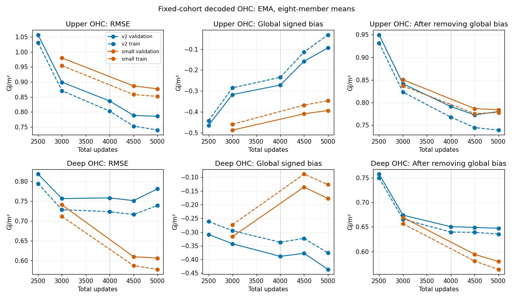
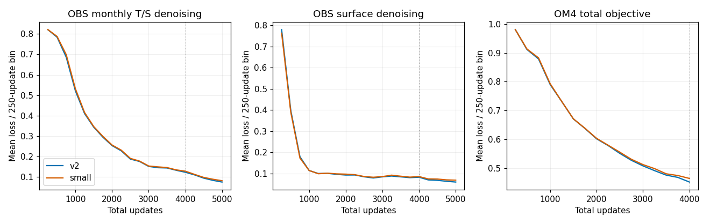
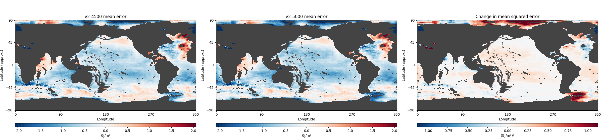
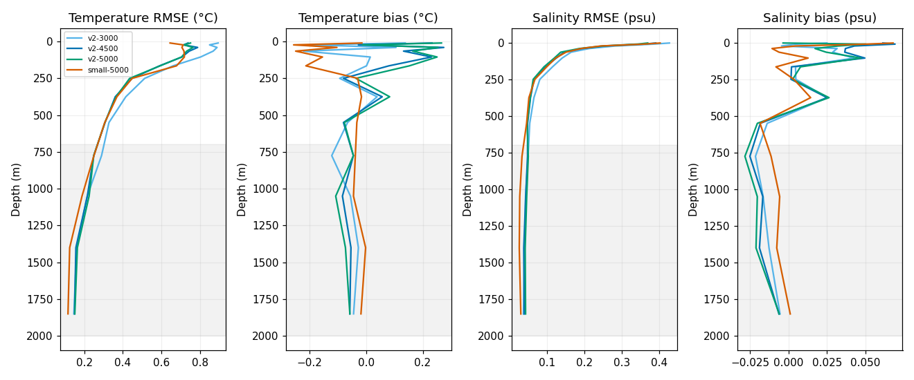
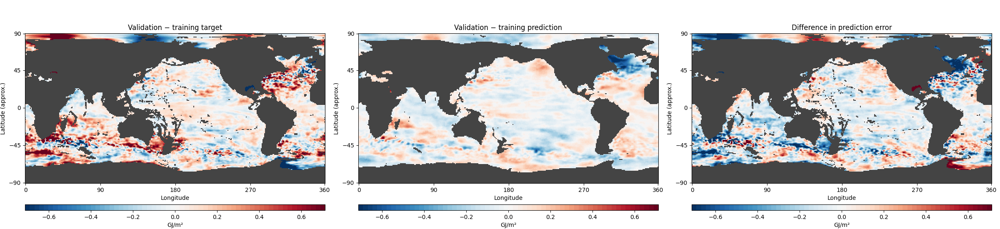
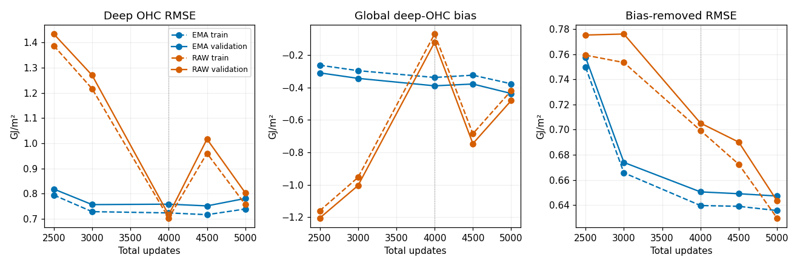

<!-- SPDX-FileCopyrightText: 2026 Samudra Authors -->
<!-- SPDX-License-Identifier: CC-BY-4.0 -->

# Native v2 deep-OHC diagnosis

**The late rise comes mainly from a growing deep-ocean cold bias, and it also
occurs on training examples.** Between updates 4,500 and 5,000, v2's bias-removed
error improves slightly while its mean heat content moves farther below
the targets. The diffusion training objective keeps falling. This evidence
points to a mismatch between the optimized denoising objective and the decoded
heat-content mean; it does not show a clean case of fitting training OHC while
losing validation OHC.

This is the native 180×360 latent model with two retained time slots, each containing 64 channels with the
280/380/480/520-width v2 InstanceNorm processor. The comparator uses the small
four-block convolutional processor. Both train for 4,000 updates split equally
between OM4 and observations, then 1,000 OBS-only cooldown updates, seed 1729,
effective batch eight and shared ERA5 forcing. See the
[processor comparison](native-latent-pair-2026-10-30.md) for architecture and
objective details.

## Training error also rises when measured in the same decoded metric

These are deep-OHC (700–2000 m) RMSEs in GJ/m², using eight-member EMA forecasts.
Lower is better. Training evaluation uses a fixed nine-month cohort, not the
minibatches used for the denoising-loss curves.

| Model and cohort | 3,000 | 4,500 | 5,000 |
|---|---:|---:|---:|
| v2, training | 0.7281 | 0.7161 | 0.7386 |
| v2, validation | 0.7561 | 0.7510 | 0.7805 |
| Small, training | 0.7112 | 0.5874 | 0.5780 |
| Small, validation | 0.7405 | 0.6098 | 0.6064 |

V2 fluctuates near 0.75 after update 3,000; the clear final increase is from
4,500 to 5,000. Calling the whole interval a sustained validation rise was too
strong. Its training-cohort decoded error rises at the end too. Nine training
months cannot rule out overfitting elsewhere in the training set, but they do
not support validation-specific overfitting as the main explanation here.

Meanwhile, Observation (OBS) monthly temperature/salinity (T/S) denoising loss falls:

| Update window | v2 InstanceNorm | Small processor |
|---|---:|---:|
| 2,501–3,000 | 0.16394 | 0.16583 |
| 3,501–4,000 | 0.12809 | 0.13167 |
| 4,501–5,000 | 0.07958 | 0.08546 |

These are means over OBS updates using raw training weights. The objective
predicts diffusion targets over temperature and salinity channels; it does not
directly penalize decoded, depth-integrated OHC. Falling loss can coexist with
worsening heat-content bias. The same loss/metric distinction applies to the
small model, but its decoded OHC improves.

## Mean bias explains the final rise

For error `e = prediction − target`, the exact area-weighted decomposition is
`MSE = mean(e)² + mean((e − mean(e))²)`. The second term measures the remaining
error after removing one constant offset over the cohort. It is a diagnostic,
not an adjusted score used for checkpoint selection.

| v2 validation, deep OHC | 4,500 | 5,000 |
|---|---:|---:|
| RMSE (GJ/m²) | 0.7510 | 0.7805 |
| Signed mean bias (GJ/m²) | −0.3778 | −0.4362 |
| Bias-removed RMSE (GJ/m²) | 0.6491 | 0.6472 |
| Mean-bias contribution to MSE | 0.14274 | 0.19030 |
| Remaining MSE | 0.42127 | 0.41889 |

Total MSE rises by 0.04518 (GJ/m²)². The mean-bias term rises by 0.04756;
the remaining term falls by 0.00238. Thus the growing mean bias accounts for
105% of the net rise, with improving pattern error offsetting 5%. Removing a
separate global mean per month gives the same conclusion. All nine validation
months worsen; this is not one anomalous start.

A separate decomposition across months also shows improving variability:
RMSE of the error's month-to-month deviations falls from 0.2894 to 0.2792,
while RMSE of its nine-month mean map rises from 0.6930 to 0.7288. These are
reinitialized monthly forecasts, not a continuous nine-month rollout or a
measure of long-term dynamics.

At update 5,000, 66% of the deep-OHC MSE gap between v2 and the small processor
is attributable to their different global mean-bias terms. The rest remains after removing the global bias. This identifies a target
for a controlled correction experiment; the small processor still has lower
error, including after removal of global bias.

## Where and at what depths?

Left and middle show mean prediction-minus-target error; right shows the change
in mean squared error. Positive values on the right worsen the score. Gray is
unsupported land/shallow-column area. All maps average the nine validation
months. Each grid cell occupies 2×2 image pixels; displayed colors clip at the
98th percentile of absolute values, while calculations use unclipped values.

| Latitude band | Share of scored area | Share of net MSE increase, 4.5k→5k |
|---|---:|---:|
| 60–90°S | 5.7% | 12.2% |
| 30–60°S | 27.2% | 10.8% |
| 30°S–30°N | 54.1% | 61.7% |
| 30–60°N | 11.4% | 18.3% |
| 60–90°N | 1.5% | −3.0% |

The increase is broad, with the tropical Pacific longitude sector (120–290°E)
contributing 46.5% of the net global increase and the tropical Atlantic sector
(290–360°E plus 0–20°E) contributing 18.4%. These are geographic rectangles
within 30°S–30°N, not basin masks. The Arctic has large absolute error but
improves slightly in this last interval. Over the longer 3k→5k interval it
contributes 63% of the much smaller net increase, illustrating why the choice
of checkpoints matters. [3k→5k maps](assets/native-ohc-diagnosis-2026-11-05/post3k-maps.png) ·
[Small versus v2 at 5k](assets/native-ohc-diagnosis-2026-11-05/architecture-gap-maps.png).

The late deep-OHC rise is concentrated vertically in the 1,050 m and 1,400 m
model levels. Their mean temperatures cool by approximately 0.024°C and
0.020°C from 4.5k to 5k on complete deep-column support. Temperature biases
against the interior labels at those levels become −0.108°C and −0.074°C.
The 775 m and 1,850 m levels barely change in their global mean during this
interval.

Using the actual native-layer overlap thicknesses, the 1,050 m and 1,400 m
levels account for 47.9% and 55.3% of the net OHC MSE increase. Other levels
partly offset them. This attribution includes cross-depth error terms: it
allocates `layer change × (2 × old error + total OHC change)` to each layer.
Summing those contributions exactly recovers the total MSE change. Independent
per-depth RMSEs would omit the cross-depth terms. The integrated prediction change was
checked against the exported OHC maps. The total additional cold bias is
equivalent to only 0.011°C averaged over the 1,300 m thick layer, so a visually
small temperature shift can noticeably change OHC RMSE.

## Is validation's mean state different?

Yes, but it does not explain the training-time drift. On matched seasonal
cohorts, validation's mean target deep OHC is 0.0457 GJ/m² higher than training's
(18.3310 versus 18.2853). At 5k, the model's biases are −0.4362 on validation and
−0.3761 on training. The validation prediction mean is also 0.0144 GJ/m² lower than the training
prediction mean. Arithmetically, the +0.0457 target shift and −0.0144 prediction
shift together give the −0.0601 difference in bias. This is a decomposition,
not an experiment isolating the effect of dataset shift; the much larger cold
bias is shared by both.

Both cohorts are also warmer at these depths than the full training-set
calendar-month climatology. At 1,050 m, validation and the sampled training
cohort are +0.031°C and +0.018°C above it; at 1,400 m, +0.017°C and +0.009°C.
These differences are consistent with the slightly worse validation scores.
The model already underpredicts the sampled training targets and drifts colder
as it trains.

As a diagnostic, subtracting the global bias measured on the nine training
months from validation predictions changes v2's deep-OHC RMSE from 0.7510→0.7805
to **0.6513→0.6500** across 4.5k→5k. No validation targets fit that offset. This
shows that a training-estimated scalar bias can account for the late rise; it
is not a validated calibration method, and those nine months were selected
for this investigation.

## EMA and possible next steps

The raw-weight fluctuations also largely involve global bias. At 3k, raw
validation bias is −1.005 GJ/m² versus EMA's −0.343; at 5k it is −0.480 versus
−0.436. EMA smooths the error but does not eliminate the final bias, which is
present in both raw and EMA predictions. These outputs do not isolate whether
the initializer, processor, or diffusion decoder causes it.

The most informative next checks would be:

1. Track decoded monthly T/S and OHC mean bias on a fixed training cohort during
   training, alongside denoising loss. This detects this failure directly.
2. Test a small mean-temperature or heat-integral auxiliary objective, calibrated
   on training data, while retaining the diffusion objective. The evidence favors
   controlling coherent depth bias over generic regularization alone. It remains
   an experiment: denoiser predictions and final sampled means need not respond
   identically.
3. Isolate decoder versus latent evolution with a fixed-processor decoder
   calibration experiment, then compare against a fixed-decoder processor update.
   That would test the mechanism; the current maps cannot assign it to a module.

No new training was launched. Early stopping avoids the final increase but
leaves most of v2's gap to the small processor. More training alone is not yet
supported as a remedy for this particular metric.

## Evaluation and verification

The fixed cohorts are November 2011–July 2012 (training) and November 2013–July
2014 (validation), nine origins each. Matching calendar months reduces seasonal
confounding. V2 checkpoints 2.5k/3k/4k/4.5k/5k use raw and EMA weights; small
checkpoints 3k/4.5k/5k use EMA. All use the original eight-member mean, 32 sampling
steps, fixed noise seeds and global cosine-latitude weights on common finite,
complete-column support. Each origin initializes independently, then forecasts its first calendar
month. The monthly decoder receives the calendar-weighted average of the
evolved five-day latent states; OHC is computed from that monthly temperature
decode. These are first-month OHC scores, not a blend over multiple forecast
months. Complete-column support requires finite observed OHC and all model
temperature levels needed to integrate 700–2000 m; the same paired mask is used
across checkpoints and architectures. Deep-OHC support
is identical across the nine months for these comparisons. OHC is relative to
0°C with density 1,035 kg/m³ and heat capacity 3,850 J/kg/K.

All 26 evaluations completed. Every validation metric reproduced its original
receipt within `rtol=1e-6, atol=1e-8`; all 52 output archive hashes were checked.
The interior capture hook also recorded climatology calls; analysis selects the
alternating forecast entries and independently reconstructs their absolute
700–2000 m OHC from the exported temperatures. Original archives are preserved.
The 2.5 m temperature channel is supplied by the surface decode and excluded
from the interior profiles, matching the training mask.

Beta job 223638 failed after 85 seconds because the container lacked the
`torchrun` executable. Job 223651 used `python -m torch.distributed.run` and
completed in 33m17s. Combined cost was **2.3133 GPU-hours**. Evaluation code
commit: `3cb135d8b`; sources and checkpoints were mounted read-only.
Root: `beta:/projects/ny/lz1955/multiscale/jrusak/runs/native-ohc-diagnosis-20261105`.
This is one seed, nine months per cohort, and one fixed eight-member ensemble.
There is no independent annual or repeated-noise confirmation of the proposed
mechanism.

[Decoded curves CSV](assets/native-ohc-diagnosis-2026-11-05/decoded-curves.csv) ·
[Numeric decompositions](assets/native-ohc-diagnosis-2026-11-05/analysis.json) ·
[Verification](assets/native-ohc-diagnosis-2026-11-05/verification.json).
