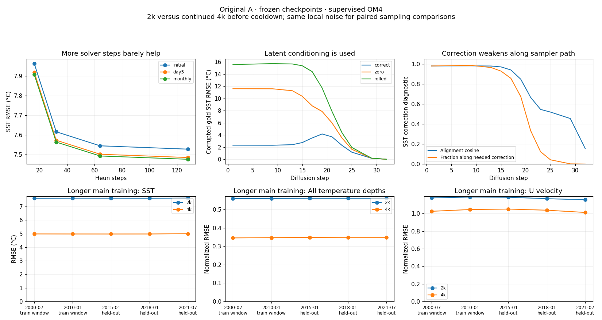

<!-- SPDX-FileCopyrightText: 2026 Samudra Authors -->
<!-- SPDX-License-Identifier: CC-BY-4.0 -->

# OM4 decoder diagnosis and possible fixes

**More training is the best-supported first intervention.** Continuing the same
A run from 2k to 4k main updates reduces full77 sampled SST RMSE by about 35%,
with similar improvements on training-window and held-out examples. The learned
correction improves too. Increasing sampling from 32 to 128 steps helps only
about 1%; zeroing or spatially shifting the latent makes predictions worse.
There is no evidence here that replacing the latent architecture is the next
necessary step, or that the failure is simply too few solver steps.

This follows the [corrupted-gold comparison](om4-denoiser-diagnostic-2026-10-23.md).
It uses frozen checkpoints, not newly trained models. The remaining errors are
large, so this is evidence of improvement with training, not evidence that the
full-field decoder is already adequate.

## What was compared

| Name | Main-training exposure | Weights and schedule |
|---|---|---|
| A-2k | 1,000 OM4 + 1,000 OBS updates | Original A EMA, before cooldown |
| A-4k | 2,000 OM4 + 2,000 OBS updates | Exact continuation of A-2k, EMA, before cooldown |

Both use seed 1729, effective batch eight, LR 1e-4, clipping threshold 1,
EMA half-life 100 updates, the same architecture and objectives, and no replay
or latent norm penalty. A-4k is `A-extend/endpoint-04000.pt`, not its cooled 5k
checkpoint. Its own initializer and processor generate its conditioning; this
is an end-to-end training-length comparison, not an isolated decoder-weight swap.

The original January 2015 example supplies initialization, day-5 and monthly
full77 decodes. Four additional initialization histories are July 2000 and
January 2010 (training window), January 2018 and July 2021 (held out). The
training-window designation does not prove those exact histories were sampled
in the finite training run. Only SST/SSH are visible to every initializer.

## 1. Longer matched training helps substantially

The table averages **per-draw RMSE over three draws**, not RMSE of a three-member
mean. Physical units; each field uses unweighted wet-cell spatial RMSE.

| January 2015 decode | A-2k SST (°C) | A-4k SST (°C) | A-2k SSH (m) | A-4k SSH (m) |
|---|---:|---:|---:|---:|
| Initialized | 7.525 | 4.935 | 0.429 | 0.288 |
| Day 5 | 7.474 | 4.889 | 0.427 | 0.286 |
| Monthly | 7.471 | 4.844 | 0.426 | 0.283 |

The effect repeats on four additional examples, with one paired draw each:

| Initialization history | Split | A-2k SST (°C) | A-4k SST (°C) |
|---|---|---:|---:|
| July 2000 | Training window | 7.608 | 4.982 |
| January 2010 | Training window | 7.617 | 4.978 |
| January 2018 | Held out | 7.610 | 4.978 |
| July 2021 | Held out | 7.626 | 5.001 |

All-temperature-depth error improves strongly; U velocity improves more modestly
(see figure). Source-separated stochastic training loss also falls: the mean
of the last 100 OM4 updates before 2k versus 4k is **0.585 → 0.459**; OBS is
**0.214 → 0.127**. These are different training minibatches, not a fixed-set loss
comparison. The frozen-example evaluations above provide the matched evidence.

This is consistent with undertraining rather than a held-out-only failure. It
does not establish convergence, predict the benefit of 8k/10k, or determine
whether decoder fitting versus better latent representations caused the gain.
The differently trained 10k OBS model was not evaluated here and is not a matched
control; its behavior cannot isolate training duration by itself.

## 2. The correction helps, but leaves too much error during sampling

Write the denoiser output as analytic skip plus learned correction:

`D(x, sigma, h) = x/(1+sigma²) + sigma/sqrt(1+sigma²) * F(x, sigma, h)`.

The diagnostic compares the learned correction to `gold - skip`. Its alignment
cosine measures direction; its projection coefficient measures the component
along the correction needed to reach gold. A coefficient of one with cosine one
would be an exact correction. Neither metric identifies removable noise versus
unpredictable signal on its own.

For initialized SST on A-2k's actual sampler path:

| Sigma | Correction cosine | Projection onto needed correction |
|---|---:|---:|
| 2.174 | 0.939 | 0.856 |
| 1.174 | 0.847 | 0.674 |
| 0.598 | 0.665 | 0.333 |
| 0.123 | 0.519 | 0.042 |

The correction generally reduces error relative to the skip-only baseline;
it is not simply adding a harmful term. But it progressively loses the ability
to repair the error left in its own sampling trajectory. At low sigma, the
analytic skip approaches identity and the learned term's prefactor shrinks.

On training-style corrupted gold at sigma 1.174, going from A-2k to A-4k improves
SST correction cosine **0.885 → 0.938**, projection **0.785 → 0.858**, and prediction
RMSE **4.170 → 3.113°C**. This is direct evidence that additional training improves
the problematic intermediate-noise regime, beyond changes to a final-sample score.

At initialization the SST/SSH target is already supplied in the surface history.
Large error there cannot be dismissed as unavoidable uncertainty about a future
ocean state. Information loss in the learned representation and imperfect decoder
fitting remain possible explanations. Copying the known surface into the display
would hide this diagnostic without repairing the interior or forecast decoder.

## 3. The decoder is using latent conditioning

At sigma 1.174, initialized SST denoising from the same corrupted gold gives:

| Latent supplied | SST RMSE (°C) |
|---|---:|
| Correct latent | 4.170 |
| Zero latent | 7.866 |
| Spatially shifted latent | 11.718 |

The shift rolls both slots by 11 latitude and 23 longitude latent cells, retaining
the values but changing their spatial alignment. Support and time conditioning
remain fixed. These are out-of-distribution interventions, especially zeroing;
they show sensitivity and spatial dependence, not a causal measure of how much
physical information is stored. They contradict the simple hypothesis that the
decoder ignores the latent throughout the problematic noise regime.

## 4. More solver steps do not fix this

Same local initial noise, A-2k initialized decode:

| Heun steps | SST RMSE (°C) | SSH RMSE (m) |
|---|---:|---:|
| 16 | 7.963 | 0.449 |
| 32 | 7.616 | 0.429 |
| 64 | 7.544 | 0.425 |
| 128 | 7.527 | 0.425 |

32 → 128 steps reduces SST RMSE by **1.16%**, versus roughly 35% from longer
training. Day-5 and monthly results have the same pattern. Numerical integration
error is present but is far too small to explain the bulk of the observed gap.
This does not prove every aspect of the sampler is correct.

## Code/objective audit

No training/sampling convention mismatch was found in the inspected paths:

- Same `diffusion_noise` helper, correlation fraction 0.5, physical support and
  OM4 normalization; noise is masked both during corruption and sampling.
- Same denoiser, sigma embedding, preconditioning and window conditioning.
  Initialization uses position -2.5 days; day 5 uses +2.5; monthly uses duration
  31 and position 15.5 for the original January example.
- Decoder uses GroupNorm, not BatchNorm; there are no running batch statistics
  to recalibrate here.
- Training `log(sigma) ~ Normal(-1.2, 1.2²)` places **30.9%** of draws between
  sigma 0.5 and 3. The problematic regime is not an almost-unseen tail.
- Loss averages over present channels. For SST, the sum of nominal coefficients
  across OM4's monthly/native/initial terms is `1.1/77 ≈ 0.0143`; on OBS's
  native/initial terms it is `0.3/2 = 0.15` (monthly OBS excludes top temperature).
  This roughly 10.5-fold difference is a scalar-loss coefficient comparison,
  **not a measured gradient ratio**, and the terms have different target windows.
  It is a reason to inspect full-field task fitting and balance rather than infer
  comparable per-field training from equal numbers of source updates.

## Recommended fixes to test, in order

1. **Continue the unchanged mixed run beyond 4k**, with intermediate checkpoints
   and full77 noise-binned diagnostics before any OBS-only cooldown. This has
   the strongest direct support. An 8k main endpoint is a reasonable next test,
   not a prediction that 8k will solve the problem. Track OM4 and OBS separately,
   correction quality around sigma 0.5–3, and both sample and ensemble-mean skill.
2. **Isolate decoder underfitting with a frozen-latent decoder continuation.**
   Cache training latents and targets, hold the initializer/processor fixed,
   and compare extra decoder optimization against continuing the whole model.
   Improvement here would justify spending compute on decoder fitting rather
   than enlarging the latent grid. Include OBS readouts to detect interference.
3. **If the intermediate-noise defect plateaus, test the objective.** Compare
   source/variable-group balancing and stratified sigma minibatches. Stratified
   draws can preserve the original sigma distribution; oversampling or new
   weights would intentionally change it and need a matched control. Log loss
   and gradients by source, variable group and sigma before choosing weights.
4. **Only then consider residual diffusion or conditional variance scaling.**
   Predicting residuals around a conditional mean may reduce the cancellation
   burden on the denoiser. The current unit-data-variance preconditioning may
   be inefficient when conditional uncertainty is much smaller, but the tests
   do not establish that it is mathematically wrong. This changes the modeling
   setup and requires retraining and calibration checks.

Keep 32 steps for these comparisons; 128 adds substantial cost for little gain.
Do not select an early denoiser call solely because its RMSE is lower: it may be a
smoother conditional estimate rather than a calibrated sample. Assess spatial
structure and uncertainty as well as RMSE before adopting any proposed fix.
No new training or fix-treatment runs were launched for this report.

## Reproducibility and limits

Local GB10, PyTorch 2.9.1+cu130, deterministic flags, bfloat16 autocast. The main
control suite took **330.4 seconds (0.0918 GPU-hours)**; no cluster compute was
allocated. It completed 297 correction/conditioning records, 27 sampler runs,
and eight additional example/checkpoint pairs. Solver and 2k/4k comparisons use
identical seeded initial noise *locally*. The local random stream differs from
Beta's despite using the same numeric seed; these are not exact reproductions of
the viewer draw. The prior saved-input replay check establishes close denoiser
agreement across machines. Recomputed A-2k latent RMS differs from the saved
Beta latent by 0.0016–0.0021; original-example A-2k controls retain the saved
latent exactly, while A-4k uses its newly computed latent.

Only one training seed and five examples are tested. Three sampling draws are
not three training seeds, and per-draw RMSE is not ensemble-mean RMSE. Findings
localize a problem and prioritize experiments; they do not establish general
forecast skill or calibrated conditional uncertainty.

A-2k SHA256: `3888a09b570d1efcd362d07162f746ce484010b651335421732786cea3412bdf`.
A-4k SHA256: `2463c9e7e4c49dd02d7aa23b3f9c94ca9dd2b9793a1f10ad5a5e97a61cc0275a`.
Model/decoder/noise implementation files match both original training producers.
The extra OM4 subset contains 6,080 explicitly requested 180×360 float32 chunks
(1,575,936,000 payload bytes), all read-back SHA256-verified against Beta. There
is no inference from silently filled missing chunks: every requested file and
all wet values were checked. Original source is `om4_onedeg_v3/OM4.zarr`, with
its own forcings and original OM4 statistics.

[Compact result data](assets/om4-denoiser-controls-20261023.json) retain all
endpoint channel RMSEs and the SST correction/conditioning curves. Full per-call,
per-channel results and source hashes remain at
`/tmp/om4-denoiser-controls-20261023`, with the verified input subset at
`/tmp/om4-diagnostic-subset`. Code:
[controls](../../../scripts/diagnose_om4_denoiser_controls.py),
[plotter](../../../scripts/plot_om4_denoiser_controls.py).
