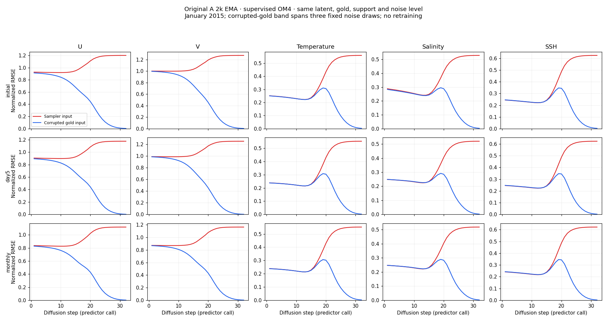

<!-- SPDX-FileCopyrightText: 2026 Samudra Authors -->
<!-- SPDX-License-Identifier: CC-BY-4.0 -->

# OM4 denoising: corrupted gold versus sampler inputs

The supervised OM4 full-field decoder has a mid-noise weakness even when given
training-style corrupted gold. Its own sampling trajectory then retains large
errors as noise decreases. This rules out a purely visual artifact and narrows
the problem to the decoder/sampling path without changing the initializer or
processor. It does not yet identify the cause or establish a fix.

Red: denoise the saved sampler input. Blue: denoise the actual gold plus the
training noise distribution, at the identical sigma and conditioning. The blue
band spans three corruption draws; it is very narrow here. Values are normalized
RMSE, aggregated as the square root of mean per-channel MSE within each variable.
Each channel uses its wet-cell support and equal spatial weighting. These are
map diagnostics, not the area-weighted training loss or pooled validation score.

## Results

For the initialized SST field, all values below are in °C:

| Diffusion step / sigma | Sampler-input prediction RMSE | Corrupted-gold prediction RMSE | Corrupted input RMSE before denoising |
|---|---:|---:|---:|
| 1 / 80 | 2.364 | 2.343 | 930.979 |
| 13 / 6.464 | 2.403 | 2.423 | 75.219 |
| 17 / 2.174 | 3.721 | 3.518 | 25.298 |
| 19 / 1.174 | 5.160 | 4.165 | 13.665 |
| 21 / 0.598 | 6.535 | 3.696 | 6.956 |
| 25 / 0.123 | 7.433 | 1.182 | 1.426 |
| 32 / 0.002 | 7.562 | 0.023 | 0.023 |

Temperature, salinity and SSH have a pronounced mid-noise error hump even on
corrupted gold. At those levels, the denoiser still reduces the input noise,
but does worse against gold than its own high-noise prediction. Velocities
show a different pattern: corrupted-gold prediction improves with decreasing
noise, while sampling error increases. Initialization, day-5 and monthly decoding
show closely matching patterns.

Low-noise corrupted-gold success is not proof of strong learned denoising:
the input is almost gold already, and the decoder's analytic skip term approaches
the identity as sigma approaches zero. For SST at sigma 0.123, denoising reduces
input RMSE only from 1.426 to 1.182°C. At sigma 0.002 it essentially preserves
the input. The corresponding sampler output remains far from gold.

This supports investigating the intermediate-noise denoising objective and
sampler state distribution before changing latent geometry or forcing adapters.
It does not establish that all final sample error is spurious: a single sample's
RMSE includes conditional variability. Nor does it establish a numerical solver
bug. The next discriminating controls would measure the learned correction versus
the analytic skip path around sigma 0.5–3, and test sensitivity to solver step
count with the same initial noise. Neither control has been run in this report.

## Matched protocol and verification

- Original A, 2k main-training EMA; checkpoint SHA256
  `3888a09b570d1efcd362d07162f746ce484010b651335421732786cea3412bdf`.
- The existing January 2015 OM4 example: supervised full77 initialization,
  day-5 forecast, and direct January monthly decode. No OBS full77 diagnostic.
- Exact saved latent, support, gold, duration and position from the verified
  [Xray export](a-step-anatomy-2026-10-23.md); no new latent rollout or training.
- All 32 predictor noise levels from the 32-step/63-call Heun trajectory.
  Corrector noise levels are repeated by the following predictor calls.
- Corrupted gold uses the training helper with 0.5 spatial-noise correlation.
  Three seeds (905101–905103); the same noise field is reused across sigma within
  a seed and stage, so the curve is not obscured by changing random draws.
- Recomputed sampler predictions at all 96 stage/noise combinations on local
  GB10, PyTorch 2.9.1+cu130, deterministic settings and bfloat16 autocast.
  Every channel passed the predeclared saved-versus-local RMSE tolerance
  (1% relative + 0.0001 normalized absolute) and prediction-difference RMS
  below 0.02 normalized units. Observed maximum prediction-difference RMS:
  **0.002967**. Cross-GPU replay is close, not bitwise identical.
- Local execution: 3.7-second qualification, 65.3-second full diagnostic,
  approximately **0.0192 GPU-hours** combined. No cluster allocation or training.
  Three draws quantify corruption randomness, not generalization across cases.

[Per-channel metrics and receipts](assets/om4-denoiser-gold-20261023/COMPLETE.json)
are retained alongside `initial.json.gz`, `day5.json.gz`, `monthly.json.gz` and
`metadata.json` in the same directory. They include saved/local errors, corrupted
input and prediction errors, and source trace hashes. Full unmodified receipts, including the diagnostic script hash, remain in
`/tmp/om4-denoiser-gold-20261023`; the published receipts are summaries. Model implementation files match the original export
producer `6735615ac072a9fdbe301f68e4613e031fee3934`.

Code: [diagnostic](../../../scripts/diagnose_om4_denoiser_trajectory.py) and
[plotter](../../../scripts/plot_om4_denoiser_diagnostic.py).

The [follow-up controls and possible fixes](om4-denoiser-controls-2026-10-23.md)
add correction decomposition, latent perturbations, solver convergence, four
additional histories, and the matched A-2k versus A-4k training-length comparison.
