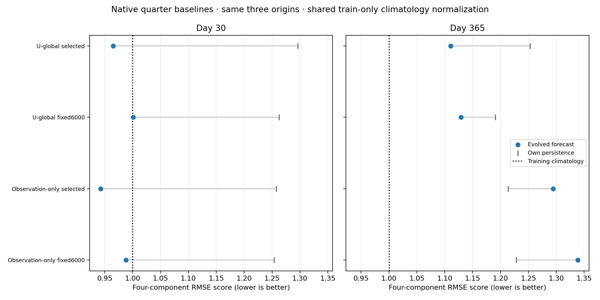
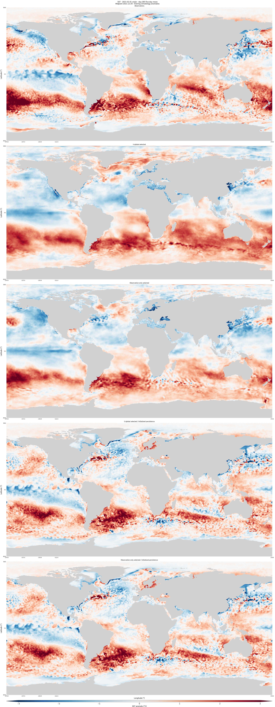
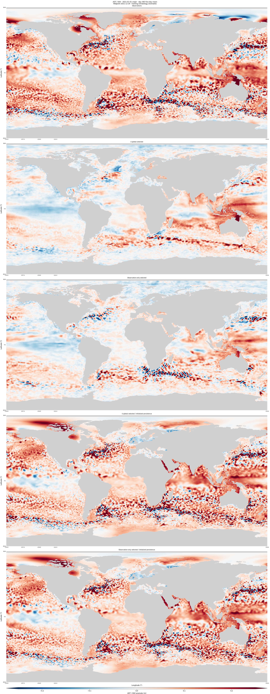
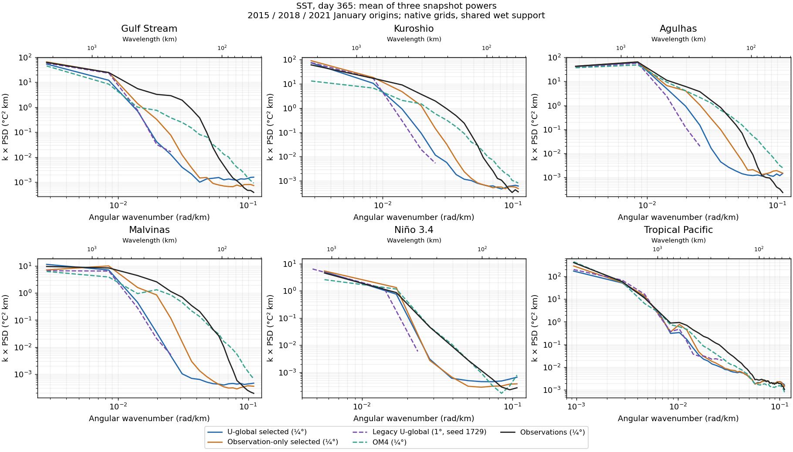
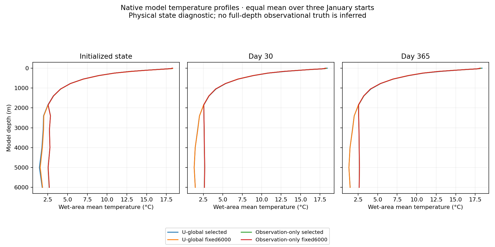

<!-- SPDX-FileCopyrightText: 2026 Samudra Authors -->
<!-- SPDX-License-Identifier: CC-BY-4.0 -->

# Quarter-degree baseline comparison

This compares fresh U-global and observation-only models at native quarter-degree resolution. Both completed 6,000 optimizer updates. The earlier-data variants are held at the user's request until these 365-day rollouts are reviewed.

**Obs-only has lower short-lead error; U-global has lower 365-day error under both checkpoint policies, mainly through better OHC.** Neither beats seasonal climatology on the overall year-long blend. These are native-resolution results from one seed and three annual starts; the matched 1° comparison is now complete.

## Models and checkpoint policies

All four table labels below refer to two trained models, each evaluated at two checkpoints. Both use the same 62,967,680-parameter initializer/evolution architecture, a global 720×1440 grid, 77 physical state channels, seed 1729, global batch eight and fixed learning rate 1e-4. Neither starts from the earlier D checkpoint. Training details and data provenance are in the [experiment plan](quarter-global-plan-2026-10-10.md).

| Literal result label | Meaning | OM4 / observation updates |
|---|---|---:|
| U-global selected | Checkpoint at update 4,900, chosen by the frozen nine-origin RMSE validation blend | 2,787 / 2,113 |
| U-global fixed6000 | Same training run at its final update; no checkpoint selection | 3,000 / 3,000 |
| Observation-only selected | Observation-only checkpoint at update 5,300, chosen by the same validation blend | 0 / 5,300 |
| Observation-only fixed6000 | Same observation-only run at its final update | 0 / 6,000 |

“Initialized persistence” holds that particular checkpoint's inferred initial physical state fixed throughout its rollout. Its state can differ across models and checkpoints. Training seasonal climatology is a separate control. The comparison matches total updates, not observation exposure: observation-only gets twice as many observation updates at the fixed endpoint. This is one seed, so differences do not establish reproducible effects across training randomness.

## Evaluation

The monthly test has 96 independently initialized starts and scores 5-, 15- and 30-day leads. Its five-component blend equally averages seasonal-climatology-normalized RMSE for SST, geostrophic velocity, EKE and OHC in the 0–700 m and 700–2000 m bands.

The annual test has three January starts (2015, 2018 and 2021), each evolved continuously for 73 five-day steps with one initialization and prescribed ERA5 forcing. At each lead, pool equal-origin MSE before taking square roots. Its four-component blend covers SST, geostrophic velocity and the two OHC bands, with lead-specific climatology denominators; annual temporal-anomaly EKE is reported separately. These annual scores are distinct from the monthly five-component blend. No spectra enter checkpoint selection or either blend.

Native results retain IAP's observation grid for subsurface/OHC comparisons. The matched 1° comparison conservatively coarsens surface predictions and uses the frozen shared supports and controls; native and common-grid score values are not interchangeable. Annual maps show five-day-bin means, with two pixels per model grid cell in each dimension.

## Results

**Observation-only has lower short-lead error, but U-global has lower year-long error under both checkpoint policies.** In this three-start annual cohort, U-global improves over its own day-365 persistence; observation-only does worse than its own persistence. All four evolved day-365 blends are worse than training seasonal climatology. The matched 1° results below show a short-lead improvement for quarter-degree U-global but essentially no change in its annual blend.

| Model/checkpoint | Monthly test blend | Annual day 30 | Annual day 365 | Own persistence day 365 |
|---|---:|---:|---:|---:|
| U-global selected | 0.8741 | 0.9649 | 1.1108 | 1.2529 |
| U-global fixed6000 | 0.9126 | 1.0011 | 1.1290 | 1.1904 |
| Observation-only selected | 0.8509 | 0.9428 | 1.2941 | 1.2136 |
| Observation-only fixed6000 | 0.8872 | 0.9881 | 1.3387 | 1.2279 |
| Training seasonal climatology | 1.0000 | 1.0000 | 1.0000 | — |

The monthly and annual columns use their respective cohorts and definitions above. Among selected checkpoints, observation-only reduces the monthly blend by 2.7%, whereas U-global reduces the annual day-365 blend by 14.2%. This supports a possible long-horizon benefit of OM4 training in this setup; it does not isolate its mechanism or establish significance across seeds.

## What drives the annual difference?

Day-365 pooled physical RMSE for the selected checkpoints:

| Model | SST (°C) | Geostrophic velocity (m/s) | OHC 0–700 m (GJ/m²) | OHC 700–2000 m (GJ/m²) |
|---|---:|---:|---:|---:|
| U-global selected | 0.947 | 0.1877 | 0.898 | 0.476 |
| Observation-only selected | 0.749 | 0.1933 | 1.142 | 0.687 |
| Training seasonal climatology | 1.023 | 0.1796 | 0.787 | 0.358 |

Observation-only still has better year-end SST. Its larger OHC errors outweigh that advantage in the four-component blend. Thus the annual difference is not simply a loss of surface-temperature skill. Both models have worse year-end velocity and OHC RMSE than seasonal climatology.

The per-origin scores and component errors are available in the [annual CSV](artifacts/quarter-baseline-results-2026-10-15/native-annual/rmse-scores.csv). [Monthly results and frozen denominators](artifacts/quarter-baseline-results-2026-10-15/native-monthly/results.json.gz) preserve the independent 96-start calculation.

## Matched 1° comparison

Both resolutions are scored against identical legacy observations, climatology denominators and the frozen intersection of their wet supports. All eight archived legacy models and their own persistence were retained; their previously frozen common-grid records reproduce exactly. These controls differ slightly from the original reports’ unrestricted-support scores.

“Legacy U-global (seed 1729)” is the original 1° 6k U-global reproduction, selected by its nine-origin RMSE validation blend. “Legacy U-global (seed 1730)” is its independent-seed repetition with the same recipe. The quarter-degree labels retain the definitions above. This matches the scoring protocol; it does not establish that all training settings or geographic receptive fields were identical across resolutions.

| Selected model | Monthly five-component blend | Annual day 30 | Annual day 365 | Own persistence day 365 |
|---|---:|---:|---:|---:|
| Legacy U-global (seed 1729) | 0.8418 | 0.8920 | 1.0281 | 1.0787 |
| Legacy U-global (seed 1730) | 0.8500 | 0.8954 | 1.0344 | 1.0834 |
| U-global selected | 0.8163 | 0.8655 | 1.0276 | 1.1166 |
| Observation-only selected | 0.8010 | 0.8445 | 1.1773 | 1.0839 |

Quarter-degree U-global improves the monthly blend by **3.0%** relative to the seed-1729 1° run and the annual day-30 blend by **3.0%**. Its day-365 blend changes by only **0.04%**: effectively unchanged at the precision justified by these runs. The stronger native-quarter annual difference between U-global and observation-only survives matched scoring, but it is not evidence that increasing resolution improved U-global’s year-long blend.

The fixed-endpoint quarter results are reported separately; there is no corresponding fixed-endpoint legacy comparison in this export:

| Fixed-endpoint model | Monthly blend | Annual day 30 | Annual day 365 | Own persistence day 365 |
|---|---:|---:|---:|---:|
| U-global fixed6000 | 0.8587 | 0.9014 | 1.0303 | 1.0657 |
| Observation-only fixed6000 | 0.8407 | 0.8931 | 1.2149 | 1.0922 |

[All common-grid scores](artifacts/quarter-baseline-results-2026-10-15/common/comparison.csv) include eight legacy selected models, both quarter models, both quarter endpoints and each own persistence. The [common-grid provenance and component tables](artifacts/quarter-baseline-results-2026-10-15/common/README.md) record frozen supports, full cohort checks and identical normalization across policies. No quarter early-data models have been trained or included.

## Day-365 maps

The following maps use the 2021 start and validation-selected checkpoints. Each includes observations, both evolved models, and each model's own initialized persistence, with shared color limits.

Additional maps: [selected checkpoints](artifacts/quarter-baseline-results-2026-10-15/native-annual/maps/native-selected/) and [fixed-6k checkpoints](artifacts/quarter-baseline-results-2026-10-15/native-annual/maps/native-fixed6000/). Anomaly maps cover all three starts; absolute-field maps cover the 2021 start. ADT maps are diagnostic: ADT itself is not a component of the reported RMSE blend.

## Regional spectra at 30 and 365 days

**Both quarter-degree models have too little regional surface power at day 365; observation-only retains more 200–500 km power than U-global in all four extratropical boxes.** For SST, U-global retains about 6–27% of observed power in that band, versus 13–53% for observation-only. This describes spatial amplitude, not phase accuracy. It also shows why U-global’s better OHC-dominated annual RMSE blend does not imply better surface spectra.

These diagnostics compare **U-global selected (¼°)** and **Observation-only selected (¼°)** from the table above, **Legacy U-global (1°, seed 1729)** from the matched comparison, **OM4 (¼°)** and **Observations (¼°)**. OM4 is a date-matched simulation reference, not an observation-initialized forecast. No additional model is selected or trained for this analysis.

The panels follow the six-region layout and spatial transform in [Samudra 2, Appendix A.5](https://arxiv.org/html/2606.02610v1#A1.SS5): remove a fitted spatial plane, apply a Hann taper, compute the spatial Fourier power and average it into radial wavenumber bins. They show SST, ADT and geostrophic kinetic-energy spectra. Geostrophic velocities are derived from each source's sea level with the same operator; this is not the spectrum of the models' prognostic velocities or temporal-anomaly EKE. Geostrophy is excluded within 5° of the equator.

The main plots average **powers**, computed separately at each lead for the three January starts (2015, 2018, 2021). They retain structure whose position differs between starts. Supplementary plots instead average the three **fields before transforming**, following the paper's averaging order; displaced features can cancel in that view. Both use five-day-bin means from the same continuous annual rollouts. The paper's multi-year evaluation and this three-case fixed-lead comparison are different cohorts.

Every source retains its native grid, including the legacy model's 1° frequency limit. Fields are restricted to shared geographic wet support held fixed across both leads, with holes treated as a mask and a taper-power correction. These are masked pseudo-spectra, not a correction for all mask-induced spectral leakage. The broad Tropical Pacific panel also uses an approximate regional Cartesian distance conversion. Spectral amplitude agreement does not establish phase accuracy or change the RMSE-based checkpoint selection.

| Variable | Day 30 | Day 365 | Paper-order supplement |
|---|---|---|---|
| SST | [View](artifacts/quarter-baseline-results-2026-10-15/spectra/day30-snapshot-power-sst.png) | [View](artifacts/quarter-baseline-results-2026-10-15/spectra/day365-snapshot-power-sst.png) | [Day 30](artifacts/quarter-baseline-results-2026-10-15/spectra/day30-mean-field-sst.png), [day 365](artifacts/quarter-baseline-results-2026-10-15/spectra/day365-mean-field-sst.png) |
| ADT | [View](artifacts/quarter-baseline-results-2026-10-15/spectra/day30-snapshot-power-ssh.png) | [View](artifacts/quarter-baseline-results-2026-10-15/spectra/day365-snapshot-power-ssh.png) | [Day 30](artifacts/quarter-baseline-results-2026-10-15/spectra/day30-mean-field-ssh.png), [day 365](artifacts/quarter-baseline-results-2026-10-15/spectra/day365-mean-field-ssh.png) |
| Geostrophic KE | [View](artifacts/quarter-baseline-results-2026-10-15/spectra/day30-snapshot-power-geostrophic-ke.png) | [View](artifacts/quarter-baseline-results-2026-10-15/spectra/day365-snapshot-power-geostrophic-ke.png) | [Day 30](artifacts/quarter-baseline-results-2026-10-15/spectra/day30-mean-field-geostrophic-ke.png), [day 365](artifacts/quarter-baseline-results-2026-10-15/spectra/day365-mean-field-geostrophic-ke.png) |

[Numerical spectra, per-origin powers and reproducibility details](artifacts/quarter-baseline-results-2026-10-15/spectra/README.md) include the shared-support fractions and exact OM4 time-bin interpretation. These twelve diagnostic plots required no new inference or GPU time.

## Initialized and evolved temperature profiles

Profiles are wet-area means at each of the 19 model depths, averaged equally across the three origins. Observation-only has nearly depth-independent deep temperatures below the IAP-supervised range. These are diagnostics of the retained model state, not evidence of observed accuracy at those depths. The deep extrapolation should not be conflated with the scored 700–2000 m OHC band. Means can also conceal substantial regional errors; the [profile CSV](artifacts/quarter-baseline-results-2026-10-15/native-annual/temperature-profiles.csv) includes individual-origin means and RMS.

## Verification and status

Both training runs and all eight evaluation modes completed. Each model's evaluation used the full 96-month and three-year-start cohorts, with selected/final checkpoint hashes and all 434 output files independently verified. Training consumed 339.7467 GPU-hours; training qualification/retries added 28.0061. The annual memory check and both full evaluations added 8.3967 GPU-hours, for 376.1494 GPU-hours so far. Score/map collection uses CPU jobs; no diagnostic weights or single-origin scores enter these results.

The [native annual provenance](artifacts/quarter-baseline-results-2026-10-15/native-annual/README.md) records source, data, checkpoint, artifact and pixel checks. The early-data jobs remain held pending discussion of these rollouts. Both native and matched 1° reporting are complete; no early-data jobs have been released. Common-grid collection added 0.5456 allocated CPU-core-hours and no GPU time.

