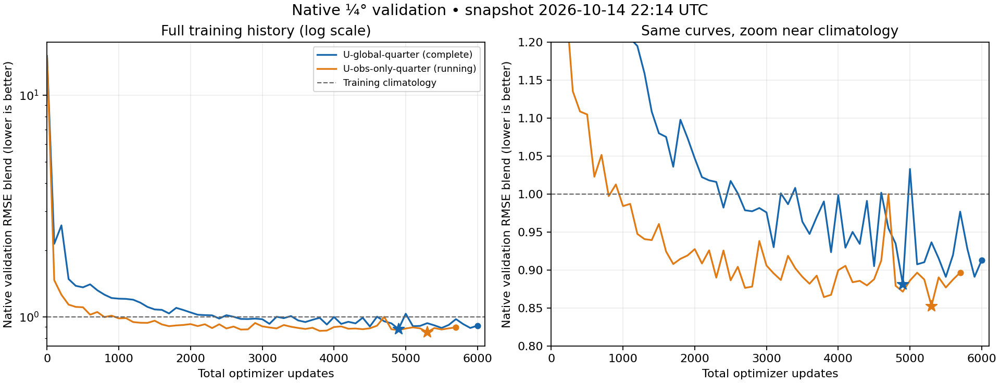

<!-- SPDX-FileCopyrightText: 2026 Samudra Authors -->
<!-- SPDX-License-Identifier: CC-BY-4.0 -->

# Native quarter-degree observation experiment

The [4k/6k auxiliary reproductions](early-rmse-6k-2026-10-10.md#auxiliary-loss-reproductions)
and matched eight-model annual comparison are complete. On October 11 the user authorized **U-global, observation-only, and the
best one or two variants from the 6k comparison**, judged at both 30 and 365 days.
All quarter-degree runs use 6,000 total updates. Training and annual evaluation
data are verified. **All four eight-GPU qualifications (212414) passed**, including
fitting, gradients, real data, exact fresh-process replay, and two-host NVLink
transport. **U-global completed all 6,000 updates**; observation-only reached
5,709/6,000 at October 14, 6:14 p.m. ET. Both earlier-data variants remain queued.
The [training snapshot and validation curves](#production-snapshot) are below;
held-out 30-/365-day evaluation and the common-grid 1° comparison are still pending.
Reporting both native-resolution and matched 1° metrics remains agreed.

## Runs

| Name | Processor and predicted state | OM4 updates | Observation updates |
|---|---|---|---|
| U-global-quarter | Global 720×1440; same U-Net widths/depth and approximately 63M parameters | 3,000 recent-period examples at ¼° | 3,000 at ¼° |
| U-obs-only-quarter | Same global processor and initializer, both randomly initialized | None | 6,000 at ¼° |
| U-early-quarter | Global 720×1440; same 77 physical channels; native analogue of the day-365 early-fine winner | 1,500 recent + 1,500 from 1958–1974, all at ¼° | 3,000 at ¼° |
| U-early-latent-quarter | Same global processor plus 10 recurrent latent channels on every task; native analogue of the day-30 early-latent winner | 1,500 recent + 1,500 from 1958–1974, all at ¼° | 3,000 at ¼° |

Train fresh with seed 1729, fixed LR 1e-4, the existing physical losses, effective
batch of eight, five-day steps and unchanged history/rollout lengths. OM4-plus-obs
arms retain the stretched progressive mixture. Observation-only uses observation
examples throughout, with the same initializer reconstruction and forecast losses;
it receives no OM4 training examples. This matches total optimizer updates, not
observation exposure or exact FLOPs. Preserve chronological splits.

## Choosing the variants

The completed [annual comparison](early-rmse-6k-2026-10-10.md#matched-annual-comparison)
selects **U-multitask-early-latent at day 30 (0.8714)** and
**U-multitask-early-fine at day 365 (0.9561)**. Their union gives the two early-data
arms above. Seed-1729 U-global scores 0.8924/1.0286. This is the result of the
prespecified rule below, not a new ranking based on quarter-degree outcomes.

The rule was to finish the auxiliary reproductions and evaluate the **fixed validation-selected
checkpoints from the 6k runs** for U-global (both seeds), the four earlier-data
variants, U-aux01 and U-aux01-anomaly. Do not substitute the older 4k annual results.
Do not choose a different checkpoint using annual test outcomes.

Reuse the [matched annual comparison](presentation-annual-2026-10-08.md#fixed-evaluation-protocol):
three January starts (2015, 2018, 2021), continuous 73-step forecasts, and the same
four-component climatology-normalized RMSE blend at days 30 and 365 (SST,
geostrophic velocity, OHC 0–700 m, OHC 700–2000 m). Pool equal-origin MSE before
taking square roots. Each lead has its own common climatology denominators.
Report EKE separately: annual temporal-anomaly EKE is not the fixed-lead monthly
cohort EKE used in the five-component training-validation blend.

Promote the best non-baseline variant at each horizon, taking their union (one
or two variants). Deduplicate recipes that become identical at native quarter
resolution: early-coarse and early-fine without latent channels both map to
U-early-quarter; their latent counterparts both map to U-early-latent-quarter. Inspect component errors and both U-global seeds alongside
that ranking; describe weak gains as uncertain. This avoids inventing a weight
between short and long horizons. The three starts are a small, previously viewed
test cohort: using them to choose the next wave is exploratory model development,
not an untouched test of the winning hypothesis. Show all candidate scores and
per-origin results. Quarter-degree results require their own evaluation.

This is full global ¼° evolution, not a ¼° encoder around a 1° processor.
The same convolutional architecture has a smaller receptive field in geographic
units at ¼°; hold architecture fixed in this first comparison and document that
limitation. The current early-fine model's 4× encoder/decoder cannot carry over
unchanged: earlier and recent data now share a resolution. Promoting its result
therefore tests earlier-data/latent benefit, not the original resolution-adapter
mechanism. It does not imply introducing an unrequested 1/16° source.
Recent and earlier OM4 examples will share the native-quarter preprocessing and
forcing statistics. The historical early-data loader normalized physical fields
directly, whereas the matched quarter reader preserves the baseline's normalization
round trip; this is a matched native-resolution recipe, not bitwise reproduction
of that historical loader.

## Confirmed inputs and remaining preparation

Read-only Beta checks on October 10 confirmed the five-day-averaged store:

```
/projects/ny/lz1955/multiscale/jrusak/data/om4/v2026-09/om4_quarterdeg_compact_zstd
```

This is the averaged dataset subsequently prepared in thread
`01a0e8d3-f694-7830-aad3-6d9f00717c95`, not its separate snapshot store.
It contains OM4, mean and standard-deviation stores; packed depth arrays use
Blosc/Zstd compression. Saved conversion receipts verify lossless payload
read-back. Compressed payload is approximately 635 GB. The 4,745 timestamps span
1958–2022, on a Gaussian 720×1440 grid. A direct coordinate audit found 4,728
five-day intervals and 16 six-day intervals at leap-year boundaries (December 28
to January 3, Julian calendar). Keep the published timestamps and existing OM4
step convention; do not reject or silently rewrite those boundary intervals. This is a prepared regridded product,
not the original tripolar simulation grid. Its release differs from the current
Torch wave's quarter-degree v2 source, so comparisons include that provenance
difference. All quarter-degree arms will use the same release.

Observation sources already exist under:

```
/projects/ny/lz1955/multiscale/jrusak/data/obs_full_range/prepared
```

| Product | Confirmed source resolution | Proposed treatment |
|---|---|---|
| OISST | Regular ¼° daily | Remap to Gaussian ¼°; preserve the existing five-day averaging convention |
| DUACS ADT/velocity | Regular ⅛° daily | Aggregate/remap with valid ocean support; retain the established velocity diagnostic definition |
| ERA5 surface forcing | Regular ¼° hourly | Align spatially and temporally to the same observation examples |
| IAP temperature/salinity | ½° monthly, 41 depths | Retain its native observational support for supervision/evaluation through a model-to-observation operator |

The checked pilot caches are still 180×360. A new quarter-degree cache is needed;
no new primary-product transfer is required. The verified calendar requires
10,882 daily dates for 348 monthly examples; the three annual sequences add no
extra daily coverage. Daily plus materialized monthly/annual arrays total roughly
1.6 TB before compression, against approximately 35 TB of available project storage.
Equal OISST/OM4 array dimensions do
not mean identical coordinates: regular versus Gaussian latitude differs.
Do not manufacture fine-scale subsurface truth by upsampling IAP and counting
the interpolated cells as independent observations. Preserve monthly OHC depth
integration, masks, coast handling, calendar alignment, and split isolation.

## Selection and reporting

Agreed selection: retain the same five-component **RMSE-only** blend and equal
weights, evaluated at the new observation supports, with a frozen training-only
seasonal-climatology control and validation denominators established on that
grid. Full-field errors remain neither detrended nor deseasonalized. Spectra do
not enter checkpoint selection.

Report both the validation-selected checkpoint and the fixed 6,000-update
endpoint, with each checkpoint's own initialized persistence. Native subsurface
profiles and OHC retain IAP's observation grid; the common-grid report uses the
frozen legacy supports below. Reporting support is implemented in evaluation
producer `d0fc3c44b142980741ad0f82156fdd2f80ff1f76` (74 focused CPU tests), separately
from the pinned training producer. A full 73-step, one-origin GPU export has
passed for U-global’s selected checkpoint (capacity details below); the exporter
releases each origin’s full state before starting the next.

Also evaluate conservatively coarsened predictions through the unchanged 1°
observation operators and frozen reference for a direct comparison with the
current runs. Calculate velocity/EKE after the chosen remapping where required
by each operator; do not interchange derivative, squaring and averaging.
Before calling the 1° comparison numerically identical to the existing one,
verify that quarter-to-one-degree wet coverage supports every required legacy
cell. If it does not, freeze a common intersection and rescore both the saved
1° comparators and their climatology there; label those scores as common-support
rescoring rather than the original published numbers. Native-resolution and
1° blend values are different protocols and must be labelled separately.

The [static geometry audit](artifacts/quarter-bringup-2026-10-11/common-grid-audit.json)
now confirms that common-support rescoring is required. With at least 90% native
wet-area coverage, the intersection retains 41,519 of 44,892 legacy surface cells,
35,803 of 38,933 upper-OHC cells, and 33,850 of 37,190 deeper-OHC cells. Removed
cosine-weighted areas are 6.62%, 7.15%, and 8.26%, respectively. These are static
model-mask differences; actual observation availability and velocity stencils
further restrict each origin. Use the same archived 1° truth and training-only
climatology for every candidate on the intersection.

Report validation curves/components, fixed endpoints and selected checkpoints,
own initialized persistence, matched rollout maps and temperature profiles.
Use the same held-out origins. Retain annual rollouts as an evaluation follow-up
to the short-lead comparison; they must not choose the training checkpoint.

### Frozen 1° comparison controls

The saved 6k forecasts have now been rescored on that common support, before any
quarter-degree training. These are **existing 1° models**, with their original
validation-selected checkpoints. Model definitions and original full-support
scores remain in the [6k report](early-rmse-6k-2026-10-10.md). Climatology is
recomputed from the same training months on the intersection; its score is 1.

| Existing model | Monthly blend | Annual cohort: day 30 | Annual cohort: day 365 |
|---|---:|---:|---:|
| U-global | 0.8418 | 0.8920 | 1.0281 |
| U-global-seed1730 | 0.8500 | 0.8954 | 1.0344 |
| U-multitask-early | 0.8402 | 0.8953 | 1.0344 |
| U-multitask-early-latent | **0.8295** | **0.8709** | 0.9731 |
| U-multitask-early-fine | 0.8345 | 0.8809 | **0.9551** |
| U-multitask-early-fine-latent | 0.8531 | 0.9036 | 1.0185 |
| U-aux01-6k | 0.8535 | 0.8870 | 1.0396 |
| U-aux01-anomaly-6k | 0.8345 | 0.8821 | 1.0013 |

Monthly scores use the 96-origin, five-component blend with surface errors
averaged across days 5/15/30. Annual scores use the separate three-origin,
four-component protocol above. The same variants lead at days 30 and 365 on
the intersection. This check does not change the selected quarter-degree recipes.

[Monthly components](artifacts/quarter-common-controls-2026-10-12/monthly-components.csv),
[annual components and individual origins](artifacts/quarter-common-controls-2026-10-12/annual-components.csv),
and [frozen inputs and verification](artifacts/quarter-common-controls-2026-10-12/)
retain the complete scores, denominators, masks and hashes. CPU job **19615441**
completed in 5m27s, using no GPUs; it checked the saved prediction payloads and
canonical truth rather than running new forecasts. Source is `81eaa1a29`;
cluster artifacts are under
`/scratch/jr7309/runs/2026-10-12-quarter-common-controls/reports`.

## Execution status

All prerequisite 1° reproductions and annual evaluations are complete. Annual
CPU audit **19607393**, eight-model GPU array **19607394**, and collector
**19607691** passed; no GPU evaluations were repeated. Selected checkpoint and
output hashes are linked in the annual report. All four quarter-degree recipes
have now passed real eight-GPU qualification.

Beta diagnostic **212260** completed all three synthetic 720×1440 full-objective
backward tests on one GB200 (`beta_test`, 0.1281 allocated GPU-hours). The exact
62,967,680-parameter U-global model used bfloat16 and activation checkpointing:

| Task | Forecast leads | Peak allocated / reserved GPU memory | Mean microbatch time after first update |
|---|---:|---:|---:|
| OM4 | 6 | 27.1 / 29.2 GiB | 1.75 s |
| Observation | 6 | 43.7 / 49.9 GiB | 3.19 s |
| Observation | 7 | 47.2 / 53.4 GiB | 3.67 s |

All three updates per case had finite gradients reaching the expected components.
[Raw records](artifacts/quarter-bringup-2026-10-11/) preserve runtime, source and
configuration hashes. These are synthetic microbatch-one measurements, excluding
data preparation; they do not establish effective-batch-eight throughput,
native-IAP operator behavior, or four-GPU correctness. No weights were saved.

The static-grid audit and a real-data five-day preparation test passed. The latter
checked surface fields, all eight finite ERA5 inputs, native IAP profiles/OHC,
timestamps and output hashes. Grace daily preprocessing **131367**, monthly
assembly **131375**, and final statistics/verification **131376** have completed.
All 348 monthly examples and three static/statistics NPZs passed full readback;
normalization uses exactly 243 training months. The
[readiness receipt](artifacts/quarter-bringup-2026-10-11/observations-ready.json.gz)
pins the complete inventory and statistics inputs. Daily preparation used
`dd79f4630`, and materialization used `ec0e0f0a9`. Annual assembly **131377** and
verification **131378** also completed: all 312 annual NPZs and three origin
manifests passed, including exact overlap with the monthly examples
([annual receipt](artifacts/quarter-bringup-2026-10-11/annual-ready.json.gz)).
The ARM compact-reader build passed (**131371**): one full 80-channel frame
and four indexed windows exactly matched independent Xarray decoding, including
missing values. Beta projection test **212269** passed forward and gradient checks
on the real grids with synthetic physical fields; repeated results were bitwise
identical under the pinned runtime. This checks the observation operator, not yet
end-to-end training on observed values.

Local groundwork now includes a bounded compact-OM4 window reader and explicit
native-IAP projection in losses and metrics. Legacy scalar-statistics outputs
were checked for exact equality on a synthetic 243-month fixture. Actual U-global
and observation-only four-GPU training passed the checks below; all four
recipes subsequently passed the eight-GPU checks.

## Beta bring-up and decision points

Use **two Beta nodes (eight B200s) per run**, preserving global batch eight,
6,000 updates and the sample/mask/task schedule. Each rank processes one example
instead of two. Eight-rank reductions can change floating-point trajectories;
all arms therefore start fresh; all four have passed new eight-rank qualification.
Cross-world checkpoint resume is rejected. The compact OM4 reader uses bounded
windows. OM4 steps now load observation coverage masks directly, avoiding
unneeded preparation of observation values; mask equivalence is tested.

Four-GPU diagnostics **212376_0/1** passed fitting, component gradients, matching
replicas, real I/O, native observation validation and exact fresh-process restart
on every trained path. U-global also passed historical OM4 retention. These are
execution checks, not trained-model results. The cold measured scheduled updates
were 28.34 seconds for OM4 and 24.35 seconds for observations in U-global, and
13.74 seconds for observation-only. The mixed estimate is about **44 hours before
validation**, motivating the additional GPUs. Eight-GPU diagnostic throughput
is measured below; production runtime remains unmeasured.

The pinned producer is `f091232ea8d7a8ee04ea14dd4cdbea5fa828f9ff`; the recovery array
**212414** completed all four eight-GPU arms on `beta_test`. Each passed actual
two-host NVLink transport, all fitting/data/gradient checks and bitwise next-update
replay after separate process restarts for each trained path. The two unstarted
four-GPU early-data tests were canceled. Only the immutable data-derived
climatology reference is inherited; old GPU qualifications and diagnostic weights
cannot initialize or authorize production. **169 source tests passed**, including
actual four/eight-rank CPU gradient and serialized-RNG replay tests; seven launch
transport checks passed. All commit checks passed. The first eight-rank array
**212398** failed before training because NCCL bootstrap selected an unreachable
InfiniBand IP. Recovery explicitly uses `bond0` for setup traffic, matching the
previous successful two-host launcher, while still requiring actual NVLink
transport. A small all-reduce check now precedes the large data read. These are
launcher-only changes; source and science stay pinned. The recovery harness
passes 18 tests. All four arms passed the initial all-reduce, real fitting and
component gradients, matching replicas, native validation, and bitwise
fresh-process replay for every trained path. All OM4 arms also passed retention;
both early-data arms passed first/last/leap-window audits. The latent arm's
initializer and recurrent latent rows received gradients on all three tasks.
Every qualification and replay verified actual cross-host NVLink; bootstrap used
`bond0`. Common validation references are byte-identical. The
[completed receipts and accounting](artifacts/quarter-bringup-2026-10-11/qualification-212414.json.gz)
retain all four source/data/runtime contracts and transport evidence.

| Model | Seconds per recent / early OM4 update | Seconds per observation update | Estimated 6k update time |
|---|---:|---:|---:|
| U-global-quarter | 11.97 / — | 12.79 | 20.6 h |
| U-obs-only-quarter | — / — | 7.57 | 12.6 h |
| U-early-quarter | 9.28 / 10.17 | 12.41 | 18.4 h |
| U-early-latent-quarter | 10.55 / 9.71 | 12.22 | 18.6 h |

These are short qualification measurements weighted by each run's full task
mix, excluding validation, checkpointing and startup. Observation timing uses
only one scheduled update per arm, so these are provisional estimates. Native
observation validation took 65–66 seconds per pass; OM4 retention added about
30–32 seconds where applicable. The latent arm peaked at 49.8 GiB allocated per
GPU. Qualification weights are diagnostic only; production starts fresh.

OM4 retention preserves the historical **11-origin** cohort. The old
`--om4-validation-origins=12` setting was an upper bound: all eight completed
6k controls actually evaluated 11 origins. The unchanged August 1, 2013–October 5,
2014 context contains 87 frames and 63 complete 25-frame windows. The runner pins
stride-six IDs `0,6,…,60`, with forecast origins October 30, 2013–August 26, 2014
(noon), ending targets September 25. CPU preflight **131990** passed recent and
first/last/leap-boundary early windows against xarray, including normalization.
Its [receipt](artifacts/quarter-bringup-2026-10-11/cpu-windows-131990.json.gz)
preserves the source/runtime/data hashes. The preceding exact-12 guard failure
was caught on CPU before any GPU allocation; failed and superseded attempts
remain saved.

Completed native-quarter diagnostic allocations total **28.0061 GPU-hours**:
7.3150 for the four-rank/single-GPU checks, 5.1067 for failed network attempts,
and 15.5844 for the four successful eight-rank qualifications. The final latent
qualification took 2,333 seconds on eight GPUs (5.1844 GPU-hours). Canceled
unstarted tests used zero. This is separate from the completed 1° campaigns.
[Earlier launch receipts](artifacts/quarter-bringup-2026-10-11/eight-rank-transition.json.gz)
and the [network recovery receipt](artifacts/quarter-bringup-2026-10-11/eight-network-recovery.json.gz)
preserve failed attempts.

## Production snapshot

**October 14, 22:14 UTC (6:14 p.m. ET).** U-global **212532_0** completed in
20h38m, with verified terminal receipt and selected/final checkpoint hashes.
Observation-only **212896_1** is still training; **212896_2/3** (early and
early-latent) are pending priority.

| Model | Training status / updates | Best native validation RMSE blend (update) | Latest native validation RMSE blend (update) |
|---|---|---:|---:|
| U-global-quarter | Complete: 6,000 (3,000 OM4 + 3,000 observation) | **0.8817** (4,900) | 0.9131 (6,000) |
| U-obs-only-quarter | Running: 5,709 observation updates | **0.8528** (5,300; provisional) | 0.8968 (5,700) |
| U-early-quarter | Queued | — | — |
| U-early-latent-quarter | Queued | — | — |

These are **native-resolution validation scores**, on the same nine validation
origins and frozen climatology denominators (1 means climatology). They are not
held-out test results or the common-support 1° comparison. Observation-only is
unfinished, and both earlier-data variants are pending; no final model ranking
is claimed. Selected checkpoints will receive the agreed 30-/365-day evaluation.

Annual memory qualification **213258 passed** on one GB200: U-global’s
validation-selected checkpoint completed the 2015 origin’s **73 forecast steps and 12 monthly
targets**, including own persistence and common-grid exports. Export took **192 s**;
peak GPU memory was **67.04 GiB allocated / 120.86 GiB reserved**, and peak CPU RSS
was **19.32 GiB**. This demonstrates export capacity, not a one-origin scientific
comparison. Full reporting still requires all three annual starts and the 96-origin
monthly cohort for both selected and fixed-6k checkpoints.
All seven exports passed independent SHA256 and byte-count readback. The
[capacity receipt and accounting](artifacts/quarter-bringup-2026-10-11/annual-memory-213258.json.gz)
preserve that audit and producer/checkpoint/output hashes. Evaluation producer `8bad9c34a` adds
only an optional, provenance-bound origin subset; training and weights are unchanged.
The completed memory allocation adds **0.1133 GPU-hours** (408 seconds × one GPU),
reported separately from the earlier timestamped training totals below.

Full U-global evaluation **213261** is submitted to production Beta (one host,
four GPUs). It evaluates the validation-selected and fixed-6k checkpoints
separately over all 96 monthly test origins and all three annual starts, with
each checkpoint’s own persistence and common-grid exports. No retraining or
checkpoint reselection is involved; scores remain pending.



Raw curves are unsmoothed; stars mark the best observed validation checkpoints
and circles the latest validated checkpoints. The right panel zooms the same
curves. The horizontal axis counts all optimizer updates: observation-only uses
an observation task every time, whereas U-global mixes OM4 and observations.
[Curve values](artifacts/quarter-bringup-2026-10-11/native-validation-2026-10-14.csv)
and [saved receipts, events and accounting](artifacts/quarter-bringup-2026-10-11/production-progress-2026-10-14.json.gz)
retain the snapshot and plotting provenance.

U-global's selected checkpoint is update 4,900, SHA
`57489d504cb73f4c893eba04422ea51ff1f7b60055567689419927aaffb395af`;
its final checkpoint SHA is
`f13bcbc01febc542c91c1c92573e6e3c4ea288195881089bc531524b4509665c`.
The training producer remains `f091232ea8d7a8ee04ea14dd4cdbea5fa828f9ff`.
[U-global W&B](https://wandb.ai/ocean_emulators/observational-transfer/runs/526c08186ad8)
and the [startup verification](artifacts/quarter-bringup-2026-10-11/production-212532-startup.json.gz)
remain available.

Allocated production compute is **331.2778 GPU-hours** at this snapshot:
74,269 seconds for completed U-global and 74,806 seconds for running observation-only,
each on eight GPUs. Adding **28.0061 GPU-hours** of diagnostics/retries gives
**359.2839 GPU-hours** so far. Pending jobs use zero; Slurm steps are not counted
again. Outputs are under `native-production-eight-bond0/job-212532/0/u-global`
and `native-production-eight-bond0/job-212896/INDEX/ARM` in the run root above.
