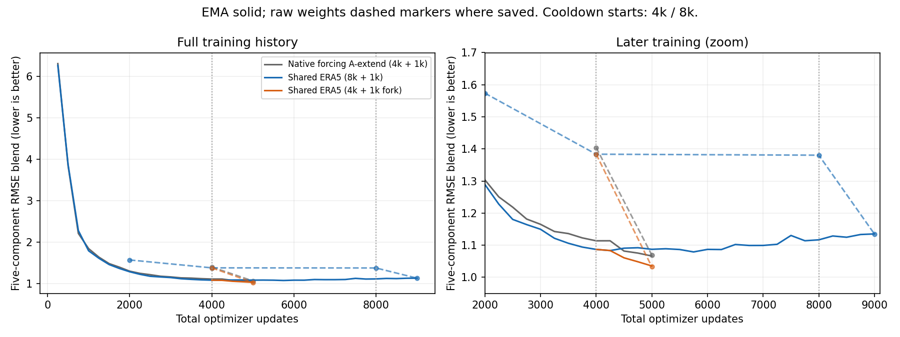
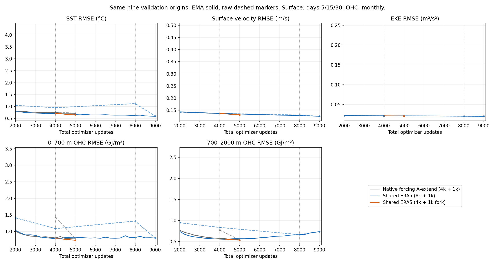

<!-- SPDX-FileCopyrightText: 2026 Samudra Authors -->
<!-- SPDX-License-Identifier: CC-BY-4.0 -->

# Shared ERA5 forcing for OM4 and observation training

## Authorized experiment

Train A from scratch with seed 1729 for **8,000 mixed optimizer updates**,
50% OM4 and 50% observations, effective batch eight. At update 4,000 fork a
separate 1,000-update OBS-only cooldown for comparison with A-extend. Continue
the untouched main trajectory through 8,000 updates, followed by the usual
1,000-update OBS-only cooldown. Both cooldowns retain Adam moments, reset EMA
to raw weights, and linearly decrease LR from 1e-4 to 1e-6. Main LR stays 1e-4.
The 4k branch must not alter the main model, optimizer, EMA or RNG state.

Only the forcing interface changes: both sources provide the same eight ERA5
variables, normalized with the existing OBS atmosphere statistics, through the
same learned 8-to-3 adapter. Gradients from both sources train that adapter.
OM4 initialization history and forecast steps both use ERA5 matched to the
actual OM4 interval bounds. No model-data calendar is relabeled to a monthly
OBS grid. Surface inputs and full-field OM4 targets remain unchanged.

Retain the architecture, losses, sampling, clipping, EMA half-life, no replay,
and absence of a latent bound from A-extend. No CM4 examples in this experiment.
Keep the original RMSE-only validation and log per-source losses/gradient norms.
Evaluate fixed endpoints and retain pre-cooldown checkpoints every 1k from 2k through 8k.
Include raw and EMA validation, matched single-draw/ensemble maps, and OM4
supervised denoising trajectories. The key controlled comparison is the new
4k+1k endpoint versus A-extend's 4k+1k endpoint.

## Data preparation gate

The staged daily and hourly ERA5 archives begin in 1993; A-extend's OM4 training
windows begin in 1975 and end at the July 2013 training cutoff. The user selected
preserving this full OM4 period and preparing earlier ERA5 rather than changing
the sample pool. Prepare 1975–1992 on Grace CPUs, not on the local workstation.

Public source:
`https://storage.googleapis.com/gcp-public-data-arco-era5/ar/full_37-1h-0p25deg-chunk-1.zarr-v3`.
Stream eight hourly fields, retain only compact daily 1° outputs. State fields
use 00–23 UTC; accumulated radiation/precipitation use hours ending 01–24 UTC,
with the original unit conversions and conservative regridding. Five-day bins
are assembled only after verifying exact OM4 start/end support. Normalization
statistics are frozen; earlier years do not refit them.

Before historical production, compare all eight fields and coverage for
1993-01-05 against the existing daily shard, and verify finite 1975-01-01 output.
Qualification uses rtol=1e-6 and atol=1e-7. Missing HTTP objects fail loudly;
no implicit Zarr NaN filling. Every prepared daily file is reopened and hashed.
No training may start before full date coverage and common-grid checks pass.

Runner: `scripts/prepare_shared_era5.py`. Data and training work run only on
cluster hosts. A matching-code fit/serialization qualification must precede
production; diagnostic weights are never promoted. Both gates passed before
the completed production run below.

## Completed training and validation results (October 26)

Beta job **217452 completed successfully** in 14h05m40 with all four GPUs:
**56.3778 allocated GPU-hours**, separate from **2.195 GPU-hours of optimization
and qualification diagnostics**. Producer `6e326a55e`; effective batch eight
(four ranks × microbatch two). Training denoising was compiled, evaluation
remained eager, activation checkpointing was disabled, and AdamW was fused.
These implementation changes passed the numerical qualification documented in
[the optimization report](diffuser-performance-2026-10-24.md).

Both completion markers are present: the main run finished 8k mixed + 1k OBS
cooldown, and the independent 4k fork finished its 1k OBS cooldown. Immutable
full-state checkpoints at every 1k from 2k through 8k, plus the 9k endpoint,
remain available. Extra intermediate cooldowns were canceled as requested.

### What the curves show

At matched **4k mixed + 1k cooldown**, shared ERA5 improves the validation blend
from **1.06637 to 1.03533 (2.9%)** relative to native-forcing A-extend. Most of the
improvement comes from SST (9.2% lower RMSE) and upper OHC (5.4% lower); velocity
and EKE are essentially unchanged. This is encouraging, but one seed and the
qualified implementation changes do not establish forcing as the sole cause.

Extending shared-ERA5 training to 8k does **not** improve the combined score:
the selected checkpoint is **5750, before cooldown**, with blend **1.07909**.
Its final 9k endpoint is **1.13521**. Longer training improves surface metrics
but worsens interior OHC, particularly the deep layer; the aggregate conceals
that tradeoff. Raw and EMA agree closely at the final endpoints, so this final
tradeoff is not simply EMA hiding an improvement in raw weights.

| Model / checkpoint | EMA blend | Raw blend | SST °C | Velocity m/s | EKE m²/s² | Upper OHC GJ/m² | Deep OHC GJ/m² |
|---|---:|---:|---:|---:|---:|---:|---:|
| Native-forcing A-extend, selected/final 5000 | 1.06637 | 1.06918 | 0.71332 | 0.13158 | 0.020975 | 0.77481 | 0.54244 |
| Shared ERA5 4k fork, selected/final 5000 | **1.03533** | 1.03267 | 0.64747 | 0.13202 | 0.020984 | 0.73333 | 0.53500 |
| Shared ERA5 8k trajectory, selected 5750 | 1.07909 | not saved | 0.64536 | 0.13272 | 0.021077 | 0.80222 | 0.57679 |
| Shared ERA5 8k trajectory, final 9000 | 1.13521 | 1.13479 | **0.58973** | **0.12548** | **0.020338** | 0.80387 | 0.73463 |

Physical components in this table are for EMA weights. Upper/deep OHC denote
0–700 m and 700–2000 m. Smaller is better for all columns.

Solid lines are EMA; dashed markers show raw weights **only where evaluated**.
Raw weights were saved/evaluated at milestone endpoints, not every validation;
connecting markers does not imply measurements between them. Vertical lines
mark the 4k and 8k cooldown boundaries. The native curve before 2k is the original
A main run; A-extend resumes that raw 2k checkpoint, excluding A's old cooldown.
The 4k shared fork branches from the main trajectory rather than continuing it.

### Evaluation contract and limitations

All saved validation records use the same **nine origins, November 2013 through
July 2014**, eight diffusion draws and 32 sampler steps. Selection is the
unweighted mean of five RMSEs divided by their fixed seasonal-climatology
counterparts: SST, velocity, EKE, upper OHC and deep OHC. There are no spectra in
selection. Surface metrics average leads 5/15/30 days; OHC is the direct monthly
interior readout, with its top layer supplied by mean predicted surface SST.
These are raw-field RMSEs, not anomaly-only scores.

A-extend and the shared 4k fork both have 2k OM4 + 3k OBS updates including
cooldown. The 8k trajectory has 4k OM4 + 5k OBS updates; it therefore has extra
exposure, not a matched-budget comparison. All use seed 1729 and the same small
single-scale latent processor. Native A-extend resumes the original A at 2k;
shared ERA5 starts from scratch. DDP, compilation and batching introduce small
qualified numerical differences from the historical control. The observations
are validation data used for checkpoint selection, not independent test results.

**No new held-out annual evaluation, denoising trajectories, or surface/interior
maps are included here.** Thus these results do not yet establish that shared
forcing fixes the supervised OM4 full-field diffusion failure or long-rollout
behavior. Those questions require the planned diagnostic outputs. No new
Samudra-processor or batch-32 experiment has been launched.

### Provenance

- Training root: `beta:/projects/ny/lz1955/multiscale/jrusak/runs/shared-era5-ddp-20261024/eager-evaluation/production`.
- Native comparator: `beta:/projects/ny/lz1955/multiscale/jrusak/runs/monthly-replay-20261020/production/A-extend`, producer `ed020de4b`.
- [Saved validation metrics, selected events and completion markers](assets/shared-era5-2026-10-26/metrics.json).
- Historical preparation: 6,575 daily files (11.36 GB), 1975–1992, qualification 146147 and array 146150. Interval audit 146353 independently reproduced every one of 2,702 intervals across the original 409 windows; cache 5.60 GB. No training dates were removed.
- Original qualification 146142 failed during CPU container startup before Python; corrected NVIDIA visibility preserved the scientific producer. Qualifications 216745, 217004 and optimized 217230 are retained separately; no diagnostic weights entered production.

The [Samudra-style processor plan](samudra-latent-processor-plan-2026-10-24.md)
remains a proposal pending review of these shared-ERA5 results.
