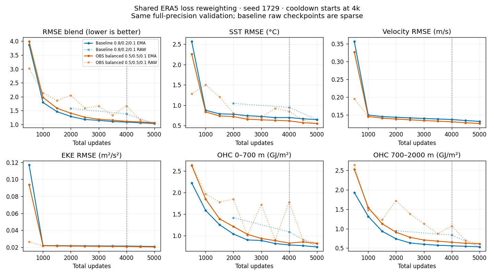

<!-- SPDX-FileCopyrightText: 2026 Samudra Authors -->
<!-- SPDX-License-Identifier: CC-BY-4.0 -->

# Shared ERA5: balance OBS interior and surface training losses

**Completed:** experiment 0 improves surface metrics but worsens interior OHC;
the selected blend is **1.06486 versus 1.03533** (+2.85%, worse). Both selected
checkpoints are at 5,000 updates on the same 500-update candidate grid. The
improvement gate fails; no subsequent architecture arm has been launched.

| EMA validation metric | Baseline 0.8/0.2/0.1 | OBS balanced 0.5/0.5/0.1 | Change |
|---|---:|---:|---:|
| RMSE blend | 1.03533 | 1.06486 | +2.85% |
| SST (°C) | 0.64747 | 0.55262 | −14.65% |
| SSH-derived velocity (m/s) | 0.13202 | 0.12600 | −4.56% |
| EKE (m²/s²) | 0.020984 | 0.020446 | −2.56% |
| OHC 0–700 m (GJ/m²) | 0.73333 | 0.81635 | +11.32% |
| OHC 700–2000 m (GJ/m²) | 0.53500 | 0.61240 | +14.47% |

This is a one-seed validation comparison, not a held-out annual result. Raw final
blend is 1.06162. The increased surface weight produces the expected tradeoff;
it is not a general improvement under the retained selection objective.

[Curve data](assets/shared-era5-obs-reweight-2026-10-26/curves.csv).
The baseline raw curve is sparse; dotted connecting segments are not additional
measurements. Vertical lines mark the start of the OBS-only cooldown.

**Runtime:** job `218327` completed with exit 0 in **2h24m05s**, including all ten
full-precision raw/EMA checkpoint evaluations. Warm mixed-phase updates
(steps 501–4000) averaged **1.40s OM4 / 1.17s OBS**, versus roughly 8.7s OM4 in
the prior serial-loader run. Exposed OM4 preparation/transfer wait averaged
0.38s. This is a cross-run speed comparison, not a controlled filesystem benchmark.
Production/evaluation cost was **9.6056 allocated GPU-hours**, **11.1100 including
all failed/canceled allocated attempts**. Prefetch and deferred parallel evaluation
are successful engineering changes even though the loss-weight scientific gate
failed. All ten checkpoint receipts and the selected checkpoint hash were verified.

[W&B run and posthoc curves](https://wandb.ai/ocean_emulators/observational-transfer/runs/e3c68fbade87).

## Matched comparison

| Setting | Existing shared-ERA5 baseline | A-shared-era5-obs50 |
|---|---|---|
| OBS monthly interior T/S denoising | 0.8 | **0.5** |
| OBS five-day SST/SSH forecast denoising | 0.2 | **0.5** |
| OBS initializer SST/SSH reconstruction | 0.1 | 0.1 |
| OM4 monthly / five-day / initializer losses | 0.5 / 0.5 / 0.1 | unchanged |
| Main training | 4,000 updates, 50% OM4 / 50% OBS | unchanged |
| Cooldown | 1,000 OBS-only updates, EMA reset | unchanged; new OBS weights retained |
| Seed / effective batch | 1729 / 8 | unchanged |

Fresh initialization, existing four-block latent processor, two 128-channel
45×90 slots, diffusion decoder and shared 8→32→3 ERA5 adapter. No replay or
latent penalty. Main LR 1e-4, linear cooldown to 1e-6, EMA half-life 100 updates,
gradient clipping at 1. Four GPUs each process two examples; activation
checkpointing off, fused AdamW, compiled training denoiser, eager evaluation.

**Selection is unchanged:** equal average of five RMSE/climatology-RMSE ratios
(SST, SSH-derived velocity, EKE, upper OHC, deep OHC), original nine validation
origins and eight-member/32-step decoding. There is no RMSE blend v2. Salinity
is supervised in training but not directly in selection. Save full raw/EMA/optimizer checkpoints every 500 updates. Defer all training
validation until the end, distributing the ten checkpoints across four GPUs.
Each retains all nine origins, eight members and 32 diffusion steps for both
raw and EMA weights. Qualification still includes its small safety evaluation. Compare both
selected and final models and all individual components; one seed is a screen,
not a replicated finding. Later processor/forcing/resolution stages remain
gated on improvement; they have not been submitted.

## Execution and qualification

- Producer: `f3413615cef20828f9928705a9cf6c391d154045`.
- Beta production: `218327`, `standard`, one node / four GPUs, 24-hour limit.
- Short parallel scheduling candidate: `218270`, `beta_test` / `test`, four
  GPUs, two-hour limit. An exclusive filesystem lock prevents duplicate
  qualification; production qualifies inline if it starts first. A failed
  qualification stops production rather than silently retrying.
- Root: `/projects/ny/lz1955/multiscale/jrusak/runs/shared-era5-reweight-20261026/prefetch-wandb-team`.
- Frozen data paths, normalization, forcing-cache proof and run configuration:
  `paths.json` at that root. The source checkpoint path is a provenance check;
  this fresh mode does not initialize weights from it.
- Qualification exercises both sources, exact optimizer/EMA/RNG serialization,
  rank agreement, finite evaluation and measured OBS loss equal to
  `0.5 * interior + 0.5 * surface + 0.1 * reconstruction`.
- Local validation: 39 targeted CPU tests passed; commit hooks passed.
- W&B configured online: `ocean_emulators/observational-transfer`; the URL will be
  recorded after initialization, not inferred while queued.
- Remote completion callback: `5e58bb7d-360d-41e1-86fc-4ccf35c75bf9`, with a
  dedicated quiet monitor and fallback reminder. Login-node authentication
  passed; each job also checks callback access inside its compute container.

At submission both revised jobs were pending without a start estimate. The
completed reference's matched update timing totals 5.67 hours; ten checkpoint
raw/EMA evaluations, distributed across four GPUs, should add roughly 24 minutes
instead of the previous 2.6 hours. Those measurements describe the old serial loader. The parallel-prefetch
producer needs measured qualification/production timings before a new ETA;
do not assume a fourfold improvement from four loading threads.

The initial attempt `218258` was canceled during qualification, before scientific
training began, when the user changed the validation schedule. Its 8m54s on four
GPUs (0.5933 allocated GPU-hours) and logs are retained in the parent directory;
its pending test `218259` never started. The replacement starts fresh and does
not promote qualification weights. The deferred-validation-only jobs `218264`
and `218265` were subsequently canceled while still pending (zero GPU time),
when the user requested parallel data preparation. Their artifacts remain in
the `deferred-validation` sibling directory.

Selection now considers 500-update checkpoints. Compare the baseline on the
same 500-update candidate grid rather than crediting a difference in selection
frequency. Full component curves live in `validation-*.json`, checkpoint SHA and
per-pass timing receipts in `validation-receipt-*.json`, and final selection in
`EVALUATION_COMPLETE.json`. W&B uses `posthoc/checkpoint_step` for these curves
so resumed logging does not discard earlier optimizer-step measurements.

## Parallel preparation and bounded prefetch

The reader memory-maps a verified uncompressed float32 `frames.npy` cache at
`monthly-latent-pilots-20261016/packed-om4`: shape 2702×77×180×360, 53,927,596,928
bytes. It does not read 77 separate Zarr arrays per sample. Eight 25–26-frame
examples traverse about 4 GB of raw fields per update, plus repeated memory
passes/intermediates. The prior rank-zero implementation prepared all eight
serially before broadcasting them; no preparation overlapped GPU computation.

The current producer uses **four CPU loading workers and a bounded queue of
eight windows**, preparing the next OM4 batch while the current GPU update and
intervening OBS update execute. Sample lookahead uses a clone of the consumed
NumPy RNG; it does not advance the checkpointed RNG. Results are consumed in
sampled order, workers never touch CUDA or diffusion RNG, and speculative work
is discarded/rebuilt on restore. Loading/hash failures propagate to training.

CPU normalization, finite checks and frame hashes are deliberately unchanged
for bitwise comparison. Qualification compares the prefetched OM4 fields,
forcing, masks, geometry and shared ERA5 tensors against the serial reader,
then exercises exact serialized replay. It additionally records eight warm
updates without the duplicate-reference reads in `prefetch_performance`.
`model_preparation_wait_seconds` tracks exposed OM4 preparation/transfer time.
The completed production measurements above establish the practical speedup;
CPU tests alone did not.

GPU normalization and skipping the unused native OM4 forcing reads are further
options if they remain material bottlenecks; neither is silently included in
this first exact-input parallelization change.

## Qualification result and logging recovery

Job `218269` passed exact prefetched-input comparison, serialized optimizer/EMA/
RNG replay and four-rank model equality. Peak allocated memory was 20.92 GiB.
The exposed OM4 preparation wait was about 0.06 seconds, but the eight measured
updates still had variable compiler-affected total times (OM4 6.8–22.3 seconds).
These do not establish an end-to-end speedup; measure warm production throughput.

Production then failed during W&B initialization, before any training updates:
`emulators` is an organization and W&B requires a team entity. Recovery `218327`
uses the historical `ocean_emulators` team. Source and all scientific settings
are identical. `QUALIFICATION_INHERITANCE.json` records exact old/new config
hashes, the sole changed key `wandb_entity`, and the original qualification hash.
The derived qualification receipt updates only the configuration hash and adds
explicit inheritance metadata; all measured evidence remains unchanged. No
qualification weights are used for production. The redundant pending test
`218270` was canceled.

The failed job used 13m40s × four GPUs = 0.9111 GPU-hours; total attempts before
recovery production are 1.5044 allocated GPU-hours. Earlier artifacts remain
untouched in their original directories.
