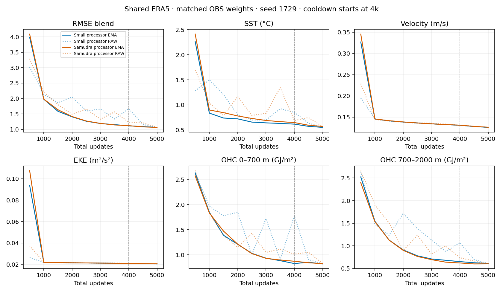

<!-- SPDX-FileCopyrightText: 2026 Samudra Authors -->
<!-- SPDX-License-Identifier: CC-BY-4.0 -->

# Shared ERA5: Samudra-style latent processor

The Samudra processor finished with selected EMA blend **1.06607**, versus
**1.06486** for the retained [small-processor baseline](shared-era5-obs-reweight-2026-10-26.md).
This is 0.114% worse in this single-seed comparison. The strict
improvement gate failed, so the eight-channel forcing and higher-resolution
latent follow-ups have not been launched.

Both models select update 5,000, after the 1k OBS cooldown. These are validation
results on nine origins, not held-out annual rollout results.

| Metric | Small processor | Samudra processor | Change |
|---|---:|---:|---:|
| RMSE blend | 1.06486 | 1.06607 | +0.11% |
| SST RMSE (°C) | 0.55262 | 0.57078 | +3.29% |
| Velocity RMSE (m/s) | 0.12600 | 0.12633 | +0.26% |
| EKE RMSE (m²/s²) | 0.020446 | 0.020536 | +0.44% |
| OHC 0–700 m RMSE (GJ/m²) | 0.81635 | 0.82187 | +0.68% |
| OHC 700–2000 m RMSE (GJ/m²) | 0.61240 | 0.60136 | −1.80% |

Lower is better. SST, velocity and EKE average leads 5/15/30 days; OHC uses
monthly targets. The blend equally averages the five errors divided by their
fixed climatology errors. Raw final blend is 1.06662 versus the baseline raw score of 1.06162; EMA is not
concealing an improvement in the final raw weights. One seed cannot establish equivalence or
a causal benefit from the small deep-OHC difference.

[Curve data](assets/shared-era5-samudra-2026-10-27/curves.csv) ·
[Full validation metrics](assets/shared-era5-samudra-2026-10-27/results.json).
Solid lines show EMA; dotted lines show raw weights.

## Model and matched protocol

`A-shared-era5-obs50-samudra` replaces the four-block single-scale processor with
`SamudraLatentProcessor`: the repository `UNetBackboneConfig` ConvNeXt U-Net,
widths 64/128/256, dilations 1/2/4, one block per scale, expansion factor two,
InstanceNorm without running statistics, projection to 128 channels and a
small-initialized residual OceanConv output head. Longitude is periodic and
latitude uses the existing backbone's boundary handling. Odd-grid 45×90 output
shape and forcing/latent gradients are tested explicitly.

The processor consumes both 128-channel 45×90 latent slots, the pooled three
forcing channels, and five geographic/calendar channels. It predicts an
increment to the latest slot, then shifts the two-slot memory. Diffusion draws
are not fed back into the processor. This changes both architecture and
GroupNorm→InstanceNorm; it is not an isolated parameter-count ablation.

The initializer, diffusion decoder, 8→32→3 shared ERA5 adapter and their initial
weights are unchanged: replacement construction preserves the global RNG stream.
The processor itself is fresh, not resumed from the small-processor checkpoint.

- Seed 1729; 4k updates, 50% OM4 / 50% OBS; then 1k OBS-only cooldown.
- OBS loss 0.5 monthly interior T/S + 0.5 SST/SSH forecast + 0.1 initializer.
- OM4 loss 0.5 monthly + 0.5 native forecast + 0.1 initializer.
- Main LR 1e-4, cooldown to 1e-6 with EMA reset; effective batch eight,
  four GPUs × two examples, existing clipping and EMA half-life.
- Four-worker bounded CPU prefetch, unchanged normalization, compiled training
  denoiser, eager evaluation. No replay or latent magnitude penalty.
- Save checkpoints every 500 updates; evaluate all ten raw/EMA checkpoint pairs
  after training in parallel, nine origins, eight draws, 32 diffusion steps.
- Select on the original five-component RMSE blend, without spectra. Report
  component curves and surface/interior tradeoffs, not just the aggregate.

## Execution and provenance

Producer `1d012c406cf00a99bf1eb12b83f973897fc1ea2e`; 41 targeted CPU tests and
commit checks passed. Beta qualification **218496** passed exact optimizer/EMA/RNG
replay and bitwise prefetch checks. Production **218495** completed successfully:
5,000 updates, comprising 3,000 OBS and 2,000 OM4 updates. All ten raw/EMA
evaluation receipts, checkpoint hashes and the selected checkpoint were verified.

The model has **60,727,904 parameters**, including **13,660,448** in the processor.
Qualification peak allocated CUDA memory was **21.18 GiB per GPU**. Production
and evaluation took **5h27m40s** on four B200 GPUs; qualification took 9m03s. Total
allocated GPU time, including qualification and evaluation, was **22.4478 GPU-hours**. Warm main-training updates averaged
4.367 seconds for OM4 and 1.319 seconds for OBS, versus 1.395 and 1.174 seconds
for the small processor. These timings come from separate jobs.

Root: `/projects/ny/lz1955/multiscale/jrusak/runs/shared-era5-samudra-20261027`.
Frozen source/config: `code.tar` and `paths.json`. Selected checkpoint:
`production/A-shared-era5-obs50-samudra/best.pt`, EMA update 5,000,
SHA256 `73456f7e03303532862fcc7c67b2ea2995501bcfd0f1f02ec7dcfdbb4de4818b`.

[W&B run](https://wandb.ai/ocean_emulators/observational-transfer/runs/825ed3d30e9a).
The completion callback has been retired; no further job is queued for this chain.
