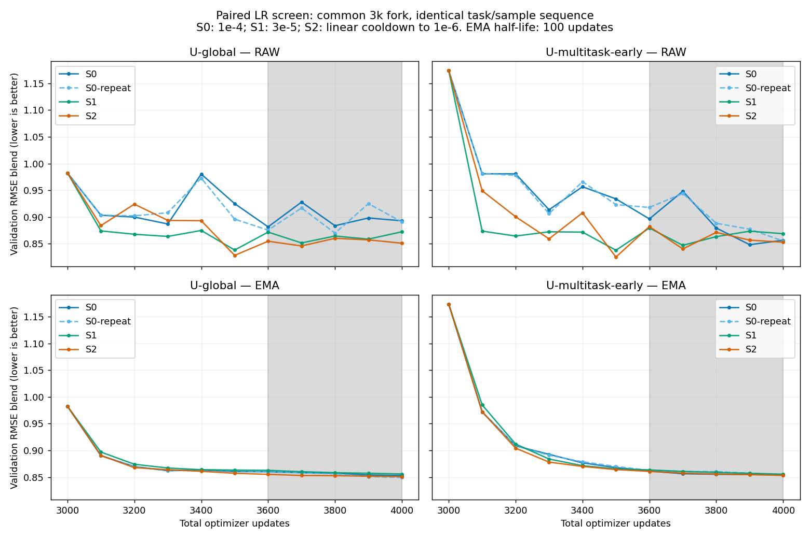
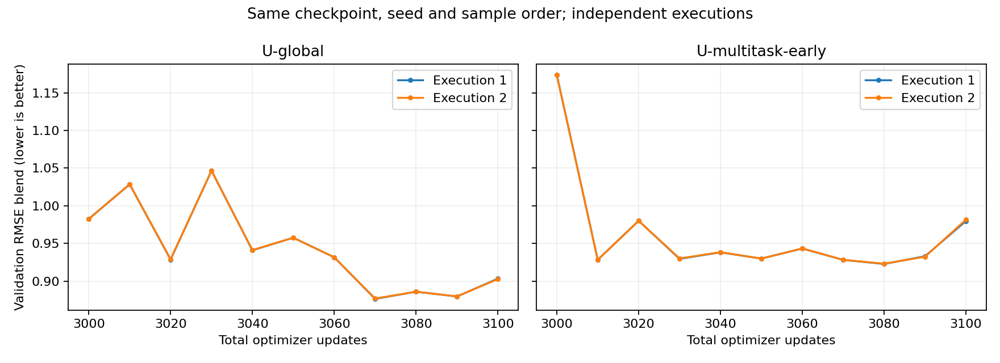

<!-- SPDX-FileCopyrightText: 2026 Samudra Authors -->
<!-- SPDX-License-Identifier: CC-BY-4.0 -->

# Observation training stability screen

**EMA materially improves validation quality and stability in this paired screen.**
Reducing the learning rate also helps raw weights, but the EMA policies are close.
This is a seed-1729 continuation experiment, not evidence that a particular recipe
will remain best over 16k updates. The [plan](stabilization-long-training-plan-2026-10-13.md)
requires a review before the longer-run matrix.

## Stage 2 results

Primary criterion: average RMSE blend over updates 3,600/3,700/3,800/3,900/4,000,
then equal weighting of the two model families. Lower is better. The shaded
region in the figure marks these checkpoints. S0-repeat is an independent
execution with the same seed and sample order, not an additional random seed.

| Policy and evaluated weights | U-global | U-multitask-early | Equal-family mean |
|---|---:|---:|---:|
| S0 raw | 0.896933 | 0.885843 | 0.891388 |
| S0-repeat raw | 0.895667 | 0.896560 | 0.896113 |
| S1 raw | 0.863813 | 0.866483 | 0.865148 |
| S2 raw | 0.853861 | 0.860736 | 0.857298 |
| S0 EMA | 0.856601 | 0.856602 | 0.856601 |
| S0-repeat EMA | 0.854939 | 0.858968 | 0.856954 |
| S1 EMA | 0.858903 | 0.859187 | 0.859045 |
| S2 EMA | **0.852837** | **0.856424** | **0.854630** |

At constant LR, EMA improves the primary score by **3.90%** for S0 and **4.37%**
for its duplicate. This is evaluation of averaged model parameters, not smoothing
plotted scores. The mean absolute adjacent-checkpoint change over the final five
checkpoints falls from 0.03377 to 0.00179 for S0 (18.9× smaller), and from 0.03659
to 0.00239 for the duplicate (15.3×). This descriptive measure includes trends;
it is not a statistical noise estimate.

| Policy and weights | Mean endpoint | Mean per-family late maximum | Mean late adjacent change |
|---|---:|---:|---:|
| S0 raw | 0.874828 | 0.938113 | 0.033771 |
| S0 EMA | 0.853669 | 0.860819 | 0.001787 |
| S1 raw | 0.870621 | 0.875944 | 0.014518 |
| S1 EMA | 0.855744 | 0.863131 | 0.001847 |
| S2 raw | 0.852012 | 0.871212 | 0.015433 |
| S2 EMA | 0.852179 | 0.858025 | 0.001462 |

S2 EMA leads S0 EMA by only **0.23%**, below the predeclared 1% confirmation
threshold. The S0 execution duplicate shifts its EMA score by 0.04% on average,
but that does not measure seed variability. S2 raw has a slightly better endpoint
than S2 EMA while its last-five mean is worse; selecting only the final point
would answer a different question.

**Recommended next decision:** retain EMA as a strong candidate and confirm
S2 EMA versus S0 EMA with the planned second-seed short screen before freezing
the longer-run policy. Constant-rate EMA preserves learning capacity; cooldown
EMA has the best short-screen mean. Neither result establishes the best LR tail
for 16k training. Larger accumulation or mixed-task batches remain reasonable
follow-ups, but these results already show a substantial improvement without
changing the model or data exposure. No longer runs have been launched.

Full values: [summary and progress CSV](assets/stability-screen/screen-summary.csv),
[component ratios](assets/stability-screen/screen-components.csv),
[all curve points](assets/stability-screen/screen-curves.json), and
[checkpoint hashes / online W&B runs](assets/stability-screen/screen-lineage.md).
Component ratios divide each physical RMSE by its frozen climatology-reference
RMSE, then average the final five checkpoints; no spectrum enters selection.

## Models and matched protocol

- **U-global:** existing global 1° physical-state model, recent OM4 plus observations.
- **U-multitask-early:** same architecture, replacing half the OM4 examples with
  earlier 1° OM4. No fine-resolution task or extra latent channels.
- **S0 / S0-repeat:** constant 1e-4 for both tasks; duplicate executions.
- **S1:** constant 3e-5 for both tasks.
- **S2:** linear decay from 1e-4 at update 3,000 to 1e-6 at 4,000.
- **Raw:** current parameters. **EMA:** parameter average with a 100-update
  half-life, initialized at the common fork; buffers copied from raw each update.

For each model, retained seed-1729 optimizer checkpoints at 2,667 updates were
migrated with exact model/optimizer/RNG/counter audits, then replayed once to a
common 3,000-update fork (1,782 OM4 / 1,218 observations). All eight treatments
start from those immutable forks and retain the original task/sample sequence,
eight-example accumulation, objectives and runtime. Each ends at 4,000 total
updates: 2,000 OM4 / 2,000 observations. No diagnostic weights were promoted.

The same nine validation origins are evaluated every 100 updates. The RMSE
blend uses full-field SST, geostrophic velocity, instantaneous EKE, and OHC in
two depth bins, normalized by the frozen reference. Surface metrics pool the
5/15/30-day leads. These are validation results, not new 365-day test results.
Historical U-global originated on Beta; the new paired controls and treatments
all use the same RTX runtime, avoiding a cross-runtime treatment comparison.

## Stage 1 findings

All diagnostic tasks completed successfully. Five ordinary evaluations of each
fixed checkpoint produced identical predictions and metrics, including the two
fresh-process reloads. The deterministic references also agreed with each other;
switching numerical backends shifted the blend by only 0.010% (U-global) and
0.006% (earlier-OM4). Evaluation repeatability is comfortably below the 0.1% target.

Both executions use identical starting model/optimizer/RNG state and sample order.
Their substantial common fluctuations therefore reflect training updates, rather
than evaluation randomness. This does not measure variability across random seeds.

| Model | Execution 1 at 3,100 | Execution 2 at 3,100 | Relative endpoint difference |
|---|---:|---:|---:|
| U-global | 0.90328 | 0.90264 | 0.071% |
| U-multitask-early | 0.97976 | 0.98156 | 0.184% |

The measured source-gradient cosines were positive at both endpoints for the
initializer and processor. These small fixed-batch probes do not support a
blanket task-conflict explanation, nor rule out conflict on other examples.
All four traces contain 100 finite updates and eleven full validation scores.
The common checkpoints are unchanged; trace weights are excluded from Stage 2.
Total allocated GPU time through Stage 1: **2.1136 GPU-hours**.

## Verification and provenance

All eight production tasks completed with exit 0. Each saved exactly 1,000
ordered finite updates, eleven raw and eleven EMA validations, an EMA count of
1,000, and a verified final checkpoint hash. Both source forks remain unchanged.
Raw weights, EMA, optimizer, counters and RNG share one atomic restart file;
qualification tested bitwise deterministic replay and raw-weight restoration
after EMA evaluation. Local validation: 48 targeted tests and all pre-commit
checks passed. Ordinary production numerical settings were unchanged.

| Work | Torch job(s) | Allocated GPU-hours |
|---|---|---:|
| Stage 1 qualification and common forks | 19808531, 19808532 | 1.0886 |
| Stage 1 repeatability and traces | 19810145, 19810146 | 1.0250 |
| Stage 2 base and EMA qualifications | 19814958, 19814959 | 1.4578 |
| Stage 2 eight continuations | 19818038 | 6.9664 |
| **Total, including all allocated attempts** | | **10.5378** |

Original H100 jobs were canceled while pending and consumed zero GPU-hours.
CPU audits were 19725599 and 19814956. Stage-1 producer:
`72c06e2e92d007315542c5c255bc3ad1937b3927`; screen producer:
`a0dbb7a34c424b23afe303553cefd5bfdddda090`. Source-only archive readback:
`ebd0fd36a1632add782dc6b58b07f275b62d13930a01e67f3bbc980d9998e153`.

Torch roots: `/scratch/jr7309/runs/2026-10-13-observation-stability` and
`/scratch/jr7309/runs/2026-10-14-observation-stability-screen`. Each contains
frozen paths/runtime contracts, submission records, qualification receipts and
outputs. Completed callbacks have been retired.

Implementation: [Stage-1 runner](../../../scripts/run_observation_stability.py),
[Stage-2 runner](../../../scripts/run_observation_stability_screen.py),
[Slurm harness](../../../scripts/slurm_observation_stability.sbatch),
[isolation/EMA/restart tests](../../../tests/test_observation_stability.py).
