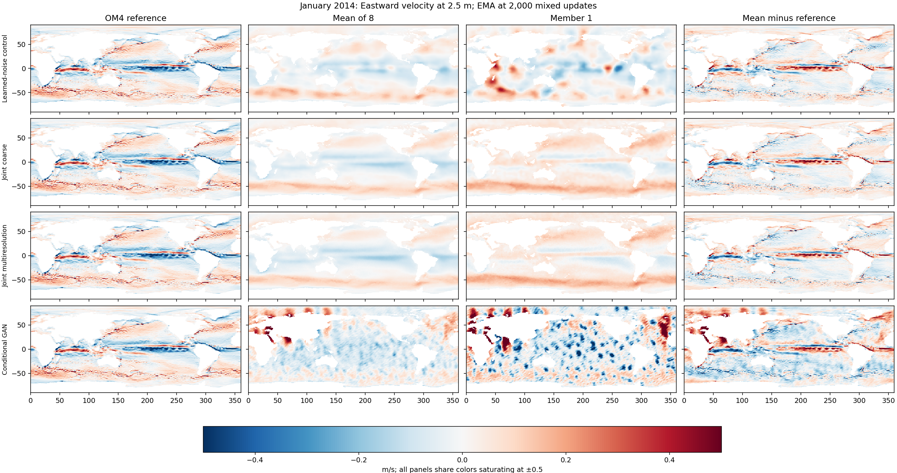
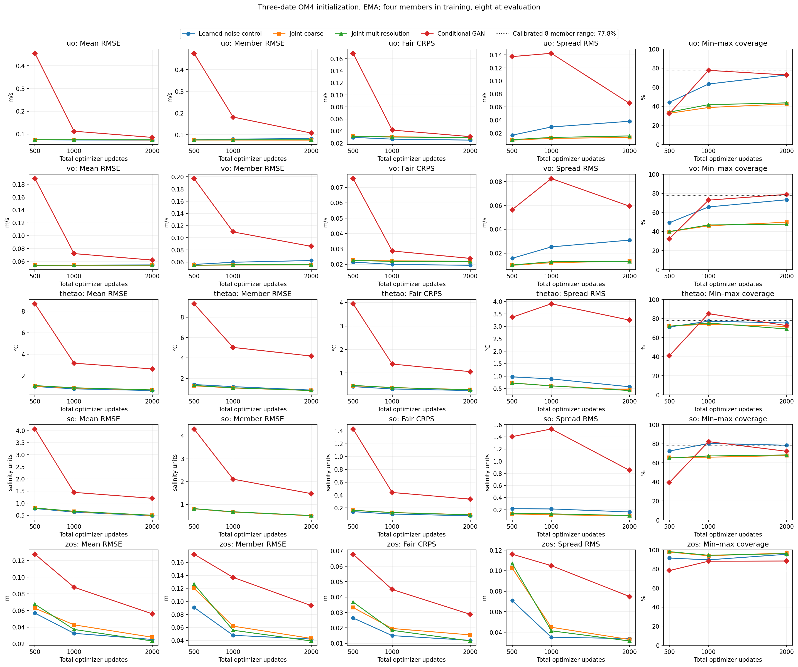
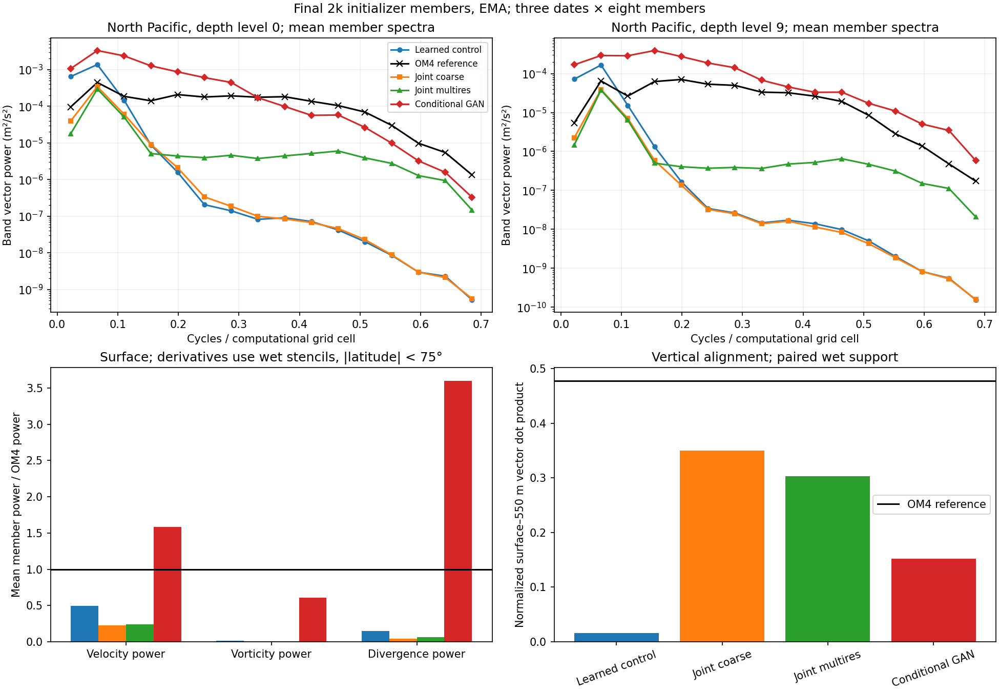
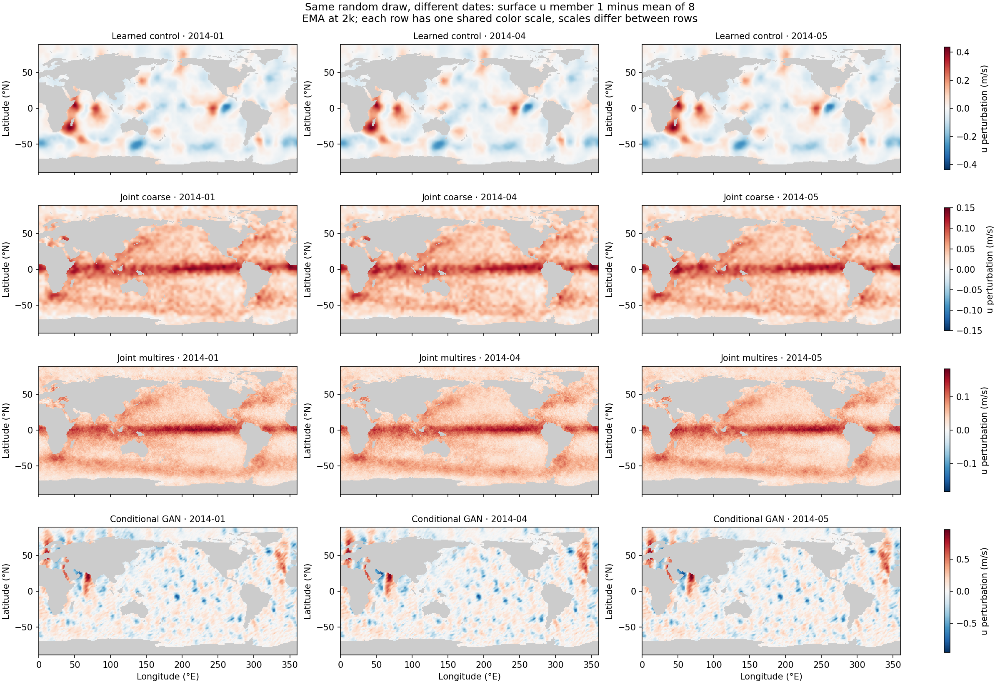
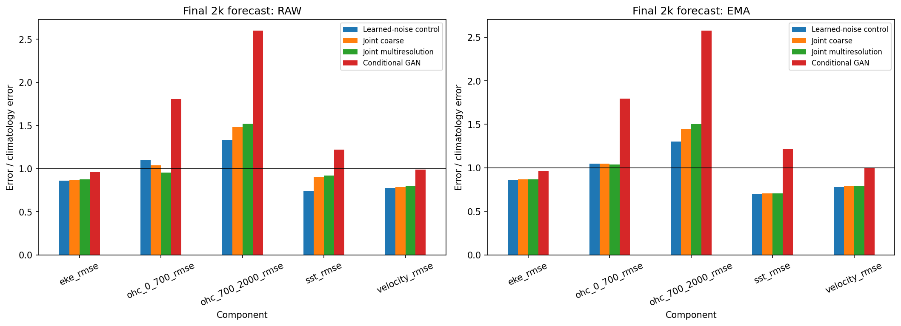
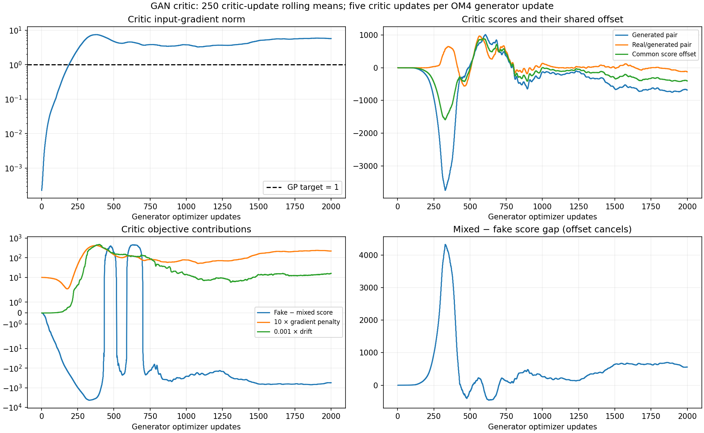

<!-- SPDX-FileCopyrightText: 2026 Samudra Authors -->
<!-- SPDX-License-Identifier: CC-BY-4.0 -->

# Joint noise and conditional GAN: four-arm results

None of these 2,000-update runs improves on the learned-noise control in final
velocity CRPS or the observation-initialized forecast blend. The joint-injection
arms produce smoother, less dispersed members. Adding independent
fine-grid noise increases short-wavelength power, but leaves a large deficit.
The conditional GAN produces more small-scale texture and larger errors; its
critic and generator gradients show an optimization-scale problem.

All four runs completed. They each use 1,000 OM4 and 1,000 observation generator
updates, effective batch eight, four training members and eight evaluation
members. There is no replay or cooldown. The stochastic initializer and
deterministic processor are Samudra ConvNeXt U-Nets; data, forcing, generator
sampling schedule and evaluation cases match. One seed was used. This screen
cost 19.69 allocated GPU-hours, including evaluation.

## What changed

| Arm | Initializer change | OM4 initializer supervision |
|---|---|---|
| Learned-noise control | Existing three-block noise processor and middle/decoder FiLM | Fair CRPS |
| Joint coarse | Unprocessed coarse noise modulates encoder, middle and decoder | Fair CRPS |
| Joint multiresolution | Independent noise at 180×360, 90×180 and 45×90 enters corresponding feature stages | Fair CRPS |
| Conditional GAN | Full-grid noise projected into conditioning before the U-Net | Paired conditional adversarial loss |

The new joint-injection arms also remove the control's separate learned noise
processor. Their comparisons therefore do not isolate placement alone. The GAN
changes both noise architecture and initializer objective. It retains OM4
forecast/monthly CRPS and all observation losses. Five critic updates per OM4
generator update add 40,000 training-only OM4 example exposures; generator
exposure is 8,000 examples per source in every arm. See the [plan](joint-noise-plan.md).

## Initialization scores and maps

Final EMA scores below average three held-out OM4 cases, labelled January,
April and May 2014, and all 19 depths. Each initialization reconstructs the last
bin in its input history; the month labels identify cases, not future forecast
validity. Conditioning includes 19 five-day SST/SSH bins (95 days), matched
ERA5 and context; the target is the latest five-day mean ocean state. RMSE is the square root of the date/depth average of cosine-weighted
wet-cell MSE. CRPS is averaged over the same date/depth scores. Velocity units
are m/s. Raw weights and per-channel scores are retained in the linked dumps.

| Arm | Ensemble-mean RMSE u / v | Fair CRPS u / v | Eight-member range coverage u / v |
|---|---:|---:|---:|
| Learned-noise control | 0.07332 / 0.05449 | 0.02495 / 0.01932 | 72.8% / 73.2% |
| Joint coarse | 0.07397 / 0.05398 | 0.02948 / 0.02201 | 42.4% / 49.7% |
| Joint multiresolution | 0.07489 / 0.05415 | 0.02899 / 0.02183 | 43.5% / 47.6% |
| Conditional GAN | 0.08516 / 0.06203 | 0.03071 / 0.02382 | 72.8% / 78.8% |

Coverage is the fraction of reference values between the pointwise minimum and
maximum of eight members. Its calibrated continuous-draw expectation is 7/9,
about 77.8%. Coverage uses cosine-weighted wet cells, then equal weighting
over dates and depths. GAN coverage close to that value does not establish calibration or
realistic current structures.

The control retains broad velocity patches. Joint coarse and multiresolution
members are closer to their ensemble means; their lower member RMSE accompanies
reduced spread and worse CRPS. The GAN member has fine texture and large
coastal/high-latitude anomalies without recovery of the reference's narrow
currents. All panels use common colors saturating at ±0.5 m/s and include the
full latitude range. The error column is ensemble mean minus reference.

[Surface northward velocity](results/joint-noise-maps/maps-ema-2014-01-vo_0.png) ·
[Eastward velocity at 550 m](results/joint-noise-maps/maps-ema-2014-01-uo_9.png) ·
[Northward velocity at 550 m](results/joint-noise-maps/maps-ema-2014-01-vo_9.png).
PDFs accompany each PNG.

GAN initialization improves substantially during training: eastward-velocity
mean RMSE falls from 0.4549 to 0.1124 to 0.0852 m/s at 500, 1,000 and 2,000
updates. It still trails the control at the endpoint. This experiment does not
establish that more training would close the gap.

[All-depth scores](results/joint-noise/initializer-summary.csv) ·
[Channel scores](results/joint-noise/initializer-channel-summary.csv.gz) ·
[Per-date comparisons](results/joint-noise/initializer-paired-differences.csv) ·
[Raw-weight curves](results/joint-noise/initializer-curves-raw.png).

## Spatial structure

North Pacific surface-member fine-band power, at wavelengths shorter than
approximately 7.5 grid cells, is 0.77% of OM4 for the control, 0.84% for joint
coarse, 3.23% for joint multiresolution and 252% for the GAN. Multiresolution
noise does reach shorter spatial scales, but that alone does not recover the
reference spectrum. The GAN also has excessive broad-scale power: 9.28 times
the reference in the complementary coarse band.

Using spherical velocity derivatives on fully wet five-point stencils within
75°S–75°N, the GAN's surface vorticity power is about 61% of OM4 while divergence
power is about 360%. The larger velocity power is not accompanied by a matched
balance of rotational and divergent structure. These are comparisons to the
same regridded OM4 reference, not assertions that all ocean currents should be
divergence free. Velocity power in the figure uses the full global wet domain;
derivative power uses the restricted stencil domain. Spectra use masked,
demeaned, Hann-windowed computational-grid FFTs, not DEX or physical isotropic
wavenumber spectra. Ratios divide mean member power by mean reference power
across three dates; they are not spectra of the ensemble mean.

The initializer exporter resets the random seed for every date. We therefore
can compare the same random draw under January, April and May conditioning.
For each member, subtract its date's ensemble mean to isolate the stochastic
perturbation. Its cross-date vector cosine similarity is 0.9992 for the control,
0.9984 for joint coarse, 0.9983 for joint multiresolution and 0.9865 for the GAN
(surface velocities; average of three date pairs and eight members). Thus the
perturbation patterns barely respond to the changed conditioning in these
cases, despite the new interaction paths.

This sensitivity check changes surface history, forcing and calendar together.
It does not isolate the effect of SSH or establish whether any movement follows
a jet correctly. Similar conditional covariance across dates can be legitimate;
the high similarities combined with the unrealistic member maps are the reason
to investigate largely input-independent perturbation patterns. Each row in the
figure shares a color scale across dates; scales differ between arms.

The exports contain velocity at 2.5, 550 and 6000 m. They support velocity/depth
diagnostics, but not a saved-map test of velocity–SSH or heat-flux coherence.
The surface–550 m vector alignment is closer to the reference in the joint
arms, but their reduced spread also exposes more of the coherent ensemble mean;
this is not independent proof of realistic stochastic depth structure.

[Spatial summary](results/joint-noise-spatial/structure-summary.csv) ·
[Spectral bands](results/joint-noise-spatial/spectral-bands.csv) ·
[Fixed-noise sensitivity](results/joint-noise-spatial/fixed-noise-conditioning-summary.csv) ·
[Raw-weight spatial figure](results/joint-noise-spatial/member-structure-raw.png).
PDFs accompany each PNG. Derivative formulas were checked against solid-body
rotation and masked-land-value invariance before evaluating the saved fields.

## Forecast skill

The existing evaluation uses nine observation-initialized origins, November
2013 through July 2014. Its blend is the equal mean of five climatology-relative
RMSE components: SST, SSH-derived velocity, EKE, 0–700 m OHC and 700–2000 m OHC.
Each component is model RMSE divided by climatology RMSE on the same support;
a blend of one equals the climatology baseline in this normalized average.
Surface errors pool origins/spatial cells at each of days 5, 15 and 30, then
average the three lead RMSEs. OHC uses calendar-weighted monthly means. Predicted
velocity is derived from ensemble-mean SSH and compared with observed DUACS
velocity. EKE is calculated from those velocities after subtracting their
nine-origin mean at each lead; it is not the average of member EKE. Lower is
better.

| Arm | EMA blend | Raw blend | EMA day-30 SST RMSE (°C) |
|---|---:|---:|---:|
| Learned-noise control | 0.93670 | 0.96100 | 0.6722 |
| Joint coarse | 0.97190 | 1.01492 | 0.6886 |
| Joint multiresolution | 0.98230 | 1.01372 | 0.6967 |
| Conditional GAN | 1.50973 | 1.51418 | 1.1663 |

[Forecast table](results/joint-noise/forecast-summary.csv) ·
[Component table](results/joint-noise/forecast-components.csv).
These results do not establish annual stability.

## Why the GAN result needs a separate optimization diagnosis

Over the last 500 generator updates, the GAN's OM4 pre-clipping gradient norm
averages 868, versus 0.257 for the control. Every GAN OM4 update is clipped at
norm one, versus none in the control. The critic's input-gradient norm averages
5.65 despite a gradient-penalty target of one. Its mixed-minus-generated score
gap averages 634; a harmless common score offset cannot explain that gap or
the large gradients.

The weighted adversarial initializer scalar averages 78.3, versus 0.403 for the
combined forecast/monthly terms. Scalar magnitudes alone do not establish each
term's gradient contribution; separate term gradients were not saved. The
24-update qualification checked finite state, learning, resume and utilization.
It ended before the critic gradient norm first exceeded one at generator update
144. Passing that engineering gate did not establish stable GAN optimization.

The paired objective, gradient-penalty formula and five-critic-update schedule
follow [Perezhogin, Zanna and Fernandez-Granda (2023), Appendix C](https://arxiv.org/html/2302.07984#A3).
Our generator, critic geometry, masks, output task and mixed training differ.
Their GAN uses batch 64, learning rate 2e-4, Adam betas (0.5, 0.999) and learning
rate halvings. This adaptation uses batch eight, critic learning rate 1e-4,
betas (0.5, 0.9), and the existing generator optimizer/schedule. The
coefficient 0.1 was carried over from CRPS without separate calibration of
adversarial and forecast gradients.
This result is a failure of this short adaptation, not a test that rules out
the paper's method.

[Generator training curves](results/joint-noise-training/generator-training.png) ·
[Generator windows](results/joint-noise-training/generator-window-summary.csv) ·
[Critic windows](results/joint-noise-training/critic-window-summary.csv).

Before extending the GAN, measure adversarial and forecast gradients separately
on fixed batches, calibrate their relative weight, and qualify critic
regularization over several hundred updates. An identical full-grid generator
trained with CRPS would separate its architecture from the adversarial objective.
For the CRPS arms, retaining the learned coarse-noise branch while adding a
fine-grid path would avoid the processing-versus-placement confound in this
screen. No additional training has been launched.

## Execution and provenance

Torch array `21616800` completed all four tasks with exit code zero. Allocated
time was 4.65, 4.66, 4.67 and 5.71 GPU-hours in table order. Qualification GPU
utilization was 84.0%, 79.5%, 83.9% and 72.1%. Training source counts and all
5,000 GAN critic updates were verified. [Runtime breakdown](results/joint-noise/runtime.csv).

The artifact transfer was checksum verified. Report generation checks matching
initializer grids, masks, normalization and reference fields, the same nine
forecast origins and climatology receipts, and that initializer/forecast exports point to the same checkpoint file
for each arm and step. Raw and EMA select different weights within that file. Source code was frozen before submission; the archive and
[manifest](sources/joint-noise/SOURCE.json) accompany the report; the
[training source archive](sources/joint-noise/code.tar.gz) contains the exact
305-file execution snapshot. CPU qualification passed 78 tests. These
checks establish execution/provenance, not scientific equivalence of the
architectures or GAN objective.
