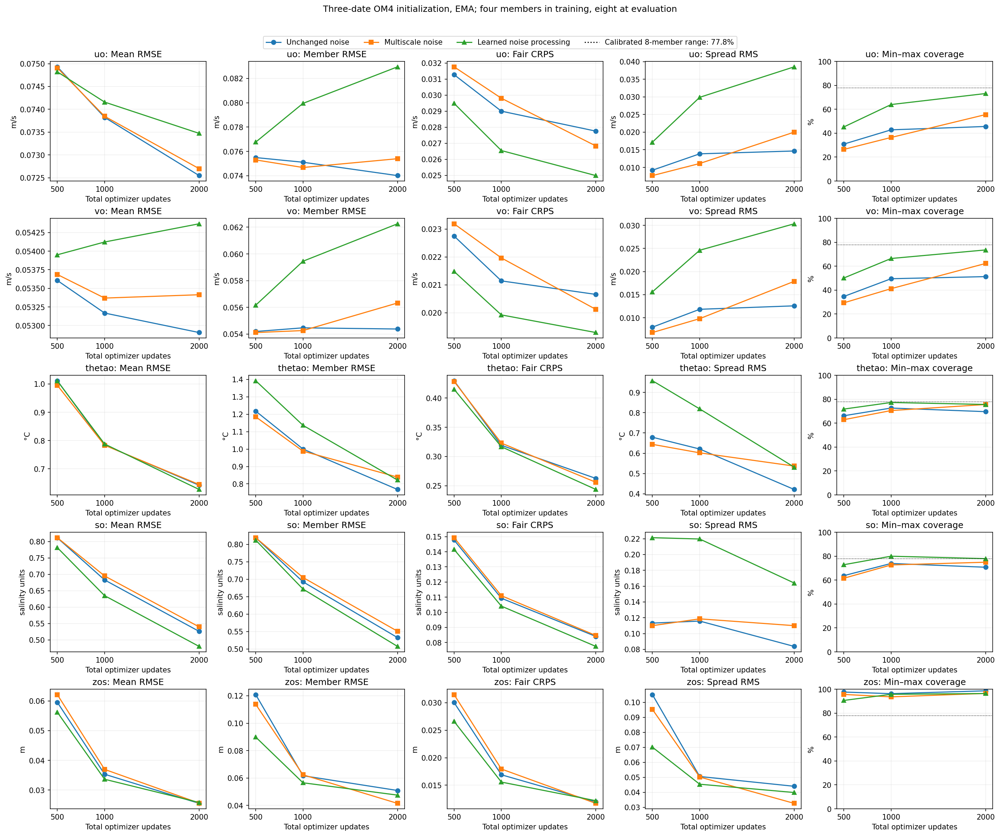
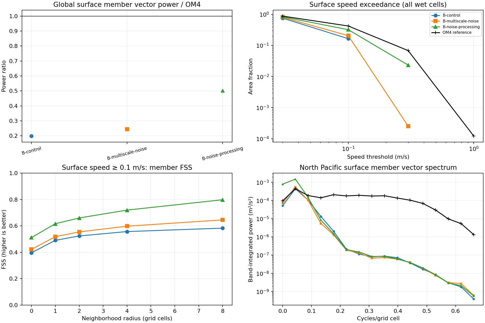
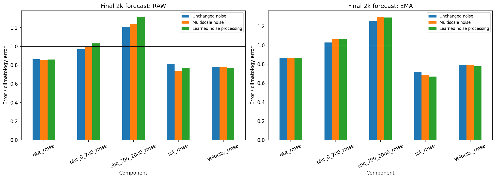

<!-- SPDX-FileCopyrightText: 2026 Samudra Authors -->
<!-- SPDX-License-Identifier: CC-BY-4.0 -->

# Noise structure and processing in the stochastic initializer

In this single-seed matched comparison, learned noise processing improves
velocity CRPS and ensemble coverage after
2,000 mixed updates, while worsening ensemble-mean and individual-member RMSE.
It increases current amplitudes, but leaves the severe fine-scale power deficit.
Neither intervention improves the final EMA forecast blend. These results support
noise processing as a way to reduce underdispersion; they do not establish a
solution to velocity reconstruction or realistic spatial uncertainty.

Three runs start from scratch with the same common weights, data order, random
seed, fair-CRPS objective, and budget: 1,000 OM4 plus 1,000 observation optimizer
updates, effective batch eight. Each trains with four members and evaluates with
eight. There is no replay or cooldown. All use the same stochastic Samudra
ConvNeXt initializer and deterministic processor on the 1° grid. OM4 supplies
simulated physical states for the model-data training and reconstruction targets.
The arms differ in initializer noise construction or processing; learned
processing also adds trainable capacity. This is a fresh matched comparison, rather than a
continuation of the older 2k checkpoints used in the information probes.

| Arm | Change |
|---|---|
| Control | Original independent Gaussian noise |
| Multiscale noise | Four spatial noise channels smoothed at sigma 0, 1, 2 and 4 cells on the 45×90 noise grid; expected variance matched after each interpolation into the backbone |
| Learned noise processing | Three width-32 ConvNeXt blocks process the original spatial noise before its existing feature-modulation path; the residual output projection starts at zero |

The learned branch adds 172,804 parameters, increasing the model from 22,700,874
to 22,873,678 parameters. Its effect is therefore not isolated from the added
capacity. The global noise vector is unchanged in both interventions. Details
are in the [experiment plan](noise-ablation-plan.md).

## Initialization accuracy and uncertainty

The table uses final exponential moving average (EMA) weights and three held-out OM4 initialization cases
labelled January, April and May 2014. Each case reconstructs the latest bin of
its surface input history. It is not a forecast into that month. Velocity RMSE
uses cosine-weighted wet-cell MSE, averaged equally across dates and 19 depths
before taking the square root. CRPS and coverage average those date/depth
scores equally. All velocity errors are in m/s.

| Arm | Mean RMSE u / v | Member RMSE u / v | Fair CRPS u / v | Coverage u / v |
|---|---:|---:|---:|---:|
| Control | 0.07255 / 0.05291 | 0.07401 / 0.05438 | 0.02775 / 0.02066 | 45.6% / 51.3% |
| Multiscale noise | 0.07270 / 0.05341 | 0.07540 / 0.05633 | 0.02683 / 0.02012 | 55.5% / 62.3% |
| Learned noise processing | 0.07347 / 0.05437 | 0.08295 / 0.06226 | 0.02498 / 0.01929 | 73.1% / 73.6% |

Coverage is the fraction of reference values inside the pointwise minimum and
maximum of eight members. For independent continuous calibrated draws, its
expected value is 7/9, about 77.8%; this is not a nominal 90% interval. Approaching
that reference does not prove calibration at every location or spatially coherent
samples. Fair CRPS rewards closeness to the reference and appropriate dispersion;
adding spread can worsen the score if it raises member error too much.

For learned noise processing, the directions of velocity CRPS, coverage, mean
RMSE and member RMSE changes hold on each of the three dates. The reduced CRPS
comes with substantially more spread: u/v spread RMS increases from
0.01466/0.01258 to 0.03851/0.03034 m/s. A more dispersed ensemble can improve CRPS
while its members have greater squared error. Temperature and salinity also
improve: their EMA mean RMSE falls by 2.3% and 8.7%, and CRPS by 7.2% and 7.8%,
respectively. These are initializer results; downstream OHC behaves differently.

[Raw-weight curves](results/noise-ablation/initializer-curves-raw.png) ·
[Full scores](results/noise-ablation/initializer-summary.csv) ·
[Per-date changes](results/noise-ablation/initializer-paired-differences.csv).
The figures retain 500, 1,000 and 2,000 total-update evaluations and all five
variables. Raw and EMA weights are kept separate.

## Amplitude, placement and spatial scale

The following scores concern individual surface-velocity members, averaged
equally over members and dates. Power is cosine-weighted u²+v² over all paired
wet cells. It includes both ensemble-mean structure and spread.

| Arm | Member power / OM4 | Wet area with speed ≥0.3 m/s | Neighborhood score at radius 8 |
|---|---:|---:|---:|
| OM4 reference | 1.000 | 6.82% | 1.000 |
| Control | 0.199 | 0% | 0.583 |
| Multiscale noise | 0.244 | 0.0254% | 0.646 |
| Learned noise processing | 0.502 | 2.334% | 0.798 |

The neighborhood score is fractions skill score for speed ≥0.1 m/s in 17×17-cell
windows. It relaxes exact placement but also responds to amplitude and event
frequency. The improved score cannot be attributed to corrected displacement
alone. The [placement diagnostic](placement-diagnostics.md) defines its masking,
aggregation and grid-distance limitations.

The North Pacific spectra show excess learned-noise power in some broad-scale
bands, with almost no recovery of the missing short-wavelength power. Stronger
currents therefore do not imply recovery of realistic current patterns. Raw
weights show the same broad amplitude ordering: member-power ratios are
0.203, 0.257 and 0.519. These spectra average individual-member power; they do
not take the spectrum of the ensemble mean.

Most of the added surface power is ensemble variability. Relative to OM4,
control mean-field power is 0.146 and perturbation power is 0.053; learned-noise
values are 0.185 and 0.317. Perturbation power is the average squared departure
of each member from the eight-member mean. The
[decomposition](results/noise-placement-ema/power-decomposition.csv) is exact for
the saved ensemble. The January maps show broad member patches without recovery
of the reference's narrow currents.

[Raw spatial diagnostics](results/noise-placement-raw/placement-amplitude.png) ·
[Surface-u maps](results/noise-maps/maps-ema-2014-01-uo_0.png) ·
[Surface-v maps](results/noise-maps/maps-ema-2014-01-vo_0.png).
Maps show reference, mean of eight, member 1 and mean error, with shared colors.
The map display is restricted to 65°S–65°N; the global statistics above use
all paired wet cells. The maps and spectra are initialization diagnostics.

## Forecast comparison

The existing nine-origin observation-initialized evaluation uses monthly origins
November 2013 through July 2014 and the ensemble-mean forecast. Each component's
RMSE is divided by the corresponding climatology-forecast RMSE on the same cases,
then the five ratios are averaged equally: SST, SSH-derived velocity, EKE,
0–700 m OHC and 700–2000 m OHC. Surface components aggregate leads 5, 15 and
30 days; OHC uses calendar-weighted monthly means. Lower scores are better.
All arms use the same origins,
climatology, forcing, members and reference data.

| Arm | EMA blend | Raw blend |
|---|---:|---:|
| Control | 0.932234 | 0.926719 |
| Multiscale noise | 0.940359 | 0.922440 |
| Learned noise processing | 0.933197 | 0.948111 |

For learned noise processing, the EMA SST ratio improves from 0.71791 to
0.66908, while upper/deep OHC ratios worsen from 1.02740/1.25780 to
1.06449/1.29171. The SST improvement is offset by worsening in other components,
including OHC. Multiscale noise improves the
raw blend slightly but worsens EMA, so there is no consistent overall forecast
benefit. No annual-rollout conclusion follows from this evaluation.

## Checks and interpretation

All 188 shared state tensors in the saved initial checkpoints and their saved
CPU/CUDA random states match exactly across arms. All 22 trainable learned-noise
tensors changed during training, including its initially zero output projection
and all three upstream ConvNeXt blocks. A fixed-noise CPU probe confirms that
the final branch changes its input. The
[checkpoint audit](results/noise-ablation/learned-branch-check.json) rules out
an inactive branch; it does not establish that each branch change was useful.

The learned branch is worth retaining as a candidate for probabilistic
initialization. The unresolved issue is the allocation of variability across
spatial scales and the quality of the conditional mean. A follow-up should
compare noise processing plus spatial supervision against a matched extra-capacity
control, and separate mean and perturbation spectra. These runs do not isolate
whether the gain comes from learned correlation, amplitude, non-Gaussian noise,
or added capacity. One seed and three initialization dates limit the conclusion.
No additional training was launched after these comparisons.

Torch array `21423135` completed all three 2,000-update runs and their raw/EMA
evaluations with exit code zero. Total allocation was 13.5164 GPU-hours, including
startup and evaluation; the separate information probes used 0.365 GPU-hours.
The runs passed the utilization gate at 83–84%. Source fingerprint
`33f172fd27507fc35f43b89611c573df29c3d10c4d9b6012ad9c8d54c1c57c4c`
identifies the frozen training implementation. Outputs remain at
`torch:/scratch/jr7309/stochastic-noise-20261030/production`.

The [numerical report script](../../../scripts/report_stochastic_noise_ablation.py)
checks matched initialization cohorts and forecast references. The
[spatial script](../../../scripts/diagnose_stochastic_placement.py) operates on
saved fields without further GPU evaluation. Full numerical artifacts and
input/checkpoint fingerprints accompany the figures. Related results:
[added-information probes](information-probe-results.md) and
[earlier loss/placement diagnostics](placement-diagnostics.md).

The exact training and evaluation source is available in the [frozen experiment source bundles](sources/README.md). Use these bundles when reproducing model execution; this report branch contains an older installed Samudra package.
