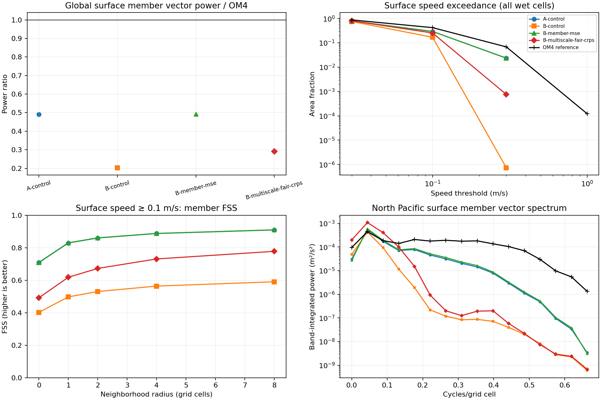

<!-- SPDX-FileCopyrightText: 2026 Samudra Authors -->
<!-- SPDX-License-Identifier: CC-BY-4.0 -->

# Current amplitude and placement diagnostics

Multiscale CRPS increased broad current variability in the saved 2k models,
although it did not close the velocity reconstruction gap. The weak currents
in the ordinary CRPS members cannot be explained entirely by displacement:
surface speeds ≥0.3 m/s are nearly absent anywhere in those members, including away
from the reference current locations.

These CPU diagnostics reuse the saved eight-member OM4 initialization fields
for January, April and May 2014. All models use EMA after 2,000 mixed updates
(1,000 OM4 and 1,000 observation updates), effective batch eight. These are
initialization reconstructions with OM4 surface-history inputs, not forecast
rollouts. The model and objective comparison is described in the
[matched loss ablation](loss-ablation-partial.md). One seed and three dates do
not establish a population uncertainty bound.

[PDF](results/placement-diagnostics/placement-amplitude.pdf) ·
[Amplitude CSV](results/placement-diagnostics/amplitude.csv.gz) ·
[Neighborhood CSV](results/placement-diagnostics/neighborhood.csv.gz) ·
[Spectra CSV](results/placement-diagnostics/spectra.csv.gz) ·
[Input fingerprints and definitions](results/placement-diagnostics/COMPLETE.json)

A is the deterministic initializer/processor model trained with MSE. B uses a
stochastic initializer and deterministic processor; its training loss varies
by row. Figure labels A-control and B-control denote deterministic MSE and
ordinary fair CRPS respectively.

The following surface values average over dates and individual members.
Energy and event frequencies use every paired wet cell, weighted by cosine
latitude. They never select cells by reference current magnitude. Power is
squared vector speed, u² + v², and its ratio is also the kinetic-energy ratio.

| Model | Member power / OM4 | Wet area with speed ≥ 0.1 m/s | Wet area with speed ≥ 0.3 m/s | 99th-percentile speed |
|---|---:|---:|---:|---:|
| OM4 reference | 1.000 | 42.17% | 6.82% | 0.574 m/s |
| A: deterministic MSE | 0.490 | 29.38% | 2.33% | 0.371 m/s |
| B: fair CRPS | 0.203 | 16.99% | 0.000074% | 0.176 m/s |
| B: per-member MSE | 0.492 | 29.43% | 2.37% | 0.372 m/s |
| B: multiscale fair CRPS | 0.291 | 25.45% | 0.0757% | 0.223 m/s |

The multiscale model's member power exceeds the ordinary CRPS model on all
three dates. Its 0.3 m/s exceedance frequency remains about 90 times below
OM4. An area-preserving relocation within the evaluated wet domain preserves speed
distribution and energy, so that form of relocation alone cannot explain these deficits.
The MSE member model retains stronger currents but nearly collapses ensemble
spread, as documented in the loss-ablation report.

Neighborhood comparisons relax exact placement. For each speed threshold, the
script computes the fraction of wet area exceeding that threshold in a square
window of width 2r+1 for radius r, then compares reconstruction and reference fractions. The fractions skill
score (FSS) is 1 for matching fractions and 0 when events occur in only one
field. Cases with no events in either field are undefined. At a 0.1 m/s
threshold, surface FSS pools the area-normalized numerator and denominator
with equal weight per member and date, then forms their ratio:

| Model | Radius 0 | Radius 2 | Radius 8 |
|---|---:|---:|---:|
| A: deterministic MSE | 0.708 | 0.860 | 0.909 |
| B: fair CRPS | 0.402 | 0.530 | 0.590 |
| B: per-member MSE | 0.710 | 0.861 | 0.910 |
| B: multiscale fair CRPS | 0.492 | 0.673 | 0.778 |

The multiscale objective improved these neighborhood statistics despite its
small change in mean RMSE and worse pointwise CRPS. FSS mixes amplitude,
occurrence frequency and placement; its increase does not isolate a reduction
in displacement. Its tolerance is in grid cells, whose physical width varies
with latitude. Windows exclude dry-cell area but can span land geometrically.

The North Pacific spectrum also changes with the multiscale loss. More power
appears at broad scales, with excess relative to OM4 in some low-frequency
bands, while the short-wavelength deficit remains. Thus the added power does
not reproduce the reference spectrum across scales. The spectrum uses a
common 150–190°E, 20–40°N wet mask, demeaning and a Hann taper, in cycles per
grid cell. It differs from the spectrum used in the forecast blend and is not an isotropic physical-wavenumber
spectrum. The CSV retains every member separately; the figure averages member
power, not the power of the ensemble mean.

The result narrows the interpretation of the earlier multiscale pilot: it did
not solve velocity learning, but it did affect member amplitude and spatial
scale. The new noise-structure and noise-processing runs can now be tested
against these diagnostics in addition to the unchanged reconstruction and
forecast metrics. No velocity climatology or persistence field was available
in the saved exports; zero velocity is retained as an explicit reference.

## Reproduction

Run `scripts/diagnose_stochastic_placement.py` with `--input` pointing to the
saved diagnostic directory and `--output` to a fresh result directory. Input
`grid.npz` supplies `lat`, `lon`, `mask`, `names` and `selection`. Each
`*-maps.npz` contains physical-unit `members[M,C,H,W]` and `gold[C,H,W]`, with a
matching JSON containing `variant`, `step`, `month`, and checkpoint fingerprint.
The optional `--variants` list selects arms. The selected velocity pairs here
are depth indices 0, 9 and 18. The report figure and table focus on depth 0;
all three levels and fixed geographic regions are in the CSVs. Zero
exceedance frequencies are omitted from the logarithmic figure, rather than
shown as missing evaluations.

Five CPU tests check displacement tolerance, land handling, longitude
periodicity, spectral normalization and amplitude scaling, and the distinction
between member energy and energy of the ensemble mean.
