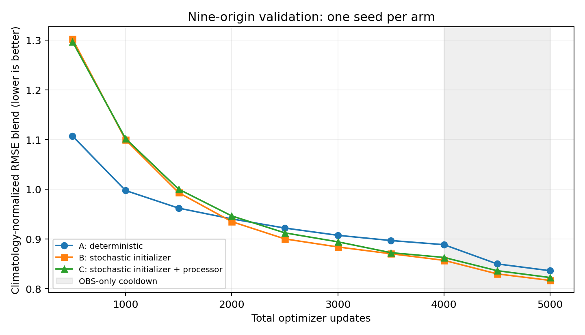

# One-pass stochastic transition results

The stochastic initializer (B) has the lowest validation RMSE blend in this
single-seed comparison. Adding stochastic processor transitions (C) does not
improve that score. All three runs completed 4,000 mixed updates followed by
1,000 OBS-only cooldown updates, at effective batch eight. Each saw 2,000 OM4
and 3,000 OBS updates in total.

| Arm | Before cooldown, EMA | Final EMA | Final raw | Total job time |
|---|---:|---:|---:|---|
| A: deterministic, MSE | 0.888229 | 0.835800 | 0.834774 | 3h01m |
| B: stochastic initializer, deterministic processor, fair CRPS | 0.856716 | **0.816268** | 0.818677 | 10h34m |
| C: stochastic initializer and processor, fair CRPS | 0.862540 | 0.822102 | 0.822024 | 11h40m |

Lower is better. B improves on A by 2.34%; C improves on A by 1.64%, but is
0.71% worse than B. The final checkpoint is also the best EMA checkpoint in
each arm. Job times include data preparation and checkpoint evaluations.

The score averages five climatology-normalized RMSE components over nine frozen
validation origins. Surface leads are 5, 15 and 30 days; interior OHC uses
calendar-weighted monthly predictions. Evaluation uses eight members for the
stochastic arms. A is deterministic, so repeated draws do not represent spread.

| Final EMA component ratio | A | B | C |
|---|---:|---:|---:|
| SST | 0.5923 | **0.5510** | 0.5545 |
| SSH-derived velocity | 0.7448 | **0.7191** | 0.7201 |
| EKE | 0.8499 | **0.8323** | 0.8332 |
| OHC 0–700 m | 0.8964 | **0.8910** | 0.8966 |
| OHC 700–2000 m | 1.0956 | **1.0879** | 1.1061 |

Ratios above one indicate worse RMSE than the scoring climatology. Deep OHC
remains worse than climatology in all arms. B has the lowest point-error ratio
in all five components, although the differences are small.

This experiment does not establish a benefit from stochasticity alone: A uses
MSE, whereas B and C use fair CRPS. There is one seed per arm. The RMSE blend
also does not establish calibration, realistic member variability, or annual
stability. No annual rollout result is included here. These results do not yet
include a provenance-matched comparison to the separate OE latent-diffusion run.

Before a larger run, inspect B/C member spread, spatial spectra and maps, then
assess temporal variability and longer rollout stability. B is the current
point-error candidate; C should be judged on whether transition noise improves
ensemble behavior enough to justify its cost. Additional experiments have not
been submitted.

## Artifacts and provenance

- [All checkpoint scores and component ratios (CSV)](results/validation-comparison.csv)
- [Validation plot (PDF)](results/validation-curves.pdf)
- Exact evaluation receipts: [A](results/A-evaluations.json), [B](results/B-evaluations.json), [C](results/C-evaluations.json)
- Torch jobs: A `21190337`, B `21190338`, C `21190339`.
- Remote root: `/scratch/jr7309/stochastic-transitions-20261027/production/{A,B,C}`.
- Source archive SHA256: `8ade59f9f0750c869a14b9cb197344522226bbfac24136f3049b2da48d0431ca`.
- All 60 raw/EMA checkpoint evaluation receipts were retrieved and checked for
  nine validation origins and finite aggregate scores. Training completed at
  step 5,000 in each arm.
- [Architecture, data, objective differences and qualification record](torch-plan.md).

## Day-30 surface CRPS

Computed from the saved final EMA ensemble members, without new model inference.
These scores cover the day-30 five-day SST/SSH means at the same nine origins,
using common wet/finite reference support and cosine-latitude weights. They do
not cover the complete monthly interior objective or the five-component RMSE
blend above.

| Arm | Fair CRPS SST (°C) | Fair CRPS SSH (m) | Empirical CRPS SST (°C) | Empirical CRPS SSH (m) |
|---|---:|---:|---:|---:|
| A | 0.42425 | 0.034119 | 0.42425 | 0.034119 |
| B | **0.26808** | **0.022757** | **0.29657** | **0.025197** |
| C | 0.27005 | 0.023126 | 0.29726 | 0.025690 |

Fair CRPS uses the finite-ensemble correction appropriate for independent draws:
mean absolute error of members minus the sum of unordered member distances
 divided by M(M−1). Empirical CRPS instead divides that sum by M² and scores the
finite empirical ensemble itself. Here M=8. A's identical deterministic members
make both scores equal to its MAE. Lower is better.

B improves on A by approximately 36.8% SST and 33.3% SSH in fair CRPS. Both
stochastic approaches improve substantially over A on these surface probability
scores; B remains slightly better than C. This is still one seed, and the
MSE-versus-CRPS training-objective difference remains a confound. Lower CRPS
does not by itself establish spatial or temporal coherence of ensemble members.

[Exact CRPS scores, member MAE and ensemble-mean MAE](results/day30-crps.json).
Reproduce with `scripts/score_stochastic_saved_crps.py` using the saved member
NPZs and scoring grid. Checks enforce identical references/support across arms,
identical A draws, and the known two-member analytic CRPS example.

[Ensemble member maps at initialization/day 30 and spatial CRPS decomposition](member-maps.md)
are available for inspection, including all eight B/C draws and C−B differences.
