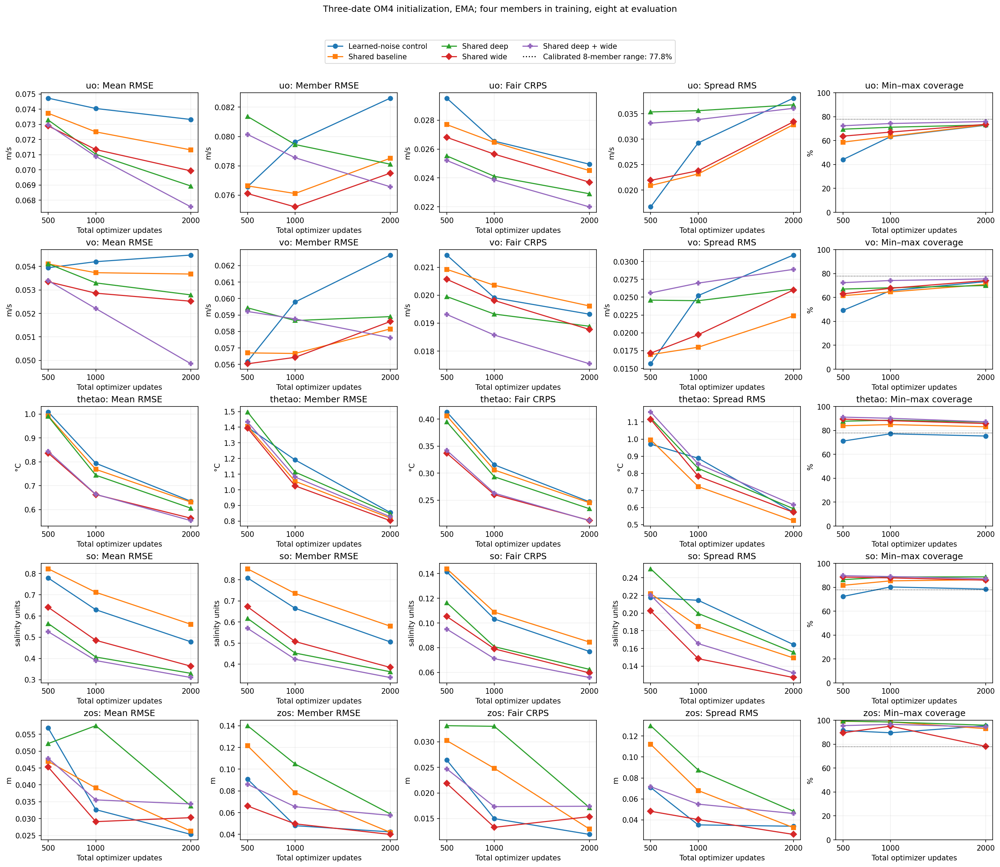
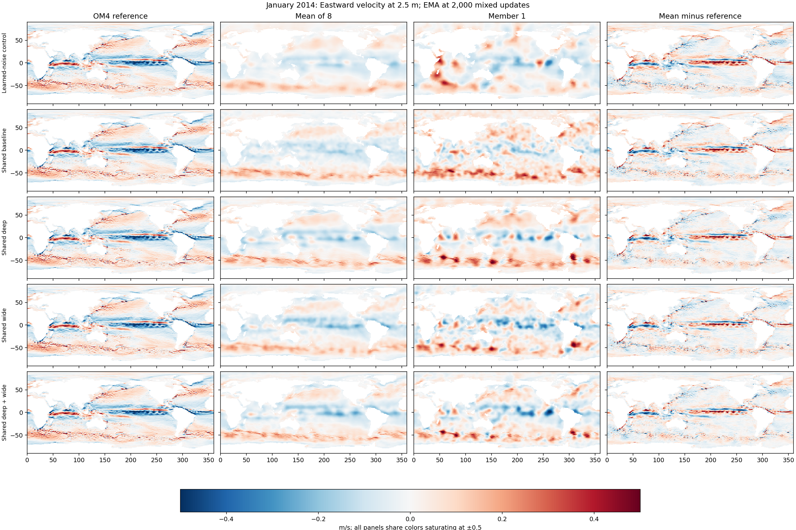
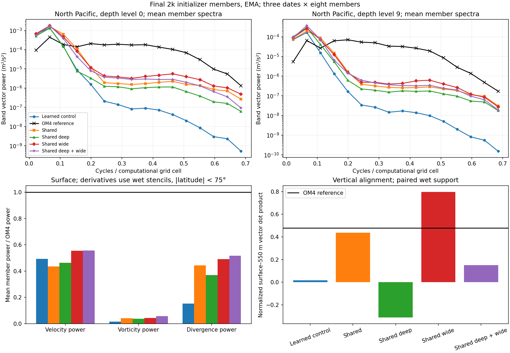
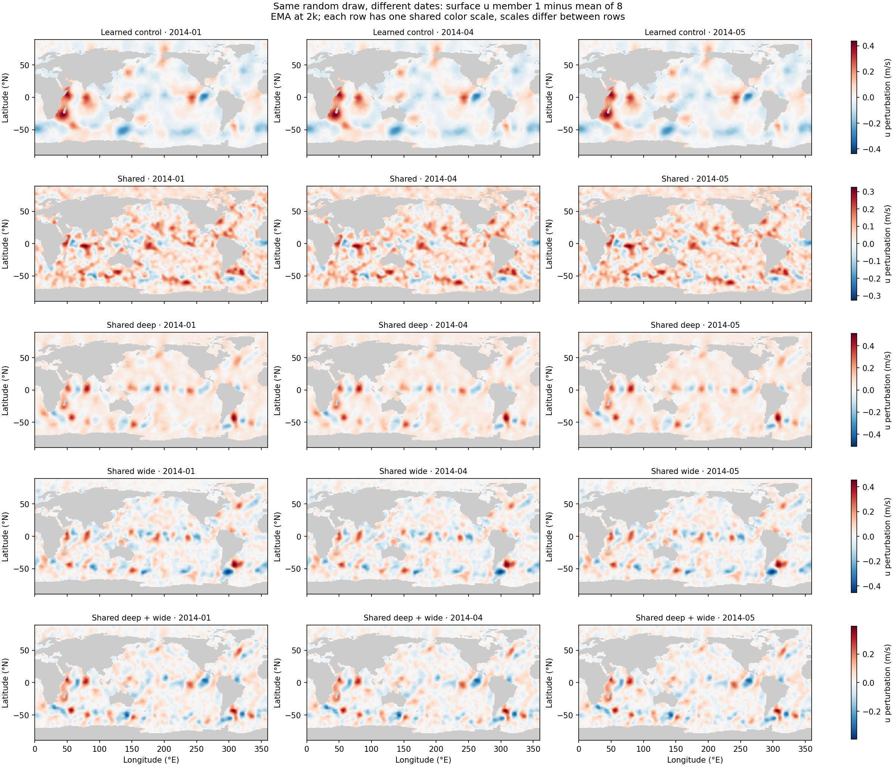

<!-- SPDX-FileCopyrightText: 2026 Samudra Authors -->
<!-- SPDX-License-Identifier: CC-BY-4.0 -->

# Shared-input noise and initializer capacity: results

The deep-and-wide initializer improves held-out interior reconstruction, but
individual velocity members still lack realistic small-scale structure. Its
final EMA u/v CRPS is 11.8%/9.2% lower than the learned-noise control, and
ensemble-mean RMSE is 7.9%/8.5% lower. Both improvements occur on all three
initialization dates and also with raw model weights. The mean-RMSE advantage
grows from about 2.4%/1.0% at update 500 to 7.9%/8.5% at update 2,000. Its observation-initialized forecast blend improves only
0.9%, and its SSH initialization is worse. This is evidence for improved
reconstruction at this budget, with unresolved problems in the sampled fields.

All four new runs completed 2,000 mixed optimizer updates: 1,000 OM4 and 1,000
observation updates, effective batch eight, four training members and eight
evaluation members. There was no replay or cooldown. Total allocated cost was
20.93 GPU-hours, including qualification and two evaluation-only recoveries.

## Model and comparison

The four new initializers concatenate conditioning, upsampled coarse Gaussian
noise, full-grid Gaussian noise and a broadcast Gaussian vector before a shared
Samudra ConvNeXt U-Net. Both noise scales pass through the same network. Only
initializer capacity varies across these four runs. Every processor has the same
architecture and initial weights, and is trained jointly with its initializer.
The initializer samples a starting state; the processor evolves each member
deterministically. OM4 batches directly supervise the initializer and forecast
fields; observation batches supervise observed surface fields and monthly
interior aggregates. The joint CRPS loss weights initialization by 0.1 and
native-cadence/monthly forecast terms by 0.5 each, so forecast gradients also
reach the initializer. See the [experiment plan](shared-noise-plan.md).

The reference is the previously completed
[learned-noise control](joint-noise-results.md). Its noise processor and FiLM
paths differ from the new shared-input design. Its processor initialization also
differs, so comparisons with that reference do not isolate noise placement alone.
The four new arms compare capacity at fixed optimizer-update and example counts;
their compute costs differ.

Initializer scores use the same January, April and May 2014 OM4 cases, each
reconstructing the final five-day bin in 19 input SST/SSH history bins. The
reference is OM4 output, not observational truth. Training uses 409 OM4 windows
from 1975 through July 2013 and 243 observation examples from May 1993 through
July 2013. The nine forecast validation origins run from November 2013 through
July 2014; the three reconstruction cases come from that held-out period. RMSE is the square root of
cosine-weighted wet-cell MSE averaged equally over 19 depths and three dates.
CRPS and coverage use the same depth/date averaging. EMA means exponential
moving average of model weights; the ensemble mean averages eight sampled states.

| Initializer | Widths | Blocks per U-Net level | u / v mean RMSE (m/s) | u / v CRPS (m/s) | u / v range coverage | Forecast blend |
|---|---|---:|---|---|---|---:|
| Learned-noise control | 64/128/256 | 1 | 0.07332 / 0.05449 | 0.02495 / 0.01932 | 72.8% / 73.2% | 0.93670 |
| Shared baseline | 64/128/256 | 1 | 0.07131 / 0.05368 | 0.02451 / 0.01961 | 73.2% / 70.9% | 0.97035 |
| Shared deep | 64/128/256 | 3 | 0.06893 / 0.05279 | 0.02290 / 0.01889 | 73.1% / 70.0% | 0.98675 |
| Shared wide | 96/192/384 | 1 | 0.06993 / 0.05252 | 0.02371 / 0.01877 | 73.6% / 74.1% | 0.93847 |
| Shared deep + wide | 96/192/384 | 3 | 0.06755 / 0.04986 | 0.02200 / 0.01755 | 75.9% / 75.5% | 0.92846 |

All table values use final EMA weights. Lower RMSE, CRPS and forecast blend are
better. Coverage is the fraction of reference values within the eight-member
pointwise range; a reference and eight exchangeable continuous draws from the same conditional
distribution have an expected coverage of 7/9,
or 77.8%. Coverage near that value does not establish realistic spatial structure.

Deep + wide also reduces temperature/salinity mean RMSE by 12.8%/35.2% and CRPS
by 14.1%/27.4%. SSH goes the other way: mean RMSE rises 35.7% and CRPS rises
46.4%, with both worse on all three dates. In physical units, SSH mean RMSE
increases from 2.53 cm to 3.44 cm. SST/SSH initialization is predicted
by this model, not hard-copied from its conditioning inputs.

The forecast blend averages five climatology-normalized errors over nine
observation-initialized 30-day cases: SST, SSH-derived velocity, EKE and upper/deep
ocean heat content. It is the existing screen metric, not a velocity reconstruction
score. Deep + wide improves the EMA blend from 0.93670 to 0.92846; its raw-weight
blend is worse than the raw control, 0.99373 versus 0.96100. The small EMA forecast
gain needs confirmation. These runs use one seed, three initialization cases and
nine forecast origins; they do not establish year-long stability.

[Raw initializer curves](results/shared-noise/initializer-curves-raw.png) ·
[Forecast component errors](results/shared-noise/forecast-components.png) ·
[Initializer scores](results/shared-noise/initializer-summary.csv) ·
[Forecast scores](results/shared-noise/forecast-summary.csv).

## What individual members look like

The deeper models recover more broad current structure in their means. Individual
members still show broad patches and miss narrow currents. The plots use common
colors and include the full latitude range. More fine-scale texture appears in
the shared-input arms, but the spectra show a large remaining deficit.

[Surface northward velocity](results/shared-noise-maps/maps-ema-2014-01-vo_0.png) ·
[Eastward velocity at 550 m](results/shared-noise-maps/maps-ema-2014-01-uo_9.png) ·
[Northward velocity at 550 m](results/shared-noise-maps/maps-ema-2014-01-vo_9.png).
PDF versions accompany each image.

On the nominal 1-degree grid, the North Pacific window is 20–40°N, 150–190°E.
Spectra combine u and v power and average over three dates and eight members.
North Pacific surface member power in the fine band (wavelengths approximately
7.5 computational cells or shorter) is 0.77% of OM4 for the control, versus
9.56%, 1.33%, 9.01% and 5.17% for shared, deep, wide and deep + wide. These are
mean individual-member powers, not spectra of the ensemble mean. None recovers
the reference spectrum, and extra depth does not consistently add fine power.

Here derivative power is the cosine-weighted wet-cell mean squared amplitude,
averaged over three dates and eight individual members. Global surface vorticity power rises from 1.64% of OM4 in the control to
3.6–5.7% in the new arms. Divergence power is much closer to OM4, at 37–52%.
The relative balance of divergence and vorticity remains distorted. Ensemble-mean
vorticity correlation with OM4 does improve from 0.143 to 0.438 for deep and
0.543 for deep + wide. These derivative diagnostics use fully wet stencils and
exclude latitudes beyond 75 degrees; this is a diagnostic mask, not a change to
training or reconstruction-score masks.

With identical random draws across the three dates, member-minus-mean velocity
patterns remain almost unchanged: their cross-date vector cosine is 0.9992 for
the control and 0.9964–0.9983 for the new arms. This supports the concern that the
perturbations still behave largely as reusable spatial templates. It does not
mean the ensemble mean ignores inputs, or establish how much the conditional
uncertainty should change between those dates. The quoted cosines compare matching
member indices at the surface over jointly wet u/v cells with cosine-latitude
weights, then average over eight members and all three date pairs.

[Spatial scores](results/shared-noise-spatial/structure-summary.csv) ·
[Power by spectral band](results/shared-noise-spatial/spectral-bands.csv) ·
[Fixed-noise diagnostics](results/shared-noise-spatial/fixed-noise-conditioning-summary.csv).

## Next experiment and execution record

Retain deep + wide as a reconstruction candidate. The next diagnostic should
isolate OM4 reconstruction from the mixed forecast objective: first same-time
surface u/v from OM4 SST/SSH history, then interior fields, with direct supervision
and no processor or observation batches. Compare deterministic MSE and stochastic
CRPS models with matched capacity and conditioning. This follows the proposed
fallback and would test whether the remaining difficulty persists without
forecast training. No additional training campaign has been launched.

| New arm | Initializer parameters | Qualification GPU use | Allocated GPU-hours |
|---|---:|---:|---:|
| Shared | 12.11 million | 81.6% | 4.7394 |
| Deep | 31.85 million | 84.1% | 5.4083 |
| Wide | 24.23 million | 84.2% | 4.8081 |
| Deep + wide | 68.63 million | 81.5% | 5.9739 |

Each processor has 11.13 million parameters. Qualification used the first 24
production updates, then resumed Adam, EMA and RNG state. Data wait was about
0.0001 seconds per update. Training jobs were 21788687–21788690 on Torch. The
shared and deep + wide harnesses failed after saving their completed checkpoints
because `nvidia-smi` exceeded a 15-second monitoring timeout. Evaluation-only jobs
21817530 and 21820489 finished the missing outputs. No training was repeated.

All 252 new report inputs were checksum-verified after transfer. The analysis
checks matching masks, normalization, reference fields, input receipts, checkpoint
identities and forecast climatology. The [execution receipt](shared-noise-submission.json),
[source manifest](sources/shared-noise/SOURCE.json),
[training source archive](sources/shared-noise/code.tar.gz), and linked CSV/JSON
dumps preserve the run and analysis provenance. The source archive contains the
exact execution snapshot; analysis scripts accompany this report.
