<!-- SPDX-FileCopyrightText: 2026 Samudra Authors -->
<!-- SPDX-License-Identifier: CC-BY-4.0 -->

# Signed-increment model with direct ERA5 and dense OM4 sampling

The initializer continues to learn velocity through 8,000 mixed updates. With EMA weights, depth-aggregated u/v RMSE falls from 0.06790/0.05267 m/s at 1k to 0.02752/0.02200 m/s at 8k; pointwise fair CRPS falls from 0.02215/0.01801 to 0.01021/0.00832 m/s. The last doubling from 4k to 8k still reduces RMSE by 21%/19%. The earlier reversed global patterns are absent in these three OM4 cases: all 228 case/channel/readout spatial correlations are positive. Individual members recover the broad current structure visible in the references, while the error maps retain localized errors around strong currents. This run does not isolate the effects of the spatial loss, denser OM4 sampling or direct ERA5 inputs.

The climatology and swap tests show useful input dependence on these cases. OM4 initializer u/v MSE is 70%/71% below the training-only monthly-climatology error. Replacing the surface history with another year's history makes that MSE worse than climatology. Replacing only the initialized interior, while retaining the recipient SST/SSH states and future forcing, changes the day-30 observational forecasts and increases SSH RMSE from 5.25 to 7.38 cm. These are tests of this model's behavior under the specified swaps; they do not establish physical causality or calibration.

The 30-day observational five-component blend improves from 1.099 at 1k to 0.797 at 8k (one equals its existing climatology baseline). Transfer to the observational interior is less consistent: under the separate diagnostic climatology, temperature has positive MSE skill, but salinity and both OHC bands do not. The next decision should separate improving OM4 reconstruction from improving observational interior forecasts. No annual rollout was evaluated in this wave.

This report covers saved checkpoints through 8,000 mixed optimizer updates. The run uses a stochastic initializer and a deterministic processor. Both are Samudra ConvNeXt U-Nets. Eight-member evaluation uses raw weights and an exponential moving average (EMA).

The initializer uses widths 96/192/384 with three blocks per stage; the processor uses 64/128/256 with one block per stage. Both retain InstanceNorm. All eight ERA5 channels enter each model directly. Removing the adapter increases the total parameter count from 79.77 million to 82.53 million; the backbone widths and block counts are unchanged from the [short screen](signed-difference-results.md). Training uses effective batch eight, four ensemble members, AdamW at 1e-4, and no cooldown or replay.

The auxiliary loss is fair CRPS on signed spatial velocity increments at separations 1, 2, 4 and 8 cells, with weight one inside the initializer reconstruction term (outer weight 0.1). Differences are start minus offset endpoint in E/N/NE/NW directions, using fixed OM4 channel standardization, wet traversed paths, endpoint-mean area weights, and equal supported channel/direction/lag weights. It applies to all 38 OM4 initializer velocity channels; the pointwise fair-CRPS objectives remain active. Training contains 2,548 OM4 windows at five-day origin spacing and 243 observational windows (May 1993–July 2013). The [previous short screen](signed-difference-results.md) used 409 monthly OM4 origins and an ERA5 channel bottleneck; comparisons with that screen change both data sampling and forcing representation.

The initializer consumes 19 consecutive five-day SST/SSH means (95 days), their validity masks, all eight matching ERA5 fields per bin, and geographic/calendar context. It predicts two complete 77-channel states for the last two history bins: u, v, temperature and salinity at 19 depths, plus SSH. Even SST/SSH are predicted rather than copied. The latest initial state receives direct reconstruction supervision: all fields on OM4 examples, available surface fields on observational examples. The residual processor advances those two states by five days using the next ERA5 interval. No interior reference enters the initializer inputs.

Observational examples use OISST sea-surface temperature, DUACS absolute dynamic topography (SSH) and geostrophic velocity, and monthly temperature/salinity analyses from the Institute of Atmospheric Physics (IAP). OHC references are layer integrals of the original IAP temperature profiles before interpolation to model depths. These gridded observational products differ from the OM4 simulation references used in the initializer maps.

Initializer scores use the common wet-cell mask and cosine-latitude weights, with no extreme-latitude exclusion. Channel metrics are in physical units: velocity m/s, temperature °C, salinity psu, and SSH m. Initializer metrics average three held-out OM4 cases (January, April and May 2014). The displayed CRPS is pointwise fair CRPS of the ensemble, and RMSE scores the ensemble mean. RMSE is the square root of mean squared error after equal case/depth aggregation; member power is divided by reference power after aggregation. Correlations are arithmetic means of the case/channel spatial correlations. Lower RMSE and CRPS are better; power ratio one matches reference second moment, which does not establish realistic members.

| weights | variable | rmse | fair_crps | correlation | member_power_ratio |
| --- | --- | --- | --- | --- | --- |
| ema | uo | 0.02752 | 0.01021 | 0.82965 | 0.95178 |
| ema | vo | 0.02200 | 0.00832 | 0.80774 | 0.95531 |
| raw | uo | 0.02791 | 0.01034 | 0.82866 | 0.97026 |
| raw | vo | 0.02237 | 0.00845 | 0.80614 | 0.96989 |

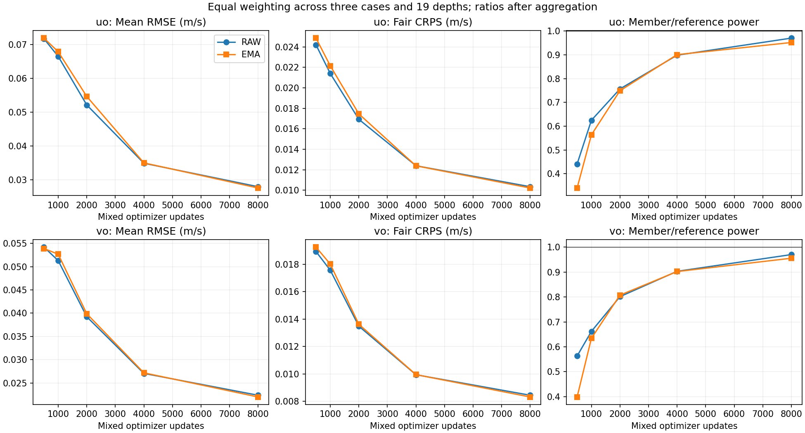

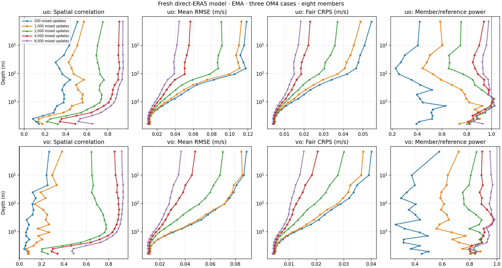

[All-depth raw-weight metrics](signed-dense-assets/depths-raw.png)

Initializer changes from 500 to 8,000 mixed updates are within this fresh run; negative percentages mean lower error.

| weights | variable | RMSE change (%) | CRPS change (%) |
| --- | --- | --- | --- |
| ema | so | -70.33 | -66.54 |
| ema | thetao | -57.67 | -60.61 |
| ema | uo | -61.74 | -58.90 |
| ema | vo | -59.18 | -56.76 |
| ema | zos | -74.68 | -74.92 |
| raw | so | -64.95 | -62.33 |
| raw | thetao | -52.97 | -55.59 |
| raw | uo | -61.11 | -57.26 |
| raw | vo | -58.73 | -55.35 |
| raw | zos | -87.25 | -91.33 |

Across 228 velocity case/channel/readout combinations at the latest checkpoint, 0 have negative spatial correlation; the minimum is 0.4352. These are global spatial correlations of ensemble means. Positive correlation does not establish locally correct signs, individual-member alignment, or signed-increment skill. This run alone does not isolate the auxiliary loss effect. Held-out signed-increment CRPS was not computed; the reported CRPS is pointwise, and spatial correlation tests a different property.

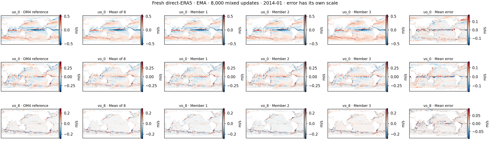

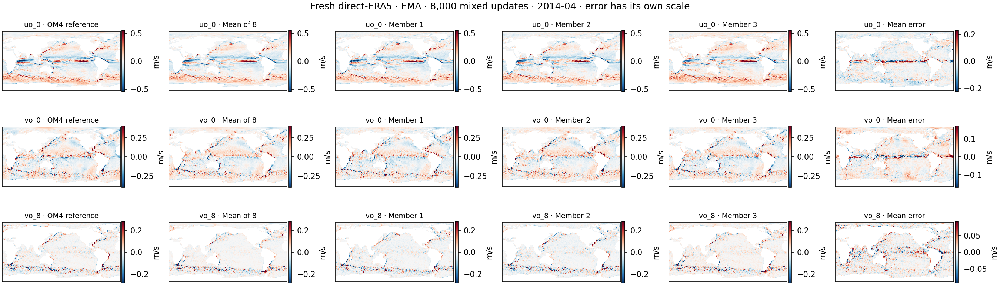

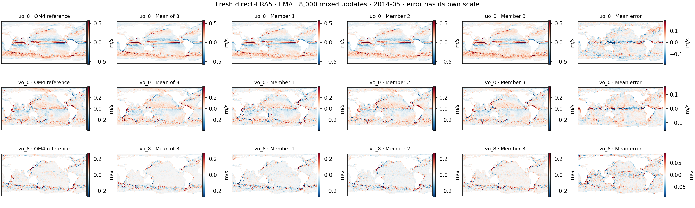

The forecast table uses nine observational origins, November 2013–July 2014. Each component is divided by its fixed climatology RMSE; the blend is the unweighted mean of five ratios. Forecast metrics score the ensemble-mean trajectory. Surface components average the separately computed RMSEs at days 5, 15 and 30; OHC uses the calendar-weighted monthly trajectory. SSH-derived velocity RMSE is the square root of the weighted mean of squared u and v errors summed together, compared with DUACS geostrophic velocities. EKE is 0.5(u′² + v′²), with anomalies about each field’s mean across the nine origins at each fixed lead; it is computed from the ensemble-mean velocity field, not averaged member EKE. The baseline uses the 243 prepared training windows: monthly surface climatologies fill never-observed cells with a monthly ocean mean, while monthly interior climatologies fill missing cells with channel training means. Its OHC is integrated from that climatological temperature state rather than averaged from original IAP OHC targets. Scores use common observed wet support and cosine-latitude weights, with geostrophic velocity excluding 5°S–5°N. Table values are dimensionless ratios: one matches this baseline and lower is better. The blend contains no spectral DEX term.

| step | weights | SST ratio | SSH-derived velocity ratio | EKE ratio | OHC 0–700 m ratio | OHC 700–2000 m ratio | blend |
| --- | --- | --- | --- | --- | --- | --- | --- |
| 1000 | ema | 0.7436 | 0.8798 | 0.9109 | 1.1610 | 1.7980 | 1.0987 |
| 1000 | raw | 0.8760 | 0.8545 | 0.8834 | 1.2789 | 1.9278 | 1.1641 |
| 8000 | ema | 0.5301 | 0.7093 | 0.8190 | 0.8657 | 1.0612 | 0.7971 |
| 8000 | raw | 0.5837 | 0.7129 | 0.8216 | 0.8677 | 1.0640 | 0.8100 |

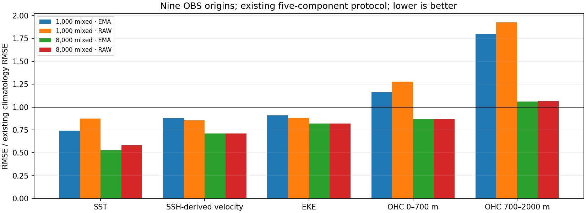

The separate conditioning diagnostics use the final 8k EMA checkpoint, the same three OM4 cases (January, April and May 2014), and the same nine observational origins (November 2013–July 2014). They use monthly climatologies computed only from training records. Their observational OHC climatology averages the saved original IAP OHC targets directly. These skill scores therefore have a different baseline from the forecast blend above. The standard forecast evaluation uses seeds 904001 plus the case index; the conditioning diagnostic uses seed 904003. Both use eight members, but their draws differ, so raw error values also need not match exactly.

Surface-history swaps replace SST/SSH histories while preserving recipient ERA5 and calendar. Interior-state swaps initialize a donor-year state from its own complete inputs, then replace both recipient interior history slots while preserving recipient SST/SSH slots. Full-state swaps also replace those surface slots. Every forecast retains recipient future forcing/calendar. Recipient, surface-swapped and independent donor initializations each reset the generator to seed 904003, so corresponding members receive identical noise inputs. Donors are the most recent training histories whose complete 19-bin month/day/time sequence matches the recipient in another year. Observational donors are the same month one year earlier. OM4 donors correspond to January 2012, April 2011 and May 2013 for the three respective 2014 cases; exact histories and checksums are in the prepared-data receipt. These interventions test model sensitivity; mixing states can create inputs outside the training distribution.

Skill is 1 − model error / climatology error: positive is better than climatology. MSE skill uses squared errors and CRPS skill uses fair CRPS against climatology MAE. Paired changes are root mean squared differences after equal case/channel aggregation. All modes retain common reference/climatology support.

For the unmodified OM4 initializer, the mean spatial correlation of anomalies after subtracting monthly climatology is 0.649 for u and 0.694 for v. The mean member anomaly power divided by reference anomaly power is 1.006/1.016; the ensemble-mean ratios are 0.788/0.809. Thus averaging reduces anomaly power, while individual members retain approximately the reference amount. Correct total power alone does not establish correct spatial organization.

| OM4 velocity | Initializer MSE skill | Initializer CRPS skill | Day-30 MSE skill | Initializer MSE skill after surface-history swap |
| --- | --- | --- | --- | --- |
| u | 0.699 | 0.565 | 0.566 | -0.219 |
| v | 0.707 | 0.581 | 0.417 | -0.675 |

The table below scores observational predictions against the diagnostic reference, using the same support across interventions. SST and SSH are the day-30 five-day bin; temperature, salinity and OHC are calendar-month means. Interior temperature excludes the SST channel. The interior-state swap preserves both recipient SST/SSH history slots exactly at initialization.

| Quantity | Unit | Unmodified RMSE | Climatology RMSE | Interior-state-swap RMSE | Unmodified fair-CRPS skill |
| --- | --- | --- | --- | --- | --- |
| Day-30 SST | °C | 0.508 | 0.862 | 0.544 | 0.613 |
| Day-30 SSH | cm | 5.25 | 7.79 | 7.38 | 0.593 |
| Monthly interior temperature | °C | 0.333 | 0.357 | 0.399 | 0.337 |
| Monthly interior salinity | psu | 0.1283 | 0.0767 | 0.1273 | 0.117 |
| Monthly OHC 0–700 m | 10⁸ J/m² | 6.022 | 5.670 | 6.409 | 0.283 |
| Monthly OHC 700–2000 m | 10⁸ J/m² | 3.755 | 3.289 | 3.638 | 0.261 |

The interior-state swap degrades SST, SSH, interior temperature and upper-ocean OHC RMSE, while slightly improving salinity and deeper OHC. Sensitivity therefore does not imply useful information in every predicted field. Unmodified observational salinity and both OHC bands have positive fair-CRPS skill despite negative MSE skill; the probabilistic and ensemble-mean scores answer different questions. The paired member changes at day 30 are 0.251 °C in SST and 5.80 cm in SSH, compared with exactly zero at initialization for those protected channels.

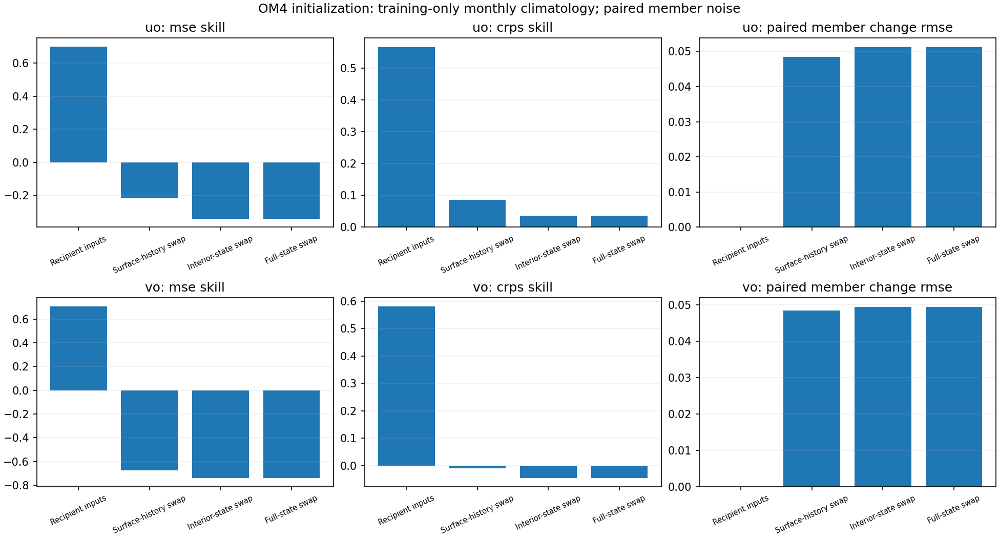

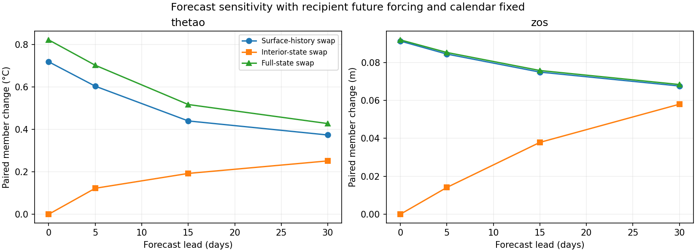

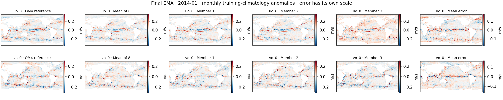

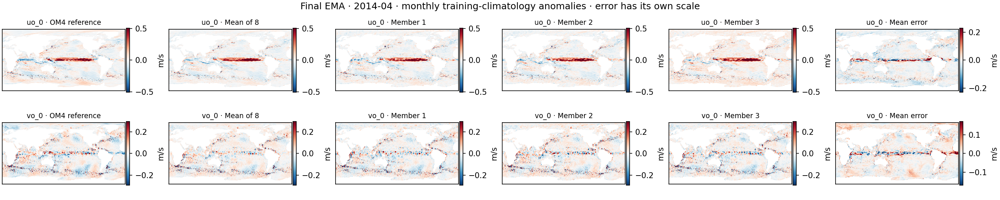

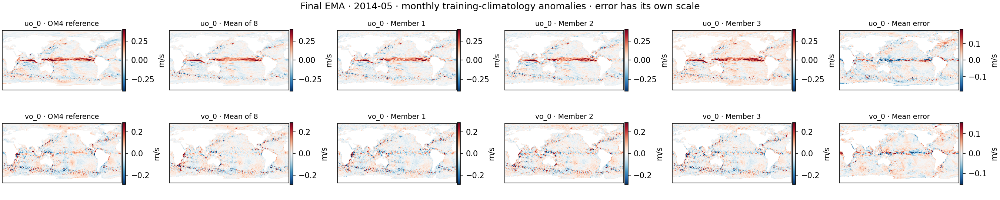

| mixed_updates | updates_per_source | examples_per_source | om4_passes | observation_passes |
| --- | --- | --- | --- | --- |
| 500 | 250 | 2000 | 0.78 | 8.23 |
| 1000 | 500 | 4000 | 1.57 | 16.46 |
| 2000 | 1000 | 8000 | 3.14 | 32.92 |
| 4000 | 2000 | 16000 | 6.28 | 65.84 |
| 8000 | 4000 | 32000 | 12.56 | 131.69 |

Actual allocated GPU time in the supplied terminal ledger: 30.778 GPU-hours of the approved 40. This includes the short screen, qualification (including the failed four-GPU comparison), main training and evaluations. Production used one NVIDIA RTX PRO 6000 Blackwell Server Edition GPU for 23.745 hours.

This is one training seed with three OM4 initializer cases and nine observational forecast origins. Thirty-day results do not establish annual rollout stability or physically coherent uncertainty. The next architecture comparison may consider the full Samudra-v2 processor and GroupNorm discussed in deterministic thread `01a1a372-5a3e-75c0-aab6-a2a7a535d653`; those settings have not been audited or used in this run.

Training events are continuous from update 1 through 8,000; the single-GPU qualification job’s first 22 updates are joined to the resumed production events. This was a fresh run, with optimizer and EMA retained at that engineering handoff.

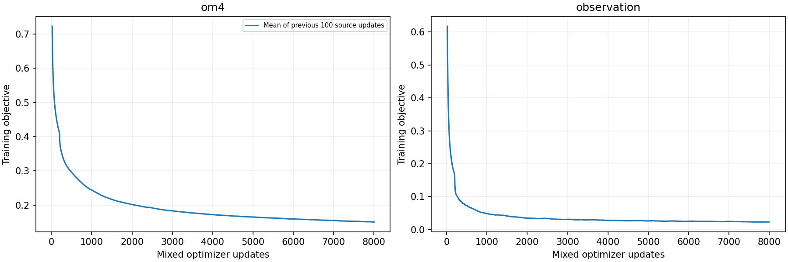

[Input/checkpoint fingerprints](signed-dense-assets/REPORT_INPUTS.json), [all initializer case metrics](signed-dense-assets/initializer-cases.csv), [forecast components](signed-dense-assets/forecast-components.csv), [conditioning aggregates](signed-dense-assets/conditioning-summary.csv), and [all conditioning cases](signed-dense-assets/conditioning-cases.csv).

[Prepared diagnostic data and exact donor histories](signed-dense-assets/provenance/conditioning-prepared-v2-PREPARED.json) · [Training configuration](signed-dense-assets/provenance/training-execution.json) · [Terminal cost ledger](signed-dense-assets/provenance/FINAL_COST.json).

[Report script](../../../scripts/report_stochastic_signed_dense.py) · [Frozen training source](sources/signed-dense/code.tar.gz) · [Source manifest](sources/signed-dense/SOURCE.json) · [Evaluation tools](sources/signed-dense/evaluation-tools.tar.gz). The archive contains the exact 563-file source snapshot used for training.
