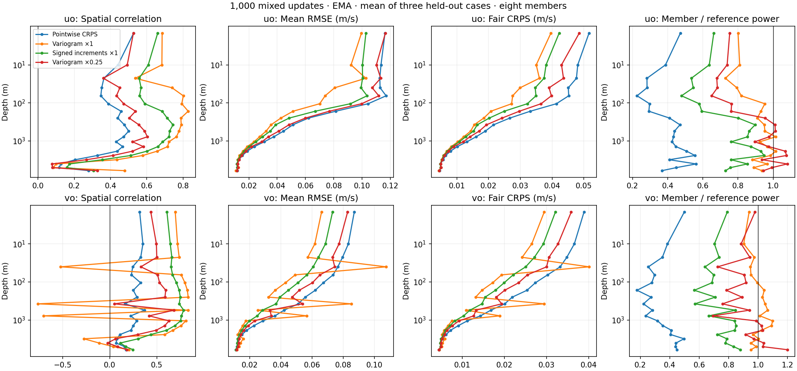
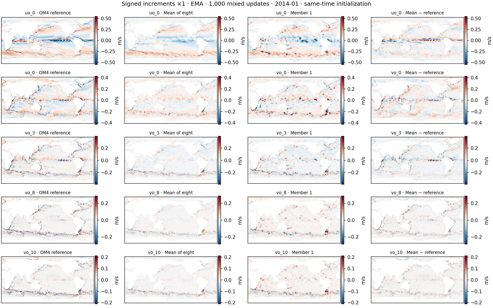

<!-- SPDX-FileCopyrightText: 2026 Samudra Authors -->
<!-- SPDX-License-Identifier: CC-BY-4.0 -->

# Signed spatial differences: short comparison

The signed-difference score is the preferred candidate for the longer run. At 1,000 mixed updates, it removes the persistent reversed meridional-current patterns seen with the full-weight absolute variogram. It also improves velocity RMSE and pointwise CRPS over the weaker-variogram alternative. It retains less velocity power than the full-weight variogram, and some non-velocity errors remain worse than the pointwise-only control. This is one seed and an early training checkpoint, not evidence of a solved stochastic ocean model.

## Matched comparison

All four rows below use the shared, deeper, wider initializer, seed 1729, effective batch eight, four training members, and the checkpoint at 1,000 mixed updates: 500 observation and 500 OM4 updates. The two earlier controls are reused at that exact checkpoint. The new models started from raw and EMA tensors verified identical to the original control. They did not fine-tune an existing trained checkpoint.

The initializer reconstructs the same-time three-dimensional ocean state from surface history; the processor advances each resulting physical member through the native five-day intervals spanning the target month. The initializer has ConvNeXt widths 96/192/384 and three blocks per stage; the deterministic processor uses 64/128/256 and one block per stage. These short runs retain the existing learned ERA5 8→3 adapter and the 409 monthly OM4 windows. They do not use the newly prepared dense cohort or direct eight-channel forcing.

Pointwise fair CRPS remains active in every stochastic arm. The additional score applies only to the 38 OM4-initialized velocity channels, using differences across lags 1/2/4/8 grid cells in four directions, excluding any pair whose connecting path crosses a dry cell. The signed score applies fair CRPS to signed increments. The older variogram measures the squared difference between the observed absolute increment and the ensemble-mean absolute increment, with a finite-ensemble variance correction. Both auxiliaries sit inside the initializer reconstruction coefficient of 0.1; their numerical scales differ. No field-MSE auxiliary is used.

Evaluation uses the same held-out OM4 initializations in January, April, and May 2014, with identical surface-history/ERA5 inputs and eight fixed-seed members. The table uses EMA weights. RMSE and spatial correlation evaluate the ensemble mean. RMSE is the square root of the mean of channel/case MSEs within each velocity component; CRPS is the channel/case mean. Lower errors are better. Negative-channel counts use the three-case mean spatial correlation across all 19 depths.

| Initializer objective | u RMSE (m/s) | v RMSE (m/s) | u CRPS (m/s) | v CRPS (m/s) | Negative v channels |
|---|---:|---:|---:|---:|---:|
| Pointwise CRPS only | 0.07088 | 0.05221 | 0.02387 | 0.01857 | 0 |
| + absolute variogram ×1 | 0.05391 | 0.04725 | 0.01722 | 0.01526 | 5 |
| + absolute variogram ×0.25 | 0.06865 | 0.04795 | 0.02154 | 0.01632 | 1 |
| + signed differences ×1 | 0.06163 | 0.04082 | 0.01900 | 0.01429 | 0 |

Relative to the weaker variogram, signed differences reduce u/v RMSE by approximately 10%/15% and pointwise CRPS by 12%/12%. They do not beat the full-weight variogram on u RMSE or u CRPS. The important improvement over that model is removal of the large-scale anticorrelated patterns and lower error in v; local current directions can still be wrong.

Between 500 and 1,000 updates, the signed model’s EMA u/v RMSE falls from 0.07211/0.05335 to 0.06163/0.04082 m/s, and pointwise CRPS falls from 0.02371/0.01843 to 0.01900/0.01429 m/s. This provides direct early evidence of improvement with more training, without extrapolating an eight-thousand-update result.

## Reversed currents

| v depth | Absolute variogram ×1 correlation | Weaker variogram correlation | Signed-difference correlation |
|---|---:|---:|---:|
| 40 m (`vo_3`) | −0.520 | +0.331 | +0.651 |
| 375 m (`vo_8`) | −0.762 | +0.049 | +0.738 |
| 775 m (`vo_10`) | −0.700 | +0.419 | +0.761 |

All 38 signed-model velocity channels have positive correlation on each of the three dates, for both raw and EMA readouts. The full-weight variogram has five v channels with negative correlation on every evaluated date in the EMA readout. The weaker variogram removes the three severe reversals, but retains a small negative correlation in `vo_16`. Raw signed weights also improve on the corresponding EMA metrics. This is compatible with EMA lag, but does not by itself establish a training trend.

[Raw-weight comparison](signed-difference-assets/depths-raw.png) · [EMA PDF](signed-difference-assets/depths-ema.pdf) · [Raw PDF](signed-difference-assets/depths-raw.pdf)

## Maps and remaining limitations

The maps show the OM4 reference, ensemble mean, one member, and mean error. Colors use the same symmetric reference-derived limits within each row. These are same-time reconstructions from surface history, not forecast maps. OM4 is the training-model reference, not observed ocean truth.

[Signed April](signed-difference-assets/B-shared-deep-wide-signed-2014-04-maps.png) · [Signed May](signed-difference-assets/B-shared-deep-wide-signed-2014-05-maps.png) · [Weaker variogram January](signed-difference-assets/B-shared-deep-wide-weak-variogram-2014-01-maps.png) · [Weaker April](signed-difference-assets/B-shared-deep-wide-weak-variogram-2014-04-maps.png) · [Weaker May](signed-difference-assets/B-shared-deep-wide-weak-variogram-2014-05-maps.png)

Signed predictions remain too smooth in their mean, and individual members still contain broad patches. Using the sum of per-channel/case area-weighted mean squared member fields divided by the corresponding sum for the reference, their physical power ratios are 0.61 for u and 0.71 for v, versus 0.84/0.97 for the full variogram and 0.34/0.33 for the pointwise-only control. This power measure includes the physical mean; it is not a high-frequency spectral score or proof of spatial realism.

Compared with the weaker variogram, signed initialization has 2.4% higher temperature RMSE and 4.1% higher SSH RMSE, while salinity RMSE is 0.6% lower. Compared with the pointwise-only control, temperature and SSH RMSE are 4.7% and 18.6% higher. The velocity result therefore comes with measurable tradeoffs.

The nine-origin observation-initialized forecast scores are numerically close between the new arms; no statistical equivalence claim is made. The existing climatology-normalized blended score is 1.0569 for signed differences and 1.0597 for weaker variogram using EMA, with lower better and climatology equal to one. The score equally averages five RMSE ratios: SST, SSH-derived geostrophic velocity, EKE, and OHC at 0–700 and 700–2,000 m. Surface terms average scores at forecast leads 5, 15 and 30 days; OHC uses the calendar-weighted forecast-month mean. These are ensemble-mean scores, with no spectral term. Both EMA blends are worse than the climatology control. Raw scores are 1.0918 and 1.1022. This does not demonstrate a forecast improvement or annual stability. [Forecast components](signed-difference-assets/forecast-summary.csv) retain the component ratios and readout identities.

## Cost and next stage

The two newly trained short arms consumed **6.487 allocated RTX GPU-hours**, including qualification, training, and evaluation: 3.299 for signed differences and 3.188 for weaker variogram. Reused-control costs are excluded from this number. These new allocations count toward the approved 40-GPU-hour campaign cap. Both jobs completed successfully. Each used one GPU, eight CPUs, 192 GiB requested memory, effective batch eight, and microbatch one. Warm qualification utilization was 80.3%/81.1%, with roughly 10.2/10.2 seconds per update and 0.14 ms data wait.

Each model saw 4,000 examples from each source: 9.78 passes through the 409 overlapping OM4 windows and 16.46 passes through 243 observation windows. These are window-equivalent passes, not independent ocean realizations. [Training receipt](signed-difference-assets/training-receipt.json) records job IDs, source fingerprint, and allocation times.

The proposed next model is **fresh**, with the signed objective, the verified 2,548-origin OM4 cohort sampled at every eligible five-day origin rather than calendar-month origins, and all eight ERA5 variables passed directly into both initializer and processor. The nonlinear old adapter prevents an exact checkpoint conversion. Qualification will compare fresh one- and four-GPU runs at unchanged global batch eight, including optimizer/EMA equivalence and interrupted resume. The eight-thousand-update run remains gated on measured cost within the total 40-GPU-hour campaign cap.

The requested follow-up diagnostics will compare against training-only climatology and anomalies, swap same-calendar initializer inputs across years, and separately swap initialized interiors while holding recipient surface fields, forcing, calendar, and member noise fixed. Those tests are not yet complete.

A **full Samudra-v2 processor and GroupNorm**, following the design referenced by the user in deterministic thread `01a1a372-5a3e-75c0-aab6-a2a7a535d653`, remain a future comparison requested by the user. This screen and the planned direct-forcing run retain the current processor capacity and normalization; the exact deterministic-thread settings have not yet been audited here.

[Per-case, all-channel CSV](signed-difference-assets/initializer-cases.csv) · [All-channel summary](signed-difference-assets/initializer-summary.csv) · [Variable summary](signed-difference-assets/variable-summary.csv) · [Input/checkpoint provenance](signed-difference-assets/provenance.json) · [Reproduction script](../../../scripts/report_stochastic_signed.py)

[Frozen training source archive](sources/signed/code.tar.gz) · [Source manifest](sources/signed/SOURCE.json). The archive is the exact source used by the two short runs, fingerprint `b5ae347e7419759bab3740cce34dd15e3aebeee0371ce9452ddbc4c18296821a`; it predates the planned direct-forcing and dense-origin changes.

The [completed 8k direct-ERA5, dense-OM4 run](signed-dense-results.md) includes learning curves, individual members, climatology comparisons and paired initialization-swap diagnostics.
