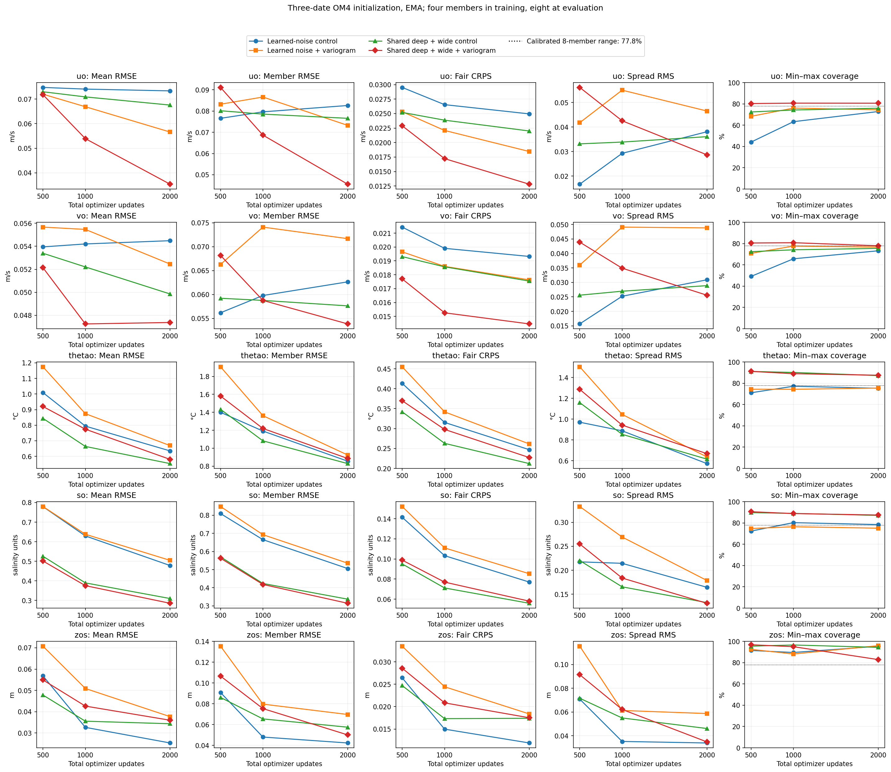
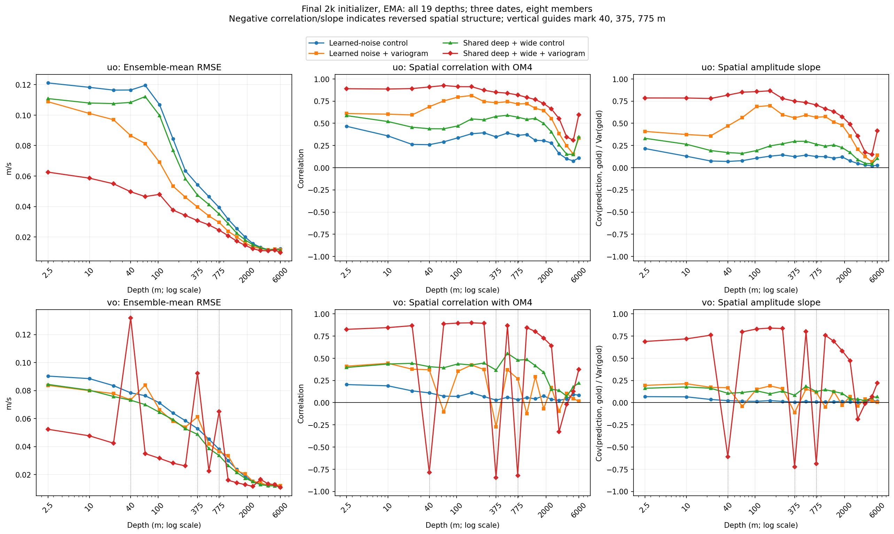
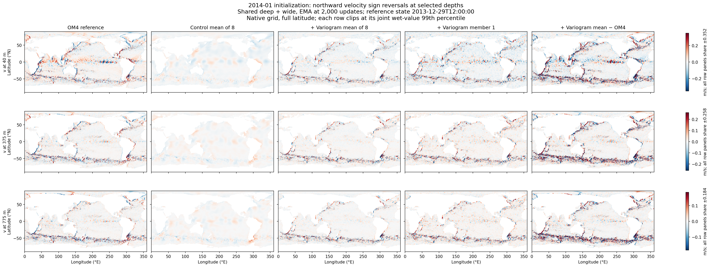
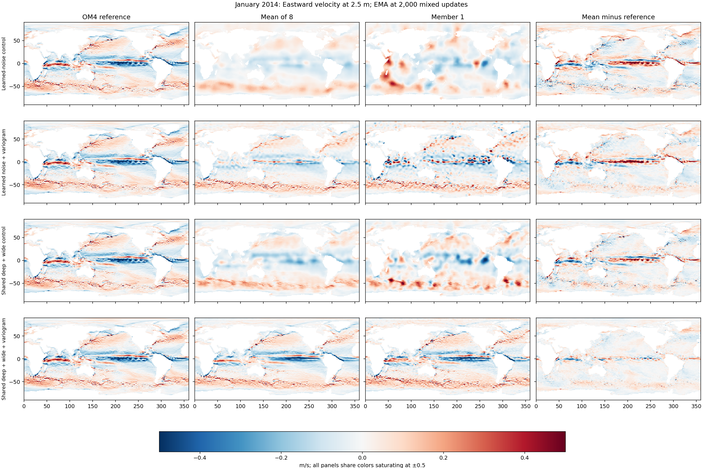
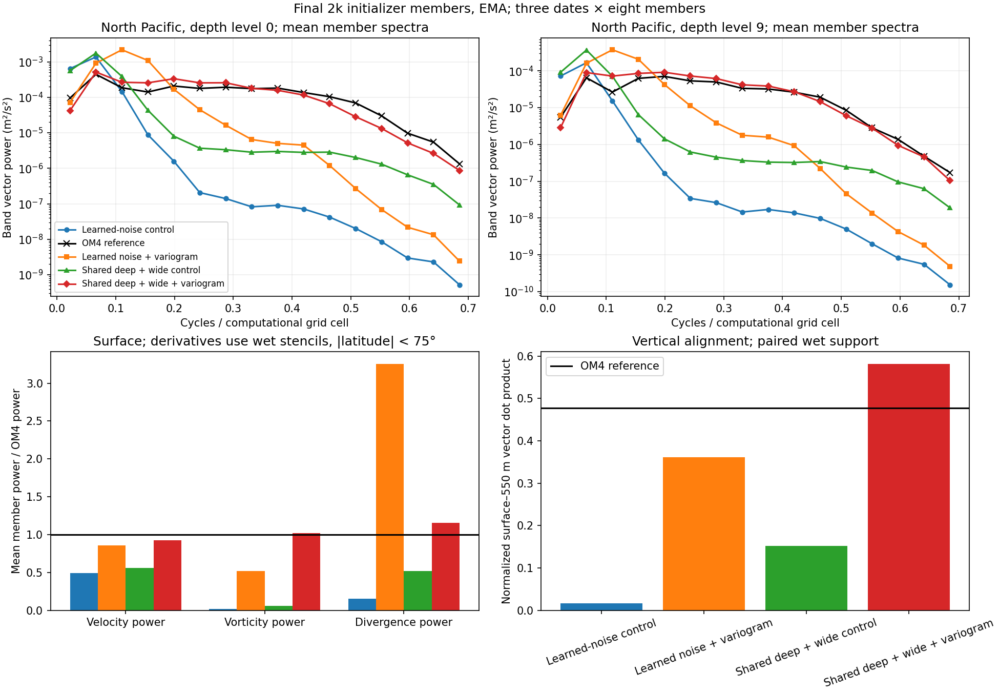

<!-- SPDX-FileCopyrightText: 2026 Samudra Authors -->
<!-- SPDX-License-Identifier: CC-BY-4.0 -->

# Variogram loss from scratch: better structure, depth-specific sign errors

Adding the spatial score substantially improves the shared + deep + wide initializer at the same 2,000-update budget. Its final EMA eastward/northward velocity ensemble-mean RMSE falls 47.6%/5.0%, and pointwise CRPS falls 41.8%/17.6%, against its own control. The surface velocity members recover much more current structure and small-scale power. However, the larger model reverses the northward-velocity pattern at several interior depths: correlations with OM4 reach about −0.8 and RMSE nearly doubles there. The smaller model retains coarse structure and develops excessive divergence. Spatial supervision helps, but this setting does not yet produce reliable full-depth velocity states.

Both new models started from scratch. Saved step-zero model and EMA tensors match their respective controls exactly. Each completed 1,000 OM4 and 1,000 observation optimizer updates, effective batch eight, four training members and eight evaluation members. Data, seeds, learning rate, processor architecture and other objectives match the controls; there is no replay or cooldown. The [plan](variogram-plan.md) defines the comparison and loss. The learned-noise control uses widths 64/128/256 and one ConvNeXt block per U-Net level; the larger model uses widths 96/192/384 and three blocks per level, and processes coarse noise, grid noise and conditioning together. Each member has independent noise. The processor remains deterministic in both architectures.

## Reconstruction and forecasts

These are final EMA weights. Each new model is compared with the control immediately above it. RMSE and CRPS average over all 19 velocity depths and three held-out OM4 initialization dates. The variogram column uses the six saved u/v channels at depth levels 0, 9 and 18; it is normalized and has a different scale. Lower is better for all table scores.

| Initializer | u / v mean RMSE (m/s) | u / v CRPS (m/s) | Saved-channel variogram | Observation forecast blend |
|---|---|---|---:|---:|
| Learned-noise control | 0.07332 / 0.05449 | 0.02495 / 0.01932 | 1.11170 | 0.93670 |
| Learned noise + variogram | 0.05660 / 0.05245 | 0.01845 / 0.01763 | 0.55732 | 0.93311 |
| Shared + deep + wide control | 0.06755 / 0.04986 | 0.02200 / 0.01755 | 0.86891 | 0.92846 |
| Shared + deep + wide + variogram | 0.03538 / 0.04738 | 0.01280 / 0.01446 | 0.32004 | 0.92816 |

The shared + deep + wide reconstruction gains occur on all three dates and with raw weights as well as EMA. Its saved-channel variogram score falls 63.2%; the smaller model's score falls 49.9%. The smaller model's velocity mean RMSE improves 22.8%/3.7% and CRPS improves 26.0%/8.7%, also on all three dates. Single-member RMSE distinguishes the two outcomes: the smaller model's northward-velocity member RMSE worsens from 0.06264 to 0.07168 m/s, while the larger model improves from 0.05762 to 0.05385 m/s.

Other fields have tradeoffs. In the larger model, temperature mean RMSE worsens 4.9% and CRPS worsens 7.1%; SSH mean RMSE worsens 4.8% while CRPS changes by only +0.6%. Salinity mean RMSE improves 7.8%, but CRPS worsens 3.7%. The smaller model's SSH mean RMSE worsens 48.9%. The auxiliary supervises only OM4 initializer velocities; shared parameters can still change other outputs.

The observation-initialized 30-day forecast blend barely changes with EMA: 0.92846 to 0.92816 for the larger model, and 0.93670 to 0.93311 for the smaller model. Raw-weight blends are 0.99373 to 0.92467 and 0.96100 to 0.96846, respectively. There is no consistent forecast improvement across both weight choices. These nine-origin forecasts do not test annual stability.

[Raw learning curves](results/variogram/initializer-curves-raw.png) · [Forecast components](results/variogram/forecast-components.png) · [All-depth scores](results/variogram/initializer-summary.csv) · [Per-date paired changes](results/variogram/initializer-paired-differences.csv).

## Depth-specific sign failure

The larger model improves eastward-velocity mean RMSE at all 19 depths, but northward velocity improves at only 13. Its largest failures are at 40, 375 and 775 m. Each has negative spatial correlation on all three dates, in both raw and EMA weights. The usual surface/550 m/6,000 m map selection misses these depths.

| Northward velocity depth | Control → variogram mean RMSE (m/s) | Control → variogram spatial correlation |
|---|---|---|
| 40 m | 0.07311 → 0.13186 | +0.405 → −0.786 |
| 375 m | 0.04873 → 0.09234 | +0.367 → −0.843 |
| 775 m | 0.03358 → 0.06510 | +0.479 → −0.820 |

These are inverted patterns, not just missing amplitude. The fitted signed amplitude slopes are −0.609, −0.722 and −0.687. Here prediction is the eight-member ensemble mean. Slope is spatial `Cov(prediction, reference) / Var(reference)` after subtracting spatial means; correlation uses the same cosine-weighted wet cells. The displayed correlations and slopes average the three per-date values. The supplementary maps also show the reversal in member 1. A weaker negative correlation also appears at 3,100 m. [Every depth and date](results/variogram/initializer-depth-by-date.csv) is retained.

The absolute-increment variogram is exactly invariant to reversing an entire channel's sign. The correlations become progressively more negative from update 500 to 1,000 to 2,000. The observed failures are consistent with the optimizer finding a sign-reversed solution that the auxiliary cannot distinguish. Pointwise CRPS still penalizes the wrong sign, so invariance alone does not prove why optimization settled there; its strength relative to the auxiliary matters. This suggests testing a lower auxiliary weight or a signed ensemble-mean increment loss before treating the result as a replacement model. Neither follow-up has been trained.

[April maps](results/variogram/depth-audit/maps-ema-2014-04-vo-sign-reversal.png) · [May maps](results/variogram/depth-audit/maps-ema-2014-05-vo-sign-reversal.png). The additional exports reproduce the original checkpoint metrics exactly; the selected fields recompute to the same scores within 1e-6. These are unchanged model outputs, without sign correction.

## Member structure

The January surface maps show the larger variogram model recovering the equatorial current and Southern Ocean bands in both its mean and first member. The smaller model produces shorter-scale patterns but still has conspicuous patches and oscillations. These selected depths look better than the full vertical profile: the sign reversals above explain much of the gap between the eastward and northward aggregate gains. Individual fine features are also not guaranteed to coincide with the reference.

[Northward surface velocity](results/variogram/maps/maps-ema-2014-01-vo_0.png) · [Eastward velocity at 550 m](results/variogram/maps/maps-ema-2014-01-uo_9.png) · [Northward velocity at 550 m](results/variogram/maps/maps-ema-2014-01-vo_9.png). The figures use common colors, full latitude coverage and equal latitude/longitude aspect. Matching PDFs accompany the PNGs.

The larger model's mean-member surface vorticity power rises from 0.057 to 1.019 times OM4, and mean member vorticity correlation with OM4 rises from 0.390 to 0.839. Surface divergence power is 1.157 times OM4, versus 0.517 before. The smaller model reaches only 0.516 of OM4 vorticity power and overshoots divergence to 3.253 times OM4. Thus a better variogram score does not by itself establish realistic velocity fields.

North Pacific surface power (20–40°N, 150–190°E) in the saved fine band, wavelengths approximately 7.5 grid cells and shorter, rises from 0.052 to 1.165 times OM4 for the larger model. Its spectral curve is much closer to OM4 across the resolved scales. The smaller model reaches a deceptively similar band total of 0.935: its power is concentrated toward the coarse end of that band and remains far below OM4 at the highest frequencies. The full curves are more informative than that total. Power agreement alone does not test the location or phase of currents; the derivative correlations and error maps provide additional evidence.

Noise remains persistent across different inputs. Define a perturbation as member minus its eight-member mean, and compare the same draw across dates using the area-weighted u/v vector cosine, then average members and date pairs. Keeping the same random draw and changing the conditioning date, the larger model's surface perturbation cosine similarity falls from 0.997 to 0.928. The smaller model changes from 0.999 to 0.993. This indicates more input dependence in the larger model, but still substantial reuse of the spatial perturbation pattern. It is a three-date diagnostic, not a test of temporally coherent stochastic rollouts.

[Fixed-noise maps](results/variogram/spatial/fixed-noise-perturbations-ema.png) · [Spatial scores](results/variogram/spatial/structure-summary.csv) · [Spectral bands](results/variogram/spatial/spectral-bands.csv) · [Variogram by lag](results/variogram/variogram-by-lag-ema.png).

## Interpretation and checks

This screen supports further work on spatial supervision for the larger shared-input initializer, with explicit checks for signed structure at every depth. The aggregate held-out variogram and pointwise velocity scores improve, with substantial changes in surface maps and derivative diagnostics; the depth-specific sign failures prevent declaring the velocity problem resolved. It does not show that capacity alone or the variogram alone resolves all member realism problems. The loss sees absolute spatial increments separately for each velocity channel; it does not explicitly enforce cross-variable balance, divergence, current placement or temporal consistency. One seed and three initialization dates limit claims about generalization.

The reported held-out variogram uses the same finite-ensemble correction as training. The auxiliary is the squared error in the ensemble's expected absolute increment, with a finite-ensemble variance correction. It uses normalized u/v at all 19 depths, grid lags 1/2/4/8 and four directions, requiring wet cells along each path. It is added inside the existing reconstruction weight of 0.1. A single fair estimate can be negative. Observation and forecast losses are unchanged. The [training diagnostics](results/variogram/training-components.png) separate the added term from the original initializer CRPS; total training loss is not directly comparable with the controls' total loss.

Initializer cases are January, April and May 2014, using 19 surface-history bins to reconstruct the latest five-day state. OM4 is the reference model output. Mean RMSE is `sqrt(mean_over_depths_and_dates(spatial_MSE))`, with cosine-weighted wet-cell spatial MSE; Spatial CRPS is averaged equally over depths and dates, without a square root. The forecast blend equally averages the existing five SST, SSH-derived velocity, EKE and upper/deep heat-content error ratios to the fixed seasonal-climatology validation control over nine observation-initialized cases. A score of 1 matches that climatology control. EMA averages model weights; the ensemble mean averages sampled states. The [full verification receipt](results/variogram/COMPLETE.json) checks input fingerprints, reference maps, masks, normalization, checkpoint identity and matching forecast cohorts.

Both runs used one Torch RTX GPU. Qualification measured 83.1%/79.1% active GPU utilization and 7.56/10.19 seconds per update, with mean data wait below 0.2 ms. Production jobs were `21860236_0` and `21860237_1`; both completed training and all evaluations. This wave cost 11.33 allocated GPU-hours including the failed first qualification, retry and one-minute depth-map audit, bringing the shared campaign total to 32.26 GPU-hours, below the 40-hour cap. The first attempt exposed latitude-only area weights; the correction and exact score/gradient regression tests are recorded in the plan. No failed attempt was used as a trained starting checkpoint.

[Submission and accounting](variogram-submission.json) · [Qualified release](results/variogram/provenance/RELEASE.json) · [Frozen training source manifest](results/variogram/provenance/SOURCE.json) · [Complete training source archive](sources/variogram/code.tar.gz) · [Report script](../../../scripts/report_stochastic_variogram.py) · [Loss implementation](../../../src/samudra/experiments/stochastic_variogram.py).
