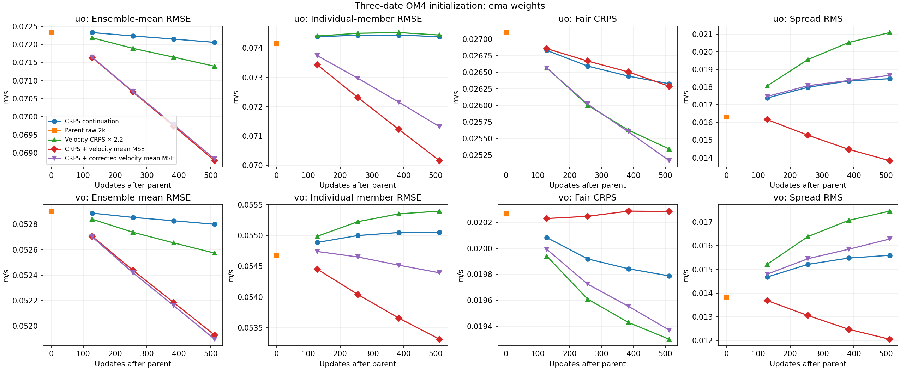
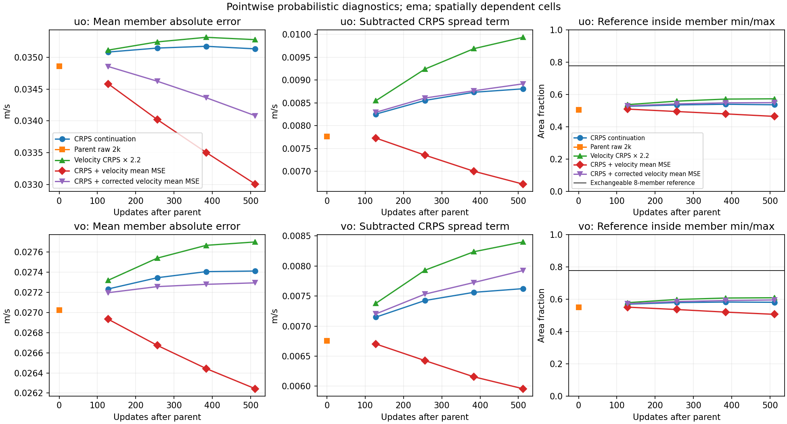
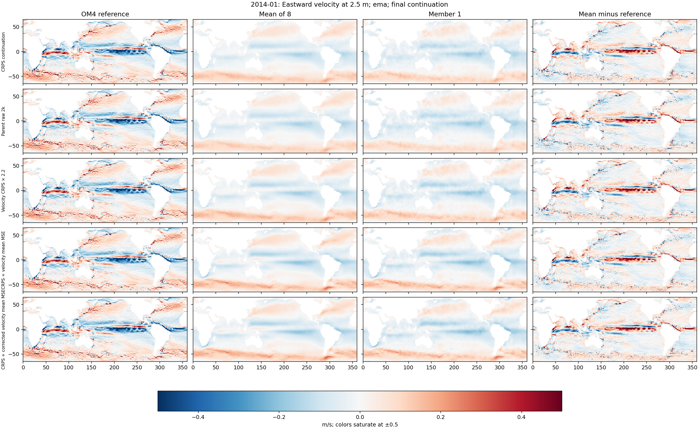
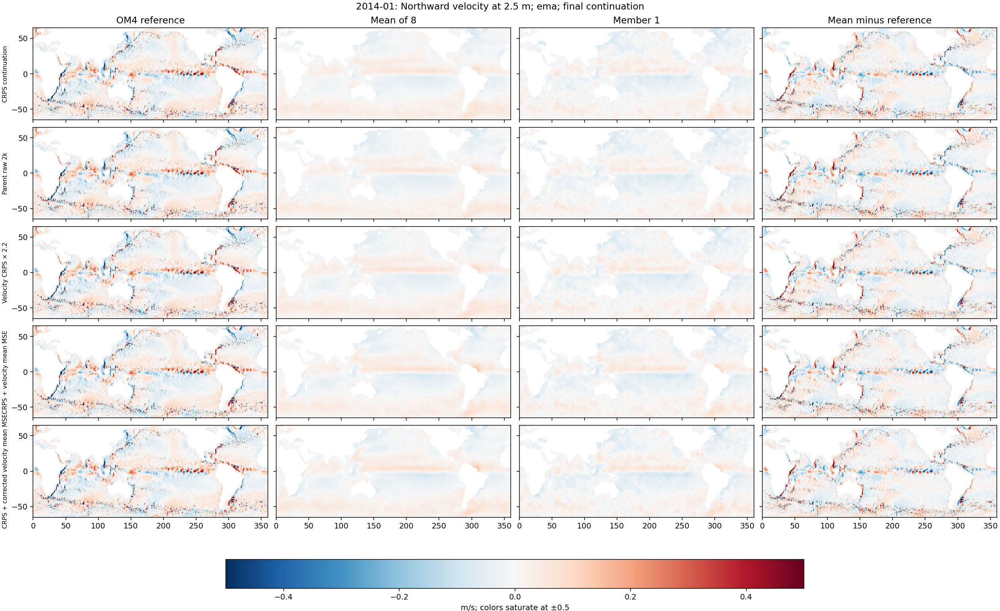
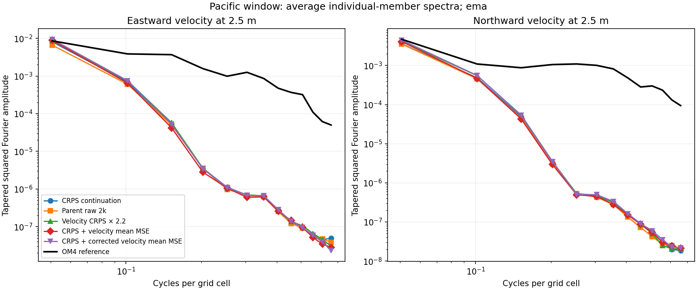
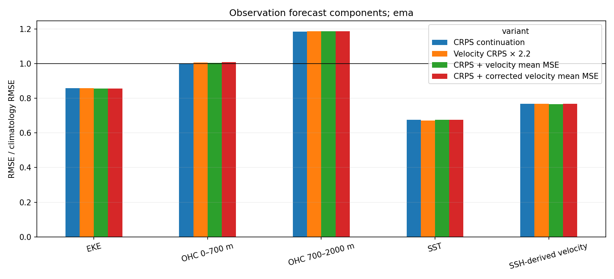

<!-- SPDX-FileCopyrightText: 2026 Samudra Authors -->
<!-- SPDX-License-Identifier: CC-BY-4.0 -->

# Short controlled continuations of velocity initialization

A variance-corrected ensemble-mean velocity MSE auxiliary improves both velocity
mean RMSE and pointwise CRPS over unchanged training in this controlled pilot.
After 512 further mixed updates, EMA u/v mean RMSE is 4.5%/1.7% lower and CRPS
4.4%/2.1% lower, while coverage increases slightly. The ordinary mean-MSE
auxiliary obtains similar mean accuracy but worsens undercoverage. Correcting
its sampling-variance penalty separates these effects in the tested setting.

All four continuations are complete. This is a partial velocity improvement,
not a solved initialization model: strong-current power remains severely
underpredicted, temperature/salinity/SSH initialization errors rise, and the
observation forecast blend does not improve under the fixed EMA comparison.

## Matched protocol

All four arms start from the same raw B/CRPS checkpoint after 2,000 mixed optimizer
updates. B has a stochastic Samudra-style initializer and a deterministic
processor. It conditions on 19 five-day SST/SSH history frames and shared ERA5
inputs to reconstruct u, v, temperature and salinity at 19 depths plus SSH.
Training uses the same existing per-channel means and standard deviations in
all arms; [the setup](loss-ablation-partial.md) is unchanged. The raw model and Adam state are retained exactly; EMA resets to the
raw model identically in all arms, with its original 100-update half-life. Each
continuation uses 512 updates, comprising 256 OM4 and 256 observation updates,
effective batch eight, four stochastic members during training, learning rate
1e-4 and no cooldown. Data order and stochastic draws are matched. Final model
step 2,512 therefore contains 1,256 updates of each source.

Only the OM4 initializer velocity reconstruction term changes. Its original 0.1
coefficient and the denominator averaging over all 77 physical channels remain
in place. All observation losses, non-velocity reconstruction terms and forecast
losses are unchanged.

- **Control:** unchanged fair CRPS.
- **Mean-MSE auxiliary:** add coefficient one times squared error of the
  four-member velocity mean, in the existing normalized units.
- **CRPS weight ×2.2:** multiply velocity reconstruction CRPS by 2.2. This factor
  approximately matches the norm of the velocity-CRPS-plus-auxiliary gradient
  on initializer parameters, excluding the processor and forcing adapter, on
  three training probes. It does not match the whole-objective gradient or the
  resulting Adam update.
- **Corrected mean-MSE auxiliary:** use the same coefficient-one auxiliary, but
  subtract the unbiased member-variance estimate divided by four. This changes
  only the finite-member mean-MSE sampling-variance penalty; the precise formula
  and its limits are given below.

Evaluation uses eight members. Initialization metrics use three exact-cadence
held-out OM4 histories, with targets centered on December 29, 2013, March 29,
2014 and April 28, 2014. Equal-depth and equal-date MSE is averaged before taking
its square root. Spatial weights are cosine latitude on each depth's wet mask.
The [multi-date report](velocity-multidate-diagnostics.md) explains the six
excluded histories and evaluation-store version. Map labels 2014-01/04/05
are forecast-origin month labels; initialization targets are the preceding
five-day bins listed above. These are validation cases
used to investigate the failure, not an independent final test set.

## Final initialization results

The primary table uses EMA weights. RMSE and fair CRPS are in m/s. Member RMSE
means the square root of MSE averaged over the eight individual members. Spread
RMS is the square root of member MSE minus ensemble-mean MSE on the same support.
Fair CRPS subtracts the sum of unordered absolute member-pair differences
divided by M(M−1) from mean absolute member error, with M=8.
Coverage is the fraction of reference values inside the ensemble minimum and
maximum, averaged over the same wet support, depths and dates.

| Continuation | Mean RMSE u / v | Member RMSE u / v | Fair CRPS u / v | Spread RMS u / v | Coverage u / v |
|---|---:|---:|---:|---:|---:|
| Control | 0.07206 / 0.05280 | 0.07439 / 0.05505 | 0.02633 / 0.01979 | 0.01848 / 0.01559 | 53.7% / 58.1% |
| Mean-MSE auxiliary | 0.06879 / 0.05193 | 0.07016 / 0.05331 | 0.02629 / 0.02028 | 0.01383 / 0.01206 | 46.5% / 50.6% |
| CRPS weight ×2.2 | 0.07139 / 0.05257 | 0.07444 / 0.05540 | 0.02534 / 0.01930 | 0.02109 / 0.01746 | 57.4% / 60.9% |
| Corrected mean-MSE auxiliary | 0.06883 / 0.05190 | 0.07132 / 0.05439 | 0.02516 / 0.01937 | 0.01867 / 0.01628 | 55.0% / 59.5% |

The ordinary mean-MSE arm improves both mean and individual-member RMSE, but reduces
spread and coverage. Its u CRPS is nearly unchanged and v CRPS worsens. Increasing
CRPS weight improves CRPS and coverage while changing mean RMSE little and
slightly worsening member RMSE. The corrected auxiliary retains almost the same mean accuracy as the ordinary
auxiliary (less than 0.1% change in mean u/v RMSE), while restoring coverage by
8.5/8.9 percentage points and improving CRPS by about 4.3%/4.5% relative to it.
Its individual-member RMSE is worse than the ordinary auxiliary but better than
unchanged control. These are different tradeoffs; nonzero spread
alone does not establish a useful probabilistic fix. Under ideal continuous
exchangeability, an eight-member minimum/maximum interval covers 7/9, about 78%,
of targets. These spatially dependent, three-date diagnostics do not certify
conditional calibration.

The ordinary auxiliary's u RMSE advantage over control grows from about 1% at +128 updates
to 2.1% at +256 and 4.5% at +512. The final raw parameters show the same direction:
u/v mean RMSE is 0.06774/0.05172 for the ordinary auxiliary versus 0.07225/0.05297 for
control. Raw ordinary-auxiliary coverage is lower still, 44.6%/49.1% versus 53.2%/58.0%.
The corrected auxiliary's raw u/v mean RMSE is 0.06821/0.05196, with CRPS
0.02481/0.01932 and coverage 55.1%/60.2%; its direction of improvement over raw
control agrees with the EMA comparison. On each of the three individual dates,
corrected EMA mean RMSE and CRPS decrease and coverage increases relative to
control. The u RMSE improvement ranges from 3.5% to 5.5%; v from 1.6% to 1.9%.
Relative to the ordinary auxiliary, corrected velocity mean RMSE changes by less than
0.1% on every date while CRPS and coverage improve on every date. These are
paired signs across three spatially dependent cases, not a significance test.
The figures and CSVs retain both raw and EMA results; the report does not select
weights separately for each arm.

## Strong currents and spatial structure

For reference speeds between 0.3 and 1 m/s, the ordinary auxiliary's ensemble mean retains
2.98% of reference squared velocity, versus 1.46% for control, 1.81% for
CRPS ×2.2 and 3.06% for the corrected auxiliary. Squared-velocity retention is the ratio of weighted predicted u²+v²
to reference u²+v² within a reference-speed bin, pooling cell-depth sums. It is
a squared-amplitude ratio, not retained speed amplitude or explained variance.
RMSE relative to predicting zero velocity is 0.915 for the ordinary auxiliary,
0.957 for control, 0.950 for CRPS ×2.2 and 0.915 for the corrected auxiliary.
This ratio is the square root of summed weighted u/v prediction
error squared divided by summed weighted reference u²+v² within the speed bin,
pooling depths and dates. The earlier fresh B/MSE
model retained 35.4% at 2k using these same dates, bin weights and ensemble-mean
calculation, so neither auxiliary has approached that level of
current reconstruction.

Global equal-depth mean u power, as a fraction of reference u power, rises from
9.6% in control to 14.6% with the ordinary auxiliary and 14.8% with the corrected
auxiliary; for v the ratios are 3.9%, 5.2% and 5.5%.
Mean-map amplitude remains weak. The January-origin maps use the same ±0.5 m/s scale,
including the error column; colors saturate but stored values are unclipped.
Surface and 550 m maps for all three dates, both raw and EMA, accompany the CSVs.

The spectra average power from individual members in the entirely wet Pacific
window 150–190°E, 20–40°N. Fields are demeaned and Hann-tapered before a radial
FFT-bin average, expressed in cycles per grid cell. This is the same diagnostic
as the first wave, not the project's forecast spectral metric. Reference,
ensemble mean, member 1 and average-member powers are retained separately.
All four continuations still have a large deficit of member spectral power
relative to reference at most plotted wavenumbers; these short continuations
have not restored that spatial structure.

## Other initialized fields

Shared initializer parameters also change temperature, salinity and SSH, even
though their losses are unchanged. The ordinary auxiliary raises EMA initializer
SSH RMSE by 13.3%, from 0.02354 to 0.02666 m. Temperature RMSE rises from 0.6065
to 0.6186 °C and salinity from 0.4746 to 0.4792 in the dataset's salinity units.
The CRPS ×2.2 arm has smaller increases: SSH 0.02417 m, temperature 0.6105 °C
and salinity 0.4784. The corrected auxiliary gives SSH 0.02649 m (+12.5% over
control), temperature 0.6202 °C (+2.3%) and salinity 0.4807 (+1.3%). Its pointwise
CRPS also worsens for these three fields. The velocity gain therefore has
measurable collateral initialization costs. These are the same equal-date/depth initialization scores;
near-equal forecast blends below do not establish absence of collateral costs.

## Observation forecasts

The unchanged forecast blend averages five climatology-normalized RMSE ratios:
SST, SSH-derived velocity, EKE, OHC 0–700 m and OHC 700–2000 m. It uses the same
nine November 2013–July 2014 origins, surface leads through 30 days and
calendar-weighted monthly OHC. Lower is better.

| Continuation | EMA forecast blend | Raw forecast blend |
|---|---:|---:|
| Control | 0.89759 | 0.92925 |
| Mean-MSE auxiliary | 0.89848 | 0.92430 |
| CRPS weight ×2.2 | 0.89838 | 0.91404 |
| Corrected mean-MSE auxiliary | 0.89870 | 0.91550 |

EMA blends differ by at most 0.13%. The ordinary auxiliary's slightly lower velocity and EKE
ratios are offset by worse OHC ratios. This single-seed pilot shows no large
forecast change under the fixed EMA comparison. Raw results are also retained;
they should not be substituted selectively into the EMA comparison.

## What the correction demonstrates

For independent conditional member draws, squared error of a finite ensemble
mean contains an expected variance penalty proportional to 1/M. The corrected
arm replaces the ordinary auxiliary with

\[
(\bar{x}-y)^2 - \frac{1}{M(M-1)}\sum_{m=1}^{M}(x_m-\bar{x})^2,
\]

using M=4 and the same normalized velocity coordinates, coefficient and masks.
It starts from the same parent and repeats the same 512 updates. This removes
the expected sampling-variance penalty under conditional independence. It does
not remove finite-batch noise or guarantee calibration, stability or spatial
coherence.

The corrected-versus-ordinary comparison supports a specific mechanism: the
ordinary auxiliary's coverage loss can be avoided here without giving up its
mean-learning gain. The corrected-versus-control comparison supplies a small
real-model improvement in mean error, member error, pointwise CRPS and coverage.
However, weighting CRPS alone improves CRPS and coverage too, and the corrected
auxiliary still leaves currents weak and increases other initialization errors.
This experiment has not established a globally preferable training objective.
It is one seed and 512 continuation updates, with validation cases used during
method selection.

[Per-date initialization scores](results/velocity-continuations/initializer-by-date.csv),
[aggregate scores](results/velocity-continuations/initializer-summary.csv),
[per-date paired contrasts](results/velocity-continuations/initializer-paired-deltas.csv),
[current-strength bins](results/velocity-continuations/current-strength-summary.csv),
[forecast components](results/velocity-continuations/forecast-components.csv),
[spectra](results/velocity-continuations/surface-member-spectra.csv), and
[input/checkpoint provenance](results/velocity-continuations/provenance.json) accompany
this report. PNG and PDF versions of the figures are retained.

[Training contracts and completion receipts](results/velocity-continuations/receipts/)
verify the same parent model/Adam state, reset EMA and 512 finite updates in each
arm. The three original continuations and the corrected follow-up, with their
associated diagnostic jobs and failed startup attempts, used approximately
6.2 GPU-hours; [accounting](results/velocity-continuations/campaign-accounting.json)
and [finite-update checks](results/velocity-continuations/health-all-arms.json)
are retained. This excludes the earlier five-arm training pilots.
