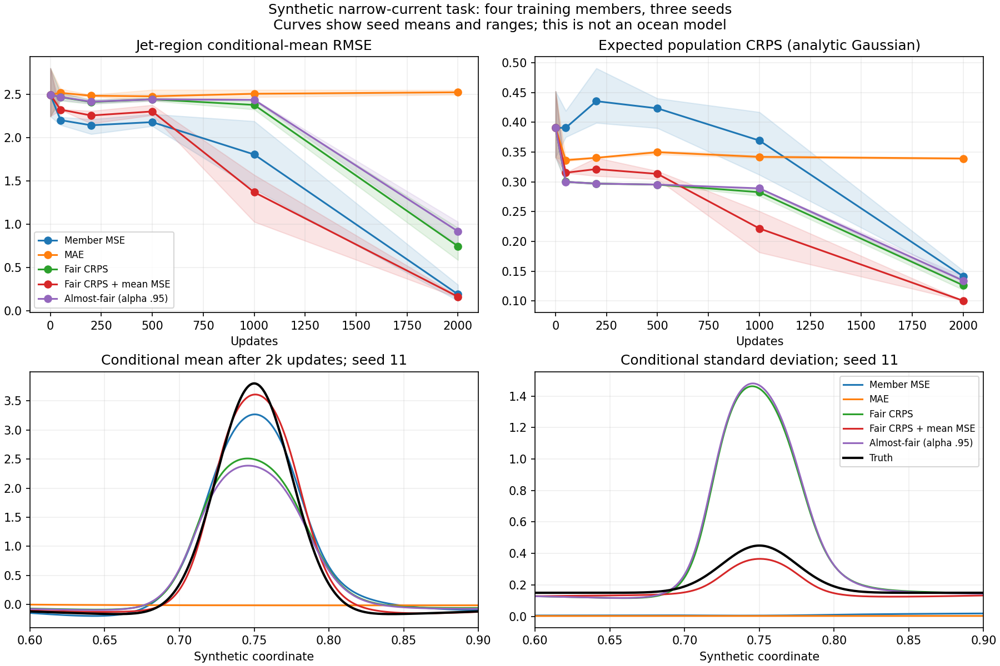
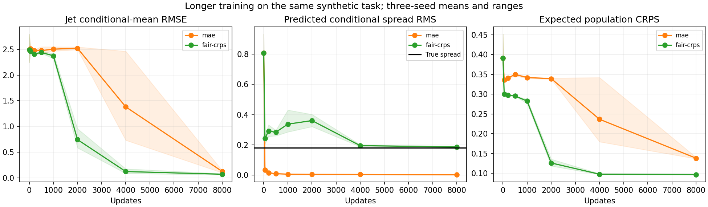

<!-- SPDX-FileCopyrightText: 2026 Samudra Authors -->
<!-- SPDX-License-Identifier: CC-BY-4.0 -->

# Finite-ensemble gradients and a synthetic current-learning test

A small conditional-regression example reproduces delayed learning of a narrow,
strong current under absolute-error objectives. Under fair CRPS, unresolved mean
structure coincides with excess spread. More training recovers the
current and reduces that spread. Adding ensemble-mean MSE speeds recovery in
this example. These results establish possible mechanisms; they do not identify
the cause of the ocean model's errors.

## Exact check of the production loss

For an untied sorted member of rank r=1,...,M, ordered from smallest to largest,
in an M-member ensemble, the derivative
of unnormalized fair CRPS is

\[
\frac{\partial L}{\partial x_{(r)}}=
\frac{\operatorname{sign}(x_{(r)}-y)}{M}
-\frac{2r-M-1}{M(M-1)}.
\]

Normalization and spatial weights multiply this expression. The smallest
member has zero derivative when it is below the target; the largest has zero
derivative when it is above the target. For four members bracketing the target
between the middle two, the derivatives are [0, -1/6, +1/6, 0]. For two members
bracketing the target, both derivatives and the empirical score are zero,
regardless of the bracket's width. Ties require the implementation's subgradient
convention and are excluded from these statements.

Nine cases with 2, 4 and 8 members were checked against both the values and
autograd derivatives of the actual production `score` function. All matched.
The [receipts](toy/gradient-checks.json) retain targets, predictions and gradients.

This finite-sample flatness does not make expected fair CRPS improper. When
members are independent conditional draws, its expectation is the population
CRPS. Members also share network parameters, so a zero derivative at one output
does not imply zero parameter learning. The ocean gradient audit must determine
how often these flat directions occur and whether they matter.

The [scale-aware weather paper](https://arxiv.org/html/2607.19161v1#S2)
explicitly discusses a fair-CRPS degeneracy and uses an almost-fair correction.
Its alpha=0.95 means mixing 95% fair CRPS with 5% ordinary ensemble CRPS. For
four members the fair spread term is multiplied by 0.9875, not 0.95. The toy
below uses that exact convention. It restores a small force on an otherwise
unconstrained extreme, but does not address the lack of residual-magnitude
weighting in an absolute-error loss.

## Synthetic experiment

The input is a coordinate x drawn uniformly from [0,1]. Define
g(x)=exp[-(x-0.75)^2/(2×0.025^2)]. The target is Gaussian with mean
0.2 sin(2πx)+4g(x) and conditional standard deviation 0.15+0.3g(x).
The current's profile width 0.025 is its Gaussian standard deviation along x.
A two-layer
32-wide tanh network predicts Gaussian mean and standard deviation. Thus the
true conditional mean and median coincide; failure to learn the current cannot
be explained as learning a different correct conditional median.

All objectives use the same initialization, training examples, target-noise
draws and four member-noise draws within each of three seeds. Adam uses learning
rate 0.003 and batch 128. Training ran on one CPU thread. MAE averages absolute
errors over the four sampled members; per-member MSE averages their squared
errors. The mean-MSE auxiliary scores the sampled four-member mean against the
same target and has coefficient 1.0. The Gaussian output family and tiny network
differ from the ocean model.

The table gives seed averages after 2,000 updates. Jet RMSE is error in the
predicted conditional mean for |x-0.75|<0.05. Spread is the RMS predicted
conditional standard deviation over all x. True spread RMS is 0.1792. Expected
CRPS takes the expectation over a fresh target Y from the known conditional
Gaussian and over the predicted Gaussian distribution analytically. Scores
are then averaged on 1,024 uniformly spaced coordinates, approximating a
uniform-coordinate integral. Thus evaluation avoids finite-ensemble noise.

| Loss | Jet mean RMSE | Spread RMS | Expected CRPS |
|---|---:|---:|---:|
| Per-member MSE | 0.1878 | 0.0087 | 0.1412 |
| MAE | 2.5223 | 0.0039 | 0.3392 |
| Fair CRPS | 0.7433 | 0.3601 | 0.1261 |
| Fair CRPS + mean MSE | 0.1597 | 0.1477 | 0.1002 |
| Almost-fair CRPS, alpha 0.95 | 0.9148 | 0.3939 | 0.1340 |

The mean-MSE auxiliary recovers the current while retaining much more spread
than per-member MSE. It is not neutral to spread: expected finite-member mean
MSE includes a variance penalty of predicted variance divided by M. A closer
global spread RMS alone does not establish calibration at every coordinate.
Almost-fair CRPS does not improve this toy at the chosen 2k budget; eliminating
an exact flat direction is insufficient here.

Across the three seeds, jet RMSE ranges are 0.584–0.956 for fair CRPS,
0.148–0.169 for CRPS plus mean MSE, and 0.762–1.025 for almost-fair CRPS.
The corresponding expected-CRPS ranges are 0.1186–0.1359, 0.1001–0.1004,
and 0.1266–0.1414. These seed ranges support the auxiliary result in this
toy; the small almost-fair comparison supports only that it provided no
observed improvement in these three runs. The experiment does not isolate
finite-ensemble flatness from residual-magnitude weighting or other changes
to the optimization dynamics.

## Longer training

MAE and fair CRPS were rerun with identical prefixes through 8,000 updates and
unchanged learning rate. Their mean jet RMSE progresses as follows:

| Loss | 2k | 4k | 8k |
|---|---:|---:|---:|
| MAE | 2.5223 | 1.3804 | 0.1220 |
| Fair CRPS | 0.7433 | 0.1214 | 0.0689 |

Fair-CRPS spread RMS falls from 0.3601 at 2k to 0.1942 at 4k and 0.1855 at 8k,
close to the true 0.1792. Expected CRPS improves from 0.1261 to 0.0970. MAE
learns the mean later while its spread collapses, as expected for independent
member absolute-error supervision of a target with a unique conditional median.

This demonstrates a resolution of the mean-current error in a small synthetic
problem: the same fair-CRPS model eventually learns the current without changing
the loss, while global spread approaches the reference. That global agreement
does not establish conditional calibration. It supports checking ocean velocity
curves for delayed learning, and
comparing a short mean-MSE-assisted continuation against an equally long plain
CRPS continuation. It does not show that longer ocean training will suffice.

Reproducible code is in `scripts/diagnose_stochastic_velocity_loss_toy.py` and
`scripts/plot_stochastic_velocity_loss_toy.py`. Raw [2k curves](toy/learning-curves.csv),
[8k curves](toy-long/learning-curves.csv), protocols, seed-specific mean/spread
profiles and [2k seed ranges](toy/summary.json) accompany the figures. No ocean
checkpoint or training configuration was changed.
