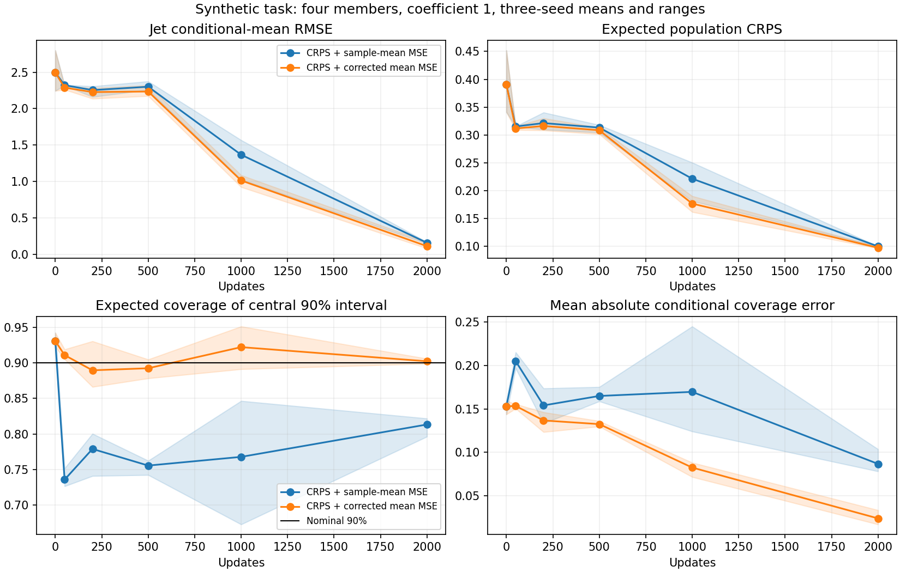

<!-- SPDX-FileCopyrightText: 2026 Samudra Authors -->
<!-- SPDX-License-Identifier: CC-BY-4.0 -->

# Removing the sample-mean MSE variance penalty: a CPU toy test

Replacing sample-mean MSE with an unbiased estimate of population-mean squared
error improves expected CRPS and interval coverage in all three synthetic runs.
It removes an explicit variance penalty, but does not guarantee calibrated
spread or stable ocean training. No ocean model was trained in this test.

For M ≥ 2 independent, identically distributed conditional draws X_i, let μ
and σ² denote the predicted conditional mean and variance. The ordinary auxiliary is
(mean(X)-y)^2. Its expectation over member draws is (μ-y)^2+σ²/M. The correction
subtracts unbiased sample variance s²/M:

\[
U=(\bar X-y)^2-\frac{s^2}{M}
=\frac{1}{M(M-1)}\sum_{i\ne j}(X_i-y)(X_j-y).
\]

Conditional on a fixed target y, E[U]=(μ-y)^2. Taking expectation over a fresh
target Y adds its irreducible conditional variance to squared mean bias, with
no predicted-variance penalty. Each member's derivative is
2 sum_{j≠i}(X_j-y)/[M(M-1)]. These statements require independent member draws
conditional on the inputs; correlated draws can invalidate the correction.

Exact value/gradient identities were checked in float64 for M=2,4,8. Nine
Gaussian Monte Carlo cases used 200,000 ensembles each; measured expectations
matched within six standard errors. For Gaussian members, the estimator
variance is 4(μ-y)^2σ²/M+2σ⁴/[M(M-1)]. At M=4, μ=y=0, σ=1, the measured mean
was -0.000023 with standard error 0.000913; its expected value is zero. The auxiliary’s expected derivative with respect to Gaussian scale is zero,
holding its mean fixed, although any sampled gradient can be nonzero.
The [check receipts](toy-ustat/analytic-monte-carlo-checks.json) retain all cases.

Negative sampled auxiliaries are expected: 60.9% of samples were negative in
that zero-error Gaussian case. At a fixed ensemble mean, increasing sample variance drives the sampled
auxiliary arbitrarily negative. Combined with a network and finite minibatches, this creates
a noisy optimization problem despite the correct population expectation.
Neither clamping negative values nor detaching the variance correction was
used; either would change the tested gradient.

## Matched synthetic training

The [narrow-current Gaussian task](toy-mechanisms.md) was rerun with four sampled
members, batch 128, 2,000 Adam updates, learning rate 0.003, auxiliary weight 1,
and seeds 11/23/47. Both arms use fair CRPS plus the stated auxiliary. Initialization, minibatches, target noise and member noise
match between arms. The ordinary-auxiliary rerun agrees with the earlier toy
metrics within 1e-6. It is a stochastic MLP, not a Samudra model.

Values below average the three seeds. Coverage is analytically expected under
the true Gaussian at each of 1,024 coordinates, using the predicted Gaussian's
central 90% interval. Conditional coverage error is the coordinate-average
absolute difference from 0.9, so opposing local errors cannot cancel. Expected
CRPS integrates over the true target and predicted distributions analytically.

| Metric at 2k | Fair CRPS + ordinary mean MSE | Fair CRPS + corrected mean MSE |
|---|---:|---:|
| Jet conditional-mean RMSE | 0.1597 | 0.1131 |
| Expected CRPS | 0.10024 | 0.09775 |
| Predicted spread RMS (truth 0.1792) | 0.1477 | 0.2016 |
| Conditional standard-deviation RMSE | 0.0335 | 0.0357 |
| Expected 90% coverage | 81.33% | 90.24% |
| Expected 90% coverage in jet region | 74.64% | 92.69% |
| Mean absolute conditional coverage error | 0.0867 | 0.0240 |

All three seeds improve expected CRPS and conditional coverage error. Corrected
CRPS values range 0.09664–0.09972 versus 0.10011–0.10038 for ordinary mean MSE.
Jet mean RMSE ranges 0.0830–0.1714 versus 0.1480–0.1692; one seed slightly
worsens mean accuracy. Conditional standard-deviation RMSE worsens slightly on
average, despite better interval coverage. The correction therefore improves
the tested distributional scores without uniformly improving every spread
diagnostic.

This is evidence for a small matched ocean pilot of the corrected auxiliary
against ordinary mean MSE and plain CRPS, contingent on the real gradient
findings. It does not show that unbiasedness prevents overdispersion or that
the ocean model's errors arise only from the ordinary auxiliary's penalty.
Stability, negative-loss frequency, coverage and individual-member fields
would all need checking in that pilot.

Code: `scripts/diagnose_stochastic_velocity_ustat_toy.py` and
`scripts/plot_stochastic_velocity_ustat_toy.py`. Raw [learning curves](toy-ustat/learning-curves.csv),
profiles and [protocol/source hashes](toy-ustat/protocol.json) are retained.
