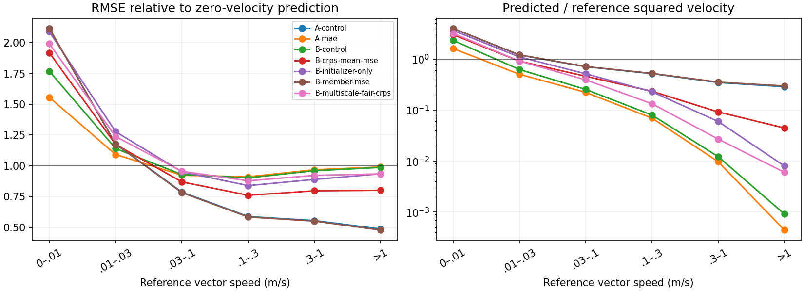
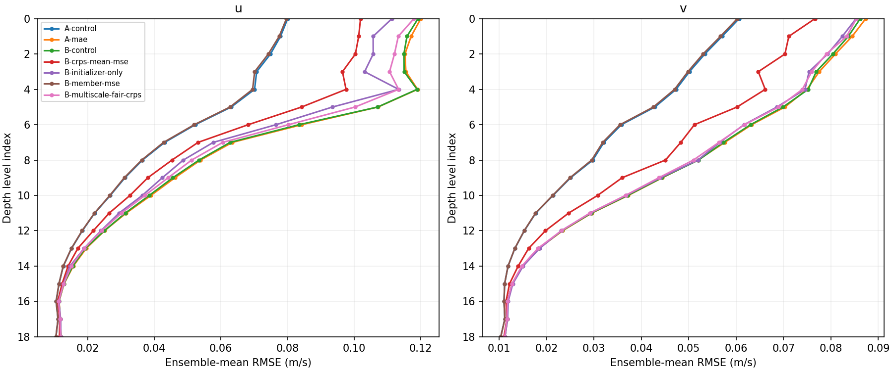
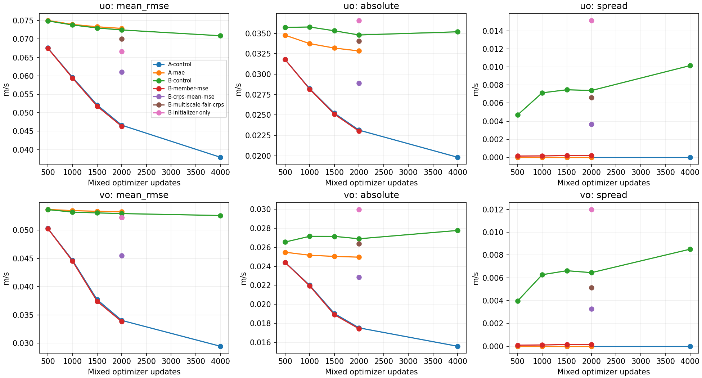
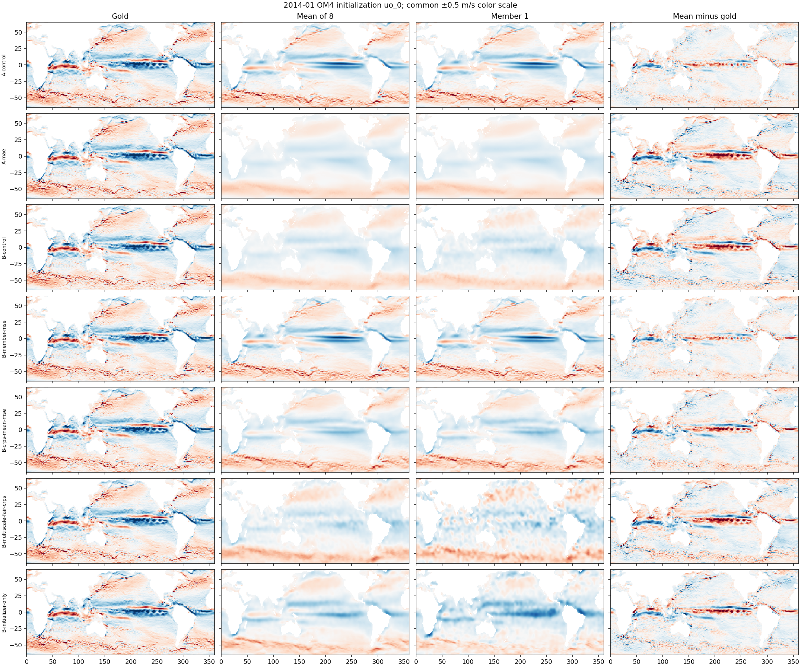
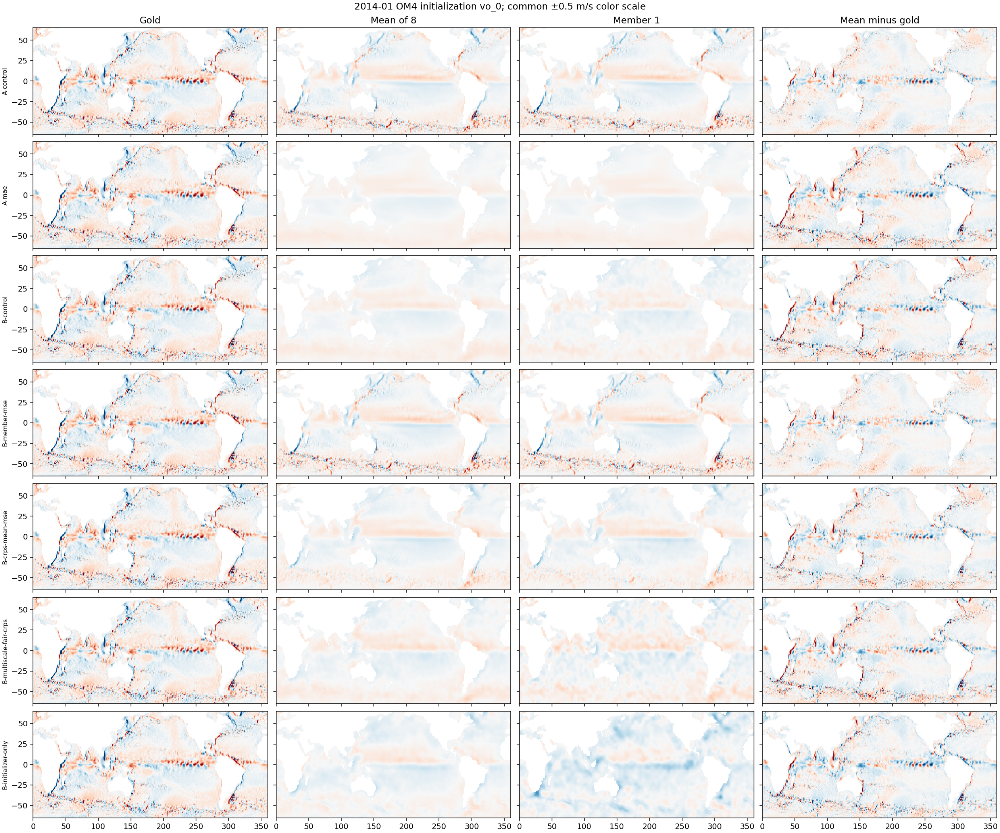
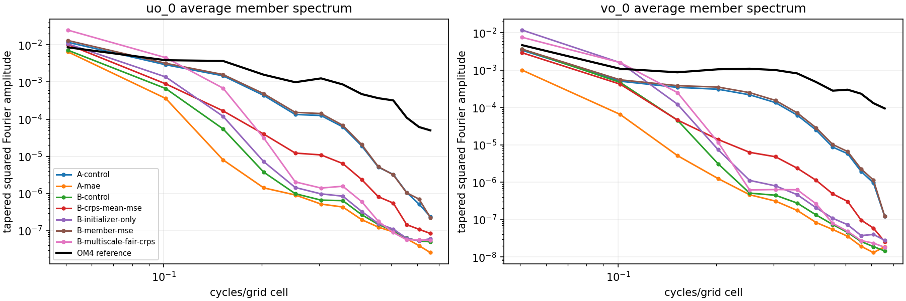

<!-- SPDX-FileCopyrightText: 2026 Samudra Authors -->
<!-- SPDX-License-Identifier: CC-BY-4.0 -->

# Velocity initialization across three held-out dates

The velocity gap persists across all three exactly aligned validation dates. The maps show stronger currents and lower velocity errors for the MSE models; deterministic MAE and stochastic fair CRPS largely suppress it. The mean of the stochastic members is not simply washing out energetic, correctly structured individual members: the individual maps also have weak currents.

The inputs are OM4 surface histories with matched ERA5. All seven models use EMA weights after 2,000 mixed updates, 1,000 OM4 and 1,000 observation updates, effective batch eight. Four primary arms also have 500/1,000/1,500 checkpoints. Original A/MSE and B/CRPS are additionally evaluated at 4,000 mixed updates before cooldown. Eight members are decoded at each checkpoint. No processor is run. The evaluated task is reconstruction of the latest five-day mean physical state from 19 five-day surface-history frames on the 1° grid. The January origin uses the final available history bin centered December 29; this is initialization, not a January forecast. The 19 history frames and 19 depth levels are different axes.

A has deterministic initializer and processor; B has a stochastic initializer and deterministic processor. The four curve arms are A/MSE, A/MAE, B/CRPS and B/member-MSE. Initializer-only freezes the untrained processor and removes forecast losses. CRPS + mean MSE adds coefficient 1.0 times ensemble-mean MSE. Multiscale CRPS sums fair CRPS over five residual bands constructed with Gaussian widths 1/2/4/8 grid cells. Deterministic members are identical.

The selected observation-validation origins are January, April and May 2014, with OM4 initialization gold centered on December 29, March 29 and April 28 respectively. Only these three of the nine validation histories match all 19 OM4 timestamps exactly. November/December 2013 and February/March/June/July 2014 have no exact matches and are excluded without interpolation. These dates are later than the training target cutoff of August 4, 2013. This is not broad seasonal or independent-seed confirmation.

## Velocity accuracy and amplitude

Scores average MSE equally across dates and 19 depths, then take its square root. Spatial weights are cosine latitude on each depth's wet mask. Units are m/s. Mean RMSE scores the eight-member mean. Member RMSE is the square root of member-averaged MSE. Fair CRPS is mean absolute member error minus the sum of all unordered pairwise absolute differences divided by M(M−1), with M=8; deterministic CRPS reduces to absolute error. These terms use the same equal-date/equal-depth spatial aggregation.

| Model, 2k updates | u mean RMSE | v mean RMSE | u CRPS | v CRPS |
|---|---:|---:|---:|---:|
| A/MSE control | 0.04662 | 0.03403 | 0.02314 | 0.01752 |
| A/MAE | 0.07287 | 0.05321 | 0.03284 | 0.02496 |
| B/CRPS control | 0.07246 | 0.05291 | 0.02740 | 0.02044 |
| B/member MSE | 0.04631 | 0.03381 | 0.02282 | 0.01727 |
| B/CRPS + mean MSE | 0.06109 | 0.04546 | 0.02522 | 0.01956 |
| B/multiscale CRPS | 0.07001 | 0.05221 | 0.02744 | 0.02123 |
| B/initializer only | 0.06658 | 0.05222 | 0.02142 | 0.01798 |

For gold vector speeds between 0.3 and 1 m/s, B/CRPS's ensemble mean retains only 1.2% of gold squared velocity, versus 35.4% for B/member-MSE. Their combined u/v RMSE relative to a zero-velocity prediction is 0.961 versus 0.551. Above 1 m/s, B/CRPS retains about 0.1% of gold squared velocity. A/MAE has the same strong-current suppression, which rules out stochastic sampling as a necessary cause of this failure.

At speeds below 0.01 m/s, A/MAE has lower error than A/MSE. The trained models show different error tradeoffs across parts of the velocity distribution at this training budget. These reference-speed bins pool weighted cell-depth errors; unlike the headline table they do not give every depth equal weight after conditioning on speed. Squared-velocity retention is sum(weight × (mean_u² + mean_v²)) divided by the corresponding gold sum within each speed bin; zero-relative RMSE is the square root of model squared-error sum divided by gold squared-velocity sum. The binning is diagnostic only and does not change training or evaluation masks.

## What changes between 2k and 4k?

A/MSE improves u/v RMSE from 0.04662/0.03403 to 0.03793/0.02946. B/CRPS improves only from 0.07246/0.05291 to 0.07089/0.05256. B's individual-member RMSE increases from 0.07412/0.05454 to 0.07420/0.05563.

B's u CRPS improves from 0.02740 to 0.02503 while its absolute-error term rises from 0.03480 to 0.03519 and its subtracted spread term rises from 0.00740 to 0.01016. Its v score follows the same pattern. The observed CRPS improvement is therefore driven by increased spread, not reduced member absolute error. This is a legitimate component of CRPS, but it does not demonstrate better current reconstruction.

## Maps, spectra and coverage

The following January maps use identical physical-unit scales. Gold, mean, first member and mean error are paired. Raw fields are saved without clipping; colors saturate at ±0.5 m/s.

The spectra below use the fixed, entirely wet surface Pacific patch 150–190°E, 20–40°N. They show power averaged over individual members and the three dates, radially binned in grid-frequency space, rather than ensemble-mean power. Each patch is demeaned and Hann-tapered. Wavenumber is cycles per grid cell, not a physical-distance radial spectrum or the project’s forecast spectral metric. Deepest-depth CSV spectra have partial wet support and should not be interpreted as unmasked ocean spectra.

The fraction of gold values inside the eight-member min/max range is roughly 50%/54% for B/CRPS u/v at 2k, rising to 60%/62% at 4k. B/member-MSE covers only about 1.7%/1.8%, Its u spread RMS is about 0.00045 m/s on the original January case, versus 0.01574 m/s for B/CRPS. Coverage uses equal-date/equal-depth cosine-latitude averages. Initializer-only covers about 69%/69%. Under ideal continuous exchangeability an eight-member min/max range covers 7/9, about 78%; this three-date diagnostic does not establish that ideal. Grid cells are spatially dependent, and observations of a single conditional realization cannot certify conditional calibration. Area-weighted rank histograms, with ties shared uniformly across admissible ranks, are retained in CSV.

## Evidence and limits

[Per-date scores](results/velocity-investigation/by-date.csv), [aggregates](results/velocity-investigation/aggregate.csv), [current-strength scores](results/velocity-investigation/current-strength-aggregate.csv), [spectra](results/velocity-investigation/pacific-spectra.csv), [rank histograms](results/velocity-investigation/rank-histograms.csv), and [provenance](results/velocity-investigation/provenance.json) are retained. Per-channel/depth metrics and speed-bin sums are in the receipts directory. Raw eight-member maps at surface, level 9 and level 18 remain in the listed local and Torch artifact roots.

Torch job 21381973 completed 63 matched evaluations in 57 seconds. Three failed bring-up attempts consumed 59 seconds before the final successful run, totaling about 0.032 GPU-hours. There was no training in this diagnostic. The execution used frozen model source, bf16 autocast, the cuDNN compatibility setting and process-local transparent-hugepage disablement.

These results support investigating optimization pressure on strong currents. They do not prove that an optimally trained CRPS model should have weak currents, establish whether its gradients are weak, or identify a stochastic intervention that preserves spread while restoring velocity. A separate gradient audit and controlled follow-up tests are in progress to address those questions.
